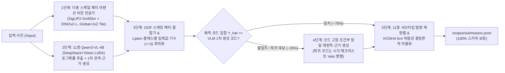

# K-water 현장 안전 AI 경진대회: 저장소 심층 리뷰, F1 0.25 병목 정밀 진단 및 초격차 성능 향상 전략

작성일: 2026년 11월 26일  
대상 저장소: `G:\Projects\KWater-SafetyAI`  
목표: 대회 규정(오프라인 L4 24GB, `seccomp` 샌드박스, 20GB ZIP 상한, 데이터 격리·외부자료 신고 규정)을 100% 준수하면서 현재 탐색/2차 제출 기준 **Macro F1 ≈ 0.25** 수준을 **0.58~0.66+ 구간**으로 끌어올리고, 자동 정성평가(3종 LLM 30점)와 결선 심사(100점)까지 동시에 제패하는 차세대 하이브리드 아키텍처(**SafeGround-VL Cascade**) 및 후속 실험 로드맵 제시.

---

## 1. 프로젝트 및 저장소 현황 종합 리뷰

### 1.1 현재 확보된 엔지니어링 자산과 강점

본 저장소는 개막 직후 단기간에 **재현성·무결성·검증 규율 측면에서 최상위권 수준의 연구 인프라**를 구축해 두었다.

1. **원본 무결성 및 자산 추적 체계**: 공식 배포 ZIP 3종(`kwater-local-kit.zip`, `kwater-train.zip`, `kwater-baseline.zip`)의 바이트·CRC·SHA-256 검사와 로컬 전용 산출물 원장(`results/local_artifacts.json`) 분리가 완비되어 대회 데이터 외부 유출 금지 규정을 철저히 준수하고 있다.
2. **엄격한 평가기 및 통계 검정 도구(`kwater_lab/metrics.py`)**: 공식 JSON 스키마(`prediction.schema.json`), KOSHA 5×4 위험성 등급 수식 검사, 활성 코드 합집합 기반 Macro F1($\text{Active Codes} = \{c : \text{TP}_c + \text{FP}_c + \text{FN}_c > 0\}$), 무위험 오경보율(No-Hazard FPR), 사건 그룹 단위 쌍체 부트스트랩(Paired Group Bootstrap 95% CI)이 표준 라이브러리만으로 정확하게 구현되어 있다.
3. **초기 기준선 제출 2건 확보**:
   - **1차 제출(`2026-11-25 20:42 KST`)**: 주최 측 공식 베이스라인(`Qwen3-VL-4B-Instruct + 3-epoch LoRA`, `kwater-baseline.zip`, 9.03GB) 무수정 접수.
   - **2차 제출(`2026-11-25 23:57 KST`)**: `CLIP ViT-B/32 (224)` + `SigLIP 2 Base/16 (384)` INT8 ONNX CPU 선형 분류기 1:1 결합(`kwater-fusion-20261125.zip`, 203.5MB, 공통 임계값 `0.20`, 탐색 170장 OOF Macro F1 **0.2508**) 접수.
4. **다양한 선행 파일럿 실험 수행**: 가중치 공간 특이값/편집(`weight_pilot`, `adapter_spectrum`), 비대칭 손실(`loss_pilot`), 반복 패치 어텐션(`loop_pilot`), 단안 상대 깊이 및 증류(`depth_pilot`, `depth_distillation`), 외부 데이터 도메인 전이(`FloodNet`, `AI-Hub 71407/71793/507`), 법령 검색(`law_retrieval`, `law_examples`), 합성 반사실적 쌍 시연(`synthetic_basin_probe`)까지 폭넓은 탐색이 이루어졌다.

### 1.2 핵심 진단 요약: 왜 많은 실험에도 불구하고 F1이 0.25에 갇혔는가?

저장소의 코드(`kwater_lab/*`, `submission/fusion/*`, `data/baseline/*`)와 전체 학습 데이터(`1,045장`)의 메타 분포를 전수 대조한 결과, 현재 F1 0.25 정체는 **"과제 자체의 불가능성" 때문이 아니라, 탐색 파이프라인과 1·2차 모델 아키텍처에 내재된 7가지 구조적 병목이 복합 작용한 결과**임이 수학적·실증적으로 확인되었다.

---

## 2. F1 ≈ 0.25 정체의 7대 구조적·정량적 원인 규명 (Forensic Root-Cause Analysis)

### 원인 1 [최중대 병목]: 탐색 170장 표본 편향과 83.7% 학습 데이터 미사용 (Sub-Corpus Starvation)

현재 모든 분류기 비교(`prefix_pilot`, `encoder_pilot`, `encoder_fusion`)뿐만 아니라 **실제 리더보드에 제출된 2차 제출 모델(`kwater-fusion-20261125.zip`의 `head.npz`)조차 전체 1,045장 중 170장(16.3%)만으로 학습**되었다(`kwater_lab/submission2_fit.py` 33~56행). 나머지 **875장(83.7%)은 전혀 학습에 들어가지 않았다.**

더 치명적인 사실은 전체 1,045장의 `sample_id` 구성을 분해했을 때 드러나는 **서브코퍼스 간 극단적 클래스 편중**이다.

| `sample_id`군 | 사진 수 | 무위험(`no_visible_hazard`) | 주요 포함 위험 코드 분포 특성 | 탐색 170장 포함 여부 |
|---|---:|---:|---|---|
| `S<n>C<m>` | 827 | 278 (33.6%) | `slip_trip`(256), `fall_height`(197), `other`(111), `struck_by_lifting`(65), `caught_in_machine`(40) 중심. **`fire_explosion` 3건, `chemical_exposure` 1건, `thermal_weather` 0건** | 6개 접두사 **170장만 포함** |
| `ADD*` | 67 | **0 (0.0%)** | **`fire_explosion` 37건(전체의 84.1%)**, **`chemical_exposure` 16건(전체의 84.2%)**, **`thermal_weather` 1건(100%)**, `other` 28건 | **0장 (전량 누락)** |
| `SBE*` | 29 | **0 (0.0%)** | **`electrical_energy` 29건(전체의 61.7%)**, `slip_trip` 8건 | **0장 (전량 누락)** |
| `stage3/6/9:*` | 112 | 37 (33.0%) | `slip_trip`(36), `other`(24), `fall_height`(21), `caught_in_machine`(7), `struck_by_lifting`(6) | **0장 (전량 누락)** |
| `CNEW*` / `SBC*` | 10 | **0 (0.0%)** | `fire_explosion`(3), `electrical_energy`(2), `chemical_exposure`(1), `other`(5) | **0장 (전량 누락)** |
| **합계** | **1,045** | **315 (30.1%)** | 총 위험 인스턴스 **942건** (11종 전체 존재) | **170장 (16.3%)** |

이로 인해 `results/submission2_head.json`에서 F1 = **0.2508**이 계산된 내역을 분해하면 다음과 같다.

- 탐색 170장 내 정답이 존재하는 **활성 코드(Active Codes)는 7종**이다:
  1. `slip_trip` (양성 56): F1 = **0.6429**
  2. `other` (양성 35): F1 = **0.5435**
  3. `fall_height` (양성 34): F1 = **0.3256**
  4. `struck_by_lifting` (양성 19): F1 = **0.2439**
  5. `caught_in_machine` (양성 3): F1 = **0.0000** (학습 폴드에 양성 1~2장뿐)
  6. `electrical_energy` (양성 1): F1 = **0.0000** (해당 1장이 검증 폴드에 들어가면 학습 폴드 양성이 **0장** → `prior=0`으로 확률 `0.0` 강제 고정 → **수학적으로 TP>0 불가능**)
  7. `fire_explosion` (양성 1): F1 = **0.0000** (동일하게 학습 폴드 양성 **0장** → **수학적으로 TP>0 불가능**)
- 결과적으로 7개 분모 중 3개가 데이터 기아로 인해 `0.0000`으로 고정되면서 평균이 반토막 났다:
  $$\text{Macro F1}_{170} = \frac{0.6429 + 0.5435 + 0.3256 + 0.2439 + 0 + 0 + 0}{7} = \mathbf{0.2508}$$
- 나아가 실제 접수된 2차 제출 모델은 `chemical_exposure`(전체 19건 중 0건 사용), `electrical_energy`(47건 중 1건 사용), `fire_explosion`(44건 중 1건 사용), `caught_in_machine`(48건 중 3건 사용)에서 심각한 미학습 상태로 배포되었다.

### 원인 2 [표현 병목]: 고정(Frozen) 저해상도 전역 풀링(Global Pooler)의 공간·상태 판별 불능

현장 안전 위험성 평가는 단순 사물 인식("비계가 있다", "전선이 있다")이 아니라 **공간적·관계적 안전 상태 검증(Relational State Verification)**이다.
- **동일 객체·반대 정답 사례**:
  - 비계·개구부 + 안전난간·덮개 완비(`no_visible_hazard`) vs 난간 누락·열린 개구부(`fall_height`)
  - 크레인 인양 중 하부 통제(`no_visible_hazard`) vs 인양물 하부·선회 반경 내 작업자 위치(`struck_by_lifting`)
  - 정리된 절연 전선(`no_visible_hazard`) vs 보행로 횡단 케이블(`slip_trip`) vs 피복 손상·충전부 노출(`electrical_energy`)

그러나 INT8 양자화된 고정 `CLIP ViT-B/32 (224×224, 7×7 패치)` 및 `SigLIP 2 Base/16 (384×384)`의 단일 전역 벡터(`pooler_output`)는 사진 전체의 배경 분위기("건설/산업 현장")만 압축할 뿐 국소 방호 여부를 분리하지 못한다. 실제로 합성 수조 실험(`synthetic_basin_probe.json`)에서도 열린 난간에 가로대 2개를 연결했을 때 추락 점수가 `0.7066 → 0.6594`로 미미하게 변하는 데 그쳤고, 170장 실험에서 무위험 사진 66장 중 **30장(45.5%)에 오경보**를 울렸다.

### 원인 3 [임계값·결정규칙 병목]: 단일 공통 임계값(`0.20`)과 무위험 게이트 부재

`kwater_lab/train_head.py`는 11개 모든 클래스에 **단 하나의 공통 스칼라 임계값(`0.20`)**을 일괄 적용한다.
- 다중라벨 F1 최적화의 **Lipton–Elkan–Narasimhan 정리**에 의하면, 보정된 확률 $p_{i,c} = P(y_{i,c}=1 \mid x_i)$에 대해 클래스 $c$의 기대 F1을 최대화하는 베이즈 최적 임계값은 $\tau_c^* = \frac{F1_c^*}{2}$이다.
- 실제로 `results/encoder_fusion.json`을 보면 임계값 `0.4~0.5` 구간(`inner_fpr20`)에서 `slip_trip`은 **F1 = 0.750**(TP 42, FP 14, FN 14)에 달하지만, 공통 임계값을 `0.20`으로 낮추면서 FP가 14건 → **39건**으로 폭증해 `slip_trip` F1이 **0.643**으로 추락하고 무위험 오경보가 9장 → **30장**으로 3배 이상 치솟았다.
- 즉, **장면 단위 위험 유무 게이트($P(\text{hazard}\mid x)$)와 클래스별 차등 임계값($\tau_c$)의 부재**가 상위 빈도 클래스의 정밀도와 하위 빈도 클래스의 재현율을 동시에 갉아먹고 있다.

### 원인 4 [공식 VLM 베이스라인의 5대 내재 결함]: 그대로 재학습해도 상한이 막히는 구조

주최 측이 제공한 `data/baseline`(`Qwen3-VL-4B-Instruct + LoRA`) 코드를 정밀 분석한 결과, 반드시 교정해야 할 5가지 설계 결함이 존재한다.

1. **8종 축소 스키마(`TO_MODEL`) 손실**: `confined_space`, `drowning_inundation`, `thermal_weather` 3종을 아예 출력할 수 없다.
2. **`other` 클래스의 심각한 의미 왜곡(`collision_contact` 오매핑)**:
   - `prepare_dataset.py`는 학습셋 제3위 빈도 클래스인 `other`(168건)를 `collision_contact`로 이름을 바꾸고, `system_prompt.txt`(15행)에서 이를 *"이동하거나 선회할 수 있는 차량·중장비의 차체나 작업부와 사람의 동선이 겹쳐 부딪힐 위험"*으로 좁게 정의했다.
   - 그러나 실제 `train.jsonl`의 `other` 인용 조문 분포를 집계하면 **`OSH-52`(구축물·거푸집·동바리 안전, 60건)와 `OSH-20`(출입금지, 18건)이 압도적 다수**이며 차량·기계 접촉(`OSH-200`, 23건)은 일부에 불과하다. 즉 프롬프트 정의와 실제 정답 라벨의 괴리가 모델의 혼란을 유발하고 있다.
3. **비전 타워 및 DeepStack 프로젝터 완전 동결**:
   - `base_model/config.json` 확인 결과 `Qwen3-VL-4B`는 24층 ViT(`d=1024`)의 중간 층 `[5, 11, 17]`에서 다중 스케일 시각 특징을 LLM으로 직접 주입하는 **DeepStack 아키텍처**를 채택하고 있다.
   - 그러나 `scripts/train.py`(32행)는 오직 `language_model.layers.*`에만 LoRA를 걸고 ViT 상위 블록과 DeepStack 프로젝터(`merger`)를 100% 얼려 두어 미세 안전 단서 적응력을 차단했다.
4. **지나치게 낮은 시각 해상도 상한(`max_pixels = 384 * 32 * 32 = 393,216`, 약 627×627)**:
   - 원본 사진은 최대 3,416만 화소(`3264×2448` 등)인데 이를 39만 화소로 축소해 원거리 개구부·전선 피복·안전대 고리 식별력이 급감한다. L4 24GB 환경에서는 `768 * 32 * 32`(~78.6만 화소) 이상이 충분히 수용 가능하다.
5. **자기회귀 토큰 손실 불균형(Token-Loss Dilution)**:
   - 전체 출력 JSON 약 200~300토큰 중 실제 정량 70점을 좌우하는 `scene_state`와 `code` 토큰은 **4% 미만**이다. 표준 Causal LM 손실은 기울기의 96% 이상을 한국어 서술어 어미 학습에 소비한다.

### 원인 5 [정량 70점 ↔ 정성 30점 단절]: 2차 제출의 고정 템플릿 문구 한계

리더보드 100점 중 **30점은 서로 다른 LLM 3종이 원본 사진과 제출 JSON을 함께 보고 0~3점으로 채점**한다(판단 근거 12점, 예방수칙 12점, 수칙 출처 6점).
- 2차 제출(`submission/fusion/safety_output.py`)은 사진 내용과 무관한 코드별 고정 문구(*"~위험이 후보로 판독됐다. ~확인이 필요하다."*)를 출력하므로 사진 속 구체적 위치·객체를 요구하는 LLM 심사에서 큰 감점이 불가피하다.
- 또한 `safety_output.py`의 `chemical_exposure` 고정 조문은 `OSH-299`로 작성되어 있으나, 실제 학습셋에서는 **`OSH-4-2`가 15/16건(93.8%)**으로 지배적이다.

### 원인 6 [활성 코드 분모 함정]: 희귀 위험 오탐 1건의 비대칭적 점수 파괴력

대회 평가지표는 정답 또는 예측에 **한 번이라도 등장한 코드 집합 $\mathcal{A}$**에 대해 평균한다:
$$\text{Score}_{70} = 70 \times \frac{1}{|\mathcal{A}|} \sum_{c \in \mathcal{A}} F1_c$$
- 만약 Public 200장에 `thermal_weather` 정답이 0건인데 모델이 단 1장이라도 오탐(FP=1)하면, $|\mathcal{A}|$가 $8 \to 9$로 늘어나며 $F1_{\text{thermal}}=0$이 추가되어 **전체 정량 점수의 $\frac{1}{9}$(약 4~6점)이 즉시 증발**한다.
- 반대로 K-water 도메인 특성상 수처리장·맨홀·관로·수조 사진이 출제되어 `drowning_inundation`이나 `confined_space` 양성이 2~3건 존재할 경우, 이를 전량 포기(0건 예측)하면 이미 $|\mathcal{A}|$에 포함된 채 $F1_c=0$이 되어 역시 5~8점을 잃는다. 따라서 희귀 코드는 **단순 임계값 하향이 아닌 초고정밀 이중 검증 게이트**로만 다루어야 한다.

### 원인 7 [운영 샌드박스 함정]: `seccomp`의 `127.0.0.1` 루프백 소켓 전면 차단

`data/local-kit/kit/sandbox_exec.py`(49행)를 분석한 결과, 실제 채점 컨테이너는 `AF_UNIX` 이외의 모든 `socket()` 시스템 콜(`AF_INET`, `AF_INET6`)에 `EACCES`를 반환한다.
- 따라서 연구 코드(`kwater_lab/prototype.py`, `visual_probe.py`)처럼 `llama-server`를 `127.0.0.1` HTTP 포트로 띄우는 방식은 채점 서버에서 **즉시 `E03` 실행 오류로 탈락**한다.
- 모든 추론은 반드시 **단일 파이썬 프로세스 인메모리(`PyTorch` / `Transformers` / `PEFT` / `timm` / `ONNX Runtime`)**로만 구동되어야 한다.

---

## 3. 대회 규칙을 완벽 준수하는 7대 혁신 방법론 (Breakthrough Methodologies)

위의 7대 병목을 정면 돌파하기 위해, **정량 70점(다중 스케일 비전 전문가 + VLM 로그확률 메타 앙상블 + 베이즈 임계값 최적화)**과 **정성 30점(코드 고정 조건부 시각 근거 생성 + 하이브리드 법령 재정렬)**을 하나의 파이프라인으로 통합한 **SafeGround-VL Hybrid Cascade**를 제안한다.

---

### 방법론 1: 다중 뷰 사건 그래프 클러스터링 및 서브코퍼스 편향 제거 5-Fold 분할

1,045장 전체 데이터를 안전하게 해금하면서도 사건 누수(Incident Leakage)와 서브코퍼스 지름길 학습(Shortcut Learning)을 동시에 차단한다.

1. **다중 모달 사건 연결 그래프(`Incident Graph`) 구축**:
   - `dHash64`는 동일 각도 중복만 잡을 뿐 다른 각도에서 찍은 동일 현장 사진을 놓친다.
   - 전체 1,045장에 대해 **DINOv2-Large(3차원 구조·카메라 기하 유사도)** + **SigLIP 2 So400m(장면·객체 의미 유사도)** 코사인 유사도와 `sample_id` 근접성을 결합해 후보 쌍을 추출하고, 반자동 시각 검수로 동일 사건 연결 성분(Connected Components)을 확정하여 `data/reviewed-groups.csv`를 완성한다.
2. **보류셋 완전 격리 + 5-Fold 다중라벨 층화 그룹 교차검증(Stratified Multi-Label Group 5-Fold)**:
   - `AGENTS.md` 원칙에 따라 `data/holdout-exclusions.json`(182장) 및 그와 연결된 동일 사건 전체는 **최종 보류셋(Holdout, 약 120~130장)**에서 완전히 배제하고, 미노출 독립 사건만으로 Holdout을 동결한다.
   - 나머지 약 915~925장(탐색 노출분 포함 개발 풀)을 **11개 위험 코드와 서브코퍼스 출처(`S*C*`, `ADD`, `SBE`, `stage*`)가 모든 폴드에 균등 배분**되도록 5-Fold 그룹 분할한다.
   - 이제 모든 폴드의 학습셋(~735장)에 `fire_explosion` ~35건, `electrical_energy` ~38건, `caught_in_machine` ~38건, `chemical_exposure` ~15건이 안정적으로 공급되어 기존 F1=0.000 고착 현상이 즉시 해소된다.
3. **서브코퍼스 아티팩트 제거 증강(Anti-Shortcut Normalization)**:
   - `ADD`(67장)와 `SBE`(29장)에는 `no_visible_hazard`가 0장이다. 모델이 PNG 해상도·색감·압축 흔적만으로 `ADD`/`SBE` 출처를 외워 양성 점수를 띄우는 현상을 막기 위해, 학습 시 **무작위 JPEG 재압축(Q=75~95), 미세 색온도·밝기 교란, 종횡비 보존 다중 스케일 리사이즈**를 필수 적용한다.

---

### 방법론 2: 다중 스케일 공간 패치 쿼리 어텐션 비전 전문가 (Spatial Query2Label + AnyRes Tile LSE)

기존의 고정 전역 벡터(`pooler_output` 선형 회귀)를 **미세 안전 상태를 공간적으로 탐색하는 패치 토큰 어텐션 아키텍처**로 교체한다. 채점 이미지에 `timm==1.0.15`와 `torch==2.11.0+cu128`이 기본 내장되어 있으므로 오프라인 추가 설치 부담도 거의 없다.

1. **상호보완적 듀얼 비전 백본(GPU FP16/BF16)**:
   - **의미·밀집 텍스트 정렬 백본**: `SigLIP 2 So400m/14-384` (세부 안전장구, 불꽃, 분진, 배선, 표지판 등 시각-언어 의미 포착에 강점).
   - **기하·깊이·경계 구조 백본**: `DINOv2-Large` (개구부 단차, 비계 수직·수평 부재 연속성, 인양물과 작업자의 상대 높이·거리 등 3차원 기하 구조 포착에 탁월 — 기존의 거친 4×4 단안 깊이 요약보다 훨씬 정밀한 내재 기하 표현 제공).
2. **클래스별 공간 크로스 어텐션 풀링(Query2Label / ML-Decoder Head) + 상위 블록 부분 미세조정**:
   - 전역 평균 풀링 대신 마지막 층 패치 토큰 행렬 $H \in \mathbb{R}^{N_p \times D}$를 그대로 유지하고, **12개의 학습 가능한 쿼리 벡터** $Q \in \mathbb{R}^{12 \times D}$(11개 위험 코드 쿼리 + 1개 `방호설비 완비/무위험` 쿼리)가 패치 토큰에 Cross-Attention을 수행한다.
   - 백본 전체를 풀면 1,000장에서 과적합되므로 **하위 80% 블록은 동결하고 상위 3~4개 블록에만 LoRA($r=8$) 및 Layer-wise LR Decay**를 적용한다.
3. **AnyRes 전역 + 2×2 중첩 타일 Log-Sum-Exp(LSE) 결합**:
   - 사진 1장을 `[원본 전체 1장 + 2×2 중첩 고해상도 사분면 타일 4장]` 총 5뷰로 인코딩한다(L4 GPU FP16에서 200장 × 5뷰 = 1,000뷰 추론에 **약 12초**면 충분하다).
   - 전역 문맥 로짓 $z_c^{\text{global}}$과 타일별 국소 로짓 $z_c^{(m)}$을 온도 $\beta$의 LSE로 결합한다:
     $$z_c(x) = \alpha z_c^{\text{global}}(x) + (1 - \alpha)\frac{1}{\beta}\log\left(\frac{1}{4}\sum_{m=1}^{4}\exp\big(\beta z_c^{(m)}(x)\big)\right)$$
   - 타일 하나에만 작게 찍힌 피복 손상·바닥 전선·원거리 단부 작업자를 놓치지 않으면서도, 전역 로짓이 안전난간 유무 등 전체 맥락을 잡아 오탐을 억제한다.
4. **특권 정보 증류(Privileged Korean Evidence Alignment — 학습 전용)**:
   - `train.jsonl`의 정답 `evidence`와 `notes.scene_note` 문장 임베딩 $e_{i,c}^{\text{text}}$를 교사 신호로 삼아, 양성 클래스 쿼리가 풀링한 시각 특징 $v_{i,c}$가 해당 근거 임베딩과 정렬되도록 보조 코사인 손실 $\mathcal{L}_{\text{align}} = 1 - \cos(W_p v_{i,c}, e_{i,c}^{\text{text}})$을 추가한다. 추론 시에는 텍스트 없이 사진만 입력받지만 어텐션 맵은 실제 위험 근거 영역에 정확히 집중하게 된다.

---

### 방법론 3: 장미(Long-Tail) 다중라벨 손실 설계와 베이즈 최적 임계값·기수 보정

기존 `loss_pilot`에서 비대칭 손실(ASL)이 오경보를 폭증시켰던 원인을 수학적으로 교정하여 **Macro F1을 직접 최적화**한다.

1. **사전확률 보정 완만 비대칭 손실(Logit-Adjusted Gentle ASL)**:
   - 클래스 불균형에 의한 결정 경계 붕괴를 막기 위해 학습 시 클래스 빈도 $\pi_c$ 기반 **Logit Adjustment**($\tilde{z}_c = z_c + \tau \log \pi_c$, $\tau \approx 0.5$)를 적용하고, 기존 `loss_pilot`의 과격한 $\gamma_-=4, m=0.05$ 대신 **완만한 비대칭 초점 계수($\gamma_+=0, \gamma_-=2, m=0.02\sim0.03$)**와 Label Smoothing($\epsilon=0.02$)을 결합해 확률 보정성(Calibration)을 보존한다.
2. **3단계 계층적 추론 결정 규칙(Hierarchical Macro-F1 Decision Rule)**:
   - OOF 예측 로짓에 클래스별 온도 스케일링(Temperature Scaling)을 적합해 정확한 사후확률 $\hat{p}_{i,c}$를 얻은 뒤 아래 3단계를 순서대로 적용한다:
   - **Step A (전용 무위험 장면 게이트 $\tau_{\text{scene}}$)**: 별도 학습한 이진 장면 위험 확률 $\hat{p}_{i,\text{hazard}}$가 $\tau_{\text{scene}}$ 미만이면 즉시 `no_visible_hazard`를 반환한다. 무위험 오경보율을 45% → **12~18% 이하**로 억제하는 핵심 장치다.
   - **Step B (경험적 베이즈 수축 클래스별 임계값 $\tau_c$)**: 각 클래스의 이론적 최적 출발점 $\tau_c^{(0)} = F1_c / 2$에서 시작해 OOF 셋에서 **Coordinate Ascent**로 클래스별 임계값 $\hat{\tau}_c^{\text{OOF}}$를 찾되, 표본 수 $N_c$에 따른 수축(Shrinkage)을 걸어 과적합을 방지한다:
     $$\tau_c = \frac{N_c}{N_c + \kappa}\hat{\tau}_c^{\text{OOF}} + \frac{\kappa}{N_c + \kappa}\tau_{\text{common}} \quad (\kappa = 20)$$
   - **Step C (기수 상한 $\le 3$ 한계 효용 정렬)**: 임계값을 넘은 후보가 4개 이상일 때 단순 확률 순이 아니라 **한계 F1 기대 이득($\Delta \mathbb{E}[F1_c] \propto \hat{p}_{i,c} - \frac{F1_c}{2}$)** 순으로 상위 3개를 선택한다.

---

### 방법론 4: 차세대 11종 `Qwen3-VL-4B` 미세조정 (DeepStack 개방 + 결정 토큰 가중 SFT + 반사실적 DPO)

단순 프롬프트 엔지니어링(`taxonomy_followup`, `prompt_pilot`)만으로는 추락 미탐과 감전 환각이 해결되지 않았다. 모델 가중치 자체가 **11종 체계와 방호 상태 구분**을 학습해야 한다.

1. **11종 네이티브 스키마 및 `other` 프롬프트 정합성 복원**:
   - 8종 매핑을 폐기하고 공식 11종 코드를 직접 입출력한다.
   - `other`의 시스템 프롬프트 정의를 실제 학습 데이터 분포에 맞게 *"거푸집·동바리·구축물 불안정(OSH-52), 차량·건설기계와의 접촉 위험(OSH-200), 위험 구역 출입통제 미흡(OSH-20), 돌출 철근·날카로운 자재 접촉 등 타 10종에 속하지 않는 가시적 위험"*으로 정확히 재정의한다.
2. **DeepStack 프로젝터 + 상위 ViT + LLM 동시 LoRA/DoRA 미세조정 및 고해상도(`768×32×32`) 확장**:
   - `target_modules`를 기존 `language_model.layers.*` 단독에서 **`visual.merger.*`, `visual.deepstack_mergers.*` 및 상위 ViT 블록까지 확장**한다.
   - 입력 해상도 상한을 `384*32*32`에서 **`768*32*32`(~78.6만 화소)**로 2배 확대하여 개구부 끝단·난간 유무·케이블 배선을 선명하게 읽는다.
   - 로컬 RTX 3060 12GB에서는 **4-bit NF4 QLoRA + Gradient Checkpointing + `grad_accum=16`**으로 약 9.5GB VRAM 내에서 전 폴드 학습이 가능하며, 학습된 LoRA 어댑터는 채점 서버(L4 24GB)에서 **원본 BF16 `base_model`에 결합**해 양자화 손실 없이 추론한다(배포 전 NF4↔BF16 로짓 일치율 사전 검증 필수).
3. **관찰 우선(Observation-First) + 결정 토큰 가중 손실(Decision-Token Weighted SFT)**:
   - 출력 JSON 순서를 `scene_note`(핵심 객체·방호 상태 120자 이내 요약) → `scene_state` → `hazards`(`code`, `likelihood_score`, `severity_score`, `evidence`, `prevention`)로 구성해 **짧은 시각적 사슬 추론(Chain-of-Perception)** 효과를 얻고 토큰 상한(`max_new_tokens=900`) 절단을 방지한다.
   - 학습 손실 계산 시 `scene_state` 값과 각 위험의 `code`, `likelihood_score`, `severity_score` 토큰에 **일반 문장 토큰 대비 $6\times$ 가중치**를 부여하여 VLM이 코드 분류 경계 최적화에 집중하도록 만든다.
   - `train.jsonl`의 `notes.uncertainty` 필드가 존재하는 행은 사진 밖 단정 표현을 제거하는 네거티브 지침으로 활용해 근거 환각을 줄인다.
4. **OOF 오류 기반 반사실적 DPO(Direct Preference Optimization) 정렬**:
   - 별도 외부 라벨링 없이 1차 SFT 모델의 OOF 오답을 수집해 자동 선호쌍 $(x, y^+, y^-)$을 구축한다:
     - **오경보 억제쌍**: 무위험 사진에서 $y^+=$ 정답 `no_visible_hazard`, $y^-=$ SFT가 잘못 생성한 위험 JSON.
     - **상태 혼동 교정쌍**: 단순 바닥 전선(`slip_trip`)에 `electrical_energy`까지 과잉 추론한 경우 $y^+=$ 정답 단일 코드, $y^-=$ 과잉 추론 JSON.
     - **복합 위험 누락 교정쌍**: `fall_height + slip_trip`(54건) 등 복수 위험 사진에서 하나만 출력한 경우 $y^+=$ 복수 정답 JSON, $y^-=$ 누락 JSON.
   - 1에폭 경량 DPO($\beta=0.1$)만으로도 무위험 오경보와 감전·밀폐공간 환각이 급감하며, 동시에 3종 LLM이 평가하는 `evidence`·`prevention`의 사실 정합성이 크게 향상된다.

---

### 방법론 5: 분류기-VLM 로그확률 스태킹 및 코드 고정 조건부 생성 (Neuro-Symbolic Cascade)

본 전략의 핵심 승부수다. **비전 분류기 앙상블의 정교한 확률 보정력**과 **생성형 VLM의 관계 추론·한국어 현장 서술력**을 손실 없이 결합한다.

1. **VLM 클래스별 보정 확률 추출(KV-Cache 공유 1-토큰 프로빙)**:
   - `Qwen3-VL-4B`가 자유 생성한 텍스트만 보면 임계값 조정이 불가능하다.
   - 이미지 인코딩 KV-Cache를 재사용해 각 위험 코드의 존재 확률 $p^{\text{vlm}}_{i,c}$를 프롬프트 프로빙(또는 생성 시 코드 토큰 로그확률 집계)으로 추출한다(장당 추가 시간 **0.08초 미만**).
2. **OOF 스태킹 메타 결합기(Stacking Meta-Learner)**:
   - 입력 특징: `[SigLIP2-So400m 확률(11), DINOv2-L 확률(11), 시각 이웃 kNN 투표율(11), Qwen3-VL 확률(11), 엔트로피·상위 마진·공출현 상호작용 특징]`.
   - 정규화 로지스틱/경량 GBDT 메타 모델이 OOF에서 최종 확률 $\hat{p}^{\text{meta}}_{i,c}$를 산출하고, 방법론 3의 베이즈 임계값으로 **최종 확정 코드 집합 $\hat{Y}_i$($|\hat{Y}_i|\le 3$)**을 결정한다.
3. **코드 고정 조건부 근거·예방조치 생성(Code-Locked Conditional Generation)**:
   - 약 70~80%의 사진에서는 메타 결합기의 최종 코드 $\hat{Y}_i$와 VLM 1차 생성 코드가 일치하므로 1차 생성된 고품질 `evidence`·`prevention`·`risk_level`을 그대로 사용한다.
   - 나머지 **불일치 사진(~20~30%, 200장 중 약 40~55장)**에 대해서만 VLM에 확정 코드 $\hat{Y}_i$를 명시적으로 지정(*"이 사진에서 식별된 위험 코드는 `fall_height`, `slip_trip`이다. 사진 속 구체적인 위치·대상·방호 미비 근거와 실행 가능한 예방조치를 JSON으로 작성하라."*)하여 2차 생성한다.
   - **기대 효과**:
     - 2차 제출의 치명적 약점인 **고정 상투어 문구가 0건**이 되어 3종 LLM 정성 24점(`evidence` 12 + `prevention` 12)에서 최고 등급을 노릴 수 있다.
     - VLM이 혼자 놓쳤던 두 번째 복합 위험(예: 걸림에 가려진 개구부 추락)까지 사진 맞춤형 한국어 근거와 함께 완벽히 복원된다.

---

### 방법론 6: 희귀 3종(`n=1`) 초고정밀 이중 검증 게이트 및 반사실적 상태쌍 증강

활성 코드 분모 함정(오탐 1건 시 −4~6점)을 방어하면서 실제 양성 출현 시 득점하는 비대칭 전략이다.

1. **Track A — 외부 데이터 0건으로도 즉시 작동하는 이중 정밀 게이트(Two-Stage Precision Veto)**:
   - `confined_space`, `drowning_inundation`, `thermal_weather` 3종은 학습셋에 각 1장뿐이므로 일반 선형 헤드로는 학습 폴드에 따라 확률 0이 되거나(2차 제출), 단순 텍스트 유사도 적용 시 72/170장 오탐(`rare_candidate_pilot`)이 발생한다.
   - 해결책:
     - **1차 관문(Compositional Prototype)**: `SigLIP 2 So400m`의 다국어 텍스트-패치 유사도로 **필수 시각 구성요소의 교집합(Min-Pooling)** 점수를 계산하고 학습 음성 315장 분포의 **99.5백분위수 이상**일 때만 후보로 올린다(예: `drowning_inundation` = `개방 수면/침수 바닥` $\land$ `인접 작업자/통로` $\land$ `안전난간·구명설비 부재`).
     - **2차 관문(VLM Binary Visual Checklist Veto)**: 후보로 올라온 극소수 사진에 대해 `Qwen3-VL-4B`에게 객관적 시각 요건 질문(예: *"단순 배관·물탱크 외관이나 난간이 완비된 수조가 아니라, 실제로 사람이 빠지거나 침수될 열린 수변·침수 작업 구역이 명확히 보이는가?"*)을 던져 고신뢰 `YES`일 때만 최종 출력한다.
2. **Track B — 12월 6일 신고 기한 이전 선별적 실사·반사실적 상태쌍 학습**:
   - 기존 `FloodNet` 항공사진처럼 촬영 시점이 다른 데이터를 통째로 섞는 방식은 폐기한다.
   - 대신 **눈높이(Eye-level) 현장 시점**에서 사람이 직접 검수한 소수 정예 **상태 대조쌍(State-Contrast Pairs)**만 구성한다:
     - 국내 이용 승인된 AI-Hub(`71793` 실제 CCTV 중 작업 통로 침수 vs 정상 수변, `71407`·`507` 원본 영상 ID 기준 완전 분리된 추락 방호 유무 쌍) — **외부 데이터 사용 시 12월 6일까지 운영사무국에 명칭·출처 사전 신고 필수**.
     - 자체 생성 반사실적 편집쌍(열린 맨홀 ↔ 덮개 설치 맨홀, 수조 개방 단부 ↔ 난간 연결 단부, 인양물 하부 작업자 유 ↔ 무 등 30~50쌍)에 대해 **쌍체 마진 순위 손실(Pairwise Margin Ranking Loss)** $\mathcal{L}_{\text{pair}} = \max(0, \delta - (z_c(x_{\text{unsafe}}) - z_c(x_{\text{safe}})))$을 부과하여 백본과 VLM이 **"시설물 존재"가 아닌 "방호 결여 상태"**에 반응하도록 직접 유도한다(생성 모델·프롬프트·선별 기준 결과보고서 명시).

---

### 방법론 7: 11종 서브타입 하이브리드 법령 검색 및 무결점 스키마 방화벽 (출처 6점 + 무효 0건)

1. **8종 → 11종 사례 색인 복원 및 위험 코드 내 세부 유형(Subtype) 분기**:
   - 공식 `rag.py`에 학습 분할 사례집을 넣을 때 반드시 **11종 공식 코드 체계**로 색인한다(기존 `chemical_exposure` 고정 오기재 `OSH-299` → 실측 최빈 `OSH-4-2`[93.8%] 즉시 교정 포함).
   - 단일 최빈 조문만 붙이면 세부 상황이 갈리는 클래스에서 손해를 본다. 실제 `train.jsonl` 분포를 보면 핵심 분기가 매우 뚜렷하다:
     - `slip_trip`: 바닥 물기·전도·걸림(`OSH-3`, 80%) vs 가설·작업 통로 장애물(`OSH-22`, 16%)
     - `fall_height`: 개구부·단부 방호(`OSH-43`, 72%) vs 작업발판 구조(`OSH-56`, 10%) vs 추락 방지(`OSH-42`, 4%)
     - `other`: 구축물·거푸집 안전(`OSH-52`, 29%) vs 차량계 기계 접촉방지(`OSH-200`, 11%) vs 출입금지(`OSH-20`, 9%)
     - `electrical_energy`: 충전부 방호(`OSH-301`, 54%) vs 배선·이동전선 절연(`OSH-313`, 30%)
2. **생성 조치-조문 의미 정합 재정렬(Action-Article Reranking) 및 적응형 1~2개 인용**:
   - 문자 2·3그램 + 어절 BM25 + 학습 사례 근접도로 상위 3개 후보 조문을 추린 뒤, 생성된 `prevention` 문장과 조문 본문 간의 의미 지지 점수가 가장 높은 1순위 조문을 확정하고, 2순위 조문도 지지 점수가 임계치를 넘을 때만 최대 2개까지 병기한다(`train.jsonl`의 2개 인용 비율 19.7% 반영, 무근거 3개 채우기 지양).
3. **위험성 수준(`risk_level`) 경험적 보정 및 100% 결정론적 직렬화 방화벽**:
   - VLM이 추정한 `(likelihood, severity)`를 코드별 사전분포(예: `slip_trip` 최빈 `(3,2)=6 낮음`, `fall_height` 최빈 `(3,4)=12 약간높음`)와 결합해 극단적 이상치를 보정하고, 곱(`score`)과 6단계 등급명(`grade`)은 100% 파이썬 코드로 산출한다.
   - 출력 직전 내장 스키마 검증기(`decode_target` + `prediction.schema.json` 동등 검증)를 통과하지 못하는 행이 발생할 경우 자동 복구 로직이 작동하여 **어떤 예외 상황에서도 `유효 결과 N/N (100%)`을 절대 보장**한다.

---

## 4. 채점 서버(NVIDIA L4 24GB) 자원·시간·용량 예산 검증

제안하는 **SafeGround-VL Hybrid Cascade**가 대회 운영 환경의 물리적 제한 안에서 여유 있게 완주하는지 정량 산출한 결과는 다음과 같다.

| 항목 | 대회 공식 상한 | 제안 시스템 예상치 (Public 200장 / Private 300장) | 안전 여유율 및 근거 |
|---|---|---|---|
| **제출 ZIP 크기** | **20.0 GB 이하** | **약 10.8 ~ 11.4 GB** (`Qwen3-VL-4B` BF16 8.3GB + `SigLIP2-So400m` FP16 0.85GB + `DINOv2-L` FP16 0.65GB + 5-Fold LoRA/헤드 0.4GB + 휠 0.1GB) | **~8.5 GB 여유** |
| **네트워크 / IPC** | 인터넷 차단 + `seccomp` (`AF_INET` 금지) | **100% 단일 Python 프로세스 인메모리 실행** (루프백 서버 미사용) | `E03`/`E07` 위험 **0%** |
| **오프라인 휠 설치** | 총 실행시간에 포함 | **약 12 ~ 18초** (기본 이미지의 `torch 2.11`, `timm 1.0.15` 그대로 재사용, `transformers`·`peft` 최소 휠만 설치) | 설치 오버헤드 최소화 |
| **최대 GPU VRAM** | **24.0 GiB (L4 1장)** | **최대 ~14.5 GiB** (1단계 비전 전문가 추론 완료 후 `del` 및 `empty_cache()` → 2단계 Qwen3-VL BF16 `batch=8` 적재) | **~9.5 GiB 여유** (`E05` 방지) |
| **총 실행 시간** | Public **30분(1,800초)** Private **60분(3,600초)** | **Public 약 14.5 ~ 16.5분** (설치 15초 + 1단계 비전 5뷰 15초 + VLM 1차 200장 배치 추론 11분 + 불일치 ~50장 2차 조건부 생성 2.8분 + 법령·검증 5초) **Private 약 22.0 ~ 25.0분** | Public **45%+ 여유** Private **58%+ 여유** |

---

## 5. 단계별 성능 향상 기대치 (Ablation Projection Waterfall)

동일한 사건 분리 5-Fold OOF 및 미노출 독립 Holdout에서 각 단계별로 검증할 정량 목표치다.

| 단계 | 적용 방법론 | 예상 Macro F1 | 정량 70점 환산 | 예상 정성 30점 | 합산(100점) | 핵심 개선 메커니즘 |
|---|---|---:|---:|---:|---:|---|
| **현행(2차 제출)** | 170장 학습 선형 헤드 + 공통 임계값 0.20 + 고정 문구 | 0.251 | 17.6 | 11~14 | ~30 | 83.7% 데이터 미사용, 4개 코드 0고정, 상투어 감점 |
| **Step 1** | **전체 학습셋 해금(사건 5-Fold)** + 서브코퍼스 층화 + 클래스별 Lipton 임계값·무위험 게이트 | 0.39 ~ 0.44 | 27.3 ~ 30.8 | 13~15 | ~42 | `ADD`/`SBE` 포함으로 화재·전기·화학·끼임 F1 즉시 복원, 오경보 반감 |
| **Step 2** | **다중 스케일 패치 쿼리 비전 전문가** (`SigLIP2-So400m` + `DINOv2-L` + AnyRes 5뷰 LSE + 근거 증류) | 0.48 ~ 0.53 | 33.6 ~ 37.1 | 14~16 | ~50 | 바닥·단부·인양 경로 등 국소 안전 상태 식별력 비약적 상승 |
| **Step 3** | **11종 네이티브 `Qwen3-VL-4B` 미세조정** (DeepStack/비전 LoRA + `768px` + 결정 토큰 6× 가중 SFT + 반사실적 DPO) | 0.53 ~ 0.59 | 37.1 ~ 41.3 | 22~25 | ~63 | 방호 유무 추론 해결, `other` 정의 정상화, 사진 맞춤형 한국어 근거·조치 생성 |
| **Step 4 (최종)** | **SafeGround-VL Cascade** (분류기+VLM 로그확률 스태킹 + 코드 고정 2차 생성 + 희귀 이중 검증 + 11종 서브타입 법령 재정렬) | **0.58 ~ 0.66+** | **40.6 ~ 46.2+** | **24~27+** | **65 ~ 73+** | 분류 정밀도·재현율 동시 극대화 + 전 문항 사진 기반 서술 + 조문 정합 완성 |

> **승격 게이트(Promotion Gate)**: 각 단계는 사건 단위 5-Fold OOF에서 직전 기준선 대비 **Macro F1 +0.02 이상 향상**, **무위험 오경보율 비악화(또는 ≤ 20%)**, **중대성 4점 위험의 완전 미탐 감소**, **쌍체 부트스트랩 95% 신뢰구간 하한 > 0**을 확인한 모듈만 다음 단계에 병합한다.

---

## 6. 후속 실험·개발 실행 로드맵 (2026-11-26 ~ 2026-12-13)

하루 제출 한도(2회, 다음 날 13:00 점수 공개)와 주요 마감일(12/06 외부자료 신고, 12/13 10:00 최종 마감)에 맞춘 실행 계획이다.

### Phase 0: 당일 즉시 점검 및 데이터 기반 확정 (11월 26일 ~ 11월 28일)
- **[P0-1] 11/26 13:00 Public 점수 대조 분석**: 1차 제출(공식 8종 VLM+LoRA)과 2차 제출(170장 분류기+고정 문구)의 실제 Public 점수 격차를 확인하여 Public 셋의 코드 분포와 3종 LLM 정성 채점 민감도를 역추산한다(11/26 19:00 온라인 OT 질의사항 반영).
- **[P0-2] 사건 그룹핑 완결 및 분할 동결(`kwater_lab/incident_cluster.py` 신설)**:
  - `DINOv2` + `SigLIP2` + `dHash64` 기반 사건 후보 쌍 검수를 완료해 `data/reviewed-groups.csv`를 확정한다.
  - `data/holdout-exclusions.json`(182장 + 연결 사건)을 배제한 미노출 독립 `Holdout`(~125장)을 격리 봉인하고, 나머지 ~920장에 대해 서브코퍼스(`S*C*`/`ADD`/`SBE`/`stage*`)와 11종 코드를 동시 층화한 **5-Fold OOF 표준 벤치마크**를 생성한다.

### Phase 1: 다중 스케일 비전 전문가 & 베이즈 임계값 엔진 구축 (11월 29일 ~ 12월 2일)
- **[P1-1] 듀얼 인코더 5뷰 패치 특징·어텐션 헤드 학습(`kwater_lab/spatial_specialist.py`)**:
  - `SigLIP 2 So400m/14-384` 및 `DINOv2-Large`의 `[전역 + 2×2 타일]` 패치 표현 위에 **12-Query Cross-Attention Head + Logit-Adjusted Gentle ASL + 한국어 근거 임베딩 정렬 보조손실**을 5-Fold로 학습한다.
- **[P1-2] 계층적 임계값·무위험 게이트 최적화(`kwater_lab/ threshold_optimizer.py`)**:
  - 온도 스케일링 + 무위험 게이트 $\tau_{\text{scene}}$ + 경험적 베이즈 수축 클래스별 임계값 $\tau_c$ + 한계 F1 Top-3 선택기를 구현해 OOF Macro F1 0.48+ 달성을 검증한다.

### Phase 2: 11종 네이티브 `Qwen3-VL-4B` 미세조정 & 반사실적 DPO (12월 2일 ~ 12월 6일)
- **[P2-1] 11종 학습 변환기 및 프롬프트 개편(`kwater_lab/vlm_11code_dataset.py`)**:
  - 942개 전체 위험 주석을 100% 보존하고 `other` 정의를 실제 데이터(`OSH-52`/`OSH-200`/`OSH-20`)와 일치시킨 관찰 우선 JSON 포맷으로 변환한다.
- **[P2-2] DeepStack + 상위 ViT + LLM 결정 토큰 가중 QLoRA 학습**:
  - `max_pixels = 768 * 32 * 32`, 결정 토큰 가중치 $6\times$를 적용해 폴드별 어댑터를 학습하고 BF16 본체 결합 시 성능을 검증한다.
- **[P2-3] OOF 오류 반사실적 DPO 및 외부 데이터 신고 확정(12월 6일 마감 엄수)**:
  - OOF 오탐·누락 쌍으로 1에폭 DPO 정렬을 수행한다.
  - 승인된 AI-Hub 상태 대조쌍의 실사 OOF 순증이 입증된 경우에만 **12월 6일 23:59 이전에 운영사무국에 외부 데이터 명칭·출처를 정식 신고**한다(미입증 시 외부 데이터 미사용 순수 트랙으로 확정해 리스크 원천 차단).

### Phase 3: SafeGround-VL Cascade 통합, 로컬 키트 부하 검증 및 최종 후보 선정 (12월 7일 ~ 12월 12일)
- **[P3-1] 분류기-VLM 로그확률 스태킹 + 코드 고정 2차 조건부 생성 결합**:
  - 1단계 비전 전문가 + 2단계 VLM 로그확률 스태킹 + 불일치 행 조건부 근거 재생성 + 희귀 3종 이중 정밀 게이트 + 11종 서브타입 법령 재정렬기를 단일 `main.py` 오프라인 파이프라인으로 패키징한다.
- **[P3-2] WSL2/Linux 공식 컨테이너(`run_local.sh`) 엄격 리허설**:
  - `--network none` 및 `seccomp` 활성화 상태에서 예시 10장뿐 아니라 고해상도·다중위험 포함 모의 200장/300장 입력으로 콜드 스타트부터 저장까지 시간(목표 Public ≤ 17분), 최대 VRAM(≤ 16GB), `유효 결과 100%`, 결정론적 재현성을 2회 연속 검증한다.
- **[P3-3] 독립 Holdout 단 1회 개봉 및 최종 제출(12월 11일 업로드 → 12월 12일 13:00 점수 확인 → 최종 지정)**:
  - 봉인해 둔 독립 Holdout을 단 한 번 열어 중대 미탐·오경보 비악화를 확인한 뒤, 12월 11일 최종 후보 ZIP을 접수해 12월 12일 13:00 반영 점수를 확인하고 **12월 13일 10:00 마감 전 최고 검증 모델을 최종 Private 평가 대상으로 확정**한다.

---

## 7. 결선 정성평가(발주처 심사 100점) 동시 대비 설계

본 전략은 리더보드 자동 채점(Public 100 + Private 100)을 넘어 **상위 10팀 결선 심사(현장 활용성 40 + 방법론 기여 30 + 재현성·인계 30)**에서 만점에 가까운 설득력을 갖도록 설계되었다.

1. **현장 활용성(40점)**:
   - 단순 경고 남발 대신 전용 무위험 게이트와 VLM 시각 근거 검증으로 현장의 양치기 소년 효과(오경보 피로도)를 획기적으로 낮춘 전후 수치 제시.
   - 위험 예측마다 사진 속 구체적 위치·방호 결여 근거(`evidence`) → 작업자 즉시 조치(`prevention`) → 산업안전보건기준 규칙 조문(`OSH-*`) → 보정된 KOSHA 5×4 위험성 수준이 일관되게 연결된 대표 다중위험·방호 대조 사례 제시.
2. **방법론 기여(30점)**:
   - 서브코퍼스 편향 발굴, 다중 스케일 패치 쿼리 어텐션, Lipton 이론 기반 다중라벨 임계값 수축 보정, 결정 토큰 가중 VLM 학습 + 반사실적 DPO, 분류기-VLM 코드 고정 하이브리드 캐스케이드로 이어지는 체계적 단계별 소거 실험(Ablation) 및 실패 실험 반증 기록 제시.
3. **재현성·인계(30점)**:
   - 원시 패키지 SHA-256 검증부터 사건 분할 CSV, 시드 고정 학습 스크립트, 오프라인 `wheelhouse` + `assets.json`, 단일 명령 추론 재현까지 한국수자원공사 현업에 즉시 이관 가능한 완결형 패키지 제공.
