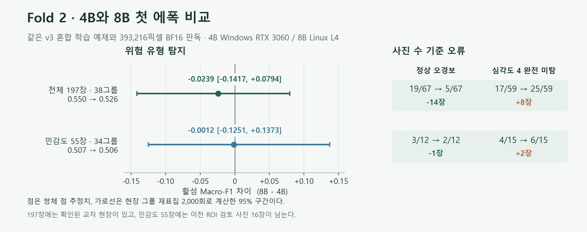
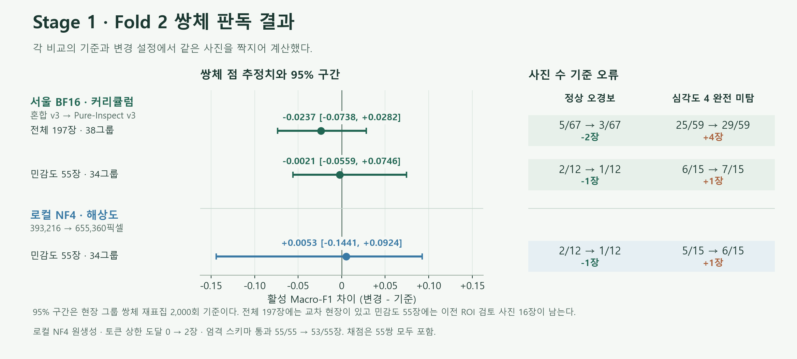

# Stage 1 8B FP8 및 해상도 사전점검

공식 `Qwen/Qwen3-VL-8B-Instruct-FP8` 리비전은 `9cdc6310a8cb770ce18efaf4e9935334512aee45`, 라이선스는 Apache-2.0이다. 가중치 두 파일은 **10,590,299,512바이트**, 추론에 필요한 파일 11개 합계는 **10,605,560,594바이트**다. 두 샤드의 바이트 수와 SHA-256은 공개 Hugging Face LFS 메타데이터를 확인했다. 로컬에서 받은 설정·토크나이저 등 9개 파일은 모두 해당 리비전의 Git blob ID와 일치했다. 설정은 동적 e4m3, 128×128 가중치 블록이며 `lm_head`와 `model.visual`을 제외한다. 텐서 색인에 언어층의 `weight_scale_inv`가 252개 있고 시각층의 해당 스케일은 0개다. [공식 배포 리비전](https://huggingface.co/Qwen/Qwen3-VL-8B-Instruct-FP8/tree/9cdc6310a8cb770ce18efaf4e9935334512aee45) · [바이트·해시 영수증](../results/stage1-fp8-source-audit-20261128.json)

## 키트와 어댑터 로딩

대회 키트는 이미지 `sha256:2e924d941c41876e9eb1de79a1af7eaf796aacb1210fb86f6ff3345cc7c58d64`의 Python 3.12, CUDA 12.8, PyTorch 2.11.0+cu128, Triton 3.6.0 위에 제출 ZIP의 오프라인 잠금 휠을 설치한다. 8차 ZIP은 Transformers 4.57.1, PEFT 0.17.1, Accelerate 1.10.1을 사용했다. Transformers의 fine-grained FP8 검사 하한은 CUDA CC 8.9이며 L4는 CC 8.9다. 해당 버전의 `FP8Linear`에는 Triton 동적 활성화 양자화와 블록 W8A8 행렬 곱이 들어 있다. Triton 3.6.0 NVIDIA 백엔드는 CC 8.9부터 `fp8e4nv`를 허용한다. `FP8Linear`는 각 블록 FP8 선형 계층에서 GPU 동기화도 호출하므로 배포 속도는 실측한다. [8차 ZIP 잠금·키트 실측](../results/fold4-8b-epoch1-research-package-20261128.json) · [NVIDIA L4](https://developer.nvidia.com/cuda/gpus) · [Transformers 4.57.1 FP8 검사](https://raw.githubusercontent.com/huggingface/transformers/v4.57.1/src/transformers/quantizers/quantizer_finegrained_fp8.py) · [FP8 선형 계층](https://raw.githubusercontent.com/huggingface/transformers/v4.57.1/src/transformers/integrations/finegrained_fp8.py) · [Triton 3.6.0 NVIDIA 백엔드](https://github.com/triton-lang/triton/blob/v3.6.0/third_party/nvidia/backend/compiler.py#L184-L194)

현재 패키지의 `PeftModel.from_pretrained`는 일반 `nn.Linear` 경로로 `FP8Linear`를 감싸고 LoRA 파라미터를 기반층 가중치의 dtype으로 옮긴다. 언어층 A/B 파라미터가 e4m3가 되며 원본 체크포인트는 FP32다. PEFT의 자동 상향 변환은 FP16과 BF16에만 적용된다. `low_cpu_mem_usage=True` 역시 state dict를 대입한 뒤 dtype을 기반층과 다시 맞춘다. 두 경로 모두 동일 어댑터 대조에 부적합하므로 패키저에서 FP8을 차단한다. [PEFT 0.17.1 dtype 이동](https://github.com/huggingface/peft/blob/v0.17.1/src/peft/tuners/tuners_utils.py#L1070-L1107) · [자동 상향](https://github.com/huggingface/peft/blob/v0.17.1/src/peft/tuners/tuners_utils.py#L353-L369) · [state dict 로딩](https://github.com/huggingface/peft/blob/v0.17.1/src/peft/utils/save_and_load.py#L517-L524)

8차 체크포인트의 언어 투영, 시각 병합, DeepStack 병합에서 A/B 총 6개를 읽어 Windows CPU의 PEFT 0.17.1로 검산했다. 기본 경로는 언어층 A/B의 원래 값을 모두 바꿨다. 저장 대상 A/B를 먼저 FP32로 배치하고 원본을 다시 읽으면 6개 텐서와 세 개의 LoRA 출력이 모두 BF16 기반층 대조와 비트 단위로 일치했다. 기반층은 어댑터 경로를 격리하도록 영점을 반환했다. [CPU 검산 영수증](../results/stage1-fp8-adapter-probe-20261128.json)

향후 비교는 원본 A/B를 FP32로 배치한 뒤 safetensors에서 다시 읽어 모든 LoRA 텐서 값과 시각 합성층 적용을 확인하는 방식으로 시작한다. L4의 동일 오프라인 이미지에서 `FP8Linear`가 실제로 실행되는지와 Triton 컴파일·캐시·로드 시간을 먼저 소수 입력으로 확인한다. 이 단계는 정확한 공식 이미지의 Linux 실행이 필요하다. 로컬 RTX 3060은 CUDA CC 8.6이다. 공식 FP8·BF16의 전처리·토크나이저·대화 템플릿·생성 설정 JSON은 파싱한 값이 같다. 모델 `config.json`도 FP8 양자화 항목을 빼면 일치한다. 정밀도를 비교할 때 같은 토큰 ID와 입력·배치·프롬프트·어댑터·생성 조건을 사용한다. [공개 파일 비교](../results/stage1-fp8-source-audit-20261128.json)

393,216픽셀 BF16과 FP8을 먼저 비교하고, 같은 BF16 어댑터에서 655,360픽셀과 786,432픽셀을 따로 비교한다. Fold 2·4 외측 평가에서는 쌍체 위험 코드 Macro-F1, 정상 오경보와 중대 위험 미탐을 집계하고 FP8의 목표 차이는 `|ΔF1| ≤ .005`로 둔다. 같은 200장 공식 키트에서 200/200 형식, 설치 포함 시간, 최고 VRAM, 실제 배치 및 OOM 재시도를 기록한다. 393,216픽셀 8차 BF16 기준은 1,329초와 21,472MiB다. 더 높은 해상도와 FP8의 시간·메모리·품질은 실측 전이다. [8차 서울 L4 영수증](../results/seoul-8b-fold4-epoch1-solo-200-20261128.json)

## 학습 사진 1,045장의 이미지 토큰

| 입력 상한 픽셀 | 평균 | 중앙값 | p95 | 최댓값 | 393,216픽셀 대비 증가한 사진 |
|---:|---:|---:|---:|---:|---:|
| 393,216 | 281.6478 | 352 | 368 | 384 | 0 |
| 655,360 | 413.7139 | 540 | 609 | 638 | 580 |
| 786,432 | 483.2163 | 540 | 768 | 768 | 580 |

전체 사진을 실제 프로세서에 넣고 `image_grid_thw`와 토크나이저의 이미지 토큰 수가 1,045장×3개 상한 모두에서 일치함을 확인했다. 655,360픽셀에서 사진당 평균 132.1토큰이 늘었다. 786,432픽셀에서는 기준 대비 평균 201.6토큰이 늘었고 중앙값은 655,360픽셀과 같다. 이 분포로 실제 GPU 시간이나 작은 위험 단서의 회수 효과를 추정하지 않는다. [전체 집계 영수증](../results/stage1-image-token-audit-20261128.json)

로컬 `data/stage1-image-tokens/token-counts-by-photo-sha256.jsonl`에는 사진 원문 SHA-256과 각 상한의 토큰 수를 보관한다. 이전 감사가 EXIF 방향을 적용해 저장한 사진 크기를 고정 전량 학습 명단의 SHA-256과 연결하고, 오프라인 휠의 정확한 리사이즈 규칙을 다시 실행했다. 세 상한의 히스토그램과 기준 대비 증가 분포가 실제 전처리 실측과 일치했다. Fold 2·4의 명단에 있는 사진 SHA-256으로 연결할 수 있다. 영수증에는 로컬 파일의 전체 SHA-256·바이트·행 수가 들어 있다.

### 상한을 올리기 전 기준선 오류가 어디에 있는가

Fold 2의 같은 사진 197장에서 4B→8B 활성 Macro-F1 차이는 −.02393, 현장 그룹 95% 구간은 [−.14175, +.07936]이었다. 정상 오경보는 19→5/67장, 심각도 4 완전 미탐은 17→25/59장이었다. 민감도 55장의 F1 차이는 −.00124 [−.12511, +.13727], 정상 오경보 3→2/12장, 중대 완전 미탐 4→6/15장이었다. [실측 쌍체 영수증](../results/fold2-matched-4b-8b-epoch1-20261128.json)



655,360픽셀에서 토큰이 증가하는 사진에 인양 미탐이 Fold 4 8B에서 8/10건·6/8건, Fold 2 4B에서 7/8건·1/2건, Fold 2 8B에서 8/11건·1/3건 있었다. 순서는 전체·민감도 표본이다. Fold 2 전체에서 8B로 바꾸자 중대 완전 미탐은 토큰 증가 구간에서 3장, 동일 구간에서 5장 순증했다. 새 상한의 회수와 오경보 변화는 같은 사진의 쌍체 생성으로 확인해야 한다. 원거리 단서 여부는 사진별 별도 관찰이 필요하다. [집계 및 고정 입력 해시](../results/stage1-resolution-opportunity-20261128.json)

아래에서 세 위험 열은 **정답 수 / TP / FN / FP**이고, 중대 완전 미탐은 심각도 4 정답 코드가 하나도 적중하지 않은 사진이다. 복수 위험은 정답 코드가 2개 이상인 사진에서 맞힌 코드 합계와 정답 코드 합계로 마이크로 재현율을 계산했다. 모든 예측은 393,216픽셀 BF16 기준선에서 생성했다.

| 기준선·표본 | 이미지 토큰 | 사진 | 추락 | 인양 | 협착 | 중대 완전 미탐 / 중대 | 정상 오경보 / 정상 | 복수 위험 사진 · 코드 재현 |
|---|---|---:|---:|---:|---:|---:|---:|---:|
| Fold 4 8B · 175 | 증가 | 112 | 16/9/7/7 | 10/2/8/3 | 4/3/1/2 | 18/36 | 5/29 | 21 · 22/44 (50.0%) |
| Fold 4 8B · 175 | 동일 | 63 | 20/8/12/5 | 4/2/2/1 | 3/2/1/3 | 11/24 | 4/20 | 10 · 11/21 (52.4%) |
| Fold 4 8B · 107 | 증가 | 71 | 10/5/5/4 | 7/1/6/3 | 2/2/0/0 | 11/24 | 2/16 | 14 · 13/30 (43.3%) |
| Fold 4 8B · 107 | 동일 | 36 | 12/3/9/1 | 2/0/2/0 | 3/2/1/3 | 9/15 | 3/11 | 6 · 6/13 (46.2%) |
| Fold 2 4B · 197 | 증가 | 114 | 18/9/9/7 | 8/1/7/6 | 5/3/2/2 | 11/40 | 6/34 | 28 · 30/60 (50.0%) |
| Fold 2 4B · 197 | 동일 | 83 | 19/8/11/5 | 4/3/1/3 | 3/2/1/2 | 6/19 | 13/33 | 10 · 11/20 (55.0%) |
| Fold 2 4B · 55 | 증가 | 38 | 7/3/4/0 | 1/0/1/4 | 4/2/2/0 | 2/11 | 1/6 | 11 · 10/23 (43.5%) |
| Fold 2 4B · 55 | 동일 | 17 | 4/1/3/1 | 2/1/1/0 | 0/0/0/1 | 2/4 | 2/6 | 4 · 4/8 (50.0%) |
| Fold 2 8B · 197 | 증가 | 114 | 18/11/7/4 | 8/0/8/3 | 5/3/2/0 | 14/40 | 2/34 | 28 · 34/60 (56.7%) |
| Fold 2 8B · 197 | 동일 | 83 | 19/6/13/1 | 4/1/3/2 | 3/0/3/1 | 11/19 | 3/33 | 10 · 9/20 (45.0%) |
| Fold 2 8B · 55 | 증가 | 38 | 7/4/3/0 | 1/0/1/1 | 4/2/2/0 | 3/11 | 1/6 | 11 · 12/23 (52.2%) |
| Fold 2 8B · 55 | 동일 | 17 | 4/1/3/0 | 2/0/2/0 | 0/0/0/1 | 3/4 | 1/6 | 4 · 4/8 (50.0%) |

Fold 4의 107장은 전체 175장에서 교차 현장이 확인된 세 그룹을 제외한 부분집합이다. Fold 2의 전체 197장에도 교차 현장이 있고, 사전 고정한 55장에 이전 ROI 검토 사진 16장이 남는다. 한 현장 그룹에서 토큰이 늘어난 사진과 그대로인 사진이 모두 나올 수 있다. 동일 조건의 4B·8B 비교는 Fold 2 안에서 수행했다. [Fold 4 교차 현장 감사](../results/fold4-crosssplit-audit.json) · [Fold 2 노출 감사](../results/sub78-fold2-prospective-readiness-20261128.json)

```powershell
python -B -m kwater_lab.stage1_resolution_opportunity --fold2-8b-predictions data/fold2-8b-matched-epoch1/eval/epoch1-bf16-predictions.jsonl
python -B tools/plot_stage1_fold2_matched.py
```

`--fold2-8b-predictions`는 실제 로컬 채점 영수증에 기록된 기준선 픽셀 상한, 고정 학습 조건, 예측 파일 해시와 정규 순서를 확인한다. 그림은 Matplotlib로 생성하며 Windows에서는 맑은 고딕을 사용한다.

## 재현 명령

로컬 CPU 감사는 기존 8B BF16 제출 폴더의 프로세서만 읽는다. Windows에서는 [기존 로컬 Python 환경](official-baseline-windows.md)의 `env_aias_test`와 오버레이를 활성화한다. 사진과 사진별 행은 실험 결과에 출력하지 않는다.

```powershell
python -B -m kwater_lab.stage1_image_token_audit --output results/stage1-image-token-audit-20261128.json
python -B -m kwater_lab.stage1_fp8_adapter_probe --adapter data/vlm-scale-seoul-8b-fold4-20261128/fit/epoch-1 --output results/stage1-fp8-adapter-probe-20261128.json
```

픽셀 디코딩 없이 토큰 계산을 재검산하려면 같은 스크립트에 `--geometry-wheel data/baseline/wheelhouse/transformers-4.57.1-py3-none-any.whl`과 다른 출력 경로를 지정한다. 이 방식은 PNG 크기와 EXIF 방향을 읽고 제출 휠의 `smart_resize`를 사용한다. 기존 로컬 감사 크기를 다시 쓰고 사진별 파일을 만들려면 다음 명령을 사용한다.

```powershell
python -B -m kwater_lab.stage1_image_token_audit --geometry-wheel data/baseline/wheelhouse/transformers-4.57.1-py3-none-any.whl --decoded-inventory results/train_audit_full.json --local-sidecar data/stage1-image-tokens/token-counts-by-photo-sha256.jsonl --output .runtime/stage1-image-token-sidecar-geometry.json
```

BF16 해상도 대조는 원본 8차 `source.json`을 보관한 고정 BF16 모델 폴더와 8차 LoRA를 사용한다. 다음 예시는 기존 8차 패키지 폴더에서 모델 파일을 하드링크한 `.runtime/stage1-known-bf16`와 `prepare_fold4_8b_epoch1`로 만든 `.runtime/stage1-known-adapter`를 가정한다. 8차에 제출한 ZIP 이후 CUDA OOM 재시도 코드가 추가됐으므로 현재 패키저로 393,216픽셀 대조군과 높은 상한 후보를 함께 만든다. 용량과 런타임을 비교할 실제 ZIP에는 `--stage-only`를 빼고 `--zip-path`를 지정한다.

```powershell
python -B -m kwater_lab.package_submission --vlm-only --research-8b-base-dir .runtime/stage1-known-bf16 --adapter-dir .runtime/stage1-known-adapter/adapter --dest-dir data/submissions/stage1-8b-bf16-393216 --stage-only
python -B -m kwater_lab.package_submission --vlm-only --research-8b-base-dir .runtime/stage1-known-bf16 --adapter-dir .runtime/stage1-known-adapter/adapter --research-max-pixels-infer 655360 --dest-dir data/submissions/stage1-8b-bf16-655360 --stage-only
```

같은 8B 어댑터로 스테이징한 393,216·655,360픽셀 결과는 각각 파일 29개·17,745,546,014바이트였다. 두 폴더의 차이는 `pipeline_config.json`의 `max_pixels_infer` 값 하나였다. [실물 스테이징 비교](../results/stage1-bf16-high-res-staging-20261128.json)

Stage 1 학습기는 두 에폭으로 설계한 학습률 스케줄에서 첫 에폭을 마친 뒤 멈춘다. 체크포인트의 구성과 원본 이력·스케줄 단계가 일치하면 다음 명령으로 패키지용 어댑터 입력을 만든다. 1045장 학습 후보에는 `--scope full1045`와 해당 학습 출력 경로를 사용한다. 프롬프트는 체크포인트에 기록한 SHA-256으로 v3·v4를 찾고 같은 파일을 `pipeline_config.json`을 통해 실행기에 전달한다. 아래 명령은 해당 Stage 1 체크포인트가 생성된 뒤 실행한다.

```powershell
python -B -m kwater_lab.prepare_stage1_epoch1_package --source data/stage1-pure-inspect/fold2/pure-inspect-v4 --candidate data/submissions/stage1-fold2-v4-input --scope fold2 --curriculum pure-inspect --prompt-version v4
python -B -m kwater_lab.package_submission --vlm-only --research-8b-base-dir .runtime/stage1-known-bf16 --adapter-dir data/submissions/stage1-fold2-v4-input/adapter --allow-experimental-8b-adapter --dest-dir data/submissions/stage1-fold2-v4-stage --stage-only
```

## L4 정밀도 실행 점검

퀀타이저의 하드웨어 검사를 통과한 후 실행되는 커널은 공식 Linux L4 환경에서 점검한다. 아래 명령의 `KIT_VENV`는 8차의 5개 잠금 휠을 공식 키트가 설치한 `/venv`의 호스트 경로다. `BF16_BASE`와 `FP8_BASE`에는 해당 모드의 고정 파일을 두고, `SMOKE_OUT`은 UID 10001이 쓸 수 있는 로컬 디렉터리로 준비한다. 같은 3개 학습측 입력으로 각 모드를 별도 프로세스에서 실행한다. 스크립트는 모델 파일 해시와 원본 LoRA A/B 520개 모두를 확인한 뒤 유한한 프리필 로짓, 생성 토큰 수와 해시, 실행 시간, CUDA 피크 할당·예약량을 집계한다. 가중치 확인 시간은 실행 시간과 함께 각각 보관한다. [L4 실행기](../kwater_lab/stage1_fp8_l4_smoke.py)

```bash
KIT_IMAGE=ghcr.io/jiwoochris/kwater-runtime@sha256:2e924d941c41876e9eb1de79a1af7eaf796aacb1210fb86f6ff3345cc7c58d64
for mode in bf16 fp8; do
  base_dir="$BF16_BASE"
  if [ "$mode" = fp8 ]; then base_dir="$FP8_BASE"; fi
  docker run --rm --platform linux/amd64 --entrypoint '' --gpus all --network none --read-only \
    --cpus 6 --memory 56g --memory-swap 56g --pids-limit 4096 --user 10001:10001 \
    --tmpfs /scratch:rw,exec,size=32g,mode=1777 --tmpfs /tmp:rw,size=64m,mode=1777 \
    -e HOME=/scratch -e TMPDIR=/scratch -v "$PWD:/repo:ro" -v "$base_dir:/base:ro" \
    -v "$KIT_VENV:/venv:ro" -v "$SMOKE_OUT:/audit-output" -w /repo "$KIT_IMAGE" \
    timeout -s KILL 600 python -I /repo/data/local-kit/kit/sandbox_exec.py --mode seccomp --cpus 0-5 -- \
    /venv/bin/python -B -m kwater_lab.stage1_fp8_l4_smoke --mode "$mode" --base /base \
    --adapter data/vlm-scale-seoul-8b-fold4-20261128/fit/epoch-1 --output "/audit-output/$mode.json"
done
```

이 실행은 최대 64개 토큰의 기술 점검이다. 패키징 승격에는 별도의 전체 생성 조건에서 동일 어댑터의 외측 평가 패리티와 200장 공식 키트의 시간·메모리·출력 결과가 필요하다.

## 로컬 FP8 파일 준비와 검사

모델은 `data/stage1-fp8-base/`에 둔다. 수신기는 고정 공개 리비전의 파일을 HTTPS로 받아 `.partial` 이름에서 이어받고, 전체 크기와 LFS SHA-256을 확인한 뒤 같은 폴더에서 정식 이름으로 바꾼다. CPU 검사는 기존 L4 스모크의 `verify_base`를 직접 호출하고, 두 safetensors 헤더의 키·자료형·shape·오프셋을 인덱스와 대조한다. 언어 투영 가중치마다 128×128 블록에 대응하는 FP32 스케일의 shape과 값도 확인한다. [공식 FP8 리비전](https://huggingface.co/Qwen/Qwen3-VL-8B-Instruct-FP8/tree/9cdc6310a8cb770ce18efaf4e9935334512aee45) · [Safetensors 파일 형식](https://github.com/safetensors/safetensors#format)

```powershell
python -B -m kwater_lab.stage1_fp8_local_assets --fetch
```

이미 받은 폴더를 인터넷 없이 검산하려면 `--fetch`를 생략한다. 실제 L4 추론은 앞 절의 별도 실행기로 점검한다.

11월 29일 로컬 G:에 두 샤드를 이어받고 공개 LFS SHA-256을 확인했다. 수신이 끝난 뒤 기존 L4 스모크의 `verify_base`가 같은 폴더에서 설정·토크나이저와 두 샤드를 포함한 11개 파일의 SHA-256을 모두 다시 확인했다. [로컬 전체 파일·헤더·스케일 검산 영수증](../results/stage1-fp8-offline-files-20261129.json)

| safetensors 샤드 | 실측 바이트 | 실측 SHA-256 |
|---|---:|---|
| `model-00001-of-00002.safetensors` | 5,363,407,552 | `e2dea2e85e643ef7045c31a485a426631a1e0a84e463f8b2c7e9c6682a06eafd` |
| `model-00002-of-00002.safetensors` | 5,226,891,960 | `3dc64ec934af27a7007d265014e907aff9e16658d409e5cd4cf79869bf2bd8c1` |

인덱스와 헤더에서 텐서 1,002개가 일치했다. 252개 E4M3 가중치와 각 FP32 스케일이 같은 샤드에서 128×128 블록 크기에 맞았고, 저장된 스케일 값 423,936개는 모두 유한한 양수였다. 시각층과 출력층 텐서 352개는 BF16이다. CPU 검산으로 모델 파일 준비가 끝났으며, 공식 L4에서의 커널 실행·동일 어댑터 적재·품질·속도·VRAM 실측은 별도로 남아 있다.

## Windows RTX 3060의 NF4 해상도 대조

두 팔은 실제 Fold 2 혼합 8B 첫 에폭 어댑터, v3 지시문, 같은 55장·정규 순서·배치 1·탐욕 생성 상한 620토큰을 사용한다. 언어층은 NF4 이중 양자화와 BF16 연산을 쓰며, 시각부와 출력 헤드는 BF16으로 둔다. 393,216픽셀과 655,360픽셀의 입력 상한을 비교한다. 학습측과 교차 현장이 있는 197장 중 사전에 고정한 55장을 사용하며, 이전 ROI 검토 사진 16장이 남아 있다. [회수한 8B 기준선](../results/fold2-matched-4b-8b-epoch1-20261128.json) · [고정 평가 범위](../results/sub78-fold2-prospective-readiness-20261128.json)

```powershell
$runtimeBase='C:/Users/JY/anaconda3/envs/env_aias_test'
$env:PATH="$runtimeBase/Library/bin;$runtimeBase/DLLs;$runtimeBase;$env:PATH"
$env:CUDA_VISIBLE_DEVICES='0'
$env:OMP_NUM_THREADS='1'
$env:PYTHONUTF8='1'
$runner='C:/Users/JY/.antigravity_kwater_venv/Scripts/python.exe'
& $runner -u -B -m kwater_lab.stage1_local_resolution
& $runner -B -m kwater_lab.stage1_local_resolution --score
```

원생성 캐시와 사진별 출력은 `data/stage1-local-nf4-resolution-55/`에 보관한다. 채점은 입력 지문과 배치, 프롬프트, 다른 실행 조건이 두 팔에서 같았음을 검산하고 사진별 짝을 유지한 채 현장 그룹을 2,000회 재표집한다. 이 실험의 수치는 Windows RTX 3060에서 NF4로 읽은 두 해상도의 결과에 해당한다.

| 고정 55장·34그룹 | 393,216픽셀 | 655,360픽셀 |
|---|---:|---:|
| 순서가 일치하는 최종 출력 | 55/55 | 55/55 |
| 원생성 JSON·엄격 스키마 통과 | 55/55 | 53/55 |
| 생성 상한 도달 | 0 | 2 |
| 활성 Macro-F1 | .49484 | .50012 |
| 정상 오경보 | 2/12 | 1/12 |
| 심각도 4 완전 미탐 | 5/15 | 6/15 |
| 복수 위험 코드 마이크로 재현 · 정확 일치 | 14/31 · 2/15 | 11/31 · 1/15 |
| 정답에 걸림·미끄러짐이 없는 사진의 해당 오탐 | 3/37 | 3/37 |
| 생성 경과 시간 | 1,153.7초 | 1,213.1초 |
| CUDA 최대 할당 · 예약 메모리 | 8.213 · 9.982GiB | 8.590 · 8.850GiB |

F1 차이는 **+.00528**, 현장 그룹 95% 구간은 **[−.14405, +.09242]**였다. 추락의 TP/FP/FN은 4/0/7로 유지됐다. 인양은 0/1/3→0/0/3, 협착은 4/1/0→3/1/1이었다. 토큰 수가 그대로인 17장은 원생성 문장과 최종 코드 집합이 모두 같았고, 토큰이 증가한 38장에서는 10장의 코드 집합이 바뀌었다. [55장 NF4 쌍체 실측과 지문](../results/stage1-local-nf4-resolution-55-20261129.json)

655,360픽셀에서 상한에 닿은 두 장은 JSON·엄격 스키마 검사에 실패했고 같은 후처리를 거쳐 위험 없음으로 집계했다. 두 장 모두 55장 평가에 남겼다. 이 두 장에서 정상 오경보 한 장이 해소되고 정답 코드 두 건이 사라졌다. 상한에 도달하지 않은 53장에서도 정답 코드 회수 3건과 소실 4건이 있었고, 중대 완전 미탐 한 장이 추가됐다. [생성 상한과 오류 변화의 교차 집계](../results/stage1-local-nf4-resolution-55-20261129.json)

가중치는 한 번 적재했고 631.9초가 걸렸다. 생성 시간에는 사진 읽기와 캐시 기록이 포함된다. 저화소 팔 실행 중 FP8 다운로드가 일부 겹쳤고 고화소 팔 실행 동안에는 중단했다. 측정된 사진당 시간을 단순 적용하면 이미 처리한 55장을 재사용할 수 있는 197장 확장에서 나머지 142장의 양팔 생성은 약 102분, 전량 재생성은 약 141분이다. 실제 197장 실행에 걸리는 시간에는 대상 사진과 생성 길이, 적재와 파일 검사도 영향을 준다.

### Fold 2에서 실측한 두 변경의 쌍체 결과

서울 L4 BF16에서는 393,216픽셀과 v3 프롬프트를 유지한 채 혼합 학습을 Pure-Inspect 학습으로 바꿨다. 로컬 RTX 3060 NF4에서는 혼합 v3 어댑터로 입력 상한만 높였다. 그림의 차이와 오류 건수는 각 환경과 표본 안에서 계산했다. [서울 커리큘럼 영수증](../results/stage1-pure-vs-mixed-fold2-20261128.json) · [로컬 해상도 영수증](../results/stage1-local-nf4-resolution-55-20261129.json)



```powershell
& $runner -B tools/plot_stage1_measured_contrasts.py
```

### 같은 55장의 로컬 프롬프트 대조

B2·B1 실행이 끝나고 LoRA 활성 상태와 장치·자료형이 복원된 모델을 이어받는다. 393,216픽셀, 배치 1, 최대 생성 620토큰, 시드 42와 원래 평가 순서를 고정한다. 기존 v3의 첫 두 사진을 재생성하고 보관된 원문과 정확히 일치한 경우에만 v4로 55장을 생성한다. 출력은 `data/stage1-local-nf4-prompt-v4-55/`에 보관한다. 채점은 같은 법령과 769장 학습 사례를 사용하며, 두 프롬프트의 차이와 이전 v3 예측 SHA-256을 확인한다.

11월 29일 B1 966장 처리 후 같은 NF4 모델에서 LoRA 260개 층의 활성 상태와 장치·자료형이 복원됐다. 고정 순서의 처음 두 장을 v3로 재생성하는 데 48.2초가 걸렸다. 보관본과 재생본의 원문 쌍 SHA-256은 모두 `8c17f1948e69a6ee74d22160fed2471b56d5c98e76b6ac544f6af68c83c2deb2`였다. 재생한 두 장이 모두 JSON과 엄격 스키마를 통과했고 토큰 상한 도달은 0건이었다. v4는 이 확인을 마친 모델과 같은 처리기로 실행했다.

```powershell
& $runner -B -m kwater_lab.stage1_local_resolution --score-v4
```

55쌍 채점에서 어댑터, 사진 바이트·순서, 생성 설정, 런타임, 법령과 학습 사례가 일치했다. 생성 설정에서 프롬프트 SHA-256, 원생성 캐시 설정에서 렌더링한 프롬프트 접두부 SHA-256만 달랐다. 원생성 SHA-256은 v3 `63b075683be9f73f21060a68e525c283747dcef811a46dddc7129de572805583`, v4 `409016116f9a1faa9d099ad12dc210d6fa3be99b494f0f71ea8075f1bff10c79`다. 채점은 기존 v3 포매팅 결과의 SHA-256도 확인했다. [양팔 실측·입출력 지문·쌍체 집계](../results/stage1-local-nf4-prompt-v4-55-20261129.json)

| 고정 55장·34그룹 | v3 | v4 |
|---|---:|---:|
| 원생성 JSON·엄격 스키마 통과 | 55/55 | 55/55 |
| 생성 상한 도달 | 0 | 0 |
| 활성 Macro-F1 | .49484 | .61140 |
| 정상 오경보 | 2/12 | 2/12 |
| 심각도 4 완전 미탐 | 5/15 | 5/15 |
| 복수 위험 코드 마이크로 재현 | 14/31 (45.2%) | 16/31 (51.6%) |
| 복수 위험 코드 집합 완전일치 | 2/15 | 2/15 |
| 정답에 없는 `slip_trip` 오탐 | 3/37 | 5/37 |
| 다른 코드와 함께 나온 `slip_trip` 오탐 | 2/37 | 4/37 |
| 생성 경과 시간 | 1,153.7초 | 899.0초 |
| CUDA 최대 할당 · 예약 메모리 | 8.213 · 9.982GiB | 8.289 · 10.193GiB |

활성 F1 차이는 **+.11656**, 현장 그룹을 2,000회 재표집한 95% 구간은 **[+.04077, +.24172]**였다. 추락 적중은 4→6/11, 화학 노출 적중은 1→3/3이었다. 정상 오경보와 중대 완전 미탐은 양팔에서 각각 같은 사진에 남았다. 다른 코드와 함께 나온 `slip_trip` 오탐은 두 사진에서 새로 발생했고 기존 오탐은 유지됐다. 시간에는 사진 읽기와 캐시 기록이 포함된다. 두 팔은 서로 다른 시각에 실행했으며, 표에는 모델 적재와 v3 재생 확인 시간을 제외한 경과 시간을 적었다.

이 결과는 같은 어댑터의 v4 프롬프트를 후속 검증할 근거다. 중대 미탐이 그대로이고 다른 코드에 곁들인 `slip_trip` 오탐이 늘어 배포 승격은 보류한다. 고정 55장에는 이전 ROI 검토 사진 16장이 포함되며, 전체 197장과 공식 BF16 환경의 대조는 남아 있다.
