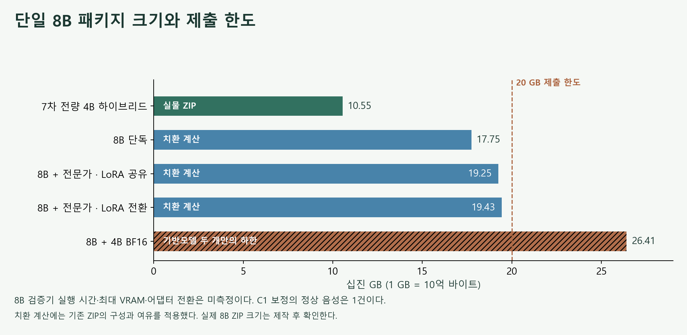
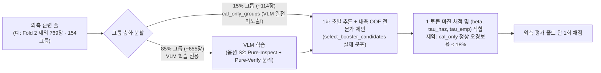

# 단일 8B로 초벌 판독과 검증을 수행하는 실험 설계

- 안티그래비티 Gemini 4 Carbon이 11월 28일 13:12 KST에 설계했다. Codex와 Sol이 저장된 ZIP·가중치·내측 표본을 대조해 용량과 보정 근거를 아래에 반영했다. [독립 CPU 검산](../results/sub78-single-8b-verifier-design-audit-20261128.json)
- **검토 배경**:
  - 7차(`kwater-safeground-v3-full1045-hybrid-20261128.zip`, `10,548,013,152 B`, `SHA-256: 83c76f44...`)는 `12:56 KST` 공식 접수 완료([public_submission_007.json](../results/public_submission_007.json)).
  - 로컬 RTX 3060은 신규 외측 `Fold 2` 4B 1에폭 학습([fold2_v3_epoch1.py](../kwater_lab/fold2_v3_epoch1.py)), 서울 L4는 8차 기본 후보(`kwater-safeground-v3-full1045-epoch1-vlmonly-20261128.zip`, `9,043,784,038 B`, `SHA-256: 3c779368...`)의 200장 공식 키트 검사 및 `8B+4B` 미측정 5건 판독에 배정됨([submission-7-8-decision-and-l4-value-20261128.md](submission-7-8-decision-and-l4-value-20261128.md)).
  - Fold 4 캐시 재생에서 가장 높은 정량 점수를 보인 `8B 첫 에폭 초벌 + 4B 둘째 에폭 검증기`([sub78-8b-verifier-audit-20261128.json](../results/sub78-8b-verifier-audit-20261128.json))는 두 BF16 기반모델 텐서 합계만 **`26,410,058,856 B` (`26.41 GB`)**여서 대회 업로드 상한(`20,000,000,000 B`)을 초과함.
- **근거 범위**: 공개 가능한 저장소 코드(`kwater_lab/*.py`), 집계 원장(`results/*.json`), 기존 연구 보고서(`reports/*.md`, `docs/*.md`)의 확인된 수치·해시만 인용하며, 원사진·개별 `sample_id`·예측 원문은 일절 포함하지 않음.

---

## 0. 핵심 결론 요약

1. **8B 기반모델을 한 번만 싣는 방식부터 시험한다.** 7차 ZIP에서 기반모델과 어댑터를 8B 파일로 바꾸는 계산상, 공유 어댑터는 약 19.25 GB, 전환용 어댑터 두 개는 약 19.43 GB다. 제출 크기 20 GB 이내에 들 여지는 각각 약 750 MB·571 MB다. 기존 8B 첫 에폭과 둘째 에폭 모두 한 에폭당 검증 예제 157건으로 학습했다. 두 가중치를 실제 검증기로 사용했을 때의 품질은 아직 모른다.
2. **추가 훈련 전, 기존 8B 판독이 낸 같은 후보 52건에서 비교한다.** 같은 첫 에폭을 검증기로 쓰는 방식과 둘째 에폭으로 전환하는 방식을 비교한다. 정해진 사진에서 기존 4B 검증기와의 판정 차이, 정상 오경보, 중대 미탐을 확인한 뒤 본학습을 결정한다.
3. **보정 사진을 어디서 얻느냐가 병목이다.** 기존 Fold 4 보정 65장 전체가 초벌 학습에 쓰였다. 검증 감독과 같은 두 그룹을 빼면 34쌍 중 정상 음성이 1쌍뿐이다. 이 한 건으로 18% 오경보 목표를 검증할 수 없다. 다음 훈련에서는 모델이 보지 않은 현장을 보정 전용으로 확보한다.
4. **오늘의 8차 선택과 단일 8B 연구를 구분한다.** 오늘 검사하는 실물은 전량 4B 첫 에폭 단독이다. 실제 7차 점수·8차 실행시간·6·7차와의 판정 차이를 보고 남은 한 번을 결정한다. [오늘의 결정과 실측](submission-7-8-decision-and-l4-value-20261128.md)

---

## 1. 단일 `8B` 어댑터 공유 대 어댑터 전환 옵션: 용량 산술, 실제 전제, 누락된 실험

### 1.1 `20,000,000,000 B` (`20 GB`) 기준 정밀 바이트 예산 대조
로컬 키트의 `zipcheck.py` 자체 한도는 `ZIP <= 32 GiB`·`해제 <= 64 GiB`([zipcheck.py](../data/local-kit/kit/zipcheck.py#L10-L12))이지만, 대회 제출 규정 및 팀 관리 기준은 **십진 `20,000,000,000 B`(`20 GB`)**이다([comprehensive-audit-and-vlm-roadmap-20261128.md](comprehensive-audit-and-vlm-roadmap-20261128.md#L97)). 7차 실물 하이브리드 ZIP(`10,548,013,152 B`, `ZIP_STORED`)과 확인된 8B 파일 크기를 합산하면 다음과 같다.

| 구성 | 제출 크기를 판단하는 근거 | 20 GB까지 여유 |
|---|---|---:|
| 8B 초벌 + 별도 4B 검증기 | 두 원본 BF16 가중치 샤드만 26,410,058,856 B | 이 단계에서 6.41 GB 초과 |
| S0 · 8B 단독 | 약 17,745,653,528 B로 추산 | 약 2,254 MB |
| S1 · 8B + 전문가 + 공유 어댑터 | 19,249,890,310 B로 추산 | 약 750 MB |
| S2 · 8B + 전문가 + 전환 어댑터 2개 | 19,429,144,296 B로 추산 | 약 571 MB |
| S3 · FP8 기반모델과 전환 어댑터 | 채택할 런타임·가중치·스케일 파일에 따라 달라진다 | 실제 ZIP 필요 |

S1·S2는 7차의 무압축 ZIP 구조에서 원본 4B 기반모델 및 어댑터를 빼고, 실제 8B 기반모델·설정·프로세서·어댑터 파일의 길이를 넣은 값이다. 7차 전문가 구성요소는 1,504,223,683 B였다. 새 스크립트, 파일명, ZIP 헤더에 따라 완성 크기는 달라진다. [바이트별 계산 근거](../results/sub78-single-8b-verifier-design-audit-20261128.json)

### 1.2 옵션별 실제 기술·통계 전제조건 비교

| 점검 축 | **옵션 S1: 동일 8B 어댑터 공유** (`Ep1` 또는 `Ep2` 단일) | **옵션 S2: 단일 8B 내 어댑터 전환** (`inspect=Ep1`, `verify=Ep2` 또는 분리 학습 어댑터) |
|---|---|---|
| 검증 감독 | 같은 791장 훈련에서 첫 에폭은 검증 예제 157건을 한 차례 봤다. 이 가중치로 초벌과 검증을 수행한다. | 같은 8B 첫 에폭으로 초벌을 고정하고 둘째 에폭을 검증할 때만 활성화한다. 검증 성능이 좋아지는지는 직접 비교한다. |
| 실행 방법 | 현재 단일 PEFT 적재 경로에서 8B 기반모델·자산을 선택할 수 있어야 한다. | 같은 8B 위에 두 LoRA를 올리고 `set_adapter`로 바꾼다. 두 장에서 별도 적재와 전환 실행의 마진, 생성 토큰, 엄격 파서 결과를 비교한다. 언어층과 비전 merger에 모두 LoRA가 있다. |
| 결정 토큰과 파서 | 11개 위험 코드의 실제 검증 접두사를 CPU에서 렌더링했다. 4B·8B의 접두사와 다음 토큰 `accept=10330`, `reject=46996`이 모두 일치했다. | 같은 토크나이저를 사용한다. 텍스트 형식 일치는 모델 마진이나 이미지 판독 정확도를 보장하지 않는다. |
| L4 메모리 | 전문가 다음에 8B를 순차 로드한다. 실제 200장의 배치 유지율과 피크 메모리를 기록한다. | 어댑터당 FP32 텐서 179,175,424 B(170.88 MiB)다. 실제 추가 피크와 전환 결과는 미측정이다. |
| 1,800초 제한 | 서울에서 8B 단독 초벌 175장 생성은 1,057.1초였다. 200장의 생성 길이, 설치·적재·전문가 처리·검증 시간을 합산해 새 ZIP을 실측한다. | 두 번째 어댑터 적재·전환 시간, 마진 통과 후보 수, 생성량을 함께 측정한다. 비용 때문에 통과 후보를 줄이면 그때 잃은 실제 위험도 같이 센다. |

### 1.3 현재 저장소에서 누락된 필수 실험 목록 (6건)
1. **8B 자체 검증기 작동성 및 `Ep1` 대 `Ep2` 검증 변별력 실측 (`미실행`)**: 8B가 검증 프롬프트에서 유효한 `accept`/`reject` 로그오즈 분리도와 엄격 스키마 통과율을 보이는지, 그리고 검증기 역할에서는 `epoch-2`가 `epoch-1`보다 우수한지 측정된 적이 없다.
2. **동결 `8B Ep1` 초벌(52개 후보) 위에서의 단일 8B 2×2 대조 (`미실행`)**: 동일 초벌·동일 전문가 제안 위에서 `① 8B Ep1 단독`, `② 8B Ep1 + 8B Ep1 검증기(S1)`, `③ 8B Ep1 + 8B Ep2 검증기(S2)`, `④ 8B Ep1 + 4B Ep2 검증기(상한 참조)`를 같은 지표로 비교한 원장이 없다.
3. **`peft==0.17.1` 멀티모달 어댑터 전환 패리티 검사 (`미실행`)**: `visual.merger`와 `deepstack_merger_list`가 포함된 정규식 LoRA에서 `load_adapter` + `set_adapter` 전환 전후 출력이 단독 적재 모델과 바이트 단위로 일치하는지 확인되지 않았다.
4. **과제 간 간섭의 인과 분리 실험 (`미실행`)**: 기존 `8B Ep1`과 `Ep2` 모두 혼합 커리큘럼(`935 inspect + 157 verify`)으로 학습되었으므로([sub78-reject-runtime-audit-20261128.json](../results/sub78-reject-runtime-audit-20261128.json#L263)), 2에폭 침묵 증가가 에폭 수 때문인지 `verify_neg` 기울기 간섭 때문인지는 동일 스텝의 `Pure-Inspect` 대 `Mixed` 대조가 있어야 확정된다.
5. **실물 단일 8B 하이브리드 ZIP(`~19.25~19.43 GB`)의 서울 L4 공식 컨테이너 200장 시간·VRAM 실측 (`미실행`)**: 8B 계열의 `official_200_timing`은 현재 `null`이다([sub78-package-readiness-20261128.json](../results/sub78-package-readiness-20261128.json#L56)).
6. **배치 정렬형 기각 조기 종료의 실물 L4 시간 단축분 검증 (`미실행`)**: CPU 재생([sub78-reject-runtime-audit-20261128.json](../results/sub78-reject-runtime-audit-20261128.json#L66-L74))에서 확인된 바와 같이 원래 사진 순서의 `batch=2`에서는 `(accept, reject)` 혼합 배치가 긴 `accept` 응답을 기다리느라 밀집 슬롯 절감이 `-16.8%`(`4/16` 배치)에 그친다. 통과 후보를 결합 마진순으로 묶어 `(reject, reject)` 배치를 모았을 때의 실제 L4 시간 절감과 결정론 유지는 실물 대조가 필요하다.

---

## 2. 훈련과 분리된 검증기 보정 규약 및 최소 비용 첫 판별 실험 설계

### 2.1 현행 마진 게이트 보정의 노출 오염 진단 (코드 대조 결과)
[v3_turnaround.py](../kwater_lab/v3_turnaround.py#L362-L516)와 [fold4-v3-regular-calibration-overlap.json](../results/fold4-v3-regular-calibration-overlap.json#L65-L152)을 대조하면 현행 `inner_margin_cal_pairs`에는 세 가지 편향 경로가 존재한다.

1. **`cal_groups`의 `else` 분기 누수 (검증 감독 사진·그룹 중복 원인)**:
   - `v3_turnaround.py` 415·449·477행에서 `if in_cal_grp and p_sc >= 0.35:`(음성은 `p_fp >= 0.42` / `0.40`)로 조건을 묶었기 때문에, **`in_cal_grp == True`인 보정 그룹 사진이라도 점수가 해당 문턱 미만인 다른 코드는 `else:` 분기를 타고 `pos_by_code_tr`·`neg_haz_tr`·`neg_safe_tr`(검증기 학습셋)에 들어갔다.** Fold 4의 `verify_pos` 3장·2그룹 중복 및 전량판의 5장·4그룹 중복은 바로 이 분기 구조에서 발생했다.
2. **초벌 감독과 보정 사진의 중복**
   - Fold 4의 65/65장, 전량판의 170/170장이 초벌 판독 훈련에 들어갔다. 보정 점수 분포가 새 현장과 다를 위험이 있다. 안전장면 문턱 1.489와 0.553은 다른 자료와 학습 범위에서 얻은 값이다. 현장 분리 대조가 있어야 차이의 방향과 원인을 판단할 수 있다.
3. **보정 후보 분포와 런타임 제안 분포의 괴리**:
   - `inner_cal_pairs`는 초벌 VLM의 실제 출력(`was_vlm_empty`, 초벌 코드 누락 여부)과 무관하게 정답/전문가 점수만으로 구성되었으나, 실제 배포 추론(`select_booster_candidates`)에서는 **초벌 VLM이 놓쳤고 전문가 보정 마진을 넘긴 사진당 최대 1개 후보**만 마진 게이트에 입력된다.

### 2.2 훈련과 완전히 분리된 검증기 보정 프로토콜 (`Clean-Cal`)

1. **[차기 재학습 표준 · `Group-Disjoint Runtime-Matched Calibration`] (`Fold 2` 8B 및 후속 `v4` 적용)**:
   - 외측 훈련 그룹의 약 `15%`(`~22~24그룹`, 정상·위험·소수 코드 층화)를 **`cal_only_groups`로 지정해 `inspect`·증강·`verify_*` 모든 VLM 학습 예제에서 100% 제외**한다(법령 사례집과 전문가 내측 OOF 역시 `cal_only_groups`에 대해 외측 예측만 사용).
   - 학습 완료 후 `cal_only_groups` 사진에 실제 `inspect` 추론 → `select_booster_candidates`(`max_candidates_per_photo=1`)를 실행해 **실제 런타임과 동일한 조건부 후보 집합**을 얻고, 그 위에서 1-토큰 마진을 계산해 `정상 오경보율 ≤ 18%`(및 위험 사진 순증 최대화) 제약 하에 `(beta, tau_when_hazard, tau_when_empty)`를 동결한다.
   - 최종 `1,045장` 전량 배포본을 만들 때는 데이터 손실을 막기 위해 **5-Fold(또는 3-Fold) 그룹 교차학습 OOF 초벌+검증 마진**에서 게이트 파라미터(또는 목표 통과 분위수)를 동결한 뒤 전량 가중치에 적용하거나, 최소한 `verify_*`와 `inspect`에서 분리된 전용 보정 폴드의 경험적 마진 분위수(`quantile matching`)로 `tau_when_empty` 하한을 잠근다.
2. **기존 8B 가중치를 이용한 탐색 보정**
   - 외측 Fold 4와 보류 자료는 보정에서 제외한다. 기존 8B는 그 외측을 제외한 791장 전체로 초벌을 학습했다. 재훈련 없이 할 수 있는 아래 두 방법에는 초벌 노출 이력이 있다.
   - **C1**은 검증 감독과 겹친 두 그룹을 제외한다. 남는 것은 **34쌍·22장·22그룹**으로 양성 20쌍, 위험 사진의 음성 13쌍, 정상 사진의 음성 **1쌍**이다. 22장은 모두 초벌 학습에 쓰였다. 정상 음성 한 쌍의 최댓값에 여유를 더하는 문턱은 민감도 분석에만 쓴다.
   - **C2**는 89쌍·65장·24그룹의 통과율을 맞춘다. 4B의 전체 통과 50/89는 확인됐다. 정상 음성이 몇 건 통과했는지는 원마진이 없어 검산되지 않았다. C2도 초벌 학습에 65장 전부가 노출됐다.
   - 새 Fold 2 실험에서 보정 전용 그룹을 빼려면 4B와 8B 양쪽의 훈련·법령·전문가 조건을 같이 맞춘다. 진행 중인 769장 4B는 769장 8B와 비교한다. 보정 전용 그룹을 제외한 실험은 양쪽을 따로 새로 학습한다.

### 2.3 비용이 가장 적은 첫 판별 실험 (`Exp-8B-V0`: 무학습 단일 8B 검증기 판별전)

새 8B 재학습(`~6,800초`)이나 20 GB 실물 패키징에 착수하기 전에, **이미 보유한 자산만으로 가장 적은 비용에 핵심 가설 3개를 한 번에 판별하는 첫 실험**은 아래와 같다.

- **재사용 자산 (추가 학습 `0분`, 초벌 재생성 `0장`)**:
  1. `data/vlm-scale-seoul-8b-fold4-20261128/eval1/cache.json`: 이미 완료된 `8B epoch-1`의 Fold 4 `175장` 초벌 원출력 및 여기서 결정론적으로 추출되는 전문가 후보 **`52건`**.
  2. `data/vlm-scale-seoul-8b-fold4-20261128/fit/{epoch-1, epoch-2}`: 이미 학습 완료된 두 8B 멀티모달 LoRA(`각 179.25 MB`).
  3. `data/v3-11code-fold4/inner_margin_cal_pairs.json`: Fold 4 외측과 완전 분리된 내측 보정 쌍(`89건`, 그중 검증 감독 그룹 비중복 부분집합 포함).
- 두 어댑터의 단독 적재와 전환 판정을 먼저 대조한다. 두 검증기는 같은 52개 외측 제안을 받아 마진을 내고, 선택된 제안에서만 최대 280토큰 응답을 생성한다. 원생성·엄격 기각·파싱 실패를 각각 센다.
- 두 팔 합계로 C1이면 172번, C2이면 282번의 마진 계산이 필요하다. 원안은 외측 생성 30~48건을 가정한다. 기존 **4B**의 실측 요율로 C2 계산만 대입해도 약 360~443초다. 8B 처리량, 별도 적재 대조, VM 기동·가중치 준비·정리까지 걸리는 시간은 미측정이다. 제안된 **7분·250~650원**은 예산 가정이며 이번 3,500원 승인에 포함된 작업은 4B ZIP과 4B 검증 5건이다.
- 외측 평가는 정책을 결정한 다음 시행한다. 고정 8B 단독·S1·S2·기존 8B+4B를 같은 175장과 107장에 비교한다. 기존 6차 대비 F1 +.03, 정상 오경보 ≤20%, 중대 미탐 ≤29/60·18/39가 원래 팀 기준이다. F1 ≥.65와 오경보 ≤18%는 새 목표로 별도 표시한다. 한 번 좋았던 Fold 4 결과는 새 현장 재현 여부를 판단하는 출발점이다.

---

## 3. 실제 제출과 다음 실험

| 비교 | 같게 둔 조건 | 함께 바뀌는 조건 |
|---|---|---|
| 6차 대 8차 후보 | 4B, 첫 에폭, 초벌 단독 | 훈련 791→1,045장, 커리큘럼과 법령 사례, 체크포인트 69/138→85/170 |
| 7차 대 8차 후보 | 전량 1,045장과 법령 사례 886건 | 둘째→첫 에폭, 전문가·검증기의 사용 여부 |

7차 점수가 6차를 앞서면 새 최고점을 유지하면서 8차 단독이 더 나은지 시험할 수 있다. 7차가 뒤지면 6차 최고점을 유지하면서 전량 첫 에폭 단독이 다른 판정을 내리는지 시험할 수 있다. 어느 쪽에서도 점수 차이만으로 에폭, 게이트 또는 4B 용량의 기여를 분리할 수 없다. 실행 실패 시에는 개별 실패 코드와 실물 로그를 먼저 확인한다. 오늘의 실제 판단은 8차 ZIP에 대한 서울 200장과 공식 7차 결과를 함께 기록한 보고서에 모았다. [7·8차 결과와 실행 판단](submission-7-8-decision-and-l4-value-20261128.md)

다음 순서는 **기존 8B로 52건의 검증 기능 확인 → 같은 훈련 자료로 새로운 현장에서 모델 크기·검증기 비교 → 실제 20 GB ZIP 및 200장 시간 검사**다. Fold 4에서 이미 사용한 안을 외측 점수를 보며 반복 선택하면 선택 편향이 생긴다. 다음 현장의 보정·채택 조건은 결과를 열기 전에 동결한다. [Fold 2 평가 분모](../results/sub78-fold2-prospective-readiness-20261128.json) · [4B·8B 배포 원장](../results/sub78-package-readiness-20261128.json)
