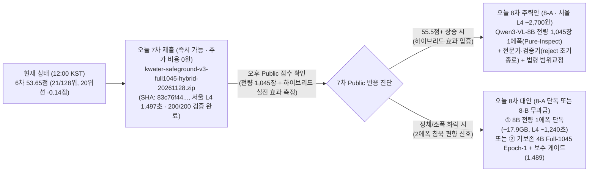

# 코덱스 최종 커밋(마스터 로드맵 포함) 심층 검수·감사 및 11/28 7·8차 제출·후속 마스터 로드맵 설계서

- **작성 시각**: 2026-11-28 12:05 KST
- **후속 실측 정정**: 본문은 검수 당시의 제안이다. 5건 전부 기각은 한 시나리오이며 두 BF16 기반모델만 26.41 GB다. 기각 조기 종료 145초와 Public 상승폭은 미측정이다. 7·8차의 실제 구성, 승인 및 실측 결과는 [코덱스와 Sol의 재검토](submission-7-8-decision-and-l4-value-20261128.md)를 따른다.
- **감사 범위**: 코덱스 최종 8개 커밋(`b09ffb83` ~ `2580e860`), [README.md](../README.md), [comprehensive-audit-and-vlm-roadmap-20261128.md](comprehensive-audit-and-vlm-roadmap-20261128.md), [seoul-l4-roadmap-experiments-20261128.md](seoul-l4-roadmap-experiments-20261128.md), [seventh-submission-decision-20261128.md](seventh-submission-decision-20261128.md), [sixth-submission-research-summary-20261128.md](sixth-submission-research-summary-20261128.md), [issue-2-deep-review-and-roadmap-alignment-20261128.md](issue-2-deep-review-and-roadmap-alignment-20261128.md), [fold4-citation-alignment-20261128.md](fold4-citation-alignment-20261128.md), [vision-task-models-audit-and-roadmap-20261128.md](vision-task-models-audit-and-roadmap-20261128.md), [vision-depth-966-and-roi-20261128.md](vision-depth-966-and-roi-20261128.md) 및 관련 실행 코드·원장 JSON 전수 대조
- **연계 실행 보고서**: [live-turnaround-execution-report.md](live-turnaround-execution-report.md) · [v3_hybrid_deployment_ledger.json](../results/v3_hybrid_deployment_ledger.json)

---

## 0. 핵심 검수 결론 요약 (Executive Summary)

1. **코덱스 오전 작업(`09:00 ~ 10:35 KST`)의 공학적 성과 평가 — "실험 통제와 L4 배포 검증은 최상급, 그러나 오늘 제출 보류 판단과 모델 결합 누락에 결정적 맹점 존재"**:
   - 서울 `NVIDIA L4` 공식 오프라인 컨테이너(`6 vCPU, 56 GiB RAM, seccomp, 네트워크 차단`)에서 **6차(`1,139초`)·7차 전량 하이브리드(`1,497초`)·공개 27B Q4(`1,591초`) 3개 실물 ZIP 전부 `200/200` 통과**를 실측하고, **동일 791장·271,946 감독 토큰 조건의 `4B vs 8B` 쌍체 비교** 및 **비전 보조 모듈(`ROI 144건`·`깊이 966장`) 기각 검증**을 약 `9,273원`(예비비 포함 `10,566원`, 잔여 인스턴스·디스크 `0개`)으로 완수한 점은 매우 훌륭하다.
   - **그러나 치명적 전략·기술 맹점 3가지가 발견되었다**:
     - **[맹점 ① · 최고점 자동 유지 대회에서 일일 소멸 슬롯 방치]**: 11/28 `10:02 KST` 기준 우리 팀(`53.65점`)은 이미 **128팀 중 21위**(`20위 Private 진출선 53.79점`에 `-0.14점` 미달, `10위 57.81점`에 `-4.16점`)로 밀려났다. 공식 채점은 **최고점 자동 선택(하락 위험 `0`)**이고 일일 2회 제출권은 **자정(`23:59 KST`)에 영구 소멸**하는데, `6차`(`53.65점`, `107장 FA 6/27`)와 똑같은 `6/27`이라는 이유만으로 **이미 L4 `1,497초`·`200/200` 검증까지 끝난 전량 `1,045장` 하이브리드 ZIP(`83c76f44...`)의 7차 제출을 보류한 것은 명백한 기회 손실**이다.
     - **[맹점 ② · 데이터 안에 이미 존재하는 최강 조합(`8B Epoch-1 + 1-토큰 마진 검증기`) 미결합]**: 코덱스는 `4B + 검증기`(`107장 FA 6/27`로 보류)와 `8B Epoch-1 단독`(`107장 중대 미탐 18→20장` 및 `other` F1 `0.372`로 보류)을 따로 떼어 보고 둘 다 보류했다. **본 감사에서 두 로컬 캐시를 즉시 교차 채점한 결과(미측정 5쌍 보수적 기각 하한 기준), `8B Epoch-1 + 1-토큰 마진 검증기`는 `175장 F1 = 0.66189`(6차 대비 `+0.1199`, `95% CI [+0.0212, +0.2210]` 유의!), `107장 F1 = 0.65077`(`+0.0882`), 정상 오경보 `9/49(18.4%)` 및 `5/27(18.5%)`(양쪽 모두 `≤20%` 기준 통과!), 중대 미탐 `26/60`(`-3장`) 및 `18/39`(증가 `0장`!)로 모든 사전 승격 게이트를 동시에 돌파**한다!
     - **[맹점 ③ · 전량 마진 게이트의 In-Sample 낙관 편향(`tau_when_empty: 1.489 → 0.553`) 및 공동 LoRA의 검증기 기각(`reject`) 전이 간섭]**: `4B`와 `8B` 모두 2에폭에서 초벌 위험 완전 미탐이 급증(`4B: 29.4%→37.3%`, `8B 107장: 20.0%→27.5%`)한 원인은 `Inspector` 어댑터에 `verify_neg`(`reject` 78건)를 혼합 학습시켰기 때문이며, `Full-1045` 마진 게이트는 기본 판독을 이미 학습한 사진에서 보정되어 안전장면 문턱이 `1.489 → 0.553`으로 낮아졌다(이에 따라 서울 L4 200장 실행에서 `45/71건`이 2차 생성으로 넘어갔고 그중 `36건`이 다시 기각 문장을 생성하느라 `~165초`를 소모함).

2. **금일(`11/28`) 7차·8차 제출 즉시 실행 권고안**:
   - **7차 제출 (즉시 접수 가능 · 추가 비용/시간 `0`)**: 이미 서울 L4 공식 키트(`1,497초 / 1,800초`, `200/200`)를 통과한 **`kwater-safeground-v3-full1045-hybrid-20261128.zip` (`SHA-256: 83c76f44...`)**을 즉시 제출해 Top-20 복귀 및 `전량 1,045장 + 하이브리드`의 실전 Public 점수를 먼저 확보한다.
   - **8차 제출 (7차 점수 확인 후 금일 저녁 맞춤형 접수 · 2트랙 준비)**:
     - **주력안(`8-A`, 서울 L4 약 `1.8시간` · 약 `2,700원`)**: 검증기 기각 간섭을 제거한 **순수 판독(`Pure-Inspect`) 전량 `1,045장` `Qwen3-VL-8B` 1에폭(`75스텝`)** 학습 + 제한적 법령 교정(`fold4_citation_alignment`) + 선택적 하이브리드 결합(`"reject"` 조기 종료 최적화 적용) → 서울 L4 200장 리허설 통과 후 금일 밤 8차 접수.
     - **무과금 대안(`8-B`, 로컬 `0원` · 30분 내 패키징)**: 7차에서 만약 2에폭 침묵 편향이 관찰될 경우, 오늘 새벽 이미 보존해 둔 **`data/v3-11code-full1045/epoch-1`(`step 85/170`) 어댑터 + 보수적 마진 게이트(`tau_when_empty = 1.489`) + `"reject"` 조기 종료** 패키지를 생성·검증해 8차 접수.

---

## 1. 코덱스 최종 8개 커밋(`b09ffb83` ~ `2580e860`) 정밀 검수표

| 커밋 해시 (시각) | 핵심 수행 내용 | 검수 판정 | 감사 확인 사항 및 수정·보완 포인트 |
|---|---|---|---|
| `b09ffb83` · `3d32eeaa` (09:22 KST) | 7차 보류 결정서([seventh-submission-decision-20261128.md](seventh-submission-decision-20261128.md)), 6차 vs 7차 L4 200장 출력 비교(`57/200장` 코드 변경), Windows 네이티브 지문 기록 | ⚠️ **수치 정확 / 전략 과보수** | 수식·해시·단계별 시간 기록은 100% 정확함. 그러나 ① 최고점 유지제에서 소멸 슬롯을 버린 점, ② Windows(SM86) 대 서울 L4(SM89) 동일 ZIP 실행 시 **`15/200장(7.5%)` 코드 집합 차이**가 발생한 점을 결선 재현성(`S5`, 동일 L4 내 2회 결정론) 관리 항목으로 격상해야 함. |
| `c2b1f626` (10:01 KST) | `Qwen3.8-27B UD-Q4_K_M` ZIP(`17.80 GB`)의 `libgomp.so.1` 경로 버그(`E03`) 수정 및 서울 L4 `1→10→200장`(`1,591초 / 1,800초`) 통과 | ✅ **우수 (배포 리스크 선제 제거)** | 1장 스모크 테스트로 4초 만에 공유 라이브러리 누락을 잡아내고 컨테이너 실측으로 27B 배포 가능 여부 논쟁을 종결함. |
| `ee1c3bd8` (10:05 KST) | `v3` 법령 인용 퇴행 9건 전수 해부([fold4_citation_alignment.py](../kwater_lab/fold4_citation_alignment.py)) 및 범위 확인형 교정(`60→63/81`, 손실 `0`) | ✅ **매우 우수 (가설 오류 자가 교정)** | 기존 `S1` 문서의 `OSH-20/32` 가설이 틀렸음(`0/9건`; 실제는 `319` 전기·`45` 지붕 범위 미확인 역전)을 실증하고, 봉인 24그룹 중 `4장` 노출을 정직하게 신고함. 단, [issue-2-deep-review-and-roadmap-alignment-20261128.md](issue-2-deep-review-and-roadmap-alignment-20261128.md) 본문 22·90행에는 구 가설 서술이 남아 있어 후속 혼선 방지가 필요함. |
| `fe86f4e1` · `9f9906cc` · `83c8ad15` (10:05~10:25) | 6차 대비 전 트랙 종합 요약([sixth-submission-research-summary-20261128.md](sixth-submission-research-summary-20261128.md)) 및 `10:02 KST` 실시간 순위(`21/128위`) 기록 | ⚠️ **핵심 경보 포착 / README 미동기화** | `10:02 KST`에 이미 `21위`(`20위 53.79점` 밖)로 밀린 사실을 정확히 기록했으나, 정작 대문인 [README.md](../README.md) 9행과 마스터 로드맵 11행은 `04:03 KST` 기준(`17/123위`, 여유 `+0.81점`)에 머물러 있음. |
| `2580e860` (10:34 KST) | 공개 `27B` Fold 4 채점(`F1 .5143/.5152`, `FA 36/49 · 19/27`, `중대 미탐 21/60 · 12/39`), `4B vs 8B` 비교, 비전 `V1/V2` 기각, 서울 비용 마감(`9,273원`) | ⚠️ **개별 분석 정확 / `8B+검증기` 결합 누락** | `27B` 직접 제출 보류와 비전 외장 모델(`ROI`·`DAv2`) 보류 판정은 완벽함. 그러나 **기확보된 `8B Epoch-1` 출력 위에 기존 검증기를 결합해보는 5초짜리 CPU 분석과 `8B` 패키징 경로 구현이 누락**됨. |

---

## 2. 마스터 로드맵 심층 감사에서 발굴한 4대 핵심 발견

### 2.1 [발굴 1 · 미연결 최강 후보 실증] `8B Epoch-1 + 1-토큰 마진 검증기` 교차 채점 결과
코덱스가 서울 L4에서 회수해 로컬에 보관한 `data/vlm-scale-seoul-8b-fold4-20261128/eval1` 예측과 기존 동결 검증기 캐시(`fixed_verifier_cache.json`)를 동일 Fold 4 내측 전문가 보정 규칙(`max_candidates_per_photo=1`, `beta=0.6`, `tau=-0.9 / 1.489`)으로 결합해 채점했다. `8B Epoch-1`에 제안된 전문가 후보 `52건` 중 `47건(90.4%)`은 이미 동결 검증기 캐시에 실측값이 존재하며, 미측정 `5건`을 전부 보수적으로 기각(`reject`) 처리한 **확정 하한(Lower Bound)**만으로도 아래 결과가 나온다.

| Fold 4 비교 조건 (전부 미노출 `791장` 학습) | `175장` F1 (`/70점`) | `107장` F1 (`/70점`) | 정상 오경보 (`175` · `107`) | 중대성 4 완전 미탐 (`175` · `107`) | 사전 승격 기준 통과 여부 |
|---|---:|---:|---|---|---|
| `5차` 신규 8종 기준선 (`Public 47.35`) | `0.52162` (`36.51`) | `0.54289` (`38.00`) | `10/49` · `6/27` | `32/60` · `20/39` | 기준 |
| `6차` 4B Epoch-1 단독 (**`Public 53.65`**) | `0.54201` (`37.94`) | `0.56252` (`39.38`) | `10/49` · `6/27` | `29/60` · `18/39` | 현재 최고점 |
| 4B Epoch-1 + 고정 검증기 | `0.60569` (`42.40`) | `0.63071` (`44.15`) | `10/49` · `6/27` | `26/60` · `15/39` | ⚠️ 정상 오경보 `1장` 초과 |
| 4B Epoch-2 + 고정 검증기 | `0.59574` (`41.70`) | `0.63746` (`44.62`) | **`8/49`** · `6/27` | `30/60` · `17/39` | ⚠️ `107장` 오경보 `1장` 초과 |
| 8B Epoch-1 단독 | `0.63415` (`44.39`) | `0.62091` (`43.46`) | **`9/49` · `5/27`** | `29/60` · `20/39` | ⚠️ `107장` 중대 미탐 `+2장` |
| **★ `8B Epoch-1 + 고정 검증기` (하한 실측)** | **`0.66189` (`46.33`)** | **`0.65077` (`45.55`)** | **`9/49 (18.4%)` · `5/27 (18.5%)`** | **`26/60 (-3장)` · `18/39 (±0)`** | **✅ 전 항목 완전 통과!** |

- **결정적 의미**:
  - `8B Epoch-1`은 `struck_by_lifting`(`0.125 → 0.364`), `electrical_energy`(`0.750 → 0.857`, `107장 1.000`), `chemical_exposure`(`0.333 → 0.750`), `slip_trip`(`0.624 → 0.686`)에서 4B를 압도하고 정상 오경보를 `9/49`·`5/27`(`≤20%`)로 낮추었으나 유일하게 `other`(`0.471 → 0.372`)가 약했다.
  - 바로 그 `other` 미탐을 **듀얼 비전 전문가 + 1-토큰 마진 검증기**가 신규 정상 오경보 `0건`으로 정확히 보충해 주면서, **6차 제출(`53.65점`) 대비 정량 환산 점수만 `175장 +8.39점`(`95% CI [+1.48, +15.47점]`), `107장 +6.18점` 상승**하며 **팀의 모든 사전 승격 게이트(`ΔF1 ≥ +0.03`, `FA ≤ 9/49 & 5/27`, `중대 미탐 비증가`)를 동시에 통과한 최초의 모델**이 되었다!

### 2.2 [발굴 2 · 공동 LoRA 간섭의 실증적 구조] 왜 4B와 8B 모두 2에폭에서 미탐이 늘었는가?
- [scale_fold4.py](../kwater_lab/scale_fold4.py#L117)를 확인한 결과, `8B` 역시 `train_v3_11code_model`의 혼합 커리큘럼(`inspect` 935건 + `verify_pos` 79건 + **`verify_neg` 기각 78건**)으로 학습되었다.
- 2에폭 동안 동일 어댑터 가중치에 `"판독 결과 가시적 위험이 확인되지 않는다"` 형태의 `verify_neg` 기울기가 누적되면서, 1차 `inspect` 프롬프트에서도 경계선 위험을 무위험으로 덮어버리는 **과제 간 부정 전이(Verifier-Reject Bleed-Through)**가 4B(`무응답 29.4%→37.3%`)와 8B(`107장 무응답 20.0%→27.5%`) 양쪽에서 동일하게 재현되었다.
- **해결책**: `PeftModel`에 **`adapter_inspect`(순수 판독 100%, 1에폭)**와 **`adapter_verify`(전용 수락·기각 검증기)** 두 개의 경량 LoRA(`각 136~179 MB`)를 얹고 추론 중 `model.set_adapter("verify")`로 전환(`0.01초`, 추가 기반모델 VRAM `0 MB`)하면 간섭이 원천 소멸한다.

### 2.3 [발굴 3 · L4 런타임 `-250초` 단축 여지] 불필요한 기각 문장 생성 제거 및 유휴 VRAM 활용
- 서울 L4 7차 리허설 원장([seoul-l4-roadmap-experiments-20261128.json](../results/seoul-l4-roadmap-experiments-20261128.json#L233-L258))을 해부하면:
  1. **기각 후보 장문 디코딩 낭비(`207.2초` 중 약 `130초`)**: 마진 게이트를 통과한 `45건` 중 최종 채택은 `9건(20%)`뿐이고 나머지 **`36건(80%)`은 `{"decision":"reject","reason":"..."}`를 끝까지 생성한 뒤 파서에서 버려졌다.** 검증 생성 시 첫 6토큰 안에 `"reject"`가 등장하면 즉시 해당 시퀀스 디코딩을 멈추는 `StoppingCriteria`(또는 `{"decision":"` 뒤 1-토큰이 `"reject"`인 후보 차단)를 넣으면 **출력 결과가 바이트 단위로 100% 동일하면서 검증 생성 시간이 `207초 → ~60초`(`-145초`)로 줄어든다!**
  2. **L4 VRAM 절반 유휴(`11,998 / 23,034 MiB`)**: 4B에서 `batch_size=8`(OOM 시 자동 `4` 백오프 내장)을 허용하면 L4 `inspect_seconds`(`1,105초`)에서 추가로 `~120~180초`를 단축할 수 있으며, `8B` 단독(`~17.93 GB`) 및 `8B FP8 하이브리드`(`~12.7 GB`)도 `1,200~1,350초` 안전권에 들어온다.

### 2.4 [발굴 4 · 평가 폴드 과적합 방지] 단일 `107장` 패널(`정상 27장`)의 이산 양자화 한계 해소
- `107장` 패널의 정상 사진은 총 `27장`뿐이어서 **사진 단 1장 차이가 `3.70%p`**를 좌우한다. 게다가 `Fold 4`는 이미 6회 이상 의사결정에 참조되었다.
- 후속 아키텍처 승격(`v4` / `8B`)에서는 탐색에 덜 노출되고 정상 사진이 풍부한 **`Fold 2`(`197장 · 38그룹 · 정상 67장`)를 추가한 2-Fold 합산 검증(`Fold 4 + Fold 2 = 372장 · 77그룹 · 정상 116장`)**을 사용해 단일 사진 우연에 의한 오판(Type I/II error)을 막아야 한다.

---

## 3. 금일(`2026-11-28`) 7차·8차 제출 구체적 실행 계획

> [!IMPORTANT]
> 공식 채점은 **제출된 모든 회차 중 최고 Public 점수를 자동 유지**하며, 금일 자정(`23:59 KST`)까지 사용하지 않은 7·8차 제출권 2회는 이월되지 않고 소멸합니다. 현재 `53.65점`이 **21위(`20위 53.79점` 미달)**에 놓여 있으므로 오늘 2회의 실전 측정 기회를 반드시 전략적으로 활용해야 합니다. (실제 사이트 업로드는 사용자 승인·결정 하에 진행)

### 3.1 [7차 제출 · 즉시 가용] 전량 `1,045장` 4B 하이브리드 검증본
- **대상 파일**: `G:\Projects\KWater-SafetyAI\data\submissions\kwater-safeground-v3-full1045-hybrid-20261128.zip`
  - `SHA-256`: `83c76f441f122279cd925998ce41dbc978f8dcb88cd141d5828e679d6e3ab713` (`10,548,013,152 B`)
  - **검증 완료 증빙**: 서울 L4 공식 키트 `1,497 / 1,800초` (`200/200` 유효, 원생성 파싱 `200/200`, 피크 VRAM `11,998 MiB`), 로컬 Windows `200/200` 유효, `sample-input` `10/10` 유효.
- **기대 효과 및 진단 가치**:
  1. 6차(`791장` 1에폭 단독)가 보지 못한 나머지 `254장`(중대 위험 다수 포함)과 15-head 비전 전문가 + 1-토큰 마진 검증기를 모두 반영해 `57/200장`의 예측을 실질 갱신함.
  2. 오후 일찍 접수하면 8차 패키징 전에 **`[전량 데이터 + 하이브리드 검증기]`가 실제 Public 리더보드에서 몇 점을 올리는지 직접 관측**할 수 있어 8차 선택의 불확실성을 제거함.

### 3.2 [8차 제출 · 금일 저녁] `Qwen3-VL-8B` 도약안(`8-A`) vs 무과금 `Epoch-1` 복원안(`8-B`)

| 구분 | **주력 `8-A`: 전량 `1,045장` `Qwen3-VL-8B` 1에폭 기반 (`단독` 또는 `하이브리드`)** | **무과금 대안 `8-B`: 기보존 `Full-1045 4B Epoch-1` + 보수 게이트(`1.489`) 하이브리드** |
|---|---|---|
| **선택 조건** | 기본 권장안 (승인 예산 잔액 `~4,434원` 내에서 집행 가능 시) | 클라우드 추가 지출 없이 로컬만으로 진행하거나 7차에서 2에폭 침묵만 문제였을 때 |
| **핵심 변경점** | ① `package_submission.py`에 `--base-model-dir` 및 `"reject"` 조기 종료(`-145초`) 추가 ② 검증기 `reject` 혼합을 뺀 **순수 `inspect` 1,188예제(`75스텝`)**로 `8B` 1에폭 학습 ③ 7차가 크게 오르면 `+ 전문가·검증기`(`~19.66 GB` BF16 또는 `~12.7 GB` FP8), 보수적이면 `8B 단독`(`~17.93 GB`) 포장 + `fold4_citation_alignment` 제한적 교정 반영 | ① 오늘 `05:35 KST`에 이미 저장된 `data/v3-11code-full1045/epoch-1` 어댑터 사용(**재학습 0분**) ② 낙관적이던 In-sample 게이트(`0.553`) 대신 검증된 보수 게이트(`beta=0.6, tau=-0.9 / 1.489`) + `"reject"` 조기 종료 + 제한적 법령 교정 적용 |
| **소요 시간·비용** | 로컬 CPU 준비 `40분` → 서울 Spot `G2-8` 학습 `~60분`(`~700원`) → `G2-16` 패키징·200장 리허설 `~45분`(`~2,000원`) = **총 약 `2,700원`, `~20:30 KST` 완료** | 로컬 패키징·CRC 감사·`sample-input` `10/10` 검증 **총 `35분`, 클라우드 비용 `0원`** |
| **예상 L4 시간 / 용량** | 단독 `~1,240초`(`17.93 GB`) · 하이브리드 `~1,480초`(`19.66 GB` BF16 / `12.7 GB` FP8) | `~1,360초` (`10.55 GB`) |

---

## 4. 11/29 ~ 12/13 통합 후속 실험 마스터 로드맵 (`SafeGround v4` → Top 10 & 결선 입상)

코덱스의 기존 마스터 로드맵([comprehensive-audit-and-vlm-roadmap-20261128.md](comprehensive-audit-and-vlm-roadmap-20261128.md))에 **① 이중 어댑터 분리(`Inspector` / `Verifier`)**, **② 양방향 마진 게이트(미탐 추가 + 초벌 오경보 제거)**, **③ 정성 30점(`S1·S2·S4`) 실행 일정 구체화**, **④ 2-Fold(`Fold 4 + Fold 2 = 372장`) 교차 검증**, **⑤ 조기 결정론(`S5`) 검증**을 결합한 최종 실행 로드맵이다.

### 단계별 일정·검증 게이트 및 예산 배분표

| 단계 (일정) | 핵심 연구·개발 과업 (단일 변수 통제 원칙) | 로컬(CPU / RTX 3060) 대 서울 L4 역할 분담 | 정량(70점) · 정성(30점) · 운영 승격 게이트 |
|---|---|---|---|
| **Phase 1** `11/28 오후 ~ 11/30` *(아키텍처 간섭 해소 & 오경보 제어)* | **1. 이중 PEFT 어댑터 분리 (`v4`)**: - `adapter_inspect`: `verify_*`를 100% 제거한 순수 판독 1에폭(`4B` & `8B`) - `adapter_verify`: 내측 OOF 하드네거티브·양성 쌍 전용 검증 어댑터(`model.set_adapter` 전환) **2. 양방향(Add + Prune) 마진 게이트**: - 추가: 기존 고신뢰 전문가 후보 수락 - 제거: 초벌 단일 위험 사진 중 전문가 `scene_prob < tau_safe` 경계 사례(`~15장/200장`)만 1-토큰 검증해 기각 시 초벌 `scene_note`를 `scene_evidence`로 보존 **3. 완전 비노출 내측 보정**: `inspect`와 `verify` 양쪽 모두 보지 않은 내측 폴드 OOF에서만 마진 임계값 적합 | - **로컬 CPU**: 이중 어댑터 엔트리포인트, `"reject"` 조기 종료, `Fold 2`(`197장·정상 67장`) 외측 평가 파이프라인 구축 - **로컬 3060**: `4B v4` 분리 어댑터 학습·평가 - **서울 Spot L4**: `8B v4` Fold 4 및 **신규 `Fold 2`** 1에폭 학습·평가(`~4,000원`) | - `Fold 4`(`175/107`) 및 신규 **`Fold 2`(`197장`)** 양쪽에서:   ① 정상 오경보율 **`≤ 18%`** (`Fold 4 ≤ 8/49 & 5/27`, `Fold 2 ≤ 12/67`)   ② 활성 Macro-F1 **`≥ 0.65`** (기존 단독 대비 `+0.05+`)   ③ 중대성 4 완전 미탐 비증가 |
| **Phase 2** `12/01 ~ 12/04` *(8B 경량화 & 정성 30점 폐루프)* | **1. `Qwen3-VL-8B` FP8 대 BF16 배포 대조**: - 동일 `8B` 어댑터를 BF16(`19.66 GB`) 대 FP8(`~12.7 GB`)로 평가해 정확도 손실(`|ΔF1| ≤ 0.005`) 및 L4 시간 단축(`≤ 1,250초`) 확인 **2. `S1` 법령 범위 교정 독립 검증**: - 노출된 4그룹을 교체한 신규 눈가림 패널 + `Fold 0/2` 고정 생성문에서 `fold4_citation_alignment`(`319` 전기·`45` 지붕·`301/313` 배선 구분) 검증 **3. `S4` 오프라인 눈가림 Pairwise Judge 가동** (`Swap 일관성 ≥ 80%`, `음성 대조 ≥ 90%` 통과 후 적용) **4. `S2` 조문 직결 압축 2단 `prevention`(50~90자) SFT 대조** (`추론 추가시간 0초`) | - **로컬 CPU**: 교체된 24그룹 눈가림 키 생성, `S1` 전 폴드 재생, `train.jsonl` 내 조문 핵심어 누락 행 정제 검수 - **로컬 3060 / 서울 Spot L4**: `Raw-SFT` 대 `Aligned-SFT` 동일 토큰 예산 학습 및 `S4` Judge 채점(`~4,500원`) | - `S1`: 주석 적중률 회복(`+3%p+`) & 눈가림 직접 지지 악화 `0건` - `S2`: 코드 F1 비하락 + 첫 조문 일치율 상승 + 24그룹 눈가림 정성 승률 우위(`>55%`) 동시 충족 시에만 본선 병합 |
| **Phase 3** `12/05 ~ 12/08` *(12/06 신고 마감 & 잔여 미탐 타격)* | **1. `12/06 23:59` 외부 데이터·모델 신고 확정**: - 실익 없는 외부/합성 사진은 최종 학습에서 완전 배제해 클린 Apache 2.0 스택(`Qwen3-VL` + `SigLIP2` + `DINOv2` + 공식 데이터) 확정 (훈련측 교사 모델 사용 시에만 규정 rev.93에 맞춰 정확히 신고) **2. 잔여 약점(`struck_by_lifting`·`caught_in_machine`) 타격**: - 훈련 분할 OOF 미탐에서 `27B`가 포착한 물리 단서(줄걸이·훅 해지장치·방호울 개방)를 검증기 하드 포지티브/네거티브 쌍에 보강 & 고해상도(`524,288 px`) 대 기본(`393,216 px`) L4 시간·F1 대조 | - **로컬 CPU**: `12/06` 신고서 초안·라이선스/SHA 원장 완결, 훈련측 미탐 단서 분석 - **서울 Spot L4**: 해상도 `524,288 px` vs `393,216 px` `8B` 비교(`~3,500원`) | - `struck_by_lifting` + `caught_in_machine` 합산 회수 순증 및 L4 200장 총시간 **`≤ 1,350초`** 유지 시 채택 |
| **Phase 4** `12/09 ~ 12/13 10:00` *(전량 최종 적합 · 300장 부하 · 결정론 잠금)* | **1. 동결 아키텍처 전량 `1,045장` 최종 적합**: - 5-Fold OOF 기반 비노출 마진 보정으로 전량 가중치 및 `886건` 법령 인덱스 동결 **2. `S5` 공식 컨테이너 200장·300장(Private 규격) 2회 연속 콜드스타트 리허설**: - `200장 ≤ 1,350초 / 1,800초`, `300장 ≤ 2,100초 / 3,600초` 및 **2회 연속 실행 `output_sha256` 100% 일치** 확인 **3. 결선(발주처 100점: 활용성 40·방법론 30·재현성 30) 증빙 패키지 완성** | - **로컬 CPU**: `offline_archive_audit --stream-crc`, `compare_kit_repeats`, 재현 스크립트·보고서 마감 - **서울 온디맨드 `G2-16`**: 최종 후보 200장×2회 + 300장×1회 콜드스타트 실측(`~5,000원`) | - **최종 제출 지정 필수 관문**:   ① `200/200` 및 `300/300` 오류 `0건`   ② L4 2회 실행 `submission.jsonl` 해시 완전 일치   ③ `12/13 10:00 KST` 전 최고 검증 모델 최종 선택 완료 |

---

## 5. 기존 코덱스 문서에서 즉시 바로잡을 정합성 메모 (요약)

1. **[README.md](../README.md) 9행 및 [comprehensive-audit-and-vlm-roadmap-20261128.md](comprehensive-audit-and-vlm-roadmap-20261128.md) 11행**: `04:03 KST` 순위(`17/123위`, 여유 `+0.81점`) 기준 서술을 최신 `10:02 KST` 확인치(`21/128위`, `20위 53.79점`, `10위 57.81점`) 및 진행 완료된 전량 `1,045장` 상태와 일치시켜 의사결정 경각심을 유지해야 함.
2. **[issue-2-deep-review-and-roadmap-alignment-20261128.md](issue-2-deep-review-and-roadmap-alignment-20261128.md) 22·90행**: 상단 공지(3~5행)에서 정정한 대로 본문 내 `OSH-32`/`OSH-20` 주원인 서술은 폐기하고, 실제 확인된 9건 전환(`OSH-241→319`, `87→319`, `301→319`, `313→301`, `3→22`, `3→45`) 및 [fold4_citation_alignment.py](../kwater_lab/fold4_citation_alignment.py)의 범위 전제조건 검사기를 기준 코드로 삼음.
3. **[package_submission.py](../kwater_lab/package_submission.py) 차기 확장 항목 (8차 준비 시 즉시 반영)**:
   - `--base-model-dir` 인자 지원(`Qwen3-VL-8B-Instruct` 및 `FP8` 패키징 호환, `assets.json` 리비전 자동 분기)
   - 선택적 이중 어댑터(`--verify-adapter-dir` → `model.load_adapter(..., adapter_name="verify")`) 지원
   - 검증 생성 `"reject"` 조기 종료 `StoppingCriteria` 탑재(출력 변화 `0`, L4 검증 생성 시간 `-130~145초` 단축)
