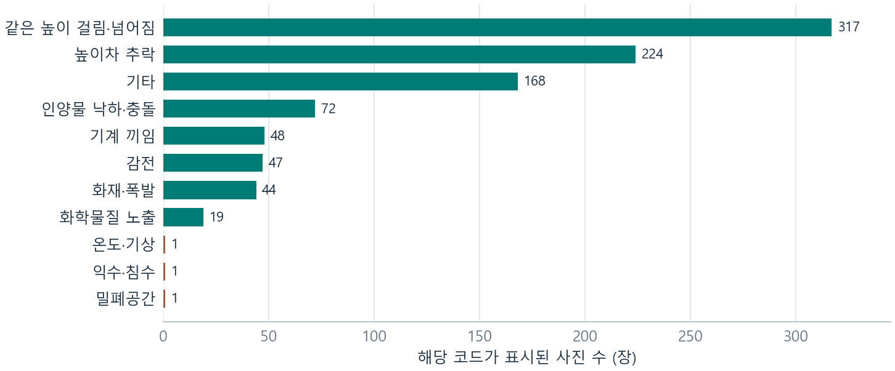
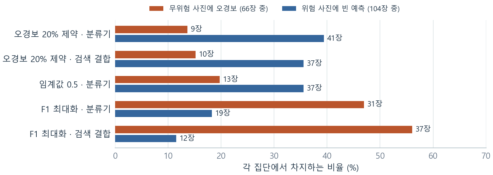
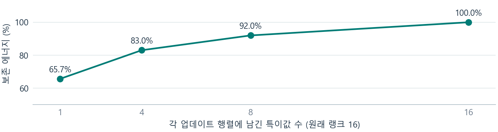
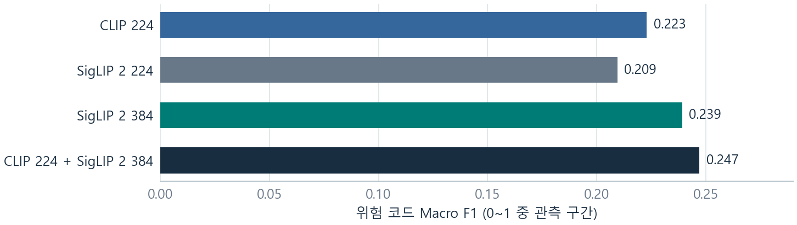
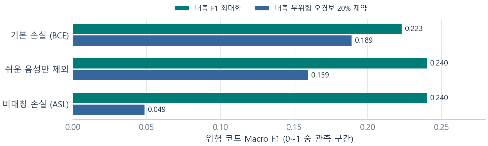
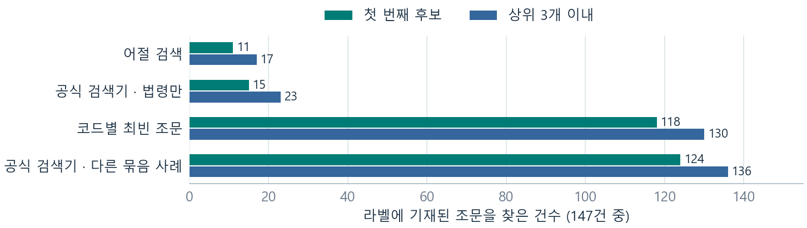

# K-water 현장 안전 AI 연구·평가 보고서

제5회 대국민 K-water AI 경진대회 · 2026년 11월 25일 연구 및 첫 제출

> **첫 Public 제출이 20:42에 접수됐다.** 제출물은 운영진이 배포한 Qwen3-VL-4B와 LoRA 원본이다. 접수 당시 공개 점수가 있는 팀은 0팀이었다. 우리 팀의 점수와 순위는 아직 미공개이며, 제출 기록 카드에 표시된 공개 예정 시각은 한국시간 **11월 26일 오후 1시**다. [접수 기록](../results/public_submission_001.json) · [공식 리더보드](https://hackathon.imaginationgroup.co.kr/kwater/#leaderboard)

### 지금까지 확인한 성능

| 무엇을 측정했나 | 결과 | 무엇을 판단할 수 있나 |
|---|---:|---|
| 공식 모델 실행 · 키트 사진 10장 | 모델 생성 10/10 유효, 공식 출력 검사 10/10 통과 | 배포 코드와 모델이 로컬 GPU에서 끝까지 작동한다. 사진별 정답 정확도는 미측정이다. |
| 위험 코드 분류 · 탐색 사진 170장 | CLIP **0.223**, SigLIP 2 384 **0.239**, 두 분류기 평균 **0.247** | CLIP 대비 두 모델의 평균은 무위험 오경보를 31→26/66장, 정답 위험을 한 건도 못 맞힌 사진을 47→42/104장으로 줄였다. |
| 위험 코드와 법령 · 인용 정답 147건 | CLIP 예측과 코드별 최빈 조문을 이어 붙이면 **64/147건(43.5%)** 동시 적중 | 사진에서 맞힌 위험 76건 중에는 조문까지 64건을 맞혔다. 오경보 117건에도 조문이 붙었다. |

### 수상 가능성을 높이기 위한 판단

공유 대화와 첨부 출전계획에서 제안한 첫 공식 제출, 사고 단위 검증, 근거·조치·출처 분리 평가를 연구의 출발점으로 삼았다. 첫 제출을 접수했고 최종 검증에서 제외할 노출 후보 182장을 기록했다. 다음 후보는 위험을 추가로 찾아내는 이득과 현장에 잘못 경보를 보내는 비용을 함께 본다. [공유 대화](https://chatgpt.com/s/t_6b06928236d88191a253a6ee7c61f91b) · [첨부 출전계획](../docs/K-water_AI_경진대회_연구개발과_출전계획.pdf)

가중치 편집은 실제로 실험했다. 추락과 걸림 분류기에 공통으로 쓰이는 방향을 줄였지만 주 비교 점수는 그대로였다. 유사 사진을 사용한 방법은 일부 묶음에서 이득을 냈다. 이 차이가 새 현장에서도 유지되는지 확인하는 것이 다음 연구다. [위험 분류 실험](../results/weight_pilot.json) · [공식 모델 실행](../results/official_baseline_10.json) · [법령 검색 실험](../results/law_examples_pilot.json)

<!-- page -->

## 대회에서 점수를 얻는 방식

모델은 현장 사진 한 장에서 보이는 위험을 최대 3개 골라, 관측 근거·예방수칙·위험성 수준을 한국어로 출력한다. 해당하는 출처가 있으면 조문 등을 연결한다. 위험이 보이지 않는 사진에는 그렇게 판단한 근거를 쓴다. 사진 번호가 맞고 필수 필드가 유효해야 해당 사진이 채점된다. [공식 출력 형식](https://hackathon.imaginationgroup.co.kr/kwater/#output-spec)

| 단계 | 대상과 배점 | 우리 팀이 준비할 증거 |
|---|---|---|
| Public | 비공개 사진 200장 · 100점 | 첫 제출과 이후 후보의 점수, 같은 조건에서 바꾼 요소 |
| Private | Public 상위 20팀의 최종 제출 · 다른 300장 · 100점 | 새 사고·다른 촬영 조건에서 오경보와 누락이 얼마나 늘어나는지 |
| 최종 정성평가 | Public과 Private 합산 상위 10팀 · 100점 | 현장 활용성 40, 방법론 30, 재현성 30에 대응하는 사례·비교 실험·복원 가능한 코드 |

두 자동 평가에서는 위험 유형별 F1 평균이 70점, 한국어 판단 근거 12점, 예방수칙 12점, 출처 6점이다. F1은 정밀도와 재현율을 함께 본다. 새 위험 하나를 더 맞혀도 다른 사진에 같은 위험을 자주 잘못 붙이면 점수가 내려간다. 위험별 평균을 쓰므로 빈도가 낮은 코드도 중요하다. 위험성 수준은 필수 필드이며 최종 정성평가에서 다룬다. [평가 기준](https://hackathon.imaginationgroup.co.kr/kwater/#evaluation)

최종 300점으로 수상팀을 가린다. 대상 300만 원, 최우수상 150만 원, 우수상 50만 원으로 각 1팀을 시상한다. 발표 예정은 12월 17일 10:00(KST)이다. [상금 및 혜택](https://hackathon.imaginationgroup.co.kr/kwater/#prizes) · [공식 일정](https://hackathon.imaginationgroup.co.kr/kwater/#schedule)

### 실제 제출한 조건

공식 ZIP의 코드·프롬프트 11개를 배포본과 대조했다. Windows RTX 3060 12GB, 배치 1에서 키트 10장 생성은 **90.0초**, 첫 기동과 모델 적재를 포함한 프로그램 실행은 **33분 55초**였다. 결과는 위험 2장·위험 미관측 8장이었고, 파싱 실패를 미관측으로 대체한 행은 0개였다. 기록된 법령 ID 3개가 모두 법령집에 존재했다. [로컬 실행 기록](../results/official_baseline_10.json)

대회 환경은 인터넷이 차단된 Linux L4 24GB이며 Public 30분, Private 60분에 패키지 설치부터 결과 저장까지 포함한다. 운영진은 배포 베이스라인의 L4 Public 실행을 약 15분으로 안내했다. 우리 제출물의 실제 서버 결과는 개별 기록 공개 후 확인한다. 제출 마감은 한국시간 **12월 13일 오전 10시**이며 결과 후보 1건을 관리해야 한다. [제출 방법](https://hackathon.imaginationgroup.co.kr/kwater/#submission) · [배포 기준선 안내](https://hackathon.imaginationgroup.co.kr/kwater/#core-data)

<!-- page -->

## 무엇을 학습했고 어디까지 검증했나

학습 사진 **1,045장** 가운데 위험 사진은 730장, 위험 미관측은 315장이다. 186장에는 위험이 둘 이상 있다. 아래 막대의 합인 **942**는 전체 사진에 달린 위험 주석 수다. 이미지와 라벨 형식 오류는 없었다.

*그림 1. 걸림은 317장, 추락은 224장이다. 밀폐공간·익수/침수·온도/기상은 각각 1장이다.* [집계](../results/train_audit_labels.json)

**희귀 위험의 첫 문제는 출력 경로다.** 제공 모델의 8종 변환기는 세 희귀 유형의 주석을 모두 잃었다. 새 11종 변환 경로는 전체 1,045장의 정답을 변환하고 되돌려 본 결과 위험 주석 **942개를 모두 보존**했다. 단일·복합·무위험을 포함한 모의 출력 14건은 공식 형식 검사를 통과했다. 희귀 유형별 양성이 한 장뿐이라 새 사진에서의 인식 성능은 별도 검증이 필요하다. [11종 변환 검사](../results/external_contract.json)

**탐색과 최종 검증을 구별했다.** 동일 화소 사진은 0쌍이었다. 모든 545,490쌍 중 64비트 dHash 거리가 4 이하인 쌍도 0개였고, 12 이하에서는 47쌍이었다. 다른 각도 사진은 같은 사고여도 해시가 멀 수 있다. 배포본에는 독립 사고 ID가 없어 사진 ID 접두사 6개를 번갈아 제외해 170장의 탐색 예측을 얻었다. 공개·탐색·키트 노출 후보 182장과 추후 같은 사고로 확인되는 사진은 최종 보류에서 제외한다. [전수 감사](../results/train_audit_summary.json) · [유사 사진 검토 통계](../results/train_audit_review_queue.json)

<!-- page -->

## 경보를 더 내면 무엇을 얻고 잃는가

같은 170장에서 고정 CLIP 특징으로 11종 선형 분류기를 학습했다. 접두사 한 묶음씩을 제외하고, 나머지 묶음 안에서 임계값을 정했다. 평가 사진에 양성이 있는 코드는 7종이었다. [검증 조건](../results/prefix_pilot_fpr20.json)

*그림 2. 주황은 위험이 없는 66장 중 경보를 낸 사진, 파랑은 위험이 있는 104장 중 코드가 하나도 출력되지 않은 사진이다. 막대 끝은 실제 사진 수다.*

| 조건 | Macro F1 | 무위험 오경보 | 위험 사진에 빈 예측 | 위험 사진에 맞힌 코드 0개 |
|---|---:|---:|---:|---:|
| 임계값 0.5 | 0.195 | 13/66 | 37/104 | 58/104 |
| 검증 F1 최대화 · 분류기 | 0.223 | 31/66 | 19/104 | 47/104 |
| 검증 F1 최대화 · 검색 결합 | 0.244 | 37/66 | 12/104 | 37/104 |
| 내측 오경보 20% 제약 · 분류기 | 0.189 | 9/66 | 41/104 | 62/104 |
| 내측 오경보 20% 제약 · 검색 결합 | 0.197 | 10/66 | 37/104 | 61/104 |

마지막 열에는 경보가 울렸어도 유형을 모두 잘못 지목한 사진이 들어간다. 학습 이웃 8장을 결합하면 F1 차이는 +0.0211이었다(묶음 재표집 95% 구간 −0.0308~+0.0457). 추락 정답은 12→19건, 추락 오탐도 31→41건으로 늘었다. 내측 오경보를 20%로 제한하면 F1 차이는 +0.0085로 작아졌다. [전체 코드별 결과](../results/weight_pilot.json) · [차이와 불확실성 도표](figures/paired-changes.png)

<!-- page -->

## 가중치를 직접 고치면 좋아지는가

Takehi 등의 연구는 Qwen3.5-0.8B에서 수학 응답이 반복되며 끝나지 않는 현상을 추적했다. 순전파 50회를 허용한 조건에서 두 층의 특정 방향을 줄여 가중치 약 0.016%를 바꾸자 MATH-500이 7.9%에서 48.1%로 올랐다. 반복이 드물던 Gemma 3 270M에서는 같은 수준의 개선을 입증하지 못했다. 우리 과제에서는 **반복 가능하고 국소적인 오류가 있는지**부터 검사하는 근거로 삼았다. [저자 원문과 대조 실험](https://rikiyat.github.io/blog/weight-space-programming/)

**분류기 편집 실험.** 걸림과 추락이 비슷한 영상 특징을 과도하게 공유한다고 가정해, 두 출력의 양의 공통 가중치 성분을 절반 제거했다. 같은 크기의 무작위 방향 편집과 무편집을 함께 실행했다. 학습 묶음별 두 열의 코사인 유사도는 약 −0.029~0.056으로 작았다. 내측 보정 조건에서 세 방식은 모두 F1 **0.223**이었다. 고정 임계값 0.5에서도 표적 편집은 0.1950에서 0.1942로 소폭 내려갔다. 현 단계에서 이 방향을 배포 모델에 적용할 근거가 약하다. [사전 고정한 조건](../docs/weight-pilot-protocol.md) · [결과](../results/weight_pilot.json)

*그림 3. 공식 어댑터의 언어 모델 36층, 252개 업데이트, 학습 파라미터 33,030,144개를 실제로 읽어 계산했다. 에너지는 특이값 제곱의 합이다.* [분석값](../results/adapter_spectrum.json)

랭크 16의 각 업데이트에서 가장 큰 8개 방향만 남기면 전체 업데이트 에너지를 **92.0% 보존**한다. 가중치 변화가 작아도 판정 경계에 있는 사진은 결과가 바뀔 수 있다. 다음 실험은 랭크 8과 16에서 같은 사진의 분류 성능과 실제 추론시간을 각각 측정한다. [LoRA 원 논문](https://arxiv.org/abs/2106.09685)

### 실제 Qwen의 배율 비교

기존 탐색 6개 묶음에서 정답을 보지 않고 사진 ID 해시로 각 3장씩, 총 18장을 골랐다. 같은 공식 Qwen 모델에서 모든 LoRA 잔차를 100%와 75%로 설정해 파싱·분류·오경보·미탐을 비교한다. 배포 어댑터가 학습 사진을 이미 보았으므로 배율에 따른 동작을 진단하는 실험이다.

SigLIP 2의 전체 사진 패치를 같은 블록으로 두 번 읽는 방법도 시험했다. 두 시드에서 상위 3개 후보의 위험 적중은 125/149건에서 120건·119건으로 줄었다. 고정 반복의 제출 적용은 보류했다. [루프 트랜스포머 실측](../docs/loop-transformer.md)

<!-- page -->

## CLIP을 SigLIP 2로 바꾸면 더 잘 보이는가

CLIP ViT-B/32는 CPU에서 사진 특징을 한 번 저장해 분류와 검색을 반복 비교하는 기준으로 썼다. 실제 제출 모델은 Qwen3-VL-4B와 LoRA다. 같은 170장·전체 화면·같은 분할과 분류기로 SigLIP 2 Base/16의 224·384픽셀 버전을 시험했다. [SigLIP 2 논문](https://arxiv.org/abs/2502.14786) · [입력·모델·실험 조건](../docs/vlm-model-selection.md)

*그림 4. 같은 임계값 선택 절차로 여섯 접두사 묶음의 예측을 합산한 위험 코드 Macro F1. 접두사와 독립 사건의 일치 여부는 미확인이다.*

| 내측 F1 보정 | 무위험 오경보 / 66 | 정답 위험을 하나도 못 맞힌 사진 / 104 | CPU 한 장 중앙값 |
|---|---:|---:|---:|
| CLIP ViT-B/32 · 224 | 31 | 47 | 40.0~42.7ms¹ |
| SigLIP 2 Base/16 · 224 | 30 | 53 | 116.4ms |
| SigLIP 2 Base/16 · 384 | 24 | 46 | 378.9ms |
| CLIP 224 + SigLIP 2 384 평균 | 26 | 42 | 결합 시간 미측정 |

384픽셀은 F1 **0.239**였지만 추락 적중이 12→6/34건으로 줄었다. 두 분류기 점수를 1:1로 평균하자 F1 **0.247**, 추락 **13/34건**이었다. CLIP 대비 +0.0241의 95% 묶음 구간은 −0.0131~+0.0627이다. 높은 위험(13점 이상) 8장의 완전 미탐은 CLIP·결합 모두 3장이었다. 이 결합을 독립 검증의 첫 후보로 정했다. ¹두 실행의 12장 중앙값. [384픽셀 실측](../results/encoder_pilot_384.json) · [결합 실험](../results/encoder_fusion.json)

생성 모델도 같은 공개 사진·한국어 질문 2개로 비교했다. 질문마다 원본 **Qwen3-VL-4B는 정답 2건 중 1건**, **Qwen3.5-4B는 0건**을 찾았다. Qwen3.5는 감전만 제안했다. 양쪽 모두 유효 JSON 2/2였다. 제출에는 공식 Qwen3-VL+LoRA를 유지하고, 8B와 Gemma 4 E4B는 L4 실행 비용까지 따로 검증한다. [생성 실측](../results/vlm_candidate_public.json) · [후보별 도입 검토](../docs/vlm-model-selection.md)

<!-- page -->

## 위험 사진을 더 많이 잡도록 학습하면 어떻게 될까

한 장의 사진은 대부분의 위험 코드에 대해 음성이다. 비대칭 손실(ASL)은 모델이 이미 쉽게 맞히는 음성의 학습 비중을 줄여 드문 양성에 집중하게 한다. 같은 170장·같은 영상 특징·같은 초기값과 학습 횟수에서 기본 손실, 쉬운 음성만 제외한 조건, 여기에 음성 비중을 더 낮춘 ASL을 비교했다. [원 논문](https://arxiv.org/abs/2009.14119) · [고정한 비교 조건](../docs/improvement-experiments.md)

*그림 5. 세 조건을 각각 학습하고, 임계값을 고르는 기준만 바꿨다. 막대는 바깥 여섯 묶음에서 합산한 점수다.*

| 학습 손실 · 내측 F1 최대화 | Macro F1 | 무위험 사진 오경보 | 위험 사진에 맞힌 코드 0개 |
|---|---:|---:|---:|
| 기본 손실 | 0.223 | 31/66 | 47/104 |
| 쉬운 음성만 제외 | 0.240 | 45/66 | 36/104 |
| 비대칭 손실 | 0.240 | 53/66 | 31/104 |

ASL은 정답 위험을 하나도 못 맞힌 사진을 16장 줄였고, 무위험 오경보는 22장 늘렸다. F1 차이 +0.0172의 묶음 재표집 구간은 −0.0422~+0.0458이었다. 같은 임계값 0.5에서는 ASL이 0.195에서 0.257로 올라 비교가 한층 유리해 보인다. 임계값 선택 방식이 방법의 평가를 크게 바꿨다. [전체 결과·코드별 수치](../results/loss_pilot.json)

오경보를 제한하자 ASL은 여섯 묶음 중 다섯 곳의 안쪽 검증에서 기존 임계값 후보(0.2~0.8) 대신 모든 경보를 보류하는 조건을 선택했다. 전체 F1은 0.049였다. 현재 설정은 제출 후보에서 제외했다. 다음 비교에서는 별도 보정 자료에서 임계값을 더 촘촘하게 정하고, 모양이 비슷한 안전 장면을 학습에 포함해 경보 분별력이 나아지는지 확인한다.

<!-- page -->

## 판단 근거와 법령 출처를 어떻게 개선할까

제공 법령 자료에서 학습 라벨의 인용 1,086건을 대조한 결과 70개의 서로 다른 조문으로 모두 연결됐다. 다음으로 이미 탐색에 사용한 170장 중 법령이 붙은 위험 147건에서 라벨과 같은 조문을 찾는지 측정했다. 검색어에서 명시적인 조문 번호를 지웠다. [조문 실재 여부 검사](../results/train_audit_references.json)

*그림 6. 검색어는 정답 근거·조치다. 최빈 조문은 정답 코드만 사용하고, 마지막 조건은 정답 코드와 다른 다섯 묶음의 사례까지 사용한다.*

법령만 쓴 공식 검색기는 첫 조문 일치가 15/147건이었다. 위험 코드별 최빈 조문은 **118건**, 다른 묶음 사례까지 사용한 공식 검색기는 **124건**이었다. 같은 위험을 쌍으로 비교하면 사례 검색만 맞힌 9건, 최빈 조문만 맞힌 3건이었다. 단순 문자 검색도 같은 질의에서 어절 대신 두 글자 단위로 나누면 상위 3개 일치가 17건에서 30건이 됐다. [검색 방식 비교](../results/law_retrieval_pilot.json) · [사례 검색 비교](../results/law_examples_pilot.json)

**실제 위험 예측부터 시작하면** CLIP 분류기와 코드별 최빈 조문이 함께 맞은 수는 **64/147건**이었다. 모델이 인용한 193건 중 117건은 위험 코드 자체가 틀렸다. 이웃 검색을 결합한 SigLIP 2는 공동 적중 75건을 얻었지만 틀린 위험에도 155건을 인용했다. 공개 예시에서는 걸림에 맞는 조문이 붙었고, 사진에서 확인되지 않은 감전에도 실재 조문이 붙었다. 조치와 인용의 의미상 지지 여부는 별도의 익명 평가 항목이다. [실제 위험 예측과 조문의 동시 적중](../results/encoder_law_pilot.json) · [운영진 공개 예시](https://hackathon.imaginationgroup.co.kr/kwater/#core-data)

<!-- page -->

## 다음 제출을 고르는 실험 순서

| 우선순위 | 다음에 비교할 조건 | 후보 채택에 필요한 증거 |
|---|---|---|
| 1 · 11종 위험 판독 | 11종 형식 검사를 통과한 경로에서 실제 사진으로 학습하고 8종 모델과 비교 | 희귀 양성이 있는 새 사건, 방호된 구조물과 실제 노출 위험에서 코드별 정답·오경보를 측정 |
| 2 · 오경보와 불균형 | 비대칭 손실 비교에서 늘어난 오경보를 바탕으로, 비슷해 보이는 안전 사례와 임계값 보정을 각각 검증 | 코드별 TP·FP·FN, 위험 미관측 사진 오경보율, 중대한 위험을 하나도 맞히지 못한 사진 수 |
| 3 · 가중치·검색 | 검증된 오류 방향만 편집, LoRA 잔차 크기·랭크 비교, 검색 결합에 근거 재확인 추가 | 무편집·같은 크기 무작위 편집·단순 빈도 기준선을 앞서는지 새 사건 묶음에서 확인 |
| 4 · 설명과 출처 | 같은 위험 코드에 대해 단순 최빈 조문과 생성 근거 기반 사례 검색 | 실재 ID 비율, 조치 지지율, 근거 없는 조문을 보류했을 때 출처 품질과 적용 범위 |
| 조건부 보류 · 부분 확대 | K-water 전체 사진 판독에서 작은 단서의 반복 누락이 별도 사건들에서 확인될 때만 같은 사례로 전체 사진과 부분 확대를 비교 | 코드별 미탐·오경보, 장면 맥락 손실, L4 전체 실행시간 |

**제안하는 개발 판정선.** 사건을 확인한 새 개발 자료에서 기존 후보 대비 Macro F1이 0.02 이상 개선되고, 무위험 오경보율 증가가 3%p 이내이며, 중대한 위험의 완전 미탐이 늘지 않는 조건을 우선한다. 이는 연구팀의 선택 기준이다. 바깥 검증셋을 보고 문턱을 다시 맞추지 않는다. CLIP 분류기에 이웃 검색을 더한 조건의 오경보 증가폭은 9.1%p였다. 서로 다른 기준이 충돌하면 사례와 분모를 공개한 뒤 선택한다.

**최종 검증.** 같은 사고·연속 사진을 우선 묶고 학습·개발·최종 보류를 분리한다. 제공 LoRA가 본 학습 사진으로 독립 점수를 만들 수 없으므로 새 어댑터는 원 기반 모델에서 학습한다. 법령 사례집도 같은 학습 분할로 제한한다. 확정 후보 1개에 최종 보류를 한 번 사용하고, L4와 같은 조건으로 실행·설치·출력·시간을 확인한 뒤 다음 대회 제출을 결정한다. [실험별 가설·대조군·중단 기준](../docs/improvement-experiments.md)

기존 CLIP 중앙 크롭과 전체 화면 여백 비교는 공개 사진 한 장의 표준 입력 전처리 실험이었다. 두 방식 모두 정답 위험을 상위 3개에 올리지 못했다. 후속 부분 확대 실험의 착수 조건은 별도로 검증한다.

<!-- page -->

## 수상 심사 준비와 재현 자료

| 심사 관점 | 현재 확보한 것 | 다음에 남길 것 |
|---|---|---|
| 현장 활용성 · 40점 | 오경보와 완전 미탐의 실측, 잘못된 위험에도 유효 조문이 붙는 사례 | 다른 각도·방호 유무가 바뀐 사례, 안전 담당자가 판단을 검토하거나 보류할 수 있는 근거 |
| 방법론 · 30점 | 같은 사진에서의 모델 쌍 비교, 무작위 편집 대조군, 개선 실패 사례 | 사건 단위 검증, 희귀 유형 표본의 출처·감사, 새로 맞힌 사례와 새로 틀린 사례 |
| 재현성 · 30점 | 원본 ZIP 해시, 코드·프롬프트 대조, 출력 검사, 실험 설정과 Git 기록 | 학습 환경·시드·가중치, 오프라인 L4 재실행, 데이터 활용·권리 명세 |

대회는 외부 공개 자료의 이용 권한을 확인하고 12월 6일까지 이름·출처를 신고하도록 안내한다. AI-Hub 건설 현장 위험·부산 침수·고소작업의 대회 참가 목적 이용은 승인됐다. 원본은 국내 G:에서 보관한다. 부산 CCTV에서 보이는 침수와 항공 사진에서 보이는 침수 면적은 구별하고, 외부 자료를 추가했을 때 같은 K-water 사진에서 오탐이 늘어나는지도 측정한다. 첫 제출은 공식 자료만 사용했다. [공식 데이터 이용 조건](https://hackathon.imaginationgroup.co.kr/kwater/#core-data) · [자료별 출처와 실험 조건](../docs/improvement-experiments.md)

FloodNet 항공사진 114장에서 침수 판정 F1은 **0.980**이었다. K-water 탐색 사진에서는 침수 오탐 48건이 생겼고 F1은 **0.195 → 0.170**으로 내려갔다. AI-Hub 건설 자료의 정상·비정상 라벨을 추가하면 F1은 **0.198**, 라벨을 섞으면 **0.201**이었다. 실제 라벨로 무위험 오경보가 13/66에서 20/66으로 늘어 제출 적용을 보류했다. [외부자료 전후 비교·시각화](external-first-experiment.md) · [세 출처를 각각 추가한 결과](../results/aihub_ablation.json)

### 자료를 다시 확인하는 방법

- 연구 소스·집계·도표·보고서는 비공개 GitHub 저장소의 커밋으로 관리한다. 참가자 전용 ZIP·사진·라벨·원문 예측은 G 프로젝트에 보관한다. 별도 다운로드한 대회 자료는 파일명·크기·SHA-256으로 관리하며 대회 종료 후 이용 조건에 따라 처리한다. [패키지 검증](../results/package_manifest.json) · [연구 저장소](https://github.com/nornen0202/KWater-SafetyAI)
- 모델의 원출력 파싱 횟수, 키트의 최종 형식 검사, 정답에 대한 품질 평가는 서로 다른 실험으로 기록했다. Windows 실행 환경과 Linux 대회 환경의 차이도 기록했다. [공식 모델 재실행](../docs/official-baseline-windows.md) · [실험 명령과 작업 기록](../README.md)
- AI 코딩 도구는 실험 코드·프롬프트·평가 및 문서 작성에 사용했다. 이번 보고서의 새 분류 실험은 기존 탐색 라벨과 로컬 특징을 사용했다. 외부 API로 참가자 사진을 보내 채점하지 않았다. 이 보고서에 첨부한 그림은 모두 집계 수치로 그렸다.
