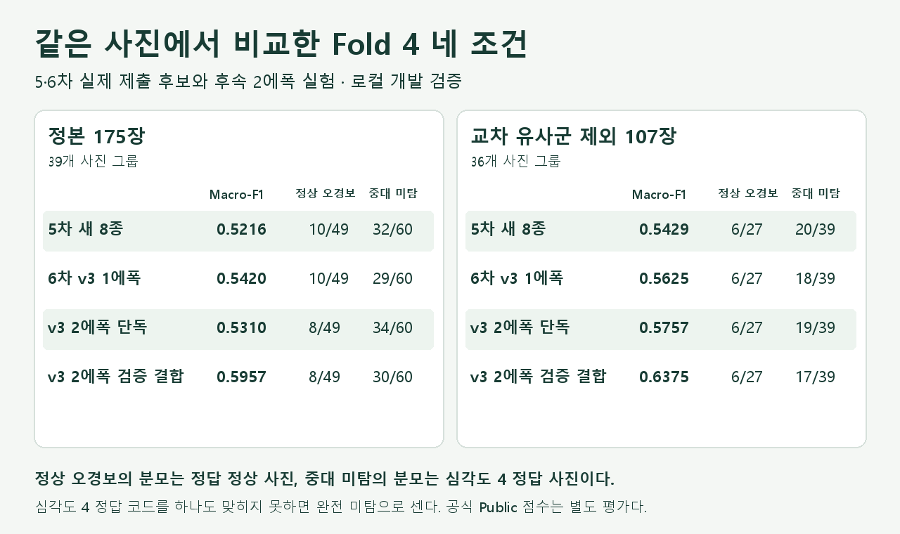
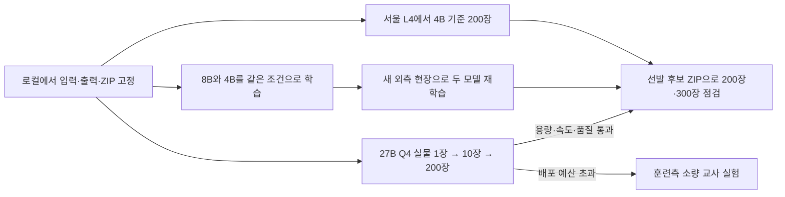

# K-water 현장 안전 AI 실험 감사와 후속 연구 마스터 로드맵

2026년 11월 28일 KST. 제미나이 카본이 제안한 대형 모델·검증기 실험을 공식 제출 영수증, 사진별 결과의 집계, 실제 학습 코드, 서울 L4 재개 실험과 대조했다. [검토한 카본 원문](https://github.com/nornen0202/KWater-SafetyAI/blob/c5a7e6b8306d36d2fa468c5b45c98b197aefd01e/reports/comprehensive-audit-and-vlm-roadmap-20261128.md)

**지금 돈을 쓸 순서는 4B 제출 ZIP의 채점 환경 재현 → 같은 조건의 4B·8B 비교 → 앞선 실험을 통과한 후보의 독립 재학습과 Private 부하 검사다.** 서울 L4에서 4B 학습 8스텝은 로컬보다 2.60배 빨랐다. 8B의 정확도 우위와 27B의 200장 처리시간은 아직 측정할 항목이다. 첫 지출은 약 5,800원, 기본 연구 예산은 누적 약 1만 4,300원, 추가 증거가 생길 때만 약 2만 8,800원까지를 제안한다. [L4 실측](fold4-v3-seoul-l4-benchmark-20261128.md) · [예산의 조건](#l4-budget) · [수상 손익분기점](#prize-roi)

**실행 현황.** 서울 L4의 동일 조건 32장 파일럿에서 4B·8B 모두 학습·저장·재로드·이미지 생성을 통과했다. 8B의 16스텝 합계는 4B의 1.59배였다. [실험 원장과 재현 절차](seoul-l4-roadmap-experiments-20261128.md)

## 제출 성적과 현재의 의사결정

11월 28일 **04:03:55 KST** 공식 조회 시 도니는 **123팀 중 17위, 53.65점**이었다. 당시 20위는 52.84점으로 여유가 **0.81점**, 10위는 55.90점으로 격차가 **2.25점**이었다. 같은 날 01:00의 15/114위와 비교하면 점수가 그대로여도 진출선이 움직였다. Public 상위 20팀이 Private 평가를 받고, 두 점수의 합산 상위 10팀이 발주처 심사에 진출한다. 최종 순위는 세 평가의 합계 300점으로 정한다. [공식 리더보드](https://hackathon.imaginationgroup.co.kr/kwater/api/leaderboard) · [평가 규정](https://hackathon.imaginationgroup.co.kr/kwater/#evaluation)

| 실제 제출 | 공개 결과 | 실험으로 설명할 수 있는 범위 |
|---|---:|---|
| 1차 공식 4B·8종 | 42.04 | 배포 어댑터의 훈련 자료 노출로 독립 검증에는 한계가 있다. |
| 2차 CLIP·SigLIP 분류와 고정 문구 | 16.12 | 분류와 설명을 함께 바꿨다. 항목별 점수는 비공개다. |
| 3·4차 1차 출력에 조문 또는 관찰문 규칙 적용 | 각 42.04 | 새로 생성한 28장에서 목표했던 첫 인용 또는 코드 변경이 각 0건이었다. |
| 5차 새로 학습한 4B·8종 | 47.35 | 6차 비교의 출발점이다. |
| 6차 4B·11종 v3, 첫 에폭 단독 | **53.65** | 5차보다 +6.30점. 학습 표적과 프롬프트 등이 함께 바뀌어 어떤 변경이 몇 점을 만들었는지는 미상이다. |

두 자동 평가의 정량 70점은 위험 코드 Macro-F1, 정성 30점은 근거 12·예방조치 12·출처 6점이다. 로컬 F1을 공개 총점에서 빼서 비공개 정성 점수를 추정할 수 없다. [1~4차 재생 원장](turnaround-handoff-20261127.md) · [5차 영수증](../results/public_submission_005.json) · [6차 영수증](../results/public_submission_006.json)

| Fold 4 조건 | 175장 F1 | 107장 F1 | 정상 오경보 175장 · 107장 | 중대성 4 완전 미탐 175장 · 107장 |
|---|---:|---:|---|---|
| 새 8종 단독 | 0.52162 | 0.54289 | 10/49 · 6/27 | 32/60 · 20/39 |
| v3 첫 에폭 단독 | 0.54201 | 0.56252 | 10/49 · 6/27 | 29/60 · 18/39 |
| v3 두 번째 에폭 단독 | 0.53103 | 0.57566 | 8/49 · 6/27 | 34/60 · 19/39 |
| 첫 에폭 + 고정 검증기 | **0.60569** | 0.63071 | 10/49 · 6/27 | **26/60 · 15/39** |
| 두 번째 에폭 + 같은 검증기 | 0.59574 | **0.63746** | 8/49 · 6/27 | 30/60 · 17/39 |

중대성 4 완전 미탐은 사진에 표시된 중대 위험 코드 중 하나도 맞히지 못한 경우다. 두 하이브리드의 실제 재판독은 끝났다. 검증기가 추가한 정답/오답은 첫 에폭 8/4건, 두 번째 에폭 8/5건이었다. 검증기가 새 오경보를 낸 정상 사진은 두 조건 모두 0장이다. 두 번째에서 첫 번째를 뺀 F1 차이의 현장 단위 95% 구간은 175장 −0.09928~+0.04657, 107장 −0.04093~+0.02268이다. 107장은 175장의 부분집합이며 최대 잔존 그룹 하나가 49장을 차지한다. 두 패널 모두 정상 오경보 20% 이하라는 사전 기준은 **9/49·5/27 이하**다. 두 하이브리드 모두 107장에서 초과해 현재 7차 판단은 보류다. [고정 검증기 쌍체 집계](../results/fold4-v3-fixed-verifier-paired-code-evaluation.json) · [7차 판단과 58장 민감도](seventh-submission-decision-20261128.md)

## 카본 리뷰에서 확인된 사실과 검증할 가설

| 쟁점 | 원자료를 대조한 결과 | 다음에 바꿀 결정 |
|---|---|---|
| 대형 모델 도입이 늦어진 이유 | 11/26에 8B·9B·27B 파일과 규격을 조사했다. 제출 I/O와 호스트 메모리 압박으로 다운로드를 중단했고, 11/27 계획에 재개 조건과 자원 배정이 빠졌다. 11/28에 같은 조건의 4B·8B 학습과 27B 실물 ZIP 검사를 정식 과제로 등록했다. 27B 비전 프로젝터 931,146,432바이트의 SHA는 확인됐고 본체는 부분 수신 상태로 확인했다. | 8B는 크기 비교, 27B는 배포 가능성 검증으로 예산을 각각 둔다. 다운로드 완료, 적응 학습, 공식 키트 통과를 별도 기록한다. [기존 감사](../docs/large-vlm-sam3-fit-audit-20261126.md) · [등록한 두 과제](issue-2-transfer-experiments-20261127.md) |
| 가산 전용 검증기와 위험 누락 | 175장 중 위험 사진 126장을 전부 정상으로 출력한 수는 8종 27장, v3 첫 에폭 37장, 둘째 47장이다. 걸림·미끄러짐 적중은 39→34→27건이다. 반면 107장 단독 F1은 첫째 0.56252→둘째 0.57566으로 올랐다. 정규 훈련의 검증용 기각은 어려운 예 44행+정상 예 34행, 총 78행이다. | 공동 LoRA의 과제 간 간섭은 가능한 원인이다. 에폭, 코드 재표집, 프롬프트도 영향을 줄 수 있다. 어댑터 분리와 초벌 오탐 제거를 별도로 대조한다. 전환 비용과 추가 초 수는 실물로 잰다. [에폭 비교](../results/fold4-v3-epoch1-paired-code-evaluation.json) · [실제 커리큘럼](../results/fold4-v3-regular-calibration-overlap.json) |
| 보정·평가 사진 노출 | Fold 4 보정 89쌍의 65장 전부가 초벌 학습에 들어갔다. 검증기 감독과는 3장·2그룹이 겹쳤으며 동일 사진×코드는 0쌍이었다. 전량판도 보정 251쌍의 170장 전부가 초벌에 노출됐다. Fold 1은 177장·41그룹, 이전 노출 표시가 26장이고 기존 Fold 4 학습에 포함됐다. 구 보류 79장 중 58장도 과거 개발 OOF에 쓰였다. | 새 외측 폴드에서 두 모델·전문가·검색 자료를 함께 다시 적합한다. 보정은 내부의 별도 현장 또는 내측 OOF에서 끝낸다. 반복 열어 본 Fold 4를 탐색 자료로 명시하고, 출처·현장별 표본 수와 불확실성을 공개한다. [보정 노출 원장](../results/fold4-v3-regular-calibration-overlap.json) · [전량판 중복 검사](../docs/hybrid-public200-timing-20261128.md) · [보류셋 이력](turnaround-handoff-20261127.md) |
| 9B·27B 호환성 | 두 모델의 `model_type`은 `qwen3_5`다. 9B는 32층 중 선형 24층·전체 어텐션 8층, 27B는 **64층 중 선형 48층·전체 어텐션 16층**이다. 기존 LoRA 정규식은 `self_attn` 외에 언어 MLP 세 투영과 비전 병합기도 포함한다. 층의 75%가 학습에서 빠진다는 결론은 성립하지 않는다. | 고정된 런타임·오프라인 휠에서 실제 클래스 로드, 매칭 모듈명·개수, 기울기, 저장·재로드와 1장 생성을 확인한다. 모델별 JSON 결정 접두사의 accept/reject 토큰도 다시 검사한다. [9B 공식 구성](https://huggingface.co/Qwen/Qwen3.5-9B/blob/main/config.json) · [27B 공식 구성](https://huggingface.co/Qwen/Qwen3.8-27B/blob/main/config.json) · [현재 LoRA 대상](../kwater_lab/vlm_11code.py) |
| 27B 속도·샌드박스 | L4의 대역폭은 300 GB/s다. GGUF 본체와 비전 프로젝터를 더한 크기를 매 생성 토큰마다 읽는다고 가정하면 이미지 인코딩과 텍스트 디코딩을 혼동한다. 공식 키트는 AF_UNIX 외 소켓 생성을 차단해 localhost TCP 서버에 접속하는 실행기가 실패한다. | 이미지 임베딩·프리필·디코딩·배치 대기를 분리하고 인프로세스나 표준 입출력 파이프 등을 실제 샌드박스에서 검사한다. 평균 260토큰, 설치·로드 등 고정비 120초를 **가정**하면 200장에 필요한 전체 처리량은 약 31토큰/초다. 12~16토큰/초와 예상 시간 초과는 측정값이 아니다. [L4 사양](https://www.nvidia.com/en-us/data-center/l4/) · [공식 키트 적용 절차](../docs/hybrid-public200-timing-20261128.md) |
| 큰 모델과 정성 점수 | L4의 FP8 지원만으로 실제 커널 가속·정확도·메모리 점유를 보장할 수 없다. 3060의 시스템 RAM 압박과 과거 드라이버 이벤트의 인과관계도 확인되지 않았다. MoE의 활성 파라미터 수로 4~6배 가속을 단정할 수 없다. 일부 가지번호 조문의 누락 복원은 Fold 4 새 8종의 9장 출력을 바꿨다. | 동일 응답의 조치와 첫 조문이 직접 연결되는지 눈가림 비교한다. 코드 F1과 정성은 별도로 평가한다. 거대 교사의 문장, 전문가 5개 앙상블, 고해상도 판독은 각각 단독 효과와 추가 비용을 확인한 뒤 결합한다. [법령 복원](fold4-fifth-submission-decision.md) · [정성 실험과 실제 샘플 위치](issue-2-transfer-experiments-20261127.md) · [MoE 모델 카드](https://huggingface.co/Qwen/Qwen3-VL-30B-A3B-Instruct) |

## 후속 실험과 진행 기준

| 시기(KST) | 로컬 PC·보조 PC | 서울 L4에서 얻을 증거 | 다음 단계로 넘어갈 조건 |
|---|---|---|---|
| 11/28~11/30 | 제미나이가 메인 GPU에서 기존 1,045장 배포 후보 학습을 계속한다. CPU에서 ZIP 구성·해시·공식 포매터·200장 입력 순서와 출력 비교기를 준비한다. | G2-16에서 준비한 4B 기준 ZIP을 공식 Linux 이미지·오프라인·6 vCPU·RAM 56 GiB로 설치해 200장 출력과 각 구간 시간을 잰다. | 200개 고유 ID·순서·공식 형식·종료 코드, 원생성 실패와 정상 대체 수, 모델/ZIP SHA를 기록한다. 전량 학습 사진으로는 배포 동작만 판정한다. |
| 11/28~12/04 | 학습·보정·평가 그룹을 고정하고 현재 4B를 대조군으로 보존한다. CPU에서 기존 초벌 오경보의 제거 후보와 삭제 시 잃는 정답을 표로 만든다. | 4B·8B 각자의 저장/재로드 예비 실험과 동일 조건 학습을 수행한다. 로컬과 병행해도 동일 모델을 중복 전량 학습할 필요는 없다. 27B는 아래의 실물 검사 시간을 별도 배정한다. | 8B 승격은 쌍체 변화와 오경보·중대 미탐으로, 27B 배포 승격은 ZIP 바이트·형식·실행시간으로 결정한다. 하나의 실패가 다른 실험을 중단시키지 않는다. |
| 12/03~12/09 | 보조 PC의 48장 원경·고정 타일·ROI 비교, CPU의 조치·조문 눈가림 검토를 병행한다. 12/06 23:59까지 사용할 외부·자체 생성 자료의 신고 조건과 실제 사용량을 확정한다. | 근거가 남은 한 가지 변경부터 새 외측 폴드에서 양쪽을 재학습한다. 제출에 느린 27B/30B는 훈련측 표본의 교사로 소량 비교한다. | 검수한 교사 답과 원 주석 SFT를 같은 예산으로 대조한다. 선호쌍 DPO는 독립 검토에서도 선호가 재현될 때 착수한다. [48장 판독](vision-roi-experiment-roadmap-20261127.md) · [외부자료 신고 규정](https://hackathon.imaginationgroup.co.kr/kwater/api/report) |
| 12/09~12/13 | 고른 정책을 동결하고 전량 적합 ID·법령 인덱스·전문가 범위를 기록한다. 발주처의 현장 활용성 40·방법론 30·재현성 30점에 대응하는 사례와 재현 절차를 정리한다. | 제출 후보 실물 ZIP으로 독립적인 콜드 스타트 200장·300장을 모두 실행하고, 가장 느린 입력·최대 VRAM·출력 일치·오류를 보존한다. | 팀당 하루 2회 슬롯을 검증된 변경에 쓰고 12/13 10:00 전에 최종 제출물 한 건을 지정한다. [공식 일정](https://hackathon.imaginationgroup.co.kr/kwater/#schedule) · [채점·제출 규정](https://hackathon.imaginationgroup.co.kr/kwater/api/report) |

### 4B 검증기 대조와 공통 평가

1. 공동 어댑터 대 분리 어댑터는 동일 사진·주석·프롬프트·시드·과제별 감독 토큰·업데이트 예산을 맞춘다. 초벌 단독, 초벌+동일 검증기, 분리 검증기로 교체한 조건을 순서대로 비교한다. 예산을 맞출 수 없는 조건은 학습량과 trainable 파라미터 수를 명시한다.
2. 위험 추가 전용 대 추가+제거는 **같은 초벌 출력**으로 비교한다. 각 조건에서 새로 맞힌 위험, 추가한 오탐, 제거한 오탐, 지워 버린 정답, 정상 오경보, 중대 미탐을 함께 센다. 임계값과 코드별 지원 수는 초벌·검증기 모두 보지 않은 내측 현장에서 동결한다. 107장에서 정상 오경보를 한 장 줄이면 6/27→5/27이다. 이 한 장을 맞히도록 외측 임계값을 고르면 독립 검증이 깨진다.
3. 위험 코드 변경에 대해 팀의 기존 승격 기준인 두 패널 F1 +0.03, 정상 오경보 9/49·5/27 이하, 중대 미탐 비증가를 미리 정한 대조군에 적용한다. 7/49·4/27과 실행시간 1,350초는 여유 목표다. 실제 F1과 현장 단위 쌍체 95% 구간, 큰 현장 제외 결과, 재현 폴드의 방향을 함께 판단한다. 정성만 바뀌는 후보는 고정 코드의 조치·인용 판정과 공식 형식을 별도로 평가한다. [사전 판단 기준](issue-1-research-roadmap-20261127.md) · [정성 패널](../results/fold4-qualitative-panel-20261127.json)

코드별로 다음 실험의 우선순위를 좁힐 수 있다. 175장에서 두 번째 에폭에 같은 검증기를 붙이면 걸림·미끄러짐 적중은 27→29건, 추락은 15→16건, 기타 위험은 10→13건으로 늘었다. 끼임 3건과 인양·낙하 2건은 그대로였다. 보조 PC의 48장 원경·고정 타일·수동 관심영역 비교는 걸림·추락·낙하/인양에 각 16장씩 배정돼 있다. 여기서 낙하 단서를 읽을 수 있는지 우선 확인하고, 끼임은 별도 표본에서 평가한다. 같은 v3 예방문을 고정한 법령 재생에서는 주석 첫 조문 적중이 61/71→54/71이었고, 바뀐 8장·2현장의 단독 눈가림 검토에서는 조문이 조치를 직접 지지한 수가 0→3건이었다. 두 지표를 따로 집계하고 다음 24개 그룹에서 재검증한다. [코드별 집계](../results/fold4-v3-fixed-verifier-paired-code-evaluation.json) · [법령 2×2 대조](../results/fold4-law-policy-replay-20261127.json) · [8장 눈가림 원장](../results/fold4-law-support-blind-review-20261128.json)

**비전 태스크 보조 모델(`SAM` · `YOLO` · `Depth Anything` · `Grounding DINO`) 편입 범위 확정.** 지금까지 수행된 7종 비전 실험 원장(`Grounding DINO Tiny` 64장 안전 명사 검출 0건, `SAM 3.1` 초기화 오류, `Ubuntu 4×4 MIL` `+2.26%p` 기준 미달, `Depth Anything V2 Small` 인양 오탐 `13→6건` 감소, `48장 ROI` 생성 `0건`)과 라이선스(`YOLOE` AGPL-3.0, `DAv2-Large`/`DAM` 비상업, `SAM 3` 3.5GB 커스텀 라이선스)를 전수 대조해 무분별한 외장 모델 추가는 배제하고, 잔여 미탐(`struck_by_lifting`, `caught_in_machine`, 원거리 `fall_height`)을 겨냥한 **3단계 게이트(`Gate V1`: 48장 ROI 144입력 Qwen 오라클 실측 및 무가중치 패치/자기그라운딩 Zoom-Crop → `Gate V2`: Apache 2.0 `DAv2/DA3-Small` 깊이-공간 전문가 결합 OOF 대조 → `Gate V3`: 조건부 `Florence-2`/`Grounding DINO Base` GPU 크롭)**만 보조 트랙으로 편입했다. [비전 태스크 모델 전수 감사 및 3단계 게이트 설계](vision-task-models-audit-and-roadmap-20261128.md)

**이슈 #2(`서베이`) 정성 30점·출제기관 DNA 5대 보완 트랙(`S1~S5`) 통합.** 정량 F1 중심이던 현행 실험에 이슈 #2의 핵심 미반영 공백을 보강했다: ① **`S1` 계층 보호형 법령 검색**(범용 `OSH-32`/`OSH-20`이 핵심 설비 주조문을 덮어써 적중이 `68/81→60/81`로 낮아진 역전 현상 수정 + `OSH-n-m` 복원 + 복수 인용 `21.8%` 분포를 반영한 적응형 1~2개 인용 CPU 대조), ② **`S2` 학습 시점 폐루프 타깃 정렬**(추론 지연 `0초`로 주석 조문 핵심 의무어와 50~90자 압축 2단 안전순서를 SFT `prevention` 타깃에 내재화, 상투적 TBM 일괄 삽입 배제), ③ **`S3` 출제기관 DNA 역설계**(공식 `train.jsonl`의 미사용 `notes.uncertainty` 25건 및 상위 공출현 쌍 기준 추출, 기각 전환 시 관찰형 `scene_evidence` 보존), ④ **`S4` 동결 24그룹 오프라인 눈가림 Pairwise Judge 가동**(좌우 교환 일관성 `≥80%` 및 음성 대조 검증 후 정량 F1과 공동 승격 게이트화), ⑤ **`S5` 2회 연속 실행 출력 해시 완전 일치(결정론) 잠금**. [이슈 #2 심층 감사 및 정성 30점 로드맵 보완안](issue-2-deep-review-and-roadmap-alignment-20261128.md)

### 4B 대 8B 학습과 27B 4비트 실물 검사

| 후보 | 확인된 자원·규모 | 비교 방법과 중단 시점 |
|---|---|---|
| Qwen3-VL-4B 대 8B | 8B BF16 네 파일 17,534,339,512 B. 공식 8B FP8 가중치 10,590,299,512 B. FP8 배포와 학습 정밀도는 별개다. | 11종 공통 후보 791장·153그룹, 데이터 순서·감독 토큰·시드·업데이트·LoRA 설정·393,216화소·생성 상한 620을 맞춘다. 32장/16업데이트로 저장·재로드 후 확장한다. 8B에 NF4 QLoRA가 필요하면 4B도 NF4, 평가 정밀도도 양쪽 동일하게 한다. 초벌끼리 175장·39그룹 / 107장·36그룹에서 같은 사진의 코드별 결과를 비교한 뒤, 같은 8B 어댑터의 BF16 대 FP8 배포 차이를 별도 측정한다. 24 GB에서 BF16 LoRA를 시도할 때는 옵티마이저·활성값을 포함한 1스텝 피크부터 잰다. 비교를 통과한 8B의 BF16 병합→FP8 재양자화에서는 어댑터 반영과 출력 변화를 각각 확인한다. [기존 비교 계약](issue-2-transfer-experiments-20261127.md) · [제작사 FP8](https://huggingface.co/Qwen/Qwen3-VL-8B-Instruct-FP8) |
| Qwen3.8-27B UD-Q4_K_M | 고정 리비전의 본체 16,564,259,744 B + 비전 프로젝터 931,146,432 B = **17,495,406,176 B**. 20,000,000,000 B까지 2,504,593,824 B가 남는다. | Linux 멀티모달 런타임·동적 라이브러리·토크나이저·포매터·진입점을 모두 동봉해 실제 ZIP 바이트와 SHA를 기록한다. 공식 샌드박스에서 공개 사진 1장→키트 10장→고정 개발 200장(192그룹) 순서로 실행한다. 200장에서는 설치·로드·이미지 처리·생성·저장 총 벽시계, 실제 토큰·배치·피크 VRAM·유효 행·출력 SHA를 기록한다. 1·10장에서 실행 경로가 깨지면 수정 후 재검사한다. 200장 설치 포함 1,800초 초과나 형식 실패 시 직접 제출을 보류하고 교사 실험의 가치만 따로 본다. [고정 변환본](https://huggingface.co/unsloth/Qwen3.8-27B-GGUF/tree/4af51b3542f775b0a8e4b310bfb3f17e01c306c9) · [시간 전용 입력](../docs/hybrid-public200-timing-20261128.md) |
| Qwen3.5-9B, Qwen3-VL-30B-A3B, InternVL3.5-8B | 9B Q4와 프로젝터는 약 6.60 GB다. 30B-A3B는 희소 전문가 모델이며, 예측에 참여하는 가중치와 배포해야 할 가중치의 크기가 다르다. | 8B·27B 측정 뒤 남은 병목에 맞는 후보 한 종류에만 투자한다. 새 모델은 이미지 입력·한국어 출력·토크나이저·실행 커널·라이선스를 확인한다. 교사 실험은 훈련측 사진만 사용하고 교사가 추가한 관찰 오류를 눈가림 검수한다. [후보별 용량 원장](../docs/large-vlm-sam3-fit-audit-20261126.md) |

791장은 두 11종 모델이 공유하는 외측 훈련 풀이다. 초벌 비교에는 등록된 공통 훈련 범위를 쓰고, 후단 임계값을 정할 때에는 그 안의 그룹을 떼어 양쪽에서 같은 만큼 제외하거나 내측 OOF 예측을 쓴다. 별개 실험인 8종 대 11종 비교는 기존 변환으로 표현 가능한 공통 790장에 맞춘다. 해상도 실험은 393,216 대 524,288 **화소 상한**으로 명시하고 실제 입력 면적과 시각 토큰을 기록한다. 크기만 비교하는 예비 선발에는 초벌 F1 +0.025를 탐색 목표로 둘 수 있다. 제출 승격에는 앞 절의 두 패널 기준과 독립 재학습을 적용한다. [훈련·평가 분할](../results/fold4-cpu-readiness-20261127.json) · [8종 훈련 범위](fold4-fifth-submission-decision.md)

대회는 ZIP 20 GB, 오프라인 L4 24 GB 1개, CPU 6개, RAM 56 GiB를 지정한다. 여기서는 ZIP 상한을 십진 200억 바이트로 관리한다. 설치부터 결과 저장까지 Public **200장 1,800초**, Private **300장 3,600초**다. 1,351~1,800초의 유효한 Public 후보는 입력 길이 편차와 재실행 여유를 점검한다. 카본이 제안한 1,350초와 1,400초 중 내부 목표는 1,350초로 통일한다. 200/300장은 규격과 부하를 재현하는 개발 입력이다. 실제 비공개 사진과 서버 점수는 주최 측에서만 확인한다. [공식 제출 규정](https://hackathon.imaginationgroup.co.kr/kwater/api/report)

## 로컬·서울 L4 병행 비용

**이미 끝난 실험.** 서울 `asia-northeast3-a` 온디맨드 `g2-standard-8`에서 Fold 4 v3의 131~138번 스텝만 재생했다. 같은 116예제·감독 토큰 13,921개에 L4 **251.27초**, RTX 3060 **652.78초**였다. 로드와 저장을 포함한 L4 학습 프로세스는 274.28초, VM 시작부터 삭제 확인까지는 14분 34초였다. 부팅 디스크까지 04:00 KST 삭제 확인. 부대비·VAT를 포함한 파일럿 추정액은 **약 $0.30**이며 결제 명세 확정액은 아직 없다. 학습률·감독 토큰을 맞춘 이 재생은 처리량을 비교한다. [클라우드 세션이 공개한 스텝별 원장](fold4-v3-seoul-l4-benchmark-20261128.md)

같은 4B 설정의 138스텝 학습은 L4 순수 업데이트 약 **1시간 19분·$1.45**, 170스텝은 **1시간 39분·$1.80**으로 추정한다(세전 연산비). 기존 138스텝 로컬 전체 훈련은 약 3시간 30분이다. 예측대로라면 같은 4B 훈련 한 번에 약 2시간의 로컬 GPU 점유를 줄이는 데 세금 포함 연산비 약 2,400원이 든다. 환경 준비 시간은 별도다. 데이터·이미지 크기와 토큰 분포가 다른 8B 학습, 27B 디코딩, ZIP 설치시간에는 별도 시계를 쓴다. 로컬은 학습을 계속하면서 CPU로 자료 선별·해시·에러 분석·문서화를 할 수 있고, 클라우드는 로컬 12 GB GPU를 비우지 않고 새 모델과 채점기 리허설을 시험할 수 있다. 8B는 16업데이트 실측으로 전체 학습시간과 최대 메모리를 다시 견적한다. [실측과 외삽 방식](fold4-v3-seoul-l4-benchmark-20261128.md)

| 서울 단가, 11/28 조회 | 온디맨드 시간당 | Spot 시간당 | 배정할 일 |
|---|---:|---:|---|
| G2-8 · L4 1개, CPU 8, RAM 32 GiB | $1.096224 | $0.366956 | 체크포인트 재개가 가능한 4B·8B 학습, 처리량 측정 |
| G2-16 · L4 1개, CPU 16, RAM 64 GiB | $1.473245 | $0.493212 | 컨테이너에 CPU 6·RAM 56 GiB를 제한한 200/300장 콜드 스타트. 채점 리허설은 온디맨드로 연속 실행 |

위 머신 요금에는 GPU·CPU·메모리가 모두 들어 있다. Spot은 해당 리전의 당시 표시가이며 가격·재고·중단 여부가 달라진다. 체크포인트를 남기는 학습에만 쓰고, 현재 일반 GPU 할당량과 Spot 가용성은 각각 확인한다. [Google 서울 선택 가능 머신 요금](https://cloud.google.com/products/compute/pricing/accelerator-optimized) · [공식 Spot 가격](https://cloud.google.com/spot-vms/pricing) · [중단 조건](https://docs.cloud.google.com/compute/docs/instances/spot)

| 앞으로의 누적 사용안 | G2-16 온디맨드 / G2-8 온디맨드 / G2-8 Spot | VM 세전 | 디스크·IP·전송 포함 세전 추정 | VAT 포함 원화 |
|---|---|---:|---:|---:|
| A. 4B 기준 및 준비된 27B ZIP 각각 200장 리허설 | 2 / 0 / 0시간 | $2.95 | $3.51 | **약 5,800원** |
| B. A + 4B·8B 동일 조건 예비 학습 및 쌍체 비교 착수 | 2 / 2 / 6시간 | $7.34 | $8.66 | **약 14,300원** |
| C. B + 우세 후보 독립 재학습·Private 리허설 | 4 / 2 / 18시간 | $14.69 | $17.45 | **약 28,800원** |

표는 **추가 연구를 시작할 때부터의 누적 예산**이다. 이미 끝난 파일럿 약 $0.30은 별도다. 환율은 계획값 **1달러=1,500원**, 한국 VAT 10%로 계산했다. 서울 zonal `pd-balanced` 150 GiB를 VM 가동 중에만 보유한다고 가정해 시간당 `150×$0.13/730`, 외부 IPv4는 모든 시간에 보수적으로 $0.005를 잡았다. 외부 전송·소량 로그 예비비는 A/B/C에 각각 $0.50/$1/$2를 넣었다. 실제 인터넷 송신량·환율·보존시간에 따라 달라지며, 대형 ZIP을 반복 반출하거나 디스크를 계속 보관하면 예비비를 넘을 수 있다. 150 GiB 디스크만 24시간 더 유지해도 약 $0.64가 추가된다. 활성 크레딧 0개를 확인한 유료 계정이므로 $300 할인은 적용하지 않았다. [디스크 요금](https://cloud.google.com/compute/disks-image-pricing) · [IP·네트워크 요금](https://cloud.google.com/vpc/network-pricing) · [한국 VAT](https://docs.cloud.google.com/billing/docs/resources/vat-overview) · [체험 크레딧 조건](https://docs.cloud.google.com/free/docs/free-cloud-features)

**예산 통제.** Spot을 전부 온디맨드로 바꾸면 같은 10시간은 약 **21,500원**, 24시간은 약 **50,500원**이다. 각 단계의 원화 상한을 유지할 때는 실행 시간을 줄인다. Spot 회수에 대비해 가중치·옵티마이저 상태·스텝·시드를 같은 리전의 팀 전용 저장소나 유지할 디스크에 저장한다. 재시작 대기 중의 저장비도 원장에 포함한다. VM을 켜기 전에 로컬에서 패키지·입력·검산기를 준비하고, 서울에서 공개 가중치를 받아 해시를 맞춘 뒤 로그·소형 어댑터 위주로 회수한다. 학습·평가 중 점유시간 외에도 부팅·전송·재개가 과금되므로 단계별 최대 실행시간을 두고 실행 후 VM·디스크 잔존을 확인한다. A의 G2-16은 4B와 27B에 약 1시간씩 나누어 ZIP이 준비된 날에만 켠다. 27B 패키징이 늦으면 해당 시간을 이월한다. 8B 성적과 독립적으로 27B의 실물 200장을 확인한다. 대회 자료는 팀 전용 비공개 환경에서 처리하고 종료 후 삭제한다. 별도 이용조건이 있는 AI-Hub 원본은 국내 로컬에 둔다. [VM 실행시간 제한](https://docs.cloud.google.com/compute/docs/instances/limit-vm-runtime) · [대회 데이터 이용 FAQ](https://hackathon.imaginationgroup.co.kr/kwater/api/report)

## 상금과 클라우드 지출의 손익분기점

공식 상금은 대상 **300만 원**, 최우수상 **150만 원**, 우수상 **50만 원**으로 각각 한 팀이다. 총액은 500만 원이다. 20위와 10위는 다음 평가에 진출하는 순위다. 당시 Public 3위도 62.18점으로 53.65점과 8.53점 차이가 있었지만, Private과 발주처 점수가 미공개라 이 차이만으로 최종 3위 확률을 산출할 수 없다. [K-water 공식 시상 공고](https://m.kwater.or.kr/kiwe/news/notiView.do?brdId=KW17&s_mid=2034&seq=141216) · [공식 평가 단계](https://hackathon.imaginationgroup.co.kr/kwater/#evaluation)

팀 전체의 세전 상금 기준으로, 클라우드 사용의 기대 추가 이익은 **300만 원 × Δ대상확률 + 150만 원 × Δ최우수확률 + 50만 원 × Δ우수확률 − 추가 지출**이다. Δ는 로컬만 사용했을 때와 비교한 각 등급의 최종 확률 변화다. 한 등급에서 다른 등급으로 이동하면 두 항을 모두 바꾼다. 아래는 비수상에서 해당 등급으로만 확률이 옮겨 간다고 가정한 손익분기점이다.

| 계획 지출(반올림) | 대상만 늘 때 | 최우수상만 늘 때 | 우수상만 늘 때 |
|---:|---:|---:|---:|
| 6,000원 | +0.20%p | +0.40%p | +1.20%p |
| 15,000원 | +0.50%p | +1.00%p | +3.00%p |
| 30,000원 | +1.00%p | +2.00%p | +6.00%p |

예를 들어 우수상 확률 +1%p의 기대 상금은 5,000원, 최우수상 확률 +1%p는 15,000원이다. 이미 우수상을 받을 확률 1%p가 최우수상으로 이동하면 증가분은 두 상금의 차액 기준 **1만 원**이다. 개인이 비용 전액을 부담하고 상금의 절반을 받으면 표의 필요 확률 증가는 두 배다. 실제 상금 배분·공제를 반영하려면 각 상금을 본인의 예상 실수령액으로 바꾼다.

**권고 예산은 우선 A, 기본 상한은 B 수준(약 1만 5천 원)이다.** A는 시간 초과·무효 ZIP으로 Public과 Private 기회를 잃을 위험을 값싸게 검증한다. B는 현재 모델의 잘못된 정상 판정과 8B의 순효과를 같은 사진에서 판별한다. C는 B에서 8B 또는 개선 4B가 사전 기준을 충족해 새 외측 현장 재학습으로 재현 여부를 결정할 수 있거나, 이미 선발한 후보의 Private 300장 검사가 마지막 불확실성일 때 집행할 가치가 있다. 용량·실행 오류가 로컬 준비로 해결 가능하거나 새 모델이 대조군을 못 넘으면 그 단계에서 유료 시간을 멈춘다. 다음날 순위가 한두 칸 움직였다는 이유만으로 예산을 올리지 않는다.
