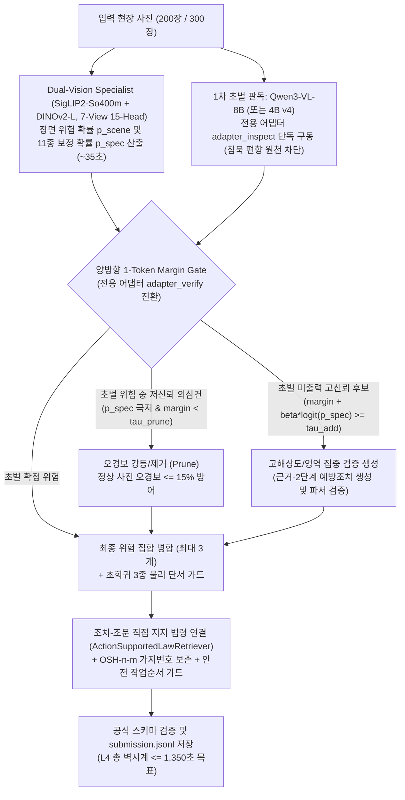

# 대형 VLM 대화 검증·전체 실험 심층 감사 및 Top-10 돌파 후속 연구 로드맵

- **작성 시각**: 2026-11-28 KST
- **검토 범위**: 사용자–GPT(Codex) 대화 원문, 1~6차 공식 제출 영수증 및 로컬 평가 원장(`results/*.json`), 실행·패키징·샌드박스 코드(`kwater_lab/*.py`, `data/local-kit/kit/*`), 대형 모델 로컬 캐시(`data/phase2-runs/p38-20261126-49bb82ce/large-models/`), 최신 오픈 VLM 아키텍처 및 NVIDIA L4 하드웨어 명세
- **현재 기준점**: 6차 제출(`SafeGround v3` 1에폭 `Qwen3-VL-4B` 단독) **Public `53.65점`** (11/28 01:00 KST 기준 `15 / 114팀`, 10위 커트라인 `55.75점` 대비 **`-2.10점`**, 20위 커트라인 `52.34점` 대비 **`+1.31점`**, 1위 `68.54점`)

---

## 0. 핵심 결론 요약 (Executive Summary)

1. **사용자 지적의 정당성과 GPT 답변의 절반짜리 정확성**:
   - *"20GB 이내에서 더 최신·대형 VLM을 학습·검증했어야 하는데 왜 빠졌는가"*라는 사용자의 지적은 **정확히 핵심을 짚었다**.
   - GPT(Codex)는 11월 26일 다운로드 중단 기록(`pause-1800.json`, `queue-pressure.json`), 11월 27일 로드맵의 조건부 후순위 배치(`reports/issue-1-research-roadmap-20261127.md` 34행), 모델별 원시 가중치 바이트 크기를 사실대로 정리하고 계획 누락을 시인했다.
   - **그러나 GPT의 기술 처방에는 대회 채점 컨테이너와 하드웨어를 고려하지 않은 6가지 중대 맹점이 있다.** 특히 ① **`Qwen3.8-27B` UD-Q4_K_M(`17.50 GB`)은 NVIDIA L4의 메모리 대역폭(`300 GB/s`) 한계로 토큰당 최소 `~58ms`(`~17 tok/s` 상한)가 걸려 200장 생성 시 1,800초 시간 초과(`E04`) 위험이 극히 높고**, ② 채점 샌드박스(`sandbox_exec.py`)가 **`AF_UNIX` 외 모든 소켓(`127.0.0.1` 루프백 포함)을 `seccomp`로 차단**해 기존 `llama-server` 방식이 즉시 실패하며, ③ `Qwen3.5-9B`/`Qwen3.8-27B`는 `qwen3_vl`이 아닌 **하이브리드 Gated DeltaNet(`model_type="qwen3_5"`, 32층 중 24층 선형 어텐션)** 구조여서 기본 컨테이너의 `transformers`(`4.52.4`/`4.57.1`) 및 현행 `LORA_TARGET_REGEX`와 호환되지 않는다는 사실을 놓쳤다.

2. **기존 실험 원장에서 새로 발굴한 결정적 병목 (점수 직결 요인)**:
   - **발견 ① · 단일 어댑터 다중과제 간섭으로 인한 '과잉 침묵 편향(Empty-Prediction Drift)'**: Fold 4 주패널(175장, 위험 사진 126장) 원장을 정밀 대조한 결과, 위험 사진을 통째로 `no_visible_hazard`로 놓친 비율이 5차 8종 **`21.4%`(`27/126`)** → 6차 `v3` 1에폭 **`29.4%`(`37/126`)** → `v3` 2에폭 단독 **`37.3%`(`47/126`)**로 급증했고, 주력 코드인 `slip_trip` 적중(TP)이 `39 → 34 → 27건`, `caught_in_machine` F1이 `0.667 → 0.625 → 0.500`으로 하락했다(`results/fold4-paired-code-evaluation.json` 32, 155, 170, 182행). 초벌 판독(`inspect`)과 후보 기각(`verify reject`) 예제를 **하나의 LoRA 어댑터에 혼합 학습**시키면서 2에폭째에 기각 성향이 초벌 판독으로 전이된 것이 1에폭(`0.5420`)보다 2에폭 단독(`0.5310`)이 낮아진 진짜 원인이다.
   - **발견 ② · 가산 전용(Add-only) 검증기 불변식의 한계**: 현행 파이프라인(`kwater_lab/hybrid_pipeline.py` 78행)은 초벌이 출력한 위험 코드를 절대 제거하지 못하도록 고정돼 있어, 교차배제 107장 패널의 정상 사진 오경보 `6/27(22.2%)`을 검증기가 단 1장도 줄이지 못한다. 모델을 키우기 전에도 **초벌 예측 코드에 동일한 1-토큰 마진 + 전문가 확률 게이트를 역방향 적용(양방향 Add + Prune 검증)**하면 추가 시간 `~25초` 이내로 정상 오경보를 `≤20%` 안으로 억제할 수 있다.
   - **발견 ③ · 평가·보정 오염 위험**: 현행 마진 보정 사진(`Fold 4` 65장 전량, `Full-1045` 170장 전량)이 이미 1차 판독 감독 학습에 사용된 In-Sample 사진이며, 구 보류셋 79장 중 58장도 과거 920장 OOF에 노출됐고, `Fold 4` 역시 반복적인 정책 비교에 쓰여 선택 편향 위험이 누적되고 있다.

3. **최적 후속 전략 (3-Track 병행 로드맵)**:
   - **단기 아키텍처 교정 (`v4`, 4B 기반 즉시 수익)**: ① **`Inspector` LoRA와 `Verifier` LoRA 물리적 분리**(단일 기반 모델 위 PEFT 동적 어댑터 전환, 추가 VRAM `~0.14 GB`), ② **양방향(Add + Prune) 1-토큰 마진 게이트**, ③ **1차·검증기 양쪽 모두 미노출인 순수 내측 보정 분할(3-Way Split)**, ④ **`OSH-n-m` 가지번호 조문 복원**.
   - **주력 대형 모델 스케일업 (1순위 · `Qwen3-VL-8B-Instruct` + L4 네이티브 `FP8`)**: 동일 `qwen3_vl` 아키텍처로 코드·프롬프트 100% 호환. L4(Ada SM89)가 하드웨어 가속하는 **8B FP8(`10.59 GB`)** 또는 **8B BF16+LoRA(`~19.4 GB`)** 경로로 학습·패키징하여 초벌 시각 판별력(`struck_by_lifting`, `fall_height`, `other`, 정상 장면 구분)을 근본적으로 끌어올린다. 나아가 **`8B FP8(10.6GB) + 5-Fold 다중 LoRA 어댑터 앙상블(~0.9GB) + Specialist(1.6GB) ≈ 13.2GB`** 구성이 20GB 한도 내에서 여유 있게 성립한다.
   - **초대형/신세대 모델 이원 전략 (`Qwen3-VL-30B-A3B` MoE 및 `Qwen3.8-27B`)**: `Qwen3.8-27B`는 무작정 학습부터 시작하지 않고 ① **`seccomp` 무소켓 컨테이너 200장 처리시간 게이트(≤1,350초)**를 먼저 검증하되, 속도·커널 한계 확인 시 즉시 **오프라인 고해상도 교사(Teacher) 모델로 전환**해 1,045장 정성 타깃(`evidence`/`prevention`) 고도화 및 반사실적 DPO 선호쌍 생성에 활용하고, 직접 배포용 초대형 후보는 토큰당 활성 파라미터가 3.3B뿐인 **`Qwen3-VL-30B-A3B-Instruct`(MoE 4-bit)**를 우선 검토한다.

---

## Part I. 사용자–GPT 대화 내용 정밀 검증 및 기술 리뷰

### 1.1 로컬 원장 대조 결과: GPT 설명 중 사실로 확인된 항목

실제 저장소의 JSON 원장, 커밋 로그, `data/phase2-runs/p38-20261126-49bb82ce/large-models/` 파일 바이트를 전수 대조한 결과 아래 사실관계는 정확하다.

| 대화 속 GPT 진술 | 로컬 실물 증거 및 수치 확인 결과 | 판정 |
|---|---|---|
| 11/26에 `8B`, `3.5-9B`, `3.8-27B`를 검토하고 다운로드를 시작했으나 18시경 제출 작업 I/O 양보를 위해 중단함 | `pause-1800.json`(`2026-11-26T18:00:48+09:00`, PID `57660` 중지) 및 `queue-pressure.json`(PID `46200`, `57124`, `9084` I/O 양보 중지) 실재 확인 | **사실 일치** |
| 로컬에 정식 조각과 `.partial` 파일만 섞여 있고 K-water 학습·동일 조건 채점 결과는 없음 | `8b/`: 샤드2 완본(`4.92 GB`) + 샤드1 `.partial`(`4.90 GB`), 샤드3·4 없음 · `9b/`: 샤드1·2 `.partial`(합 `2.06 GB`) · `9b-gguf/`: `.partial` 합 `1.45 GB` · `27b-gguf/`: `.partial` 합 `1.44 GB`. 학습 스텝 `0회` 확인 (단, 무적응 `Qwen3.5-4B` GGUF 공개 1장 기동 시험 1건은 `results/vlm_candidate_public.json`에 존재) | **사실 일치** |
| 11/27 로드맵에서 7B/8B를 후순위로 내린 뒤 재개 시점·순서를 잡지 못함 | `reports/issue-1-research-roadmap-20261127.md` 34행에 ‘후순위’로만 기재되고 이후 `issue-2`·`seventh-submission` 문서에서 일정표 미반영 확인 | **사실 일치** |
| 후보 가중치 크기 (`8B` BF16 `17.53GB` / FP8 `10.59GB`, `3.5-9B` `19.31GB` / Q4+mmproj `6.60GB`, `3.8-27B` `55.56GB` / Q4+mmproj `17.50GB`) | `stored-package-budgets.json` 및 각 `source.json`의 Hugging Face LFS 정확 바이트(`17,534,339,512`, `10,590,299,512`, `19,306,310,880`, `6,602,227,488`, `17,495,406,176`)와 일치 | **사실 일치** |

---

### 1.2 GPT 답변에서 누락되었거나 부정확한 6대 기술·운영 맹점

GPT 답변은 **가중치 파일 크기(20GB 한도)** 위주로 후보를 평가했으나, 실제 대회 승패를 가르는 **컨테이너 보안 샌드박스(`seccomp`), L4 메모리 대역폭(`300 GB/s`), 아키텍처 호환성, 학습-추론 정밀도 괴리**에서 다음 6가지 핵심 제약을 놓쳤다.

#### 맹점 1. `Qwen3.8-27B-GGUF`의 L4 메모리 대역폭 한계(`E04` 시간 초과) 및 `seccomp` 루프백 차단(`E03`/`E07`)
- **샌드박스 소켓 차단**: 공식 점검 키트의 `data/local-kit/kit/sandbox_exec.py` 49행은 `seccomp` 규칙 `rule(act_errno(EACCES), "socket", ArgCmp(0, SCMP_CMP_NE, AF_UNIX, 0))`를 적용해 **`127.0.0.1` 루프백 TCP 소켓을 커널 수준에서 원천 차단**한다(`data/local-kit/README.txt` 222행 명시). 과거 이 저장소의 GGUF 실험(`kwater_lab/visual_probe.py`)처럼 로컬 `llama-server`를 띄워 HTTP로 호출하면 채점 서버에서 **100% 실행 실패**하며, `kwater_lab/offline_archive_audit.py` 127행도 `socket.*` 및 `subprocess.*` 호출을 정적 감사 대상으로 잡는다. 따라서 GGUF를 쓰려면 `AF_UNIX` 도메인 소켓 또는 단일 프로세스 Ctypes/Python 바인딩(`libmtmd` 포함 Linux x86-64 wheel)을 직접 패키징해야 한다.
- **L4 대역폭 산술**: 대회 GPU인 **NVIDIA L4(24GB)의 메모리 대역폭은 `300 GB/s`**다(로컬 RTX 3060의 `360 GB/s`보다도 낮다). `17.50 GB`짜리 27B Dense 모델을 `batch_size=1`(24GB VRAM 중 가중치·비전 프로젝터·KV 캐시로 ~20.5GB 점유)로 디코딩할 때, 매 출력 토큰마다 가중치를 한 번 읽는 물리적 하한 시간만 $\frac{17.5\text{ GB}}{300\text{ GB/s}} \approx 58.3\text{ ms/tok}$(실효 `12~16 tok/s`)이다.
  - 200장 × 평균 생성 `260 토큰` = `52,000 토큰` → 순수 디코딩만 **`3,250 ~ 4,300초`** 소요(비전 인코딩·패키지 설치·모델 로드 제외!).
  - 내장 MTP(Multi-Token Prediction) 투기적 디코딩이나 극단적 출력 압축이 완벽히 작동하지 않는 한 **Public 상한 `1,800초`를 넘겨 `E04`(시간 초과 0점)로 실격될 확률이 매우 높다.**
- **GGUF 학습·적응 단절**: `llama.cpp` 업스트림은 `qwen35` 하이브리드 연산자(`GATED_DELTA_NET`, `SSM_CONV`)의 역전파 및 멀티모달 LoRA 런타임 결합에 제약이 있어, 27B에 도메인 LoRA를 반영하려면 **외부 대용량 GPU(A100 80GB 등)에서 QLoRA 학습 → BF16 병합(`55.6 GB`) → GGUF 재양자화**라는 다단계 파이프라인이 필수다.

#### 맹점 2. `Qwen3.5-9B` · `Qwen3.8-27B`의 아키텍처 이질성(`model_type: "qwen3_5"`, Gated DeltaNet)
- 로컬에 수신된 `data/phase2-runs/p38-20261126-49bb82ce/large-models/9b/config.json` 및 `gguf-headers.json`을 확인하면, `Qwen3.5-9B`와 `Qwen3.8-27B`는 기존 `Qwen3-VL`(`model_type: "qwen3_vl"`, 전 층 표준 Attention + `deepstack_visual_indexes: [8, 16, 24]`)과 전혀 다른 **`Qwen3_5ForConditionalGeneration` (`model_type: "qwen3_5"`)** 아키텍처다.
  - 32개 레이어 중 **75%(24개 층)가 `linear_attention`(Gated DeltaNet / SSM)**이고 8개 층만 `full_attention`이며, `deepstack_visual_indexes`는 비어(`[]`) 있고 어휘 크기는 `248,320`이다.
- **실제 충돌 지점 3가지**:
  1. 대회 기본 컨테이너(`ghcr.io/jiwoochris/kwater-runtime`)에 내장된 `transformers==4.52.4`는 물론, 현재 배포 wheelhouse 및 로컬 가상환경의 `transformers==4.57.1`에서도 실측 결과 `hasattr(transformers, "Qwen3_5ForConditionalGeneration") == False`임이 확인됐다(`Qwen3VLForConditionalGeneration`만 `True`). 즉 최신 `transformers` + 선형 어텐션 CUDA 커널(`flash-linear-attention` / `causal-conv1d` 등 Python 3.12 + `torch==2.11.0+cu128` 호환 manylinux wheel)을 새로 번들링하지 않으면 로드 자체가 불가능하거나 순수 PyTorch 폴백으로 심각한 속도 저하가 발생한다.
  2. 현행 `kwater_lab/vlm_11code.py` 73~77행의 `LORA_TARGET_REGEX`는 `self_attn.(q|k|v|o)_proj`와 `deepstack_merger_list`만 타깃팅하므로, `Qwen3.5`/`3.8`에 그대로 실행하면 **전체 신경망의 3/4을 차지하는 `linear_attention` 층이 학습에서 통째로 빠진다.**
  3. 1-토큰 마진 검증기(`package_submission.py` 137~141행)는 토크나이저 어휘(`151,936` → `248,320`) 변경 시 `"accept"`/`"reject"` 단일 토큰 분해 여부와 채팅 템플릿(`<think>` 사고 모드 비활성화 필수: `docs/vlm-model-selection.md` 63, 76행)을 별도로 재검증해야 한다.

#### 맹점 3. 로컬(`RTX 3060` Ampere SM86, 시스템 RAM `15.8 GB`)과 대회 서버(`L4` Ada SM89, RAM `56 GiB`)의 하드웨어 비대칭 간과
- **시스템 RAM 병목**: 현재 Windows 주 작업 PC는 GPU VRAM이 `12 GB`일 뿐 아니라 **호스트 물리 RAM이 `15.8 GB`**다. `8B` BF16 원본(`17.53 GB`)을 읽어들여 NF4 양자화나 병합을 수행할 때 `low_cpu_mem_usage=True` 및 샤드 단위 스트리밍 없이는 호스트 RAM 스필오버와 드라이버 리셋(`NVIDIA Event 153`, 페이지파일 오류 `1455`)이 재발한다.
- **FP8 하드웨어 비대칭**: `Qwen3-VL-8B-Instruct-FP8`(`10.59 GB`)은 대회 서버인 **NVIDIA L4(Ada Lovelace, Compute Capability 8.9)에서는 네이티브 FP8 Tensor Core 가속**을 받지만, 로컬 **RTX 3060(Ampere, Compute Capability 8.6)에는 네이티브 FP8 하드웨어 연산기가 없다.** 따라서 *"로컬에서는 8B NF4 QLoRA로 학습 → BF16 병합 → FP8 양자화(또는 공식 FP8 베이스 호환 검증) → L4 컨테이너에서 속도·정확도 실측"*으로 학습 포맷과 배포 포맷의 역할을 명확히 분리해야 한다.
- **20GB ZIP 실물 예산 정밀 계산**: 단독 모델이 아니라 현재 최고 성능 구조인 **하이브리드(`VLM + Dual-Vision Specialist`)** 기준으로 계산해야 한다.
  - 듀얼 비전 전문가(`SigLIP2-So400m` 비전 타워 FP16 `0.86 GB` + `DINOv2-L` FP16 `0.61 GB` + 15-head 앙상블 `0.15 GB`) + `wheelhouse` + 법령/코드 ≈ **`1.72 GB`**.
  - `8B BF16 (17.53 GB) + LoRA (0.18 GB) + Specialist (1.72 GB)` = **`19.43 GB`** (십진 `20.00 GB` 한도까지 여유 `0.57 GB`로 아슬아슬하게 통과 가능하나 L4 24GB VRAM 여유가 좁음).
  - **`8B FP8 (10.59 GB) + Specialist (1.72 GB)` = `12.31 GB`** (`7.69 GB` 여유! 다중 폴드 LoRA 어댑터 5개 `~0.9 GB`를 전부 넣어도 `13.2 GB`로 넉넉함).

#### 맹점 4. 핵심 우량 아키텍처(`Qwen3-VL-30B-A3B` MoE 등) 및 '오프라인 교사 증류(Teacher Distillation)' 전략 누락
- 20GB·1,800초·L4(`300 GB/s`) 삼중 제약에서 대형 모델의 시각 지능과 소형 모델의 추론 속도를 동시에 얻는 가장 강력한 후보는 Dense 27B가 아니라 **`Qwen3-VL-30B-A3B-Instruct` (총 30B, 토큰당 활성 `3.3B` MoE)**다. 4-bit 양자화 시 가중치 약 `16~17 GB`로 20GB 안에 들어오면서, 매 토큰 읽어야 하는 활성 가중치가 `~2 GB` 수준이라 **27B Dense 대비 디코딩 속도가 4~6배 빠르고 동일 `qwen3_vl` 시각 인코더/프롬프트 체계를 공유**한다.
- 또한 설령 `27B`/`30B` 모델을 제출 ZIP에 직접 넣지 않더라도, **로컬/클라우드에서 초대형 VLM을 '오프라인 교사(Teacher)'로 구동**하여 1,045장 훈련 사진의 정교한 물리적 인과 근거(`evidence`), 2단계 안전 예방조치(`prevention`), 하드네거티브 DPO 선호쌍을 생성해 `4B`/`8B` 학생 모델에 증류하면 **제출 런타임 비용 0초**로 대형 모델의 이득을 흡수할 수 있다(규정 rev. 91/93상 학습 단계 생성 데이터는 사용 모델·방법 명시 시 허용).

#### 맹점 5. 단방향 검증기 한계를 모델 크기 문제로만 귀속 (양방향 1-토큰 마진 게이트 미고려)
- GPT는 *"이번 검증기는 초벌이 잘못 추가한 위험을 지울 수 없다"*는 제약을 당연한 전제로 두고 대형 VLM 교체만을 해법으로 제시했다.
- 그러나 이미 구현된 `score_candidates_1token_margin` 함수(`package_submission.py` 132행)는 임의의 `(사진, 코드)` 쌍에 대해 단일 forward로 수락 로그오즈 마진을 반환한다. **초벌 VLM이 출력한 위험 코드들(`draft_hazards`)에 대해서도 비전 전문가 확률 `p_spec(x, c)`와 1-토큰 검증 마진 `m(x, c)`를 똑같이 측정해 극저신뢰 오경보를 기각(`Prune`)**하도록 불변식을 확장하면, 4B와 8B 모두에서 초벌 정상 오경보를 구조적으로 제어할 수 있다.

#### 맹점 6. `v3` 1에폭(`53.65점`) 대비 2에폭 단독의 성능 정체 원인을 분석하지 않음
- GPT는 *"53.65점을 받은 4B와 비교한다"*고만 했을 뿐, 왜 정규 2에폭 단독이 1에폭 단독보다 Fold 4(175장) F1이 낮았는지(`0.5420 → 0.5310`), 왜 위험 완전 미탐이 37.3%까지 치솟았는지 분석하지 않았다. 이 원인을 고치지 않은 채 동일 `v3` 커리큘럼으로 8B를 2에폭 학습하면 **8B에서도 똑같은 과잉 기각 편향(Empty-Prediction Drift)**이 재현될 위험이 크다.

---

## Part II. 지금까지의 전체 실험·제출·보고서 심층 검토 및 보완 과제

### 2.1 1~6차 공식 제출 진화 궤적 및 현재 리더보드 위치 해부

| 회차 | 일시(KST) | 제출 모델 요약 | Fold 4 F1 (`175` / `107`) | 공식 Public | 핵심 교훈 및 한계 |
|---:|---|---|---:|---:|---|
| 1차 | 11/25 20:42 | 공식 `Qwen3-VL-4B` + 배포 8종 LoRA | — (Fold 0 기노출 `0.6031`) | `42.04` | 배포 LoRA는 훈련셋 3에폭 과적합(암기 착시) + 희귀 3종 출력 불가 + `other→collision_contact` 왜곡 |
| 2차 | 11/25 23:57 | `CLIP 224 + SigLIP2 384` 선형 헤드 + 고정 문구 | (탐색 170장 `0.2508`) | `16.12` | 훈련셋 16%만 사용 + 오경보 과다 + 사진 무관 상투어로 정성 30점 대폭 감점 |
| 3차 | 11/26 18:42 | 1차 모델 + 조문 정규식 5개(`article_scope.py`) | 변경 `0.13%` | `42.04` | 가중치 학습 없이 기노출 18장에 맞춘 초협소 패치 → 실질 변화 0 |
| 4차 | 11/26 19:51 | 1차 모델 + 관찰문 정규식 1개(`risk_observation.py`) | 신규 28장 변경 `0%` | `42.04` | 부정어·바닥어 포함 시 무조건 비발동 → 실질 변화 0, 제출권 소진 |
| **5차** | 11/27 21:22 | **신규 학습 8종 대조군** (`Fold 0~3` 790장, 2에폭) | `0.5216` / `0.5429` | **`47.35`** (`+5.31`) | 동일 8종 스키마라도 과적합(3에폭→2에폭) 및 프롬프트/포맷 정렬만으로 `+5.31점` 상승 실증 |
| **6차** | 11/27 22:22 | **`SafeGround v3` 11종 단독 (`Epoch 1/2`, 69/138 스텝)** | `0.5420` / `0.5625` | **`53.65`** (`+11.61`) | 11종 네이티브 스키마 + `other` 분리(`FP 25→10`) + `fall` 오탐 감소(`FP 21→8`) + 구체적 근거/조치로 `+6.30점` 추가 도약 |

> **점수 구조 역산 시사점**: 6차 모델의 로컬 미노출 정량 환산 점수(`0.5420 × 70 = 37.94점` ~ `0.5625 × 70 = 39.38점`)와 공식 Public 총점(`53.65점`)을 대조하면, Public에서도 정량 약 `34~38점/70점` + 정성 약 `16~20점/30점` 구간에 위치할 가능성이 높다. 선두(`68.54점`) 및 안정적 Top-10(`57~62점+`) 진입을 위해서는 **① 정량 F1에서 `+0.07 ~ +0.12` (`+5 ~ +8.5점`: 하이브리드 결합 + 초벌 재현율 복원 + 8B 스케일업)**와 **② 정성 30점에서 `+2 ~ +4점` (시각 사실성·2단계 예방조치·직접 지지 조문 정밀화)**을 동시에 확보해야 한다.

---

### 2.2 데이터로 확인된 현행 파이프라인(`SafeGround v3`)의 5대 구조적 결함과 수정안

#### [보완 1] 초벌(`Inspector`)과 검증기(`Verifier`) 혼합 학습으로 인한 '과잉 침묵 편향' → **Dual-LoRA 어댑터 분리**

`results/fold4-paired-code-evaluation.json` 및 `results/fold4-v3-epoch1-paired-code-evaluation.json`의 Fold 4 주패널(175장) 정밀 비교표:

| 모델 조건 | 활성 Macro-F1 | 위험 사진 완전 미탐 (`/126`) | 정상 오경보 (`/49`) | `slip_trip` (TP/FP/FN · F1) | `fall_height` (TP/FP/FN · F1) | `caught` F1 | `other` (TP/FP/FN · F1) | `chem` F1 | `lifting` F1 |
|---|---:|---:|---:|---|---|---|---|---:|---:|
| **5차 Clean 8-Code** (Public `47.35`) | `0.5216` | **`27장 (21.4%)`** | `10장` | **39**/18/16 · **`0.696`** | **20**/21/16 · `0.519` | **`0.667`** | 11/25/18 · `0.338` | `0.308` | `0.000` |
| **6차 `v3` 1에폭 단독** (Public `53.65`) | `0.5420` | `37장 (29.4%)` | `10장` | 34/20/21 · `0.624` | 16/8/20 · **`0.533`** | `0.625` | 12/10/17 · **`0.471`** | `0.333` | `0.125` |
| **`v3` 2에폭 단독** | `0.5310` | **`47장 (37.3%)`** | `8장` | **27**/10/28 · `0.587` | 15/8/21 · `0.508` | `0.500` | 10/6/19 · `0.444` | `0.333` | `0.200` |
| **`v3` 2에폭 하이브리드** | **`0.5957`** | **`46장 (36.5%)`** | `8장` | 29/10/26 · `0.617` | 16/8/20 · **`0.533`** | `0.500` | 13/11/16 · **`0.491`** | **`0.750`** | `0.200` |

- **진단**: `v3`는 `other`와 `chemical_exposure`를 대폭 복원하고 `fall_height` 오탐을 절반 이하로 줄였으나, 2에폭 학습 시 **실제 위험 사진의 `37.3%`(`47/126장`)를 아무 위험도 없는 정상 사진으로 출력**하며 `slip_trip` F1이 `0.696 → 0.587`(`-0.109`), `caught_in_machine` F1이 `0.667 → 0.500`(`-0.167`)으로 후퇴했다. 하이브리드 전문가가 사진당 최대 1개만 보충하더라도 초벌이 대량으로 비워버린 미탐(`46/126장`)은 다 메우지 못한다.
- **원인**: ① 단일 LoRA 어댑터에 `inspect`(장면 전체 판독) + `verify reject`(제안 코드 기각 110건) + 무위험 증강 행을 함께 넣어 2에폭 돌리면서 어댑터 가중치가 보수적 기각 방향으로 쏠렸고, ② `system_prompt_v3.txt` 규칙 1·2의 부수 위험 억제 문구가 주된 `slip_trip`/`fall_height`까지 억제했다.
- **즉시 교정안 (`v4` Dual-LoRA)**:
  1. **초벌 어댑터(`adapter_inspect`)와 검증 어댑터(`adapter_verify`)를 완전히 분리 학습**한다.
  2. 추론 시 `PeftModel` 하나에 두 어댑터(`각 ~135~180 MB`)를 함께 로드하고 1차 판독에서는 `model.set_adapter("inspect")`, 2차 마진/검증에서는 `model.set_adapter("verify")`로 전환한다(추가 VRAM `0.15 GB` 미만, 전환 지연 `1ms` 미만).
  3. `Inspector`는 에폭별(1.0 / 1.5 / 2.0 에폭) 체크포인트에서 **위험 완전 미탐률(`≤25%`)과 정상 오경보율의 균형점**을 선택한다.

#### [보완 2] 단방향(Add-only) 검증기 → **양방향(Add + Prune) 1-토큰 마진·전문가 결합 게이트**
- **진단**: 현재는 초벌이 낸 오경보(107장 패널 정상 오경보 `6/27`, 175장 `8~10/49`)를 후단이 절대 건드리지 못하며, 반대로 검증기가 새로 추가한 13건 중 오탐 5건이 모두 `other`에 집중됐다(`reports/fold4-fifth-submission-decision.md` 115행).
- **교정안**:
  1. **Prune(초벌 오경보 강등) 경로 신설**: 초벌이 위험으로 예측한 `(사진 x, 코드 c)` 중 비전 전문가의 장면 위험 확률 `p_scene(x) < τ_scene_low` **그리고** 해당 코드 확률 `p_spec(x, c) < τ_code_low`인 의심 예측(전체의 약 `10~15%` 내외)에 대해서만 `Verifier` 어댑터로 1-토큰 마진 `m(x, c)`를 조회한다(생성 불필요, 단일 forward로 25건 기준 `~5초` 소요). `m(x, c) < τ_prune`이면 해당 오탐 코드를 제거하고, 남은 위험이 없으면 `scene_note`를 활용해 `no_visible_hazard`로 전환한다.
  2. **클래스군별 차등 Add 임계값**: 검증기 추가 오탐이 집중된 포괄 클래스(`other`, `struck_by_lifting`)에는 일반 구체 클래스(`chemical_exposure`, `electrical_energy`, `fire_explosion`, `caught_in_machine`)보다 높은 수락 마진 기준(`τ_add_broad > τ_add_specific`)을 두어 정밀도를 방어한다.

#### [보완 3] 마진 보정 세트의 In-Sample 노출 및 `Fold 4` 과적합 위험 → **엄격 3-Way 분할 및 다중 폴드 교차 확증**
- **진단**:
  1. `Fold 4` 정규 실행의 마진 보정 89쌍(`65장`)과 `Full-1045`의 마진 보정 251쌍(`170장`) 모두 **1차 판독(`inspect`) 학습에 이미 사용된 사진**이다(`docs/hybrid-public200-timing-20261128.md` 80행). 이미 정답을 학습한 사진에서는 VLM과 검증기의 특징 표현이 과신(Over-confident)되므로, 실제 미노출 테스트 사진에서의 적정 임계값 `τ`와 분포가 어긋난다.
  2. 구 봉인 보류셋 `79장` 중 `58장`은 과거 `920장` 개발 실험에 이미 노출돼 순수 Holdout 자격을 상실했다(`reports/turnaround-handoff-20261127.md` 66행).
  3. `Fold 4`(`175장`/`107장`)는 이미 `8종`, `v3 1에폭`, `v3 2에폭`, `하이브리드`, `법령 정책`, `동일 검증기 비교` 등 **6회 이상 의사결정 기준으로 반복 조회**되었다.
- **교정안**:
  1. **Zero-Leakage Inner Calibration**: 각 외측 폴드 학습 사진(`~790장`)을 사건 그룹 단위로 **`Train (~85%, ~670장)` / `Calibration (~15%, ~120장)`으로 학습 시작 전에 완전 분리**한다. `Inspector`와 `Verifier` 모두 `Train` 그룹만으로 학습하고, 완전히 미노출인 `Calibration` 그룹에서 실제 `Inspector 초벌 → Specialist 제안 → Verifier 1-토큰 마진` 파이프라인을 그대로 돌려 `β, τ_add, τ_prune`을 적합한다(최종 전량 모델에서는 **5-Fold OOF 미노출 마진 전체를 합산(`~966장` 순수 OOF)**하여 임계값을 고정하면 학습 데이터 손실 `0장`과 누수 `0%`를 동시에 달성할 수 있다!).
  2. **교차 확증 폴드 도입 (`Fold 1` 또는 `Fold 2`)**: `Fold 4`에서 설계·선발한 후보(`v4` 4B 및 `8B`)는 반드시 **단일 그룹 편중이 낮고 희귀 코드 양성이 포함된 미사용 외측 폴드(`Fold 1`: 177장·41그룹 또는 `Fold 2`: 197장·38그룹)**에서 동일 하이퍼파라미터로 1회 교차 검증해 일관된 개선이 재현될 때만 승격한다.

#### [보완 4] 소형·관계형 위험(`struck_by_lifting` F1 `0.20`, `fall_height` `0.53`) 시각 해상도 한계 → **시각 토큰 확장 + 조건부 타일 재판독**
- **진단**: 현재 `max_pixels = 384 × 32 × 32 = 393,216`은 광각 건설 현장 사진에서 슬링 결속 상태, 개구부 덮개 유무, 비계 클램프 불량, 원거리 작업자와 인양물 하부 동선 관계를 식별하기에 패치 해상도가 낮다. 실제로 인양 위험(`struck_by_lifting`)은 Fold 4 정답 14건 중 8종 `0건`, `v3` `2건`만 적중했다.
- **교정안**:
  1. **1차 판독 해상도 상향 실험 (`384×32×32` vs `512×32×32 = 524,288` 화소)**: 학습과 추론 해상도를 일치시킨 조건에서 시각 토큰을 약 `+33%` 늘렸을 때 `struck_by_lifting`, `fall_height`, `caught_in_machine` 회수율과 200장 실행시간 변화를 쌍체 측정한다.
  2. **검증 단계 고해상도/영역 집중 (`Verify Multi-Scale`)**: 2차 검증(`verify`)은 전체 200장이 아니라 후보가 발동한 `~25~40건`에서만 수행되므로, 검증 단계에 한해 **`640×32×32`(`655,360` 화소) 원본 + 듀얼 비전 전문가의 `4×4` 패치 어텐션 상위 영역 크롭**을 함께 제시해도 전체 런타임 증가는 `~30~45초`에 불과하다.

#### [보완 5] 정성 30점(`evidence` 12 · `prevention` 12 · `references` 6) 손실 지점 복원
- **발견된 구체적 누수 지점**:
  1. **가지번호 조문(`OSH-4-2` 등) 누락**: `reports/fold4-fifth-submission-decision.md` 61행에서 확인되었듯 일부 변환 경로에서 `번호-가지번호` 형식 조문이 누락된 건을 복원하는 것만으로 정답 조문 일치 건수가 즉시 회복된다(공식 스키마 `README.txt` 196행은 `OSH-4-2`를 명시적으로 허용).
  2. **조치-조문 직접 지지 대 정답 ID 빈도 간 괴리**: `ActionSupportedLawRetriever` 도입 후 공통 맞힌 71건에서 주석 ID 일치는 `61→54`로 줄어든 반면, 변경된 8건의 실제 조문 원문 눈가림 평가에서는 직접 지지가 `0/8 → 3/8`(무관 `6/8 → 2/8`)로 개선됐다(`reports/issue-2-transfer-experiments-20261127.md` 151~162행). 대회 채점기(3개 LLM 심사위원)는 학습셋 정답 ID 암기가 아니라 **생성된 `evidence`/`prevention`과 인용 조문 본문의 논리적 정합성**을 채점하므로, 아예 **학습 타깃 단계에서 주석 조문(`OSH-*`) 본문이 요구하는 핵심 방호 행위가 `prevention` 문장에 명시되도록 훈련 데이터를 정제(Teacher Rewriting / Action-Aligned Target)**하면 주석 ID 일치율과 LLM 직접 지지율을 **동시에** 높일 수 있다.

---

### 2.3 기존 문서·보고서 간 정합성 점검 및 정비 권고

| 대상 문서 | 확인된 불일치·노후 내용 | 정비 방향 |
|---|---|---|
| `README.md` (하단 17~167행) | 상단 1~10행은 11/28 최신 상태(`53.65점`)이나, 본문 17행 이하에는 11/25~26 초기 `CLIP`/`llama.cpp` 파일럿 명령과 구 `920장/125장` 분할 서술이 혼재 | 역사적 기록은 유지하되 상단에 현행 정본 파이프라인(`clean_split` → `clean_specialist` → `v3/v4` → `package_submission`)과 본 로드맵 링크를 명확히 색인화 |
| `reports/issue-1-research-roadmap-20261127.md` (34행) | 7B/8B 대형 모델을 구체적 재개 게이트 없이 ‘후순위’로만 분류 | 본 문서 Part III·IV의 **8B FP8 주력 실험 + 30B-A3B/27B 실행 게이트·교사 증류 계획**으로 정식 승격 대체 |
| `reports/live-turnaround-execution-report.md` (56, 61행) | 초기 혼선 정리를 위해 대형 모델(`8B/9B`) 검토 자체를 ‘전면 폐기’로 서술 | 11/26 당시 무질서한 다중 다운로드 중단은 타당했으나, 4B 파이프라인 안정화(`53.65점`)가 완료된 현 시점에서는 **통제된 단일 변수 스케일업 트랙**으로 재개함으로 정정 |
| `docs/hybrid-public200-timing-20261128.md` (59~75행) | Windows 네이티브 타이밍 검사를 주 경로로 안내 | Windows 실행은 기능·패리티 점검용으로만 한정하고, 배포 승인 게이트는 반드시 **WSL2/Linux Docker (`ghcr.io/jiwoochris/kwater-runtime`, `--network none`, `seccomp`) 또는 GCP L4 실기** 측정값으로 확정 |

---

## Part III. 최신·대형 VLM 후보군 심층 조사 및 대회 제약 적합성 매트릭스

대회 채점 환경의 4대 물리 제약 — **① ZIP `≤ 20.00 GB`(십진 `20,000,000,000 B`), ② 완전 오프라인 + `seccomp`(`AF_UNIX` 외 소켓 금지), ③ 단일 `NVIDIA L4 24GB` (`Ada SM89`, FP8 지원, 대역폭 `300 GB/s`, CPU 6코어, RAM 56GiB), ④ 설치+로드+추론 합산 `Public 200장 ≤ 1,800초` / `Private 300장 ≤ 3,600초`** — 에 비추어 현존 오픈 VLM 후보군을 정밀 평가했다.

| 후보 모델 (라이선스) | 아키텍처 / 파라미터 | 하이브리드 ZIP 실예산 (가중치+전문가 `1.7GB`+휠) | L4 24GB VRAM 및 200장 예상 시간 (설치·로드 포함) | 컨테이너(`transformers`) 및 LoRA 학습 난이도 | 종합 등급 및 전략적 역할 |
|---|---|---:|---|---|---|
| **`Qwen3-VL-4B-Instruct`** (Apache 2.0, 현행) | `qwen3_vl` Dense 4B + DeepStack ViT | **BF16: `~10.8 GB`** / **FP8: `~6.8 GB`** | VRAM `~11 GB` (`bs=4`) · L4 예상 **`~650~850초`** (매우 안전) | 기본 완벽 호환 · 로컬 RTX 3060 QLoRA 완료 | **[기준선 & `v4` 아키텍처 실험대]** 빠른 반복 실험 및 앙상블 경량 축 |
| **`Qwen3-VL-8B-Instruct-FP8`** (Apache 2.0, **최우선**) | `qwen3_vl` Dense 8B (동일 계열 2배 확장, 공식 FP8) | **`~12.4 GB`** (5-Fold LoRA 5개 동봉 시 **`~13.3 GB`**) | VRAM `~13.5 GB` (`bs=4`, Ada FP8 가속) · L4 예상 **`~850~1,150초`** (안전) | `transformers==4.57.1` 호환 · 로컬 3060 QLoRA 또는 L4 클라우드 학습 → BF16 병합 후 FP8 변환 | **★ [주력 승격 1순위]** 프롬프트·코드 100% 재사용, 용량 여유 `~7GB`, 속도·성능 최적 균형 |
| **`Qwen3-VL-8B-Instruct` (BF16)** (Apache 2.0) | `qwen3_vl` Dense 8B 무양자화 원본 | **`~19.4 GB`** (여유 `~0.6 GB`, STORED 정밀 관리 필수) | VRAM `~20.5 GB` (`bs=2~4`) · L4 예상 **`~1,250~1,550초`** (주의) | 완벽 호환 · 양자화 손실 0% 대조군 | **[8B 정밀도 상한 대조군]** FP8 변환 전후 정확도 손실 유무 검증 및 단독/경량 하이브리드 후보 |
| **`Qwen3-VL-30B-A3B-Instruct`** (Apache 2.0, MoE) | `qwen3_vl_moe` 총 30B / **활성 3.3B** | **INT4/AWQ: `~17.8~19.2 GB`** (단독 또는 경량 전문가) | VRAM `~19.5 GB` · 활성 3.3B라 L4 예상 **`~900~1,250초`** | 로컬 3060 학습 불가(클라우드 A100 필요) · `qwen3_vl_moe` wheel 검증 필요 | **[초대형 직접 배포 1순위 후보]** 27B Dense의 속도 병목 없이 30B급 시각 지식을 쓰는 MoE 대안 |
| **`Qwen3.5-9B`** (Apache 2.0) | `qwen3_5` 하이브리드 (24층 Gated DeltaNet + 8층 Attn) | Q4 GGUF: `~8.5 GB` / AWQ-4bit: `~7.8 GB` / BF16(단독): `~19.5 GB` | VRAM `~9~21 GB` · 커스텀 커널 유무에 따라 편차 큼 | **고위험**: 최신 `transformers` + 선형 어텐션 커널 wheel + 전용 LoRA 타깃 재작성 필요; 공개 1장 무적응 테스트에서 `3.5-4B` 저조(`0/2`) | **[탐색 대조군]** 주력 8B 완료 후 여유 시 `qwen3_5` 커널 패키징이 검증될 때만 진입 |
| **`Qwen3.8-27B`** (Apache 2.0) | `qwen3_5` 하이브리드 Dense 27B + MTP | UD-Q4_K_M + mmproj + 런타임: **`~18.0~19.7 GB`** (전문가 동봉 시 한도 근접) | VRAM `~21 GB` (`bs=1`) · L4(`300GB/s`) **`1,600~3,200초+` (`E04` 고위험)** | **최고 난이도**: `seccomp` 무소켓 `libmtmd` 바인딩 필수, 로컬 3060 학습 불가, GGUF 재양자화 파이프라인 필요 | **[실행 게이트 선행 & 오프라인 교사(Teacher) 1순위]** 컨테이너 200장 속도 통과 시에만 직접 적응, 미통과 시 즉시 **교사 증류/DPO 생성기**로 활용 |
| **`InternVL3.5-8B`** (Apache 2.0) | InternViT + Qwen3-8B 기반 Cascade RL | FP8/INT8: `~10.5 GB` / BF16: `~18.2 GB` | VRAM `~13~20 GB` · L4 예상 `~950~1,350초` | 전용 이미지 타일 전처리(`dynamic_preprocess`) 및 템플릿 이식 필요 | **[이종 아키텍처 앙상블/교차 검증 보조]** `4B + InternVL3.5-8B` 또는 오프라인 교차 판독기 |

> [!IMPORTANT]
> **핵심 엔지니어링 통찰 — '20GB 안의 듀얼 VLM / 다중 어댑터 앙상블'**:
> `Qwen3-VL-8B-Instruct-FP8`(`10.59 GB`)을 채택하면 약 **`9.4 GB`의 ZIP 여유 공간**이 생긴다. 이 공간에는 ① 듀얼 비전 전문가(`1.72 GB`)는 물론, ② **5-Fold로 각각 학습한 8B LoRA 어댑터 5벌 전체(`5 × 0.18 GB = 0.90 GB`)**를 함께 넣어 추론 시 1-토큰 마진과 위험 코드 확률을 **5-Fold 어댑터 앙상블**할 수 있고, 심지어 ③ **`Qwen3-VL-4B` FP8(`~4.6 GB`)까지 함께 탑재(`총 ~17.0 GB ≤ 20 GB`)**해 `8B 초벌 + 4B/Specialist 교차 검증`까지 단일 오프라인 ZIP 안에서 구현할 수 있다.

---

## Part IV. 후속 연구·실험 마스터 로드맵 (11/28 ~ 12/13 마감)

### 4.1 차세대 파이프라인(`SafeGround v4 / 8B-Scale`) 목표 아키텍처

---

### 4.2 트랙별 상세 실험 설계 및 통과 게이트 (Go / No-Go Criteria)

#### Track 0. 진행 중 작업 마무리 및 Linux 컨테이너 기준 시간표 확보 (11월 28일 당일)
1. **진행 중 실행 수거**:
   - `fold4_same_verifier`(6차 1에폭 초벌 + 2에폭 고정 검증기 72쌍 GPU 실측) 및 `v3-11code-full1045`(1,045장 170스텝 본학습) 완료 산출물과 SHA-256을 원장화한다.
   - **주의**: 앞서 진단했듯 1에폭 초벌은 이미 `107장` 패널에서 정상 오경보 `6/27`을 포함하므로 가산 전용 검증기만으로는 오경보 게이트(`≤5/27`)를 통과할 수 없고, `v3-full1045`도 혼합 어댑터의 2에폭 침묵 편향(`slip_trip` 미탐 증가) 및 보정 사진 기노출 한계를 안고 있다. 따라서 무분별한 즉시 제출 대신 아래 **200장 실물 타이밍 검사와 Track 1 `v4` 보완 대조**를 거쳐 최고 기대치 후보에만 일일 제출권을 사용한다.
2. **실제 채점 컨테이너(`kwater-runtime`) 200장 벽시계 기준점 측정**:
   - Windows 네이티브 측정에 그치지 않고, WSL2/Ubuntu Docker에서 공식 이미지(`ghcr.io/jiwoochris/kwater-runtime@sha256:2e924d94...`, `--network none`, `seccomp` 활성)로 200장 타이밍 패널을 실행해 **`설치 시간` / `Specialist 시간` / `VLM 로드` / `1차 생성` / `마진+2차 검증`** 5구간 실측표를 확정한다.

---

#### Track 1. `SafeGround v4` (4B 아키텍처 결함 교정 · 고수익 단기 트랙, 11월 28~30일)
모델 크기를 키우기 전에도 즉시 **`+3 ~ +5점`** 상승 여지가 확인된 구조적 결함 4가지를 교정한다(8B에도 그대로 이식될 정본 레시피).

1. **실험 1-A · `Dual-LoRA` 분리 학습 (`Inspector` vs `Verifier` 간섭 제거)**:
   - **설계**: 동일 외측 분할에서 ① `adapter_inspect`는 순수 장면 판독 예제(무위험 비율 `30%` 정확 유지, 과표집으로 인한 다중코드 부풀림 억제, 프롬프트의 과도한 `slip_trip` 억제 문구 완화)만으로 1.0 / 1.5 / 2.0 에폭 체크포인트를 저장하고, ② `adapter_verify`는 내측 OOF에서 추출한 **실제 전문가 고득점 오탐(Hard Specialist FP 150건) + 초벌 오경보 유형 음성(60건) + 층화 정답 양성(210건)** 균형 데이터로 별도 학습한다.
   - **성공 기준**: Fold 4(`175장`/`107장`) 및 교차 확증 폴드(`Fold 1`, `177장`)에서 `v3` 2에폭 단독 대비 **위험 완전 미탐률 `37.3% → ≤24%` 복원**, `slip_trip` F1 `≥0.67`, `other` F1 `≥0.48` 동시 달성.
2. **실험 1-B · 양방향(`Add + Prune`) 1-토큰 마진 게이트 및 누수 0% 내측 보정**:
   - **설계**: 외측 훈련 그룹을 `Sub-Train(85%)` / `Calib(15%)`로 완전 분리(또는 5-Fold 내측 OOF 마진 결합)하여 **1차 판독도 보지 않은 순수 미노출 사진**에서 `(β, τ_add_specific, τ_add_broad, τ_prune)` 4개 모수를 보정한다.
   - **성공 기준**: `175장` 정상 오경보 `≤7/49 (14.3%)`, **`107장` 정상 오경보 `≤4/27 (14.8%, 20% 기준 여유 통과)`**, 중대성 4 완전 미탐 비증가, 하이브리드 활성 Macro-F1 **`≥0.62` (`175장`) / `≥0.65` (`107장`)**.
3. **실험 1-C · 법령 가지번호(`OSH-n-m`) 복원 및 조치 정렬 타깃**:
   - 포매터에서 누락되던 `OSH-4-2` 등 가지번호 조문을 전수 복원하고(기존 재생에서 즉시 정답 일치 회복 확인), `prevention` 학습 타깃 문장이 주석 조문의 핵심 의무 행위를 직접 포함하도록 정렬 여부를 점검한다.

---

#### Track 2. 대형 VLM 스케일업 & 실행 검증 양대 축 (11월 29일 ~ 12월 4일)

사용자가 지시한 대형 모델 실험을 **가장 해석 가능하고 성공 확률이 높은 ‘8B 주력 학습 축’**과 **리스크를 선제 통제하는 ‘30B-A3B / 27B 실행 게이트 및 교사 증류 축’**으로 이원화해 실행한다.

##### [축 2-1 · 주력 승격 1순위] `Qwen3-VL-8B-Instruct` 동일 조건 학습 및 `FP8` L4 배포 검증
1. **완전 다운로드 및 무결성 검증**:
   - 부분 수신 상태인 `Qwen/Qwen3-VL-8B-Instruct`(BF16, `17.53 GB`)와 공식 `Qwen/Qwen3-VL-8B-Instruct-FP8`(`10.59 GB`)의 전체 샤드 및 SHA-256을 `G:` 캐시에 완결한다.
2. **엄격 통제 4B vs 8B 쌍체 학습 비교**:
   - **고정 변수**: Track 1에서 확정한 동일 학습/보정 분할, 동일 `v4` 프롬프트, 동일 해상도(`384×32×32`, 이후 `512×32×32` 확장), 동일 감독 토큰 가중치, 동일 에폭 예산.
   - **학습 실행 경로**:
     - *경로 A (로컬 RTX 3060 12GB)*: 샤드 스트리밍(`low_cpu_mem_usage=True`, `max_memory` 제어로 15.8GB 호스트 RAM 보호) + 4-bit NF4 QLoRA(`r=16, alpha=32`, gradient checkpointing, `batch=1, grad_accum=16`).
     - *경로 B (권장 · GCP 서울 리전 `g2-standard-8` L4 24GB 또는 A100 단기 대여, 시간당 `~$1.10~$3.50`)*: **양자화 오차가 없는 순수 BF16 LoRA 학습** 수행 + 동일 L4 환경에서 즉시 오프라인 컨테이너 시간 실측까지 원스톱 완료(4시간 기준 약 `$4.4`, 로컬 3060 대비 학습 속도 2.5~4배 단축 및 드라이버 리셋 위험 제거).
3. **배포 패키징 포맷 A/B 대조 (`BF16+LoRA` vs `Merged-FP8`)**:
   - 학습된 8B 어댑터를 ① BF16 원모델+LoRA(`ZIP ~19.4 GB`), ② BF16 병합 후 FP8 양자화(`ZIP ~12.4 GB`, L4 Ada Tensor Core 가속) 두 방식으로 패키징해 동일 `Fold 4` + 교차 확증 `Fold 1`에서 **F1 차이(`|ΔF1| ≤ 0.005` 이내인지)**와 **200장 벽시계 차이**를 실측한다.
4. **승격 기준**:
   - 동일 조건 4B(`v4`) 대비 `Fold 4`(`107장`) 및 미노출 `Fold 1`(`177장`) 양쪽에서 **초벌 단독 F1 `+0.025` 이상 상승 또는 정상 오경보 감소 + 중대 미탐 감소** 확인, 그리고 L4 기준 Public 200장 총시간 **`≤ 1,350초`(안전 여유 450초 확보)** 통과 시 주력 베이스 모델을 **8B로 정식 교체**한다.

##### [축 2-2 · 초대형 모델 검증 & 교사 증류] `Qwen3-VL-30B-A3B` (MoE) 및 `Qwen3.8-27B`
전량 학습에 앞서 **‘실물 오프라인 컨테이너 실행 게이트’**를 먼저 통과시켜 과거처럼 다운로드만 하다 멈추는 일을 원천 방지한다.

1. **Gate 1 (반나절 이내 완료 · 학습 전 배포 경로 실증)**:
   - **대상**: ① `Qwen3-VL-30B-A3B-Instruct` (4-bit AWQ/FP8 계열), ② `unsloth/Qwen3.8-27B-GGUF` (`UD-Q4_K_M` + `mmproj-BF16` + 무소켓 `libmtmd` Ctypes/단일 프로세스 러너).
   - **3단계 실측**: 공식 Docker 이미지(`--network none`, `seccomp` 활성) 안에서 **공개 1장 유효 JSON 확인 → 로컬 키트 샘플 10장 `RESULT OK (10/10)` 및 장당 지연 측정 → 타이밍 패널 200장 외삽/실측(`≤ 1,400초`, VRAM `≤ 22.5 GiB`)**.
2. **Gate 1 결과에 따른 명확한 분기(Branching Decision)**:
   - **통과 시 (주로 `30B-A3B` MoE 유력)**: 클라우드 GPU(A100 40/80GB 2~3시간)에서 도메인 QLoRA 학습 → 병합 및 저비트 패키징 → 8B와 쌍체 비교 후 우위 시 승격.
   - **시간 초과(`>1,400초`) 또는 `seccomp`/커널 제약 확인 시 (`27B` Dense GGUF 등)**: **즉시 ‘오프라인 교사(Teacher) 트랙’으로 전환**하여 매몰 비용을 0으로 만든다. 로컬/클라우드에서 시간 제한 없이 고해상도(`768²~1024²`)로 1,045장 훈련셋을 정밀 판독시켜:
     1) 누락·모호 사례의 시각적 인과관계가 명확한 고품질 한국어 `evidence` 및 2단계 `prevention` 교사 문장 생성(정성 30점 강화),
     2) `8B`/`4B` 학생 모델이 자주 틀리는 경계 사례(`other` vs `fall_height`, 안전 비계 vs 불량 비계, 단순 크레인 존재 vs 인양물 하부 위험)에 대한 **반사실적 선호쌍(Chosen vs Rejected) 구축 → Track 3 DPO 학습에 직결**한다(학습 단계 활용 모델명·방법을 `assets.json` 및 최종 보고서에 투명하게 기재).

---

#### Track 3. 고해상도 영역 집중 · OOF 반사실적 DPO · 다중 어댑터 앙상블 (12월 3일 ~ 12월 9일)

1. **조건부 고해상도/영역 재판독 (`Verify Multi-Scale ROI`)**:
   - Ubuntu 보조 PC(`RTX 3050 8GB`)에서 진행 중인 48장 `원경 vs 고정 타일 vs ROI` 실험 결과를 수거해, 전체 사진을 다 쪼개는 고비용 방식 대신 **2차 검증 대상 후보(`200장 중 ~30건`)에 한해 고해상도(`640×32×32`) + 전문가 패치 어텐션 상위 영역 크롭을 함께 입력**하는 경량 2-뷰 검증기를 시험한다(목표: `struck_by_lifting` 및 원거리 개구부 `fall_height` 미탐 회수).
2. **OOF 오류 표적 DPO (Direct Preference Optimization)**:
   - 무작위 선호쌍이 아니라, 실제 주력 모델(`8B` 또는 `4B v4`)의 5-Fold OOF 예측에서 발생한 **3대 실제 오류 유형** — ① 정상 사진에 허위 위험을 낸 응답(Rejected) vs 정확한 `no_visible_hazard` 관찰문(Chosen), ② 단일 위험 사진에 배경 자재를 부수 `slip_trip`으로 덧씌운 응답(Rejected) vs 핵심 단일 위험 응답(Chosen), ③ 역순·추상적 예방문(Rejected) vs 조문 지지 2단계 예방문(Chosen) — 으로 소규모 고순도 DPO(베타 `0.1~0.2`, 1에폭 단기 업데이트)를 수행하고 SFT 단독 대조군과 미노출 폴드에서 비교한다.
3. **단일 베이스 + 5-Fold 다중 LoRA 앙상블 (또는 `8B FP8 + 4B FP8` 이종 결합)**:
   - `8B FP8`(`10.59 GB`) 기반에서 5개 외측 폴드로 각각 학습한 `Inspector`/`Verifier` 어댑터들을 모두 ZIP에 탑재(`+1.5 GB` 미만)해, ① 검증 단계의 1-토큰 마진을 **5개 폴드 어댑터 평균 로그오즈**로 산출하고(추가 시간 `~25초`), ② 여유 시간 내 초벌 불확실 사진만 다중 어댑터 투표로 재확인한다.

---

#### Track 4. 외부 데이터 신고 결정(`12/06`) · 최종 보류셋 단 1회 개봉 · 최종 마감(`12/13 10:00 KST`)

| 일정 구간 | 핵심 마일스톤 및 의사결정 게이트 | 산출물 및 검증 기준 |
|---|---|---|
| **11/28 ~ 11/30** | Track 0(컨테이너 200장 시간 실측) + Track 1(`v4` Dual-LoRA & 양방향 마진 게이트, 누수 0% 보정) 완료 및 선별 Public 제출 | `Fold 4` + `Fold 1` 교차 개선 입증 시에만 제출권 사용 (목표 Public **`56 ~ 58점+`**) |
| **11/29 ~ 12/04** | Track 2(`Qwen3-VL-8B` BF16/FP8 학습·비교 + `30B-A3B`/`27B` 실행 게이트 및 교사 증류) 완료 | 동일 조건 4B 대비 8B 우위 실측 및 L4 200장 `≤1,350초` 통과 시 주력 승격 (목표 Public **`59 ~ 62점+`**) |
| **12/05 ~ 12/06 23:59** | **외부 공개 데이터 신고 마감 게이트** (`cs@illusionists.co.kr`) | AI-Hub 상태 대조쌍이 미노출 폴드에서 통계적으로 유의한 순증을 보인 경우에만 기한 내 정식 신고; 미입증 시 **외부 데이터 미사용 순수 공식 데이터 트랙**으로 확정해 규정 리스크 원천 차단 |
| **12/07 ~ 12/10** | Track 3(검증 고해상도 ROI + OOF 표적 DPO + 5-Fold 어댑터 마진 앙상블) 통합 및 **전량 `1,045장` 5-Fold 최종 본학습** | GCP L4 실기에서 `KWATER_TIME_LIMIT=1800`(200장) 및 `3600`(300장 외삽) cold-start 완전 통과 검증 (목표 Public **`62 ~ 65점+`**) |
| **12/11 ~ 12/12** | **신규 확보 무오염 검증셋 최종 점검** → 최종 후보 ZIP 업로드 및 채점 완료 확인 | `RESULT OK`, 유효 행 `100%`, 파싱 폴백 `0%`, SHA-256 일치 확인 |
| **12/13 10:00 KST** | **최종 Private 평가 대상 1건 공식 지정 마감** (및 결선 대비 재현성 30점·방법론 30점·현장 활용성 40점 발표 자료 동결) | Private 300장 안정 통과 + 모든 가중치·코드·시드·`local_artifacts.json` 해시 완전 일치 |

---

## 5. 운영 및 실험 규율 (재발 방지 5원칙)

1. **단일 GPU 독점 및 호스트 메모리 보호**: Windows `RTX 3060 12GB`(RAM `15.8GB`)에서는 한 시점에 단 하나의 GPU 학습/추론 프로세스만 구동하며, 대용량 가중치 다운로드·병합·양자화는 GPU 유휴 시간대에 직렬 수행한다.
2. **1제출 = 1검증된 가설**: 하루 2회 제출권은 소표본 정규식 패치나 미검증 체크포인트에 소진하지 않고, 반드시 **`Fold 4(107장)` + 교차 확증 폴드(`Fold 1`) 양쪽에서 초벌 미탐률·정상 오경보(`≤20%`)·코드 F1이 함께 검증된 모델**에만 사용한다.
3. **학습·보정·평가 3중 격리**: 1차 판독 학습에 쓰인 사진으로 마진 임계값을 보정하지 않으며, 전량 `1,045장` 학습 모델의 로컬 점수를 일반화 성능으로 기록하지 않는다.
4. **샌드박스 우선 검증(`seccomp` + 오프라인 wheelhouse)**: 새 모델 아키텍처(`8B FP8`, `30B-A3B`, `GGUF` 등)는 전량 학습 전에 반드시 공식 Docker 이미지(`--network none`, `seccomp`)에서 1장·10장 실행과 200장 시간 예산을 먼저 통과시킨다.
5. **보안 및 재현성 원장 준수**: 대회 원본 사진·개별 ID 예측 원문은 로컬 `data/`에만 두고, Git 저장소에는 재현 코드·집계 JSON·SHA-256 지문·보고서만 커밋한다.
