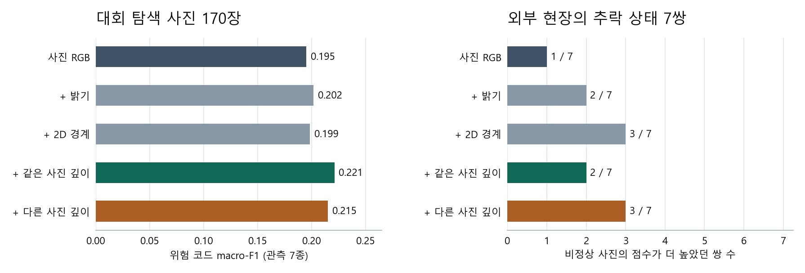

# 상대 깊이로 추락과 인양물 위험을 더 잘 찾을 수 있는가

2026년 11월 25일. 대회 탐색 사진 170장에서 단안 상대 깊이를 추가하자 낙하·비래·인양 위험을 맞힌 사진이 **0장에서 2장으로 늘었고, 오경보는 13장에서 6장으로 줄었다**. 추락을 맞힌 수는 34장 중 7장으로 같았다. 별도로 확보한 외부 건설 현장에서는 추락 방호 상태가 다른 7쌍 중 2쌍에서만 비정상 사진을 더 위험하게 평가했다. 인양 코드는 독립 사건에서 다시 시험할 후보로 남기고, 제출 모델에 깊이를 추가하는 결정은 보류했다.



## 대회 사진 170장에서의 변화

모든 조건에서 동일한 전체 화면 CLIP 특징, 학습 분할, 250회 학습, 판정 임곗값 0.5, 최대 위험 3개를 사용했다. 밝기·밝기 경계·깊이는 같은 4×4 격자에서 32개 특징으로 요약했다. 다른 사진 깊이를 넣는 대조군은 중복되지 않는 다른 접두사의 학습 사진에서 각 검증 사진의 깊이 지도를 가져왔다. 표에서 TP는 맞힌 위험, FP는 오경보, FN은 놓친 위험의 사진 수다. [실험 설계와 재현 조건](../docs/depth-pilot-protocol.md) · [11종 전체 결과](../results/depth_pilot.json)

| 입력 | 관측 7종 macro-F1 | 11종 고정 F1¹ | 추락 TP / FP / FN | 낙하·인양 TP / FP / FN | 무위험 66장 중 추락 경보 | 무위험 66장 중 하나 이상 경보 |
|---|---:|---:|---:|---:|---:|---:|
| RGB | 0.1950 | 0.1241 | 7 / 18 / 27 | 0 / 13 / 19 | 3 | 13 |
| + 밝기 | 0.2017 | 0.1284 | 7 / 16 / 27 | 0 / 11 / 19 | 3 | 14 |
| + 2D 경계 | 0.1986 | 0.1264 | 8 / 18 / 26 | 0 / 11 / 19 | 2 | 13 |
| + 같은 사진 깊이 | **0.2212** | **0.1408** | 7 / 16 / 27 | **2 / 6 / 17** | 4 | 14 |
| + 다른 사진 깊이 | 0.2152 | 0.1369 | 9 / 16 / 25 | 1 / 8 / 18 | 4 | 11 |

¹ 공식 방식에 맞춘 첫 점수는 정답 또는 예측에 등장한 7종의 평균이다. 둘째 점수는 나머지 4종의 F1을 0으로 두어 분모 11종을 고정한 참고치다. 추락은 양성 34장·음성 136장, 낙하·비래·인양은 양성 19장·음성 151장이다. 무위험 66장은 어떤 위험 코드도 관측되지 않은 별도 분모다. 침수·밀폐공간·화학·기상노출은 이 탐색셋에 양성이 없다.

추락 정답에서는 깊이를 더해 새로 맞힌 1장과 놓치게 된 1장이 서로 상쇄됐다. 낙하·인양에서는 2장을 새로 맞혔고, 기존 오경보 8개가 사라지는 동안 새 오경보 1개가 생겼다. 무위험 사진의 낙하·인양 경보는 1장에서 0장으로 줄었다. 모든 위험 코드를 사진별로 정확히 맞힌 수는 RGB 66/170, 같은 사진 깊이 70/170, 다른 사진 깊이 73/170이었다. 기존에 노출된 여섯 접두사를 번갈아 검증했으며 각 접두사가 독립 사건인지는 확인되지 않았다.

## 깊이 지도를 다른 사진과 바꾸면

첫 대조군과 같은 사진 깊이의 macro-F1 차이는 0.0061이었다. 이 결과를 본 뒤 깊이 지도의 짝을 새로 정하는 20회 비교를 추가했다. 교환 순서만 바꿨다. 결과를 확인한 뒤 추가한 분석이므로 아래 횟수는 대조군의 변동을 읽는 데 사용한다. [교환 20회 전체값](../results/depth_control_sensitivity.json)

| 지표 | 같은 사진 깊이 | 다른 사진 깊이 20회 중앙값 | 다른 사진 깊이 범위 | 같은 사진 깊이 이상인 횟수 |
|---|---:|---:|---:|---:|
| macro-F1 | 0.2212 | 0.2000 | 0.1835–0.2225 | 1 / 20 |
| 추락 F1 | 0.2456 | 0.2497 | 0.1818–0.3226 | 10 / 20 |
| 낙하·비래·인양 F1 | 0.1481 | 0.0000 | 0.0000–0.1290 | 0 / 20 |

## 외부 건설 현장에서 실제 방호 상태를 구분했는가

AI-Hub 71407의 정상·비정상 시나리오를 사용했다. 추락 방호 10종과 이동식 크레인 2종의 검증 주석 ZIP 24개에서 4,800프레임을 확인했다. 첫 표본을 고정할 때 확보한 원본 ZIP 15개에는 그중 3,000프레임이 있었다. 경량 샘플의 해당 시나리오 24개 영상은 검증 영상 130개에 모두 포함됐다. [공급기관의 시나리오 정의](https://www.aihub.or.kr/aihubdata/data/view.do?dataSetSn=71407) · [파일·영상 중복 검사 집계](../results/aihub_state_pairs.json)

같은 현장·공정·시나리오에서 정상과 비정상의 원본 영상과 촬영 시간대가 다른 경우만 짝지었다. 각 사진에 해당 시나리오의 주석 박스가 있는지 확인하고, 대회 170장 및 다른 선정 사진과 시각 해시가 가까운 후보를 제외했다. **5개 현장, 16개 영상에서 8쌍**이 남았다. 이 중 추락은 4개 현장 7쌍, 크레인 신호원 배치는 1개 현장 1쌍이다. 5개 방식 모두 대회 170장으로만 학습했다. 아래 정상·비정상은 공급자가 표시한 해당 장면의 방호 상태다. 사진 속 다른 위험은 미표기 상태로 두었다. [외부 상태쌍 점수](../results/depth_state_pairs.json)

| 입력 | 추락 비정상에 더 높은 점수 / 7쌍 | 추락 비정상 검출 / 7장 | 추락 정상 오경보 / 7장 | 크레인 비정상에 더 높은 점수 / 1쌍 |
|---|---:|---:|---:|---:|
| RGB | 1 | 3 | 4 | 0 |
| + 밝기 | 2 | 2 | 3 | 0 |
| + 2D 경계 | 3 | 1 | 3 | 0 |
| + 같은 사진 깊이 | 2 | 3 | 3 | 0 |
| + 다른 사진 깊이 | 3 | 1 | 3 | 0 |

같은 사진 깊이에서 추락 7쌍 중 5쌍은 정상 사진의 점수가 더 높았다. 크레인 1쌍의 비정상 사진은 어떤 조건에서도 판정 임곗값을 넘지 못했다. 이 한 쌍은 신호원 배치라는 단일 조건에 해당한다. 실제 사고 발생, 작업자의 추락 거리, 인양물 아래 사람의 위치는 이 라벨로 확정할 수 없다. 대회 사진과 외부 사진의 시각적 근접 중복은 검사했고, 두 기관 사이의 사건 ID 대응표는 확보되지 않았다.

## 실행 비용과 다음 판단

Intel Core i5-12400F의 CPU 스레드 2개로 대회 170장의 사진 읽기·지도 계산·특징 추출에 누적 254초가 들었다. 사진당 중앙값은 1.40초, 95백분위는 2.35초다. 원 연구진의 Depth Anything V2 Small은 Apache 2.0으로 배포된다. 이 실험은 지문을 확인한 FP32 ONNX 변환본을 국내 PC에서 실행했다. 연구진의 단안 모델은 사진 안 물체 사이의 상대적 깊이를 추정한다. 실제 높이·안전 거리·보호구 체결 상태를 재는 데는 추가 관측이 필요하다. [원 연구진과 라이선스](https://github.com/DepthAnything/Depth-Anything-V2#license) · [사용한 변환본 리비전](https://huggingface.co/onnx-community/depth-anything-v2-small/tree/4472b7362082ad9968fee890ca0f1e5aca36b93d)

공동 실험에서는 추론할 때 깊이 모델을 생략할 수 있는지도 시험했다. 학습 분할 안에서만 RGB로 32개 깊이 특징을 예측하도록 학습하고, 검증 사진에는 RGB만 넣었다. macro-F1은 0.1919, 무위험 오경보는 15/66, 낙하·인양 검출은 0/19였다. 이 증류 방식에서는 직접 깊이를 넣었을 때의 인양 검출 2건이 재현되지 않았다. [RGB 전용 증류 결과](../results/depth_distillation.json)

낙하·인양 후속 검증에서는 인양물의 유무가 같은 안전·불안전 현장을 짝짓고 신호원, 하중 이동 경로, 사람이 놓인 위치를 사람이 확인한다. 한 현장의 영상은 한 분할에만 둔다. 이 조건으로 확보된 독립 사건에서 새 검출과 오경보를 각각 다시 확인해야 한다. 공식·외부 원본과 사진별 선택 원장은 국내 G:에 보관했다.

## 재현

```powershell
$env:OPENBLAS_NUM_THREADS='1'
python -m kwater_lab.depth_pilot --download
python -m kwater_lab.depth_pilot --repeat-controls
python -m kwater_lab.state_pairs
python -m kwater_lab.depth_state_pairs
python tools/plot_depth_pilot.py
```

첫 명령의 다운로드 대상은 공개 모델이다. 대회 사진과 AI-Hub 자료는 로컬에 준비되어 있어야 한다. 마지막 그림 명령에는 Matplotlib와 한글 글꼴이 필요하다. 원본 및 사진별 기록의 지문을 확인하고, 표와 그림에는 집계만 사용했다.
