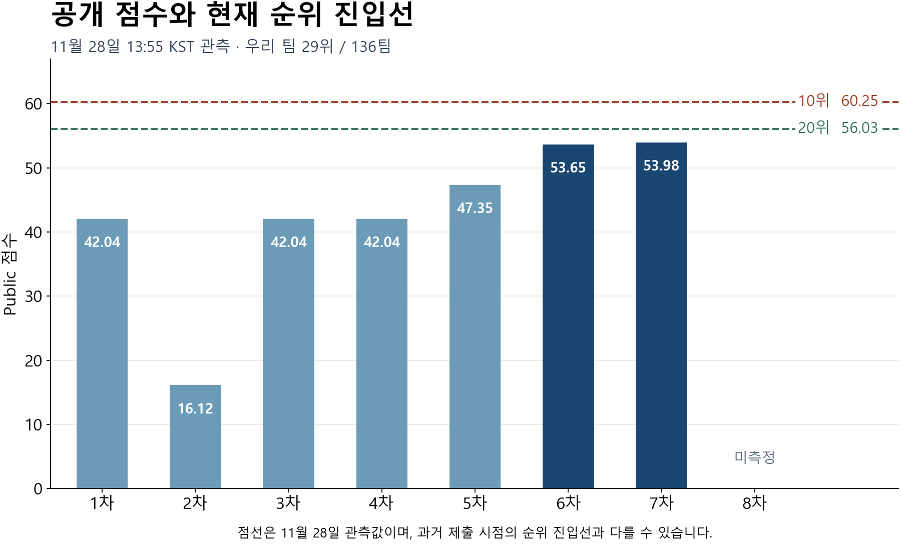
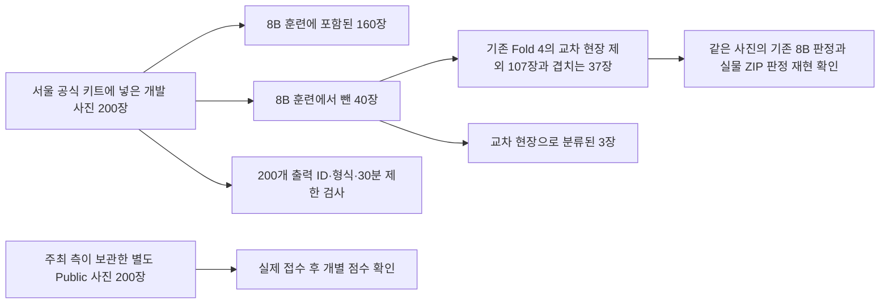
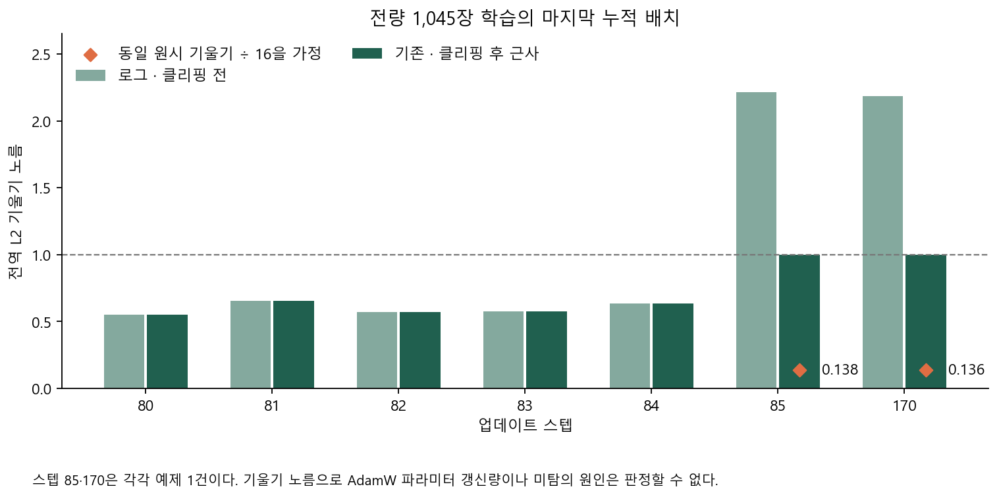

# 11월 28일 23시 30분 전 8차 제출 판단과 카본 검수

**7차는 53.98점으로 최고점이 됐다. 오늘 시험할 후보는 791장으로 학습한 8B 첫 에폭 단독이다.** 6차 53.65점보다 0.33점 올랐으며, 13:55 KST 기준 136팀 중 29위다. 20위 56.03까지 2.05점, 10위 60.25까지 6.27점이다. Public 상위 20팀이 Private 평가를 받고 합산 상위 10팀이 발주처 평가에 진출한다. 60.25는 이 시각의 Public 10위 관측값이다. [개별 접수 영수증](../results/public_submission_007.json) · [공식 순위표](https://hackathon.imaginationgroup.co.kr/kwater/api/leaderboard) · [대회 안내](https://hackathon.imaginationgroup.co.kr/kwater/api/report)

| 오늘의 선택 | 근거 |
|---|---|
| 7차 최고점 자동 선택 유지 | 전량 4B 둘째 에폭·전문가·검증기. 공식 개별 점수 53.98. |
| 8차 1순위로 791장 학습 8B 단독 실물 검사 | 6차와 같은 훈련 사진·일정에서 Fold 4 F1이 175장 .54201→.63415, 107장 .56252→.62091로 올랐다. 107장 중대 미탐은 18→20장으로 늘었다. 서울 시간과 출력까지 확인하고 접수를 결정한다. |
| 전량 4B 첫 에폭 단독은 후순위 | 서울에서 19분 50초·200/200을 통과했다. 그러나 7차 대비 정상 오경보 1건을 줄이는 동안, 발현 가능 피해가 큰 중대 위험 미탐은 22→34/68장이 됐다. 위험이 사라진 32장 중 31장에 실제 위험 주석이 있었다. |
| 8B 초벌 + 4B 검증은 후속 연구 | 실제 52건을 반영한 Fold 4 F1 .67014/.66528. 두 BF16 기반모델만 26.41 GB여서 오늘 올릴 8B 단독의 성적에 이 수치를 사용할 수 없다. |

여기서 **정상 오경보**는 공식 주석이 정상인 사진에 위험 코드를 하나라도 낸 경우다. **중대 위험 미탐**은 심각도 4 정답이 있는 사진에서 그 정답 코드를 하나도 맞히지 못한 경우다. 다른 위험을 출력한 사진도 여기에 포함될 수 있다. F1은 위험 유형별 탐지 결과를 평균한 0~1 지표이며, 공식 Public은 위험 탐지와 설명·조치·인용을 합친 100점 만점 평가다.

[14시 카본 원 제안](seventh-5398-analysis-and-sub8-roadmap-20261128.md) · [모델별 그림·실제 사진 6장](submission-7-8-decision-and-l4-value-20261128.md) · [32장과 재판독 5건의 정답 대조](eighth-slot-label-audit-20261128.md)

## 7차의 0.33점에서 알 수 있는 것

개발 사진 200장에서 6차와 7차의 위험 코드가 57장 달랐다. 6차 정상 판정에서 7차 위험 판정으로 바뀐 사진은 9장이고 반대는 12장이었다. 같은 실행에서 검증기가 승인한 **추가 코드도 9개**였다. 코드를 하나 더한 횟수와 두 제출 사이에서 처음 위험 판정이 난 사진 수는 서로 다른 집계다. 7차가 숨은 사진에서 잃고 얻은 정량 점수, 설명·예방조치·법령 점수의 개별 변화는 공개되지 않았다. [실물 세 개의 출력 대조](../results/sub78-public200-output-diff-20261128.json) · [서울 실행 원장](../results/seoul-l4-roadmap-experiments-20261128.json)

카본이 지적한 4B의 인양 취약점, 전량 보정 사진 170장의 학습 노출, 에폭이 바뀔 때 늘어난 빈 판정은 실제 후속 실험의 출발점이다. 53.98을 4B의 성능 상한으로 정하거나, 57장의 판정 변경이 숨은 사진에서도 일어났다고 단정할 자료는 없다. 6·7차 모두 같은 계열 법령 검색기를 사용했지만 훈련 범위와 동봉 사례집이 달랐고 설명도 각각 새로 생성했다. 50/178은 보정에서 승인된 사례 중 오답의 비율이다. 정상 사진에 위험을 낸 비율을 계산하려면 정상 사진을 분모로 써야 한다. [전량과 Fold 4 보정 조건](seventh-submission-decision-20261128.md) · [조문 재평가](fold4-citation-alignment-20261128.md)

8B의 개선도 표본 크기와 함께 봐야 한다. 교차 현장을 제외한 107장에서 8B 첫 에폭이 6차보다 앞선 F1 +.05838 중 +.05208은 화학 노출 한 유형에서 왔다. 이 유형의 정답은 네 장이었고 4B는 한 장, 8B는 세 장을 맞혔다. 서울 실물과 다른 현장 재훈련에서 같은 경향이 확인될 때 일반화 근거가 늘어난다. [코드별 실제 적중 수와 현장 단위 95% 구간](seoul-l4-roadmap-experiments-20261128.md)

**비교 대상을 최고점 7차의 연구 대조군으로 바꾸면 결론도 달라진다.** 같은 791장으로 학습한 4B 둘째 에폭 하이브리드와 8B 첫 에폭 단독을 사진별로 맞춰 비교했다. 전량 1,045장으로 학습한 실제 7차는 Fold 4 사진도 봤으므로 여기에는 넣지 않았다. [쌍체 원출력·현장 재표집 2,000회 검산](../results/fold4-8b-epoch1-vs-4b-epoch2-hybrid-20261128.json)

| 7차 연구 대조군 → 8B 단독 | F1 변화와 95% 구간 | 정상 오경보 | 중대 위험 미탐 | 중대 위험에서 8B만 회복 / 4B만 맞힘 |
|---|---|---:|---:|---:|
| 175장·39그룹 | **+.03841** [−.06838, +.15170] | 8→9/49 | 30→29/60 | 10 / 9 |
| 교차 현장 제외 107장·36그룹 | **−.01655** [−.17200, +.10151] | 6→5/27 | 17→20/39 | 5 / 8 |

두 구간 모두 0을 포함한다. 8B는 6차와 다른 모델 크기를 실제 평가에서 시험할 가치가 있고, 이 비교에서 7차 계열을 일관되게 이겼다는 증거는 없다.

### 같은 ‘200장’에서 무엇을 읽을 수 있나

7차는 개발 사진 200장 전부로 학습했다. 따라서 40장에서도 7차와 8B의 학습 노출이 다르다. 서울과 주최 측은 평가 사진이 다르며, 107장은 175장의 부분집합이다. [학습·검증 명단과 키트 입력 검산](../kwater_lab/sub78_public200_compare.py) · [현장 배제 근거](../results/fold4-crosssplit-audit.json)

## 마지막 훈련 예제 하나가 중대 미탐을 만들었는가

전량 4B 첫 에폭은 훈련 예제 1,345개를 16개씩 평균해 84번 갱신하고, 마지막 1개로 85번째 갱신을 했다. 마지막 예제는 ‘위험 없음’이었다. 직전과 달리 이 예제 하나가 배치 평균을 전부 차지한다는 카본의 지적은 타당하다. 그러나 학습 코드는 AdamW 갱신 전에 전체 기울기 길이를 1.0으로 제한한다. 로그의 **2.213은 제한 전 수치**다. 카본이 제안한 고정 분모 16을 같은 예제에 적용하면 제한 전 약 0.1383이고, 원래 방식의 제한 후 약 1.0과의 비는 약 7.23이다. 실제 파라미터 갱신량은 앞선 기울기의 이동평균과 제곱평균에도 의존한다. 이 비율과 ‘위험 사진 12장 추가 미탐’을 바로 연결할 수 없다. [실제 학습 코드](../kwater_lab/vlm_11code.py) · [PyTorch 2.5.1 기울기 제한 구현](https://github.com/pytorch/pytorch/blob/v2.5.1/torch/nn/utils/clip_grad.py#L87-L115) · [AdamW 갱신 구현](https://github.com/pytorch/pytorch/blob/v2.5.1/torch/optim/adamw.py#L345-L401)

원래 80번째 체크포인트와 85번째 첫 에폭의 가중치·옵티마이저 상태가 보존됐다. 84번째는 저장되지 않았다. 80과 85의 출력만 비교하면 중간의 네 갱신도 섞인다. 81~84를 한 번 재생한 뒤 같은 가중치·옵티마이저·난수 상태에서 85번째 예제의 분모만 바꿔 두 갈래로 실행한다. 원래 85번째 가중치 재현성과 두 갈래의 위험 판정 차이를 따로 점검한다. 이 비교 전에는 기존 학습의 기본 공식을 일괄 변경할 근거가 없다.

검증할 30장은 서로 다른 30개 현장 그룹에서 모델 예측을 보지 않고 정상·중대·기타 위험을 10장씩 선정했다. 이 30장은 전량 모델의 훈련에 사용됐으므로 마지막 한 번의 갱신에 출력이 얼마나 민감한지 확인하는 용도다. 2에폭 마지막 170번째 예제는 위험 사진이었고, 실제 학습률은 1.33×10⁻⁸이었다. Fold 4 기준 학습의 첫 에폭 끝에는 위험 3개·정상 1개가 남았다. Fold 2 첫 에폭 끝에는 위험 7개·정상 2개·검증 기각 1개가 배정됐다. [훈련 로그·체크포인트·표본 동결 원장](../results/sub78-tail-clipping-audit-20261128.json)

## 오늘의 서울 실측과 접수

실제 8B 단독 ZIP은 **17,745,550,610바이트**다. 6차와 8B의 프롬프트·학습측 법령 사례 658건·법령 원문·설치 휠 5개·토크나이저는 일치한다. 두 모델 모두 동일한 393,216픽셀 상한, BF16, 배치 4, 최대 620토큰으로 추론한다. 6차는 로컬 Windows RTX 3060, 8B는 서울 Linux L4에서 학습했고 학습 파라미터는 각각 약 3,398만·4,479만 개다. 배포 진입 코드도 다르며, 모델 로딩과 위험·조문을 정리하는 함수의 구문은 같다. 8B의 Public 점수를 얻으면 **잘 맞춘 두 실물 구성**의 차이를 알 수 있다. 모델 크기의 인과 효과를 완전히 분리한 값으로 쓰기에는 학습 환경과 일부 실행 코드에 차이가 남는다. [두 ZIP의 파일·함수·학습 조건 검산](../results/fold4-4b-8b-packaged-controls-20261128.json)

1. **용량과 동일성.** 8B 단독의 공개 기반모델 네 샤드, 기존 175장 평가에 쓴 첫 에폭 어댑터, 프롬프트, 법령 사례집을 검산했다. 제출 대상은 `kwater-research-8b-fold4-epoch1-bf16-20261128.zip`, SHA-256 `4b1523af723ec7f6863c0297f3dc6db84d7854e4e3c52dd26f30b26280bbd549`이다. 6차와 같은 69번째 갱신의 단독 모델이다. 오프라인 설치 휠 5개를 포함한 파일 29개를 확인했고, CPU에서 사진 전처리와 형식 검사 3/3이 통과했다. [실물 ZIP 크기·무결성](../results/fold4-8b-epoch1-research-package-20261128.json)
2. **정확한 실물 검사.** 서울 L4 단일 VM에서 같은 200개 사진 ID와 같은 순서로 공식 오프라인 키트를 실행한다. 프로젝트의 훈련 사진 791장과 겹치는 것은 이 중 160장이다. 40장은 기존 Fold 4 미학습 사진이고, 그중 37장은 교차 현장을 뺀 107장에도 속한다. 따라서 200장의 배포 진단, 겹치는 40장의 기존 원출력 재현, 175/107장의 전체 품질은 각각 해석한다.
3. **시간과 품질.** 제출 기준은 20 GB 이하, 유효 출력 200/200, 1,800초 이내다. 동시에 실제 정상 오경보·중대 정답 완전 미탐, 7차만 맞힌 수와 8B만 맞힌 수를 함께 읽는다. 8B+4B 연구 조합의 개선을 단독 8B에 더하지 않는다. 카본의 예상 1,220~1,270초 및 Public 56~58점은 측정 전 가정이다.
4. **일정과 남은 한 번.** 서울 결과가 나오는 즉시 사용자에게 7차와의 차이와 추천을 전한다. 오늘 23:30 KST 전에 접수할 수 있도록 선택한 파일과 SHA를 고정한다. 접수가 결정되면 Codex가 원본 ZIP을 공식 ‘내 참가’에 직접 올려 파일명·접수 행·잔여 횟수를 확인하고 개별 채점 결과를 따른다. 7차 53.98점이 이미 자동 선택돼 있다. [공식 내 참가](https://hackathon.imaginationgroup.co.kr/kwater/#my)

14:38 KST에 같은 Chrome의 로컬 점검 화면에서 Codex가 후보 ZIP을 직접 선택했다. 화면에 표시된 파일명과 **17,745,550,610바이트**가 제작 영수증과 일치했다. 점검 화면은 파일명·크기만 표시하며, 대회 접수 시각은 공식 사이트에서 접수 행이 생성된 뒤 별도로 기록한다.

**추가 서울 상한은 2,400원이다.** 전량 4B 검사와 기존 5건 재판독까지 10,787원, 예비비를 전부 더하면 12,590원이었다. 새 실측을 상한까지 집행해도 보수 합계 14,990원이다. 최종 파일 준비·출력 재채점은 로컬에서 한다. 동일 8B 검증기의 두 조건은 52건에서 각각 마진과 생성이 필요해 총 104회 마진, 104회 생성이다. 89쌍은 이미 8B 초벌 훈련에 노출됐고 검증 그룹 중복을 제거하면 34쌍 중 정상 음성이 1쌍 남는다. 이 표본에서 정한 문턱은 독립 보정의 증거가 되지 않는다. 서울의 우선 작업은 오늘 실제로 선택할 단독 ZIP이며, 새 검증기 연구는 독립 원장에 기록한다. [서울 비용 영수증](../results/seoul-eighth-200-20261128.json) · [보정 표본 감사](../results/sub78-single-8b-verifier-design-audit-20261128.json) · [단일 8B 실험 명세](../docs/sub78-single8-verifier-replay-20261128.md)

## 다음 실험에서 선택할 한 가지 변화

- **현장 일반화.** Fold 2에서 다른 현장의 769장으로 학습한 4B 첫 에폭 결과를 먼저 확보한다. 8B 비교도 같은 훈련 사진·예제 순서·검증 제외 그룹을 쓴다. 보정 전용 현장을 별도로 떼면 두 모델의 실질 훈련 사진 수도 다시 맞춘다.
- **위험 제거.** 4B와 8B의 ‘위험 없음’ 오류를 먼저 집계하고, 저신뢰 단일 위험 제거는 위험 추가와 다른 조건으로 시험한다. 새로 구한 정상 사진과 중대 위험 사진을 함께 보고 15~18% 오경보율과 15초 추가시간 가정을 검증한다.
- **설명·조치·인용.** 노출된 검수 그룹을 교체하고 2인 눈가림으로 첫 조문의 직접 지지와 예방조치의 적합성을 평가한다. 조치 재학습과 장면 정보 추가는 하나씩 바꾼다. 추가 문장으로 늘 수 있는 생성 시간도 측정한다. 공식 정성 점수 2~3점 상승은 개발 지표에서 환산할 수 없다.
- **마감.** 근거가 남은 모델만 전량 재학습하고 12월 6일 23:59 외부자료 신고와 12월 13일 10:00 마감에 맞춰 실제 사용 자산을 동결한다. 같은 Linux 컨테이너에서 Public 200장 재현과 Private 300장 부하 검사를 한다. [전체 연구 일정](submission-7-8-decision-and-l4-value-20261128.md) · [정성·비전 결과](qualitative-vision-followup-20261128.md) · [공식 안내](https://hackathon.imaginationgroup.co.kr/kwater/api/report)

**실험 결과를 읽는 기준.** 8B가 정상 오경보율 18%를 충족하려면 175장 중 정상 49장에서 8건 이하, 107장 중 정상 27장에서 4건 이하여야 한다. 15%에서는 각각 7건·4건이다. 현재는 9건·5건이라 정상 한두 장의 변화가 결론을 바꾼다. ‘제거 후보로 분류됨’, ‘모델이 실제로 기각함’, ‘그 기각이 정답이었음’을 사진별로 연결하고, 사라진 올바른 중대 위험과 새로 생긴 빈 판정을 함께 센다. [Fold 4 원점수와 표본 수](../results/fold4-8b-epoch1-vs-4b-epoch2-hybrid-20261128.json)

**위험 제거 후보를 실제로 세었다.** 한 가지 위험만 출력한 8B 사진 중, 기존 학습측 보정에서 정한 전문가 장면 확률이 0.40 미만인 경우를 골랐다. 표의 ‘정답을 알고 제거’는 그 후보의 틀린 코드만 골라 지웠을 때의 최대치다. 실제 검증기가 어느 코드를 기각할지는 다음 GPU 실험에서 판독해야 한다. [고정 문턱과 조건별 원장](../results/sub78-reverse-verify-candidate-limits-20261128.json)

| 초벌 한 가지 위험 · 장면 확률 < 0.40 | 175장 | 교차 현장 제외 107장 |
|---|---:|---:|
| 제거 대상이 되는 사진 / 현장 그룹 | 7 / 4 | 5 / 2 |
| 정상 사진의 오경보 / 위험 사진에서 지목한 틀린 코드 / 맞힌 중대 위험 | 4 / 2 / 1 | 2 / 2 / 1 |
| 정답을 알고 틀린 코드만 제거했을 때 F1 최대 증가 | +.01415 | +.02037 |
| 후보를 모두 지웠을 때 정상 오경보 | 9→5/49 | 5→3/27 |
| 후보를 모두 지웠을 때 중대 위험 미탐 | 29→30/60 | 20→21/39 |

107장의 정상 사진은 다섯 현장 그룹에서 왔다. 한 그룹에서 17장 중 5장에 오경보가 났고, 나머지 네 그룹은 합계 10장 중 0장이었다. 175장에서는 정상 49장이 일곱 그룹에 속했고, 오경보가 난 세 그룹은 각각 5/17·2/12·2/10이었다. 코드별 문턱까지 동시에 적용하면 107장에서는 정상 오경보 하나를 줄일 기회와, 올바른 중대 위험 하나를 지울 위험이 남는다. 위험을 지우는 규칙을 승격하려면 다른 현장에서도 정상 오경보가 줄고 중대 정답을 지키는지 확인해야 한다.

8B 판독 전용 학습과 기존 혼합 학습을 비교할 때는 같은 현장과 사진을 사용한다. 검증용 질문을 뺀 자리를 어떤 판독 예제로 채웠는지와 반복 횟수, 업데이트 수, 실제 감독 토큰 수를 기록한다. 그다음 실험에서만 위험 추가와 위험 제거를 각각 켠다. 마진 문턱은 해당 모델이 한 번도 학습하지 않은 보정 현장에서 정하고, Fold 4·2의 평가 점수를 보고 다시 고르는 절차는 피한다. 유한한 검증표본에 모델 선택을 반복하면 선택 기준 자체에 과적합할 수 있다는 실험 결과도 이 설계를 뒷받침한다. [Cawley와 Talbot의 모델 선택 연구](https://www.jmlr.org/papers/v11/cawley10a.html)

**보정용 사진을 실제로 분리했다.** 기존 Fold 4 보정 89쌍의 사진 65장과 Fold 2 보정 209쌍의 사진 149장은 모두 기본 판독 훈련에 들어갔다. Fold 4에서는 보정 예정 현장의 양성 3건, Fold 2에서는 7건이 낮은 전문가 점수 때문에 검증기 훈련에도 들어가는 코드 경로를 확인했다. 새 실험은 알던 동일 현장 연결 6개를 검사했다. Fold 2에서는 그룹 이름이 달랐지만 같은 현장인 27장을 보정 쪽으로 옮겼다. 다음 수치는 새로 사용할 사진 수이며 모델 점수는 재훈련 후 얻는다. [실험 명세·입력 검산 방법](../docs/sub78-clean-cal-design-20261128.md) · [집계](../results/sub78-clean-cal-design-20261128.json)

| 평가할 현장 | 두 모델의 공통 훈련 | 보정 전용 | 보정의 정상 / 중대 위험 | 외측 평가 |
|---|---:|---:|---:|---:|
| Fold 4 | 709장·130그룹 | 82장·23그룹 | 21장·5그룹 / 28장·7그룹 | 175장과 그중 107장 |
| Fold 2 | 631장·130그룹 | 138장·24그룹 | 46장·7그룹 / 40장·9그룹 | 197장과 그중 55장 |

보정 전용 사진은 훈련측 법령 사례집·전문가 학습·어려운 음성 선별에서도 뺀다. 새 보정 표본에는 익수·침수와 밀폐공간 양성이 두 폴드 모두 0건이어서 두 위험의 개별 문턱을 검증할 수 없다. 독립 보정의 효과를 판단할 때는 양쪽 모델을 위 표의 같은 사진에서 다시 학습한다. 기존 791장·769장 모델과 비교하면 학습량 차이도 결과에 들어간다.

| 연구 순서 | 먼저 비교할 두 조건 | 다음 단계로 넘길 근거 |
|---|---|---|
| 오늘 로컬 GPU | 같은 84번째 상태에서 끝 예제 분모만 바꾼 4B 두 개 | 원래 85번째 상태 재현 여부, 서로 다른 30개 현장의 출력 변경, 중대 검출·빈 판정의 방향을 확인한다. |
| 이어서 로컬 GPU | 동일 8B 첫 에폭 초벌에 첫 에폭 또는 둘째 에폭 어댑터를 붙여 같은 52건을 검증 | 정상 오경보, 중대 미탐, 승인·기각·형식 오류를 각자 센다. 12GiB 로컬의 4비트 결과가 후보를 가르면 상위 한 구성만 배포 정밀도에서 재확인한다. |
| 다른 현장으로 재훈련 | 같은 훈련 사진을 준 4B와 8B, 이후 8B 혼합과 판독 전용 | 197장·현장 교차 제외 55장에서 비교한다. 화학 노출을 포함한 전체 평균과 그 유형을 제외한 평균, 현장별 불확실성, 중대 미탐 증감을 함께 본다. |
| 실제 제출 직전 | 선정한 모델에서 현행 법령 검색과 눈가림에서 살아남은 조치·인용 변경 | 같은 위험 판단에 대해서만 텍스트 품질을 대조하고, 최종 SHA의 용량·공식 Linux 200장·Private 300장 부하를 확인한다. |

오늘 8B의 개별 점수가 53.98을 넘으면 해당 실물을 다음 대조군으로 남긴다. 그 아래면 최고점인 7차를 유지하고, 107장에서 7차 계열만 맞힌 중대 사진 8장과 8B만 맞힌 5장이 다른 현장에서도 갈리는지 먼저 본다. 두 경우 모두 다음 사용료는 이미 고정한 두 후보의 승패를 바꾸거나, 제출할 파일의 시간 제한을 확인하는 실험에 배정한다. [실물 가속 효과와 기존 집행액](seoul-l4-roadmap-experiments-20261128.md)

Fold 2의 정성 재검에 사용할 자료는 로컬의 `data/v3-11code-fold2-4b-epoch1/`에 생성된다. `epoch1-bf16-inference-receipt.json`이 생기면 197장과 출력 지문을 대조하고, 같은 폴더의 `epoch1-bf16-raw-cache.json`과 `epoch1-bf16-predictions.jsonl`을 읽는다. 법령 검색기는 Fold 2 외 769장의 사례로만 구성한다. 현재 서울 8B 검사 예약을 포함한 보수 예산은 14,990원이며, 15,000원 한도 내 미배정액은 10원이다. 다른 클라우드 작업은 이번 검사 종료 후 원장의 실제 잔액을 기준으로 판단한다.

정성 검수 담당은 앞서 살핀 현장과 겹친 사진을 교체해 24개 그룹을 다시 동결했다. 첫 에폭에서 교정안을 실제 적용해 보니 첫 조문이 바뀐 사진은 0/24였다. 옳고 그름을 가를 변경 사례가 없어 이 패널에서 승률을 산출할 수 없다. 별도로 AI-Hub 71407의 공급자 현장 12곳에서 로컬 연구 사진 37장을 고르고 서로 다른 오프라인 판독 모델 두 개를 준비했다. 로컬 GPU의 이미 배정된 작업이 끝난 뒤 37장 생성 결과를 읽고, 실제 변경 사례와 변경 없는 대조 사례를 함께 검수한다. [눈가림 재동결과 판독 원장](fold4-citation-independent-review-20261128.md)
