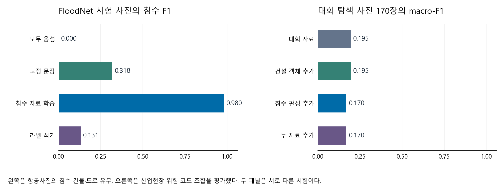

# 외부 안전 데이터가 K-water 위험 판별에 도움이 되는가

2026년 11월 25일. **이번 실험에서 제출에 채택한 외부 데이터는 없다.** FloodNet 모델은 항공사진 114장에서 침수 F1 0.980을 기록했다. 산업현장 사진 170장에 같은 판정을 적용하자 침수 오탐 48건이 생겼다. AI-Hub 건설 현장 라벨로 학습하면 대회 탐색 macro-F1은 0.1950에서 0.1978로 올랐고 무위험 오경보도 13장에서 20장으로 늘었다. 라벨을 무작위로 섞은 대조군도 0.2008을 기록했다. 이 보고서의 점수는 모두 로컬 탐색 결과다.



## 대회 사진 170장에서 같은 조건으로 비교한 결과

여섯 사진 ID 접두사를 한 묶음씩 빼고 학습했다. 같은 사진이나 근접 중복은 해당 묶음의 학습에서 제외했다. 104장은 적어도 한 종류의 위험이 있고, 66장은 위험 미관측이다. 이 170장은 이전 실험에서 본 사진이며, 접두사와 독립 사고의 관계는 검증되지 않았다. 이번 표본의 침수 양성은 0장이다.

| 학습 또는 변경 조건 | macro-F1 | 무위험 사진 오경보 / 66 | 침수 오탐 / 170 | 위험 사진에 빈 응답 / 104 | 위험 코드 조합 정확히 일치 / 170 |
|---|---:|---:|---:|---:|---:|
| 대회 자료만 | 0.1950 | 13 | 0 | 37 | 66 |
| + 국토안전관리원 객체 특징 | 0.1950 | 13 | 0 | 37 | 66 |
| + FloodNet 침수 판정 | 0.1696 | 32 | 48 | 25 | 44 |
| + 두 자료 모두 | 0.1696 | 32 | 48 | 25 | 44 |
| 후속 실험 · 대회 훈련 음성으로 침수 임곗값 조정 | 0.1707 | 16 | 9 | 34 | 62 |

대회 방식의 macro-F1은 정답 또는 예측에 등장한 코드만 평균한다. 침수 오탐이 생기면서 분모가 7종에서 8종으로 늘었다. 11종을 고정하고 미등장 코드를 0점으로 두어도 전체 평균은 각 조건에서 0.1241, 0.1241, 0.1233, 0.1233, 0.1241이다. 침수를 추가하면 위험 사진에 답을 내는 경우는 늘지만, 실제 위험 *종류의 조합*을 정확히 맞힌 사진은 줄었다. [4개 조건의 원자료](../results/external_flood.json) · [임곗값 보정 결과](../results/external_shift.json)

## AI-Hub 자료를 한 종류씩 추가하면 달라지는가

같은 170장과 분류기로 세 자료를 각각 비교했다. 고소작업·건설 현장·부산 CCTV에서 원본 그룹 12개를 골라 그룹당 1장씩 사용했다. 각각 3개, 12개, 12개 현장이 포함됐다. 각 훈련 사진이 외부 자료의 대표 장면 4개와 얼마나 비슷한지 계산해 특징으로 추가했다. 같은 수의 대회 훈련 사진을 사용해 특징 4개를 더한 대조군도 만들었다. 모든 조건의 학습은 250회, 판정 임곗값은 0.5다.

| 비교 조건 | macro-F1 | 무위험 오경보 / 66 | 위험 전체 누락 / 104 | 위험 조합 정확 일치 / 170 |
|---|---:|---:|---:|---:|
| 대회 자료만 | 0.1950 | 13 | 37 | 66 |
| 대회 사진 12장으로 유사도 특징 추가 | 0.1935 | 13 | 37 | 66 |
| 고소작업 507의 유사도 특징 추가 | 0.1941 | 13 | 37 | 66 |
| 건설 현장 71407의 유사도 특징 추가 | 0.1941 | 13 | 37 | 66 |
| 부산 CCTV 71793의 유사도 특징 추가 | 0.1941 | 13 | 37 | 66 |
| 대회 훈련 예시를 위험별 같은 수로 재표집 | 0.1948 | 13 | 34 | 66 |
| 건설 현장의 실제 정상·비정상 라벨 추가 | 0.1978 | 20 | 32 | 60 |
| 같은 건설 현장 사진의 라벨을 무작위로 섞어 추가 | 0.2008 | 22 | 34 | 56 |

건설 현장의 5개 유형은 각 유형에 해당하는 코드에만 정상 10장과 비정상 10장을 제공했다. 대회 훈련 분할에도 양성과 음성이 있을 때만 해당 코드의 학습을 갱신했다. 추락은 대회 자료 단독 대비 TP 7→9, FP 18→19, FN 27→25로 바뀌었다. 넘어짐은 TP 35건을 유지하면서 FP가 18→24건으로 늘었고, 인양 충격은 TP 0건에 FP가 13→17건으로 늘었다. 실제 라벨을 추가했을 때 위험을 한 건도 출력하지 않은 사진은 5장 줄었고, 정확히 맞힌 위험 조합은 6장 줄었다. 추락에서 추가로 맞힌 2건의 효과는 새 사건에서 확인해야 한다. [위험별 TP·FP·FN 전체표](../results/aihub_ablation.json) · [비교 설계](../docs/aihub-ablation-protocol.md)

고소작업의 로프작업 훈련 사진 5,743장과 검증 사진 707장을 원본 영상 ID로 대조했다. **훈련 영상 17개와 검증 영상 17개가 전부 겹쳤다.** 이 분할로 측정하면 같은 영상의 다른 프레임을 맞힌 효과가 섞인다. 새 검증은 원본 영상·현장을 묶어서 나눠야 한다. 부산 자료에서는 수치모델 지도와 CCTV 주석 내부 파일명이 다른 사례를 참조 후보에서 걸러냈고, 침수 여부는 학습하지 않았다. [고소작업 원본 검증](../results/external_highwork.json) · [부산 자료 교차표](../results/external_busan.json)

부산 CCTV 1,000장의 촬영지·시간 폴더까지 다시 대조했다. 원본과 주석의 폴더가 다른 40장, JSON 내부 파일명이 다른 29장은 서로 겹치지 않았다. 참조 사진 12장 중 폴더가 다른 1장을 제외하고 네 비교군을 11장씩으로 맞춰 다시 계산했다. 대회 사진 참조는 F1 0.1935, 외부 세 자료는 각각 0.1941이었다. 무위험 오경보는 모두 13/66이었다. [폴더·파일명을 함께 검사한 추가 실험](../results/busan_alignment.json)

검증 주석과 원본 영상으로 같은 현장·시나리오의 실제 방호 상태 8쌍을 구성했다. 대회 170장에서는 상대 깊이를 더했을 때 낙하·인양 검출이 0/19장에서 2/19장으로 늘었지만, 외부 추락 정상·비정상 7쌍 중 비정상에 더 높은 점수를 준 경우는 2쌍이었다. [상대 깊이와 원본 영상 대응쌍 비교](depth-and-state-pairs.md)

## 외부 자료 자체의 성능과 품질

**FloodNet**은 허리케인 하비 이후 촬영한 미국 항공사진 2,343장이다. 원 배포의 훈련 1,445장, 검증 450장, 시험 448장 중 고정 기준을 적용해 훈련 192장(96 대 96), 시험 114장(침수 50, 음성 64)을 사용했다. 라벨 마스크를 최근접 128×128 격자로 읽어 침수 건물·도로 비율 2% 이상을 양성으로 삼았다. 물·수영장만 있어도 침수로 분류하는 오류를 드러낼 수 있도록 음성을 포함했다. 원래 훈련과 시험 간 근접 중복 1장을 제외했다. [원 배포와 라이선스](https://github.com/BinaLab/FloodNet-Supervised_v1.0) · [선정 규칙](../docs/external-pilot-protocol.md)

| 항공사진 판별 방법 | TP | FP | FN | TN | 침수 F1 |
|---|---:|---:|---:|---:|---:|
| 모두 음성 예측 | 0 | 0 | 50 | 64 | 0.000 |
| 모두 양성 예측(추가 대조) | 50 | 64 | 0 | 0 | 0.610 |
| 고정된 두 문장과 CLIP 이미지의 유사도 | 17 | 40 | 33 | 24 | 0.318 |
| FloodNet 훈련 사진의 양·음성 평균 특징 비교 | 49 | 1 | 1 | 63 | **0.980** |
| 훈련 라벨 순열, 사전 지정 시드 42 | 8 | 64 | 42 | 0 | 0.131 |

추가로 훈련 정답을 1,000번 섞었을 때 F1 중앙값은 0.509였고 7회는 관측한 F1 0.980 이상이었다. 침수 재현율 49/50의 사진 단위 Wilson 95% 구간은 0.895~0.996이다. 한 재난의 유사 장면이 포함된 구간이므로 다른 재난·현장·촬영시점 성능은 별도 검증해야 한다. 대회 훈련 음성 점수의 95백분위수로 보정하면 대회 침수 오탐은 48→9건으로 줄고, 같은 외부 시험의 재현율은 98%→88%, F1은 0.936으로 낮아졌다. 대회 침수 양성에서의 재현율은 계속 미측정이다. [추가 비교 설계](../docs/external-shift-followup.md)

| 국내 자료 | 내려받아 검사한 단위 | 관측과 활용 판단 |
|---|---|---|
| AI-Hub 건설 현장 위험 상태 판단 71407 | 경량 샘플 113장·113 JSON. 이 중 100장에 5유형별 정상 10장·비정상 10장, 원본 영상 100개, 현장 17곳 | 현장을 하나씩 제외한 정상/비정상 분류 F1 0.500, 무작위 훈련 라벨 대조 0.577. 별도로 11코드 CLIP이 장면별 지정 코드를 맞혔는지 평가한 F1은 0.405(재현율 0.34). 배경만으로 안전 상태를 분류하는 방식은 이번 결과로 채택하기 어렵다. [배포처](https://www.aihub.or.kr/aihubdata/data/view.do?dataSetSn=71407) · [결과](../results/external_construction.json) |
| AI-Hub 부산시 침수위험 복합 71793 | 경량 샘플 1,274 사진·JSON 쌍. 실제 CCTV 1,000장, 수치모델 지도 274장 | CCTV JSON 내부 파일명 29개가 실제 파일명과 불일치했다. 외수 295장은 전부 위험값 1, 내수 705장은 전부 0이었다. 이 필드는 이 표본에서 촬영 구분만으로 완벽히 예측된다. 지도는 제외하고, CCTV는 영상 단위 매칭과 육안 침수 확인을 거쳐 사용한다. [배포처](https://www.aihub.or.kr/aihubdata/data/view.do?dataSetSn=71793) · [결과](../results/external_busan.json) |
| AI-Hub 고소작업 507 | 정식 로프작업 검증 원본·라벨 ZIP 두 개에서 707쌍. 원본 영상 17개 | 원본 ID 불일치 0, 바운딩박스 1,896개 중 범위 오류 0, 고정 추출 사진 32/32 해상도 일치. 전부 작업상황(WS)이다. 작업·보호구 위치를 가르칠 수 있고, 이 분할만으로 추락 위험의 유무를 검증하기 어렵다. [배포처](https://www.aihub.or.kr/aihubdata/data/view.do?dataSetSn=507) · [결과](../results/external_highwork.json) |
| 국토안전관리원 중소건설현장 위험객체 15142200 | 공식 다운로드가 제공한 샘플 10장, 짝 라벨 10개, 유효 상자 30개 | 정의 13종 중 승용차·지게차·안전 작업자 각 10개만 등장했다. 좌표 불량·빈 라벨·정확히 같은 사진은 0개다. 3개 종류의 객체 특징을 더해도 대회 사진 지표는 같았다. [공공데이터포털](https://www.data.go.kr/data/15142200/fileData.do) |
| KOSHA 사망사고 고위험요인 SIF | 고용노동부 공개 XLSX 원본 1개. 제조업 등 2,573건, 건설업 3,459건. 시트의 사례 번호 수로 확인 | 총 6,032건. 파일 버전의 공공누리 3유형은 출처표시·변경금지다. 참고용 원본으로 보관했다. 사진 성능이나 정답 라벨의 근거로 사용하지 않았다. [고용노동부 배포](https://www.moel.go.kr/policy/policydata/view.do?bbs_seq=20260400196) · [해당 파일 이용조건](https://www.data.go.kr/data/15140383/fileData.do) |
| 고용노동부·안전보건공단 지침 | 폭염 관련 원본 PDF 5개, 2022년 밀폐공간 질식재해예방 안전작업 가이드 84쪽 1개 | 문구와 판단 근거를 사람이 확인하는 참고본으로 보관했다. 사진 학습에는 쓰지 않았다. [폭염 자료](https://www.moel.go.kr/policy/policydata/view.do?bbs_seq=20260500439) · [밀폐공간 자료](https://www.moel.go.kr/local/boryeong/info/dataroom/view.do?bbs_seq=20230501649) |

## 11종 출력 검증

공식 학습 사진 1,045장에 기록된 위험은 942건이다. 기존 8종 변환기는 939건을 보존했고 침수·밀폐공간·기상노출을 각각 1건 잃어 사진 한 장 전체가 학습에서 빠졌다. 대회 코드를 직접 쓰는 후보 경로는 942건을 모두 보존했다. 11종 단일 위험·복합 위험 2개·무위험 1개를 합친 14개 모의 출력은 공식 검사기에서 **14/14** 통과했다. 이 검사는 라벨이 출력 경로를 통과한다는 증거다. 사진에서 희귀 위험을 정확히 찾아내는지는 양성 사진으로 검증해야 한다. 현재 조립기는 전기 위험 47건의 예방문을 공통 문장으로 바꾸고 참조 목록을 비운다. 정성 평가용 문장과 근거 검색은 별도로 개선할 부분이다. [변환·공식 검사 결과](../results/external_contract.json)

## 채택 결정과 다음 실험

1. 첫 제출 후보에는 기존 8종 경로에서 누락된 코드를 보존하는 11종 변환을 반영할 수 있다. 실제 후보 모델을 기반 모델에서 재학습하고, 보호된 독립 사진의 위험 코드·근거·예방·법령을 평가한 뒤 채택한다.
2. 침수 후보는 **국내 수처리 현장에 흔한 정상 수면·마른 통로·안전 난간**과 실제로 통로·작업 위치까지 유입된 물을 구분해야 한다. 부산 수위 필드 대신 사람이 확인한 양성·음성 쌍을 만들고 동일 카메라·같은 기상 사건이 분할을 넘지 않게 한다. 보정에 쓰지 않은 양성에서 재현율과 오경보율을 함께 비교한다.
3. 건설·고소작업은 위험 코드 전체를 자동 매핑하지 않는다. 작업자와 개구부의 거리, 난간 위치, 인양물 이동 경로처럼 해당 위험을 결정하는 공간 관계를 학습하고, 동일 장비가 있는 안전 장면을 대조군으로 넣는다.
4. 승인된 AI-Hub 세 원본은 G:의 `data/external/aihub`에 내려받는다. 공급기관 목록의 484개 ZIP은 표시 단위 환산 시 약 795.7GiB다. 파일별 크기·SHA-256·ZIP 항목 수가 기록되며, 진행 중인 분할은 `.partial`로 구분한다. 이용약정은 국내 AI 학습 목적과 출처 표기, 국외 반출 및 제3자 제공 시 별도 승인을 요구한다. [전송 시점별 집계](../results/external_inventory.json) · [AI-Hub 이용정책](https://www.aihub.or.kr/intrcn/guid/usagepolicy.do?currMenu=151&topMenu=105)
5. RTX 3060에서는 제한 자료의 학습·검증을 수행한다. 무료 Colab·Kaggle은 허용된 공개 데이터 실험에 사용하고, 최종 후보는 L4 오프라인 시간까지 점검한다. 사용자가 지정한 Google AI Pro 계정으로 재확인한 Colab 유료 잔액은 0 CCU였다. 신고 메일은 대회 성능 개선을 확인하고 외부 자료의 실제 사용을 결정할 때 작성한다. 사용자가 안내한 신고 기한은 12월 6일이다. [GPU·클라우드 계획](../docs/external-compute.md) · [공개 자료용 노트북](../tools/floodnet_cloud_pilot.ipynb) · [즉시 쓸 수 있는 공개 특징 306장](../public-data/floodnet-pilot/README.md)

## 재현

프로젝트 루트에서 실행한다. CPU의 고정 CLIP 모델 경로는 `--model`로 바꿀 수 있다. 같은 모델의 지문과 공식 170장 탐색 기록을 확인하며, 새 대회 홀드아웃은 열지 않는다.

```powershell
$env:OPENBLAS_NUM_THREADS='1'
python -m kwater_lab.external_contract --checker-python .runtime/baseline-venv/Scripts/python.exe
python -m kwater_lab.external_pilot --part construction
python -m kwater_lab.external_pilot --part highwork
python -m kwater_lab.external_pilot --part busan
python -m kwater_lab.external_pilot --part flood
python -m kwater_lab.external_shift
python -m kwater_lab.aihub_ablation
python -m kwater_lab.busan_alignment
python tools/external_inventory.py --save
```

전체 취득본의 디스크 SHA-256과 ZIP 내부 파일별 CRC를 다시 확인할 때는 `python tools/verify_external_archives.py --watch`를 쓴다. 내려받은 파일을 한 번씩 확인하고, 모든 자료가 검증된 시점에 `results/external_file_ledger.json`에 배포처·파일명·크기·해시를 기록한다.
