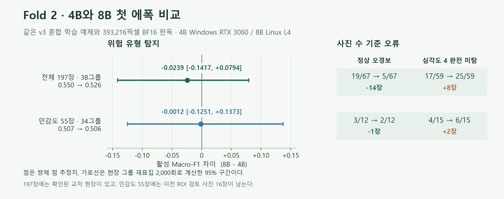

# Fold 2 Qwen3-VL-8B 첫 에폭 기준선

Fold 2의 기존 4B와 같은 학습 예제, 순서, v3 지시문, 사진 해상도와 추론 배치를 고정했다. 두 모델은 학습에서 이중 양자화 NF4과 BF16 계산을 쓰고 추론에서 BF16으로 적재한다. 8B는 공개 기반 가중치에서 새 LoRA를 초기화한다. 훈련 시스템은 4B가 Windows RTX 3060, 8B가 서울 Linux L4다. [4B 실측](fold2-v3-4b-epoch1-20261128.md) · [8B 기반모델 원본](https://huggingface.co/Qwen/Qwen3-VL-8B-Instruct/tree/0c351dd01ed87e9c1b53cbc748cba10e6187ff3b)

## 회수한 8B와 기존 4B의 쌍체 결과

서울 8B는 두 표본에서 정상 오경보 18% 기준을 통과했다. **심각도 4 완전 미탐은 정본에서 17→25건, 고정 55장에서 4→6건으로 늘어 승격을 보류한다.** 활성 코드 F1 차이의 현장 묶음 재표집 구간은 두 표본 모두 0을 포함한다. [실측 집계](../results/fold2-matched-4b-8b-epoch1-20261128.json)

| 같은 평가 사진 | 활성 Macro-F1 4B → 8B | 차이 [95% 구간] | 공통 8종 F1 | 정상 오경보 | 심각도 4 완전 미탐 |
|---|---:|---:|---:|---:|---:|
| 정본 197장·38그룹 | .55037 → .52644 | −.02393 [−.14175, +.07936] | .61916 → .59224 | 19 → 5 / 67 | 17 → 25 / 59 |
| 고정 55장·34그룹 | .50679 → .50555 | −.00124 [−.12511, +.13727] | .57014 → .56875 | 3 → 2 / 12 | 4 → 6 / 15 |
| 탐색 19장·19그룹 | .40370 → .45000 | +.04630 [−.11905, +.28571] | .45417 → .45000 | 0 → 0 / 2 | 2 → 2 / 9 |



정본에서 8B만 심각도 4 정답을 맞힌 사진은 2장, 4B만 맞힌 사진은 10장이었다. 인양 정답 적중은 4→1/12, 끼임은 5→3/8이었다. 추락 적중은 17/37로 같고 오탐은 12→5건이었다. 정답이 복수인 38장에서는 맞힌 위험 코드가 41→43/80, 위험 집합 완전 일치가 5→9장으로 늘었다. 탐색 19장에서는 4B가 정답에 없던 인양 코드를 출력해 활성 분모가 9종이고 8B는 8종이다. 같은 8종의 탐색 F1은 .00417 낮았다. [코드별 적중·미탐·오탐과 쌍체 전환](../results/fold2-matched-4b-8b-epoch1-20261128.json)

첫 에폭 67개 갱신의 예제 수, 감독 토큰 134,372개, 결정 토큰 20,707개와 학습률이 4B 대조군 기록과 일치했다. 에폭은 3,354.5초, 단계 합계는 3,344.19초, CUDA 피크 할당은 8.823GiB, 단계 로그의 최대 예약량은 9.03GiB였다. 8B 추론은 지정한 배치로 **197/197행 원생성 JSON·내부 스키마 통과**, 토큰 상한 도달 0건, 생성 누적 **1,297.2초**였다. 생성 시간은 모델 설치와 적재를 뺀 값이다. 두 예측 파일의 사진 순서와 SHA를 재검사하고 정본을 별도 CPU 경로로 다시 채점해 수치가 일치하는 것을 확인했다.

## 고정한 실행 조건

| 고정 항목 | 기준 |
|---|---|
| 사진과 예제 | 769장·154개 매니페스트 그룹. 혼합 커리큘럼 1,066예제, 정규 판독 769·희귀 판독 72·기타 판독 28·정상 균형 판독 41·양성 검증 78·어려운 음성 검증 44·정상 검증 34 |
| 예제 순서 | 원래 커리큘럼 SHA-256 `a8676c976cd0b0146717cd4cf140092f9dd824323a595a27900dcf40afac23cf`. 에폭 1은 Python `random.Random(1042)`로 같은 순서를 생성. 4B 로그의 총 감독 토큰 134,372개·결정 토큰 20,707개를 단계별로 검증 |
| 학습 | 배치 1, 누적 16, 66×16 + 10. 2에폭 코사인 스케줄 134스텝, 워밍업 7, 67번에서 중단. AdamW 기본 학습률 .00014, 시각 병합층 .65배, weight decay .01, gradient norm 상한 1.0 |
| LoRA | rank 16, alpha 32, dropout .05. 언어층과 시각 병합층. 4B 약 3,398만 개, 동일 타깃의 기존 8B 약 4,479만 개. 실제 8B 학습 경로에서 매개변수와 기울기를 검증 |
| 추론 | 393,216픽셀 상한, 131,072 최소, greedy, 최대 새 토큰 620, SDPA. 4B에서 끝까지 완료된 배치 경계 4장×11, 2장×76, 1장×1. 8B도 이 경계로 평가하고 OOM으로 경계가 바뀌면 일치 영수증 발행을 중단 |
| 출처 | v3 프롬프트 `13edaf96ccd032551ea0a1ebdc27934d958afd1259439f4b05773bdde1b2e07f`, 4B 리비전 `ebb281ec70b05090aa6165b016eac8ec08e71b17`, 8B 리비전 `0c351dd01ed87e9c1b53cbc748cba10e6187ff3b` |

### 평가 분모

정본 197장은 평가 사진 ID와 매니페스트 그룹이 학습과 겹치지 않는다. 시각 검토에서 실제 관련 현장으로 확인된 3그룹·103장도 정본에 들어 있다. 고정 55장은 이전 노출 원장과 확인된 교차 현장 4그룹·142장을 뺀 분모다. ROI에서 직접 관찰한 16장, 같은 그룹까지 포함하면 35장이 남는다. 별도 탐색 19장은 ROI와 큐레이션과 같은 그룹도 제외했다. 19장 규칙은 4B 추론 전에 고정했고 개별 명단은 그 뒤 재구성했다. 정상 분모는 197장 중 67장, 55장 중 12장, 19장 중 2장이다. [노출 원장](../results/sub78-fold2-prospective-readiness-20261128.json) · [19장 재생](../results/fold2-v3-4b-epoch1-exposure19-replay-20261128.json)

기존 4B는 정본 활성 9종 F1 .550367, 공통 8종 .619163, 정상 오경보 19/67, 심각도 4 완전 미탐 17/59였다. 55장에서는 각각 .506787, .570136, 3/12, 4/15였다. 쌍체 점수기는 두 후보의 각 활성 집합으로 계산한 F1과 고정 공통 8종 F1을 보고하고, 같은 그룹을 뽑는 재표집 2,000회(seed 42)로 차이를 추정한다. 양쪽 모델과 정답의 합집합을 사용한 F1은 보조 집계다. 정답이 복수 위험인 사진의 코드 재현율·완전 일치율, 정답에 없는 `slip_trip`의 오탐, 코드별 TP·FP·FN도 센다. 장비 크기와 원거리 시인성의 영향은 블라인드 주석이 있는 별도 표본이 필요하다. [4B 집계](../results/fold2-v3-4b-epoch1-20261128.json) · [배치 영수증](../results/fold2-v3-4b-epoch1-batch-witness-20261128.json)

### 로컬 준비와 승인된 서울 실행

프로젝트 루트에서 CPU로 원본 커리큘럼·분할·프롬프트·파일 지문과 67단계 기록을 확인한다. 사진 바이트는 공식 ZIP에서 읽고 매니페스트 SHA-256을 대조한다. 4B 학습과 같은 `c61bd9e`의 Python 소스와 전용 실행기를 학습 TAR에 담았다. 학습 TAR 1,287,813,120바이트에는 769장과 학습측 주석만, 평가 TAR 334,417,920바이트에는 순서를 고정한 사진 197장과 ID·경로·SHA만 들어 있다. 4B 예측, 평가 주석, 55·19장 마스크, 법령 원문·검색 사례는 G:에서 채점에만 사용한다. [CPU 검산과 실제 전송 지문](../results/fold2-8b-matched-preflight-20261128.json)

```powershell
python -S -B -u -m kwater_lab.fold2_8b_baseline prepare --out data/fold2-8b-matched-epoch1
python -S -B -u -m kwater_lab.fold2_8b_baseline verify-prepared --out data/fold2-8b-matched-epoch1
python -S -B -m unittest discover -s tests -p test_fold2_8b_baseline.py -v
```

이 실행의 승인 한도는 서울 `g2-standard-8` Spot 1회, 복구·종료 확인 포함 누적 3시간과 3,000원이다. 계정과 프로젝트를 기존 작업과 대조한 뒤 SSH/IAP로 비공개 작업 디렉터리에 보내고 양쪽에서 SHA-256을 대조한다. Ubuntu 24.04/Python 3.12, torch 2.5.1+cu124, transformers 4.57.1, PEFT 0.17.1, bitsandbytes 0.50.2, Pillow 11.0.0은 이전 실측 버전이다. 공개 8B 가중치는 서울 VM에서 리비전을 고정해 내려받고 샤드 4개 지문을 검증한다. 기존 서울 작업에서 사용한 부트스트랩과 체크섬 도구의 로컬 사본은 `.runtime/roadmap-seoul-1128/`의 `bootspot.sh`, `fetch8.py`, `source8.json`이다.

```bash
umask 077
export HF_HUB_OFFLINE=1 TRANSFORMERS_OFFLINE=1 OMP_NUM_THREADS=1
printf '%s  train.tar\n' "$TRAIN_SHA256" | sha256sum --check
tar -xf train.tar
flock -n fit.worker.lock "$PYTHON" -B -u -m kwater_lab.fold2_8b_baseline train \
  --base "$BASE8" --out fit

# 학습 단계가 종료된 뒤 평가 TAR를 별도로 전송한다.
test -s fit/epoch-1/training_state.pt
printf '%s  eval.tar\n' "$EVAL_SHA256" | sha256sum --check
tar -xf eval.tar
flock -n eval.worker.lock "$PYTHON" -B -u -m kwater_lab.fold2_8b_baseline infer \
  --base "$BASE8" --fit fit --out eval
```

학습 코어는 2·10·20·30·40·50·60번과 67번에서 임시 형제 디렉터리에 어댑터, 옵티마이저, 스케줄러, 난수, 학습 위치와 단계 기록을 저장한 뒤 최종 이름으로 원자적으로 바꾼다. 같은 디스크를 붙여 같은 명령을 실행하면 가장 최근에 완성된 체크포인트에서 재개한다. 10번에서 위치는 첫 에폭의 160예제 직후다. 67번에서는 이미 완료된 첫 에폭을 재사용한다. 68번 이후 또는 공개된 체크포인트의 상태·커서가 불일치하면 실행을 중단한다. 2번 이전에 끊기면 남은 단계 로그를 보존하고 초기 seed에서 다시 시작한다. 로컬 테스트는 임시 디렉터리 무시, 10번 선택, 커서·스케줄러 불일치 검출, 67번 중단 전달을 확인했다. [원자적 저장·재개 코어](../kwater_lab/vlm_11code.py) · [래퍼 테스트](../tests/test_fold2_8b_baseline.py)

서울에서 `fit/epoch-1/`의 어댑터와 상태, `fit/steps.jsonl`, `eval/`의 두 원생성 캐시·영수증을 회수한다. 코어는 생성 배치가 끝날 때마다 캐시를 원자적으로 기록하므로 같은 모델과 입력에서 평가를 재개할 수 있다. 로컬 스코어는 단계별 학습률·토큰 수, 197행의 ID·사진 SHA·렌더링된 지시문·배치와 정확한 어댑터를 교차 확인한다. 채점은 학습측 769장으로 다시 만든 법령 사례집을 사용한다. 회수물이 확인되면 VM·디스크와 남긴 임시 전송을 정리하고 리소스 부재를 확인한다.

```powershell
$env:CUDA_VISIBLE_DEVICES = '-1'
$env:OMP_NUM_THREADS = '1'
& 'C:/Users/JY/.antigravity_kwater_venv/Scripts/python.exe' -B -m kwater_lab.fold2_8b_paired_score `
  --fit data/fold2-8b-matched-epoch1/fit `
  --evaluated data/fold2-8b-matched-epoch1/eval
```

### 시간과 비용 근거

로컬 3060은 물리 VRAM 12,288MiB다. 8B의 BF16 샤드 4개가 17,534,339,512바이트이며 기존 L4 첫 에폭 단독 200장 추론 피크는 21,472MiB였다. 서울의 이전 Fold 4 8B 학습은 첫 69스텝 3,388.37초, 최대 예약 9.0GiB이고 175장 BF16 생성은 1,057.1초였다. 현행 67스텝은 55~60분, 197장 혼합 배치 생성은 20~35분을 계획값으로 둔다. 이미지 전송은 100Mb/s에서 약 2.2분, 20Mb/s에서 약 10.8분의 이론값이다. 서울의 공개 가중치 다운로드, 환경 설치, 해시 확인, Spot 복구 및 회수 시간이 추가된다. [로컬 메모리 조사](../results/fold2-local-8b-feasibility-20261128.json) · [서울 8B 실측](seoul-l4-roadmap-experiments-20261128.md)

이전 서울 Spot 영수증의 시간당 계산은 VM $0.366956, 150GiB 디스크와 IP를 합쳐 약 $0.399였다. 환율 1,500원/USD와 VAT 10% 가정으로 1.5~2.1시간은 약 990~1,380원, 3시간은 약 1,975원이다. 약 0.54GB의 체크포인트·출력 회수에 따른 인터넷 송신료가 붙을 수 있다. 실제 인스턴스 가동·디스크 보존 시간과 당일 Spot SKU로 결제액을 계산한다. [이전 자원·비용 원장](../results/seoul-l4-roadmap-experiments-20261128.json) · [Google Spot 가격](https://cloud.google.com/spot-vms/pricing) · [디스크 가격](https://cloud.google.com/compute/disks-image-pricing) · [전송 요금](https://cloud.google.com/network-tiers/pricing)
