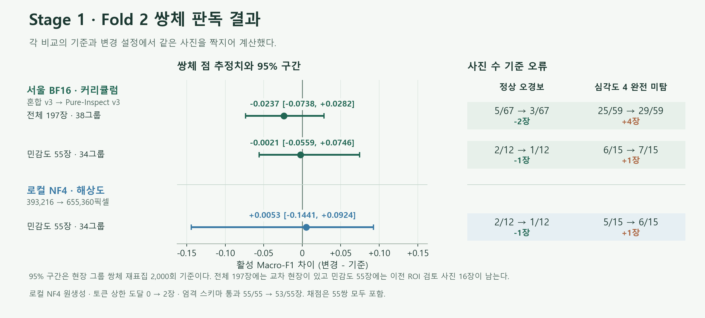

# Fold 2 Pure-Inspect 첫 에폭 결과

**혼합 학습의 검증 질문을 모두 판독 예제로 바꿔도 중대 위험 회수가 회복되지 않았다.** 공식 개발 사진 197장에서 혼합 8B가 놓친 심각도 4 사진 중 한 장을 새로 맞혔고, 기존에 맞히던 다섯 장을 놓쳤다. 정상 오경보는 두 장 줄었다. 전량 1,045장 학습에는 이 변경을 채택하지 않았다. [코드별 실측과 쌍체 판정 원장](../results/stage1-pure-vs-mixed-fold2-20261128.json)

| 평가 표본 | 활성 Macro-F1 혼합 → Pure | Δ [현장 묶음 95% 구간] | 공통 8종 F1 | 정상 오경보 | 심각도 4 완전 미탐 | 복수 위험 코드 회수 |
|---|---:|---:|---:|---:|---:|---:|
| 정본 197장 | .52644 → .50269 | −.02374 [−.07383, +.02820] | .59224 → .56553 | 5 → 3 / 67 | 25 → 29 / 59 | 43 → 36 / 80 |
| 고정 55장 | .50555 → .50342 | −.00213 [−.05587, +.07457] | .56875 → .56634 | 2 → 1 / 12 | 6 → 7 / 15 | 16 → 14 / 31 |



197장에서 인양 적중은 두 모델 모두 1/12였다. 같은 사진에 대한 기존 4B의 중대 완전 미탐은 17/59였고, 고정 55장에서는 4/15였다. 197장에 학습측과 연결된 현장이 있으며 55장에는 과거 ROI 검토 사진 16장이 남아 있다. 표의 현장 그룹 재표집은 시드 42로 2,000번 수행했다. 두 구간 모두 0을 포함한다. [4B·혼합 8B 기준선](fold2-8b-matched-baseline-20261128.md) · [고정 마스크 노출 이력](../results/sub78-fold2-prospective-readiness-20261128.json)

## 바꾼 조건과 실행

사진 769장, v3 지시문, 393,216픽셀, 선행 가중치, NF4 학습과 BF16 평가, 학습측 법령 사례집을 고정했다. 전체 1,066개 학습 슬롯에서 검증 질문 156개를 같은 사진의 판독 정답으로 바꿨다. 나머지 910개 예제와 사진·증강 순서가 일치했다. 2에폭 학습률 스케줄의 첫 67/134 갱신에서 멈췄고, 모든 갱신의 예제 수와 적용 학습률이 대조군과 일치했다. 감독 토큰은 134,372→145,562, 결정 토큰은 20,707→22,303개였다. [입력 고정과 재현 명령](../docs/stage1-pure-v3-overlay-20261128.md)

서울 L4의 학습시간은 3,388.0초, 손실은 .9116, CUDA 최대 할당은 8.823 GiB였다. 에폭 종료 후 평가 사진을 따로 전송했다. 197장 BF16 생성은 1,213.4초였고 JSON 및 원생성 스키마 검사는 197/197, 토큰 상한 도달은 0건이었다. 정답과 포매팅된 두 출력 파일에서 활성 Macro-F1, 정상 오경보와 심각도 4 미탐을 독립적으로 다시 집계해 표와 일치함을 확인했다. [학습·판독 및 비용 원장](../results/seoul-fold2-pure-8b-epoch1-20261129.json)

```powershell
python -B -m kwater_lab.stage1_pure_overlay score --pure-fit data/fold2-8b-pure-v3/fit-pure --pure-eval data/fold2-8b-pure-v3/eval-pure
```

승인된 서울 Spot G2-8 한 대와 150 GiB 디스크를 사용했다. 생성부터 삭제 확인까지 87.79분이었다. VM·디스크·IP 추정 963원과 결과 전송 추정 162원을 합쳐 1,125원이다. 전송을 포함한 예비비를 적용한 추정은 1,463원이며, 실제 청구액은 결제 명세서에서 확정된다. 회수 TAR는 554,240,000 B였고 양쪽 SHA-256은 `aca298b26540fea651d6382bd9fb196482561880aedc58b780684b42c55dd7c5`로 일치했다. 11월 29일 02:09 KST에 인스턴스와 디스크 삭제를 확인한 뒤 프로젝트 전체 목록도 각각 0개임을 확인했다. [회수·비용 근거](../results/seoul-fold2-pure-8b-epoch1-20261129.json)
