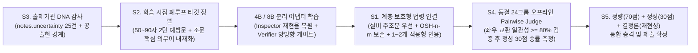

# GitHub 이슈 #2(`서베이`) 및 이식 실험 보고서 심층 감사 · 정성 30점 및 출제기관 DNA 로드맵 보완안

**S1 후속 판정.** 9건의 예방조치·조문 불일치를 검수하고, 동결 v3의 첫 인용만 바꾼 두 정책을 비교했다. 제한적 교정은 175장·107장에서 각각 3건·2건을 회복했고 적격 행의 손실은 없었다. 바뀐 사례에 대한 독립 정성 판독을 다음 게이트로 두며 이번 제출은 현행 인용을 유지한다. [9건 검수와 정성 대조](fold4-citation-alignment-20261128.md)

**11월 28일 후속 검증.** 고정 v3 생성문에서 첫 법령을 놓친 9건을 재구성했다. OSH-20·32로 교체된 사례는 0건이어서 아래 S1의 원인 설명을 수정한다. 훈련용 326장과 동결 평가 패널을 분리해 S2~S4 자료를 구성했다. [새 실측표와 단계별 실행 계획](qualitative-vision-followup-20261128.md)

- **작성 시각**: 2026-11-28 KST
- **검토 대상**:
  1. [GitHub 이슈 #2 원문 (`서베이`, 2026-11-27)](https://github.com/nornen0202/KWater-SafetyAI/issues/2)
  2. 1차 이식 검토 보고서: [issue-2-transfer-experiments-20261127.md](issue-2-transfer-experiments-20261127.md) 및 연계 원장([issue2-query-ablation-20261127.json](../results/issue2-query-ablation-20261127.json), [fold4-law-policy-replay-20261127.json](../results/fold4-law-policy-replay-20261127.json), [fold4-law-support-blind-review-20261128.json](../results/fold4-law-support-blind-review-20261128.json))
  3. 현행 마스터 로드맵: [comprehensive-audit-and-vlm-roadmap-20261128.md](comprehensive-audit-and-vlm-roadmap-20261128.md) · [vision-task-models-audit-and-roadmap-20261128.md](vision-task-models-audit-and-roadmap-20261128.md)

---

## 0. 핵심 결론 요약 (Executive Summary)

1. **현행 실험 및 마스터 로드맵의 '이슈 #2 반영률' 진단 — 전체 약 `32%` (정량 70점 편중, 정성 30점·폐루프 정합성 소외)**:
   - 지금까지의 본학습(`SafeGround v3` · `Full-1045`)과 최신 마스터 로드맵(4B vs 8B 학습, 27B 200장 시간 검증, 검증기 마진 게이트)은 **정량 70점(위험 코드 Macro-F1)과 L4 실행 안정성**에는 매우 치밀하게 설계되어 있다.
   - 반면 이슈 #2가 핵심 승부처로 제시한 **① 출제기관 라벨링 DNA 역설계, ② 조문·사례와 생성 조치의 폐루프(Closed-loop) 정합성, ③ 가림·모호 장면의 스키마 안전형 유보 처리, ④ 오프라인 정성 30점(`근거 12 + 조치 12 + 출처 6`) 다중 심사기(Judge) 게이트, ⑤ 실무형 2단 예방조치 학습**은 탐색적 CPU 재생만 일부 수행되었을 뿐 **실제 모델 학습과 마스터 승격 기준에는 30% 미만만 반영**되어 있다.

2. **원자료 전수 계량으로 새로 밝혀낸 3가지 결정적 사실**:
   - **발견 ① · 왜 `v3`의 `ActionSupportedLawRetriever`에서 정답 법령 적중이 `68/81(84.0%) → 60/81(74.1%)`로 `-9.9%p` 하락했는가?**: 코드([v3_turnaround.py](../kwater_lab/v3_turnaround.py#L99-L198), [prevention_law_guard.py](../kwater_lab/prevention_law_guard.py#L20-L64))와 원장([fold4-law-policy-replay-20261127.json](../results/fold4-law-policy-replay-20261127.json#L118-L132))을 대조한 결과, VLM이 예방문에 부수적으로 쓴 *"안전모 착용"*, *"출입 통제"* 같은 일반 어휘가 범용 조문(`OSH-32` 보호구, `OSH-20` 출입금지) 가산점·우선규칙을 발동시켜 **원래 1순위였던 구체 설비·공정 본체 조문(`OSH-43` 개구부, `OSH-56` 작업발판 등)을 덮어썼기 때문**이다. 더욱이 공식 스키마는 `references`를 **최대 3개**까지 허용하고 실제 학습 정답의 **21.8%(`193/886건`)가 복수 조문(2~3개)**인데도 `max_refs=1`로 강제 절단하고 있었다.
   - **발견 ② · 공식 `train.jsonl` 안에 이미 `notes.uncertainty`(실제 주석자의 판단 한계 기록 `25건`)가 존재함**: 지금까지 모든 학습 변환기(`prepare_dataset.py`, `vlm_11code.py`)가 `notes.scene_note`만 읽고 **`notes.uncertainty` 필드를 전량 폐기**해 왔다. 전체 1,045장 중 주석자가 직접 모호성·시야 한계를 기록한 `25건`(`no_visible_hazard` 14건, `hazard` 11건, 중앙값 `49자`)은 인위적 랜덤 Cutout(`도입 2 Task C`)의 부작용 없이 **K-water가 설정한 '단정 금지 경계'를 역추적할 수 있는 정본 단서**다.
   - **발견 ③ · K-water 정답 문체의 실제 통계(`중앙값 47~49자`, 복합 조치 `80.7%`)**: 학습셋 위험 942건의 정답 길이는 `evidence` 중앙값 **`47자`**(p90 `68자`), `prevention` 중앙값 **`49자`**(p90 `81자`), 안전 사진 `scene_evidence` 중앙값 **`34자`**다. 이슈 #2의 제안처럼 모든 사진에 장황한 *"작업 전 TBM 실시"* 상투어를 붙이면 어휘 검색 쿼리가 희석되고 정성 일관성이 깨지지만, 실제 정답의 **80.7%(`760/942건`)**는 50~80자 안에 **`[선행 안전조치/점검 + 물리적 직접 방호]`** 두 동작을 압축 기술하고 있다.

3. **마스터 로드맵에 즉시 통합할 5대 고수익 보완 트랙 (`S1 ~ S5`)**:
   - **`S1` (즉시 CPU · 비용 0원)**: 범용 조문(`OSH-32`/`OSH-20`)이 구체 설비 조문을 밀어내지 못하도록 **조문 구체성 계층(Specificity Guard)**을 복원하고, 주조문과 행위 지지 조문이 다를 때 **적응형 1~2개 인용(`Adaptive Top-2 Refs`)** 정책을 고정 생성문에서 대조한다.
   - **`S2` (학습 타깃 정렬 · 추가 추론 시간 `0초`)**: 느린 추론 시점 2-패스 RAG 대신, **훈련 분할의 SFT 타깃 `prevention`이 주석 조문(`OSH-*`)의 핵심 법령 의무어와 2단 안전순서를 50~90자 내에 담도록 정렬(Training-time Closed Loop)**하여 생성 품질과 사후 조문 검색 적중률을 동시에 높인다.
   - **`S3` (출제기관 DNA 반영)**: 공식 `notes.uncertainty` 25건과 상위 공출현 쌍(`fall+slip` 39건, `other+slip` 39건)의 독립 위험 인정 조건을 추출해 프롬프트·검증기 기각 예제에 반영하고, 저신뢰 후보 기각으로 정상 전환 시 관찰된 방호 상태를 담은 구체적 `scene_evidence`를 출력한다.
   - **`S4` (정성 30점 평가 암흑 해소)**: 이미 동결해 두고 미실행 중인 **24개 독립 그룹 정성 패널**에 대해 좌우 교환 일관성(`≥80%`)과 음성 대조를 검증한 **오프라인 눈가림 Pairwise Judge**를 가동해, 4B vs 8B 승격 시 정량 F1과 함께 정성 승률을 공동 게이트로 사용한다.
   - **`S5` (결선 재현성 30점·활용성 40점 잠금)**: 모든 후보 ZIP의 연속 2회 실행 바이트/행 단위 결정론(`seed=42`, `do_sample=False`) 검증을 의무화한다.

---

## 1. GitHub 이슈 #2 원문(`서베이`) 및 `issue-2` 보고서 정밀 비평

### 1.1 이슈 #2 원문의 타당한 핵심 통찰 vs 그대로 따랐을 때 위험한 5대 오류

이슈 #2는 역대 K-water 대회(1~4회)와 KDD Cup 2025 CRAG-MM, 한솔데코 시즌3, AI City 2026 수상 전략을 종합한 외부 리서치 문서로, **전략적 문제의식은 매우 정확하나 저장소 구조와 공식 스키마에 대한 사실 오류가 혼재**해 있다.

| 구분 | 이슈 #2 원문의 주장 | 원자료·코드·스키마 대조 검증 결과 | 채택 및 교정 방향 |
|---|---|---|---|
| **핵심 통찰 (채택)** | ① 출제기관 라벨링 기준 역설계 ② 환각 시 코드·근거·출처 3중 감점 ③ SFT 단독 한계 → 사후 검증 및 거절 DPO ④ 코드 적중 외 정성 30점(실무 조치·조문 정합성)과 재현성 잠금 | 실제 2차 제출(고정 상투어 + 오경보 → `16.12점`)과 5·6차 도약(`42.04 → 47.35 → 53.65점`)이 이 진단과 정확히 부합함. 현재 10위권 격차(`2.25점`) 돌파에도 정성 30점 방어가 필수적임. | **전면 수용** (정성·법령·불확실성 트랙을 마스터 로드맵 주류로 격상) |
| **오류 1 · 스키마·파일 착각** | `build_indices.py`, `run_benchmark.py`, `docs/spec/evaluation-alignment.md` 수정 및 애매한 위험을 **`판단 한계` 필드**로 자동 이동(`0.25~임계값`) | 해당 3개 파일은 저장소에 없으며, 공식 출력 스키마(`prediction.schema.json`)에는 `hazard_codes`, `source_ids`, **`판단 한계` 필드가 존재하지 않음**(임의 키 추가 시 `E06` 무효 처리). | **스키마 안전형으로 변환**: 애매한 후보 기각 시 정상 전환이면 `scene_evidence`에 가시 범위 관찰을 기록하고, 확정 위험 내에서는 `prevention`의 선행 확인 조건으로 표현 |
| **오류 2 · 통계적 모순** | 과거 제출 점수로 로컬 Judge와의 순위 상관 **Spearman $\rho \ge 0.85$** 달성 최우선 | [issue-2 보고서](issue-2-transfer-experiments-20261127.md#L81-L83)가 증명했듯 `42.04` 동점 3건이 낀 4개 제출에서 비동점 평가기의 수학적 최대 상관은 `0.775`이며, 공개 총점은 `정량 70 + 정성 30` 합산이라 정성 단독 상관 잣대로 쓰면 왜곡됨. | 총점 피팅 대신 **① 좌우 순서 교환 일관성(Swap Consistency), ② 고의 오답(잘못된 조문/타 사진 근거) 검출률, ③ 인간 눈가림 판정 일치율**로 로컬 Judge 신뢰도 검증 |
| **오류 3 · 상투적 TBM 강제** | 모든 예방조치에 `① 물리적 방호 + ② 관리적 TBM/사전점검` 일괄 포맷팅 | 공식 `train.jsonl` 942건 실측 결과 정답 `prevention` 중앙값은 **`49자`**(p90 `81자`)로 간결함. 모든 행에 무관한 *"작업 전 TBM 실시"*를 붙이면 어휘 검색 쿼리가 오염되고 상투어 감점 위험이 생김. | 기계적 TBM 삽입 금지 → 실제 정답의 80.7%(760건)가 따르는 **`[해당 위험 특화 선행 안전조치 + 조문 직결 물리적 방호]` 50~90자 압축 평서문**으로 정렬 |
| **오류 4 · 과중 검색 스택** | 형태소 분석기 + `Qwen3-Embedding` + `Qwen3-Reranker` 전면 교체 | 동봉 유효 법령 조문(`article`)은 총 690개(실제 정답 인용 고유 조문 **70개**), 학습 사례는 ~800건뿐임. 정답 코드 기준 기존 경량 검색기의 Hit@1이 이미 **`84~85%`**인 상태에서 수 GB 임베딩·리랭커 탑재는 L4 시간·용량 대비 실익이 낮음. | 무거운 임베딩 모델 추가 대신 **① 생성 단계의 법령 핵심어 내재화(`S2`) + ② 범용 조문 역전 방지 및 적응형 1~2개 인용(`S1`)**으로 비용 `0초` 해결 |
| **오류 5 · 단일 어댑터 4~5배 혼합** | 단일 VLM 어댑터에 `Task A+B+C`(랜덤 Cutout 포함) 4~5배 동시 학습 | 이미 `v3`에서 2개 과제 혼합 2에폭 시 **초벌 위험 완전 미탐이 `21.4% → 37.3%`로 급증**하는 과제 간 간섭이 실증됨. 인위적 Cutout 대량 혼합 시 초벌 침묵 편향이 심화될 위험이 큼. | **어댑터 역할 분리(`Inspector` vs `Verifier`)** 유지 + 인위적 Cutout 대신 공식 `notes.uncertainty`(25건) 및 실제 가림 난례를 `Verifier` 기각 학습에 표적 활용 |

---

### 1.2 `reports/issue-2-transfer-experiments-20261127.md` 문서 자체에 대한 평가와 보완 필요점

1. **높이 평가할 점**:
   - 이슈 #2의 존재하지 않는 스키마·통계 오류를 실증적으로 바로잡고, 5개 제안을 통제 가능한 단일 변수 실험으로 재정의했다.
   - 특히 146~162행에서 수행한 **동일 생성문 법령 정책 2×2 대조**([fold4-law-policy-replay-20261127.json](../results/fold4-law-policy-replay-20261127.json))와 **바뀐 8건 눈가림 직접 지지 검토**([fold4-law-support-blind-review-20261128.json](../results/fold4-law-support-blind-review-20261128.json))를 통해 *"주석 ID 적중은 내려갔는데(`61→54`) 문장 직접 지지는 올라갔다(`0/8→3/8`)"*는 핵심 역설을 포착했다.

2. **보완이 시급한 3가지 한계**:
   - **원인 미규명 및 후속 수정 누락**: 왜 `v3`의 조치 가드가 맞았던 정답 조문 8~9건을 틀리게 바꿨는지 코드 수준 원인을 파헤치지 않고 다음 현장에서 더 읽어보자는 수준에서 멈췄다(아래 3.1절에서 정확한 원인과 즉시 수정 규칙 제시).
   - **로드맵 단절**: `issue-2` 문서에 설계해 둔 실험 2(과제 증분), 실험 4(24그룹 눈가림 정성 평가), 실험 5(생성 시점 2단 예방문 개선)가 정작 최신 실행 계획인 [comprehensive-audit-and-vlm-roadmap-20261128.md](comprehensive-audit-and-vlm-roadmap-20261128.md)로 넘어갈 때 구체적인 일정·게이트에서 빠지거나 부수 항목으로 밀렸다.
   - **시계열 누적 서술로 인한 가독성 저하**: 11/27 저녁부터 11/28 새벽까지의 시점별 메모가 순차 덧붙여져 있어, 각 제안의 **현재 상태(완료 / 진행 중 / 미실행)**를 명확한 추적표로 정리할 필요가 있다.

---

## 2. 이슈 #2 제안별 현행 실험·로드맵 반영 현황 정밀 점검표

| 이슈 #2 제안 항목 | 현재까지 실제 수행된 실험·구현 | 현행 후속 로드맵 반영 수준 | 반영률 | 핵심 누락·보완 지점 |
|---|---|---|---:|---|
| **출제기관 DNA 역추적** | `other` 정의 정상화, 무위험 30% 비율 유지 | 코드별 오탐 분석 위주로만 반영 | **40%** | 공식 `notes.uncertainty`(25건), 정답 압축 길이(`47~49자`), 상위 공출현 쌍(`fall+slip`·`other+slip` 각 39건)의 정당/과잉 경계 미반영 |
| **도입 1: 시각 요약·하이브리드 법령 검색** | Fold 0 기존 텍스트 쿼리 3종(`full`·`evidence`·`prevention`) 어휘 재생 완료 | 24그룹 눈가림 재검증만 언급 | **20%** | 여전히 **사후 부착(Open-loop)**; 범용 조문(`OSH-32`/`OSH-20`)이 주조문을 덮어써 **정답 적중 `-9.9%p` 하락**한 버그 미수정; 복수 인용(`21.8%`) 미활용 |
| **도입 2: 3-Subtask QLoRA (`A·B·C`)** | `Task A`(후보 검증)만 단일 어댑터에 혼합 학습 | `Task A` 분리 어댑터 대조만 반영; `B·C` 누락 | **30%** | `Task B`(법령 핵심어 정렬 조치 학습) 및 `Task C`(실제 가림 사례 기반 단정 억제) 설계 부재 |
| **도입 3: 보류·이관 게이트 & 거절 DPO** | 추가 후보 1-토큰 마진 게이트 구현 완료 | 초벌 오탐 제거(Prune) 대조 및 조건부 DPO 반영 | **55%** | 초벌 위험 제거 후 `no_visible_hazard` 전환 시 고품질 관찰형 `scene_evidence` 보존 규칙 구체화 필요 |
| **도입 4: 로컬 `Council of Judges`** | Fold 0 12장 단일 판독 + Fold 4 **24그룹 패널 배정만 동결(채점 `0건`)** | 수동/단일 검토 수준 언급 | **25%** | **정성 30점을 모델 승격 게이트에서 정량 측정할 오프라인 자동·반자동 Judge 파이프라인 부재** |
| **도입 5: 2단 구조화 예방조치** | 사후 번호 붙이기 재생(`변경 0건`)만 확인 | **마스터 로드맵에서 사실상 누락** | **15%** | 생성·학습 단계에서 `[선행 안전확인 + 조문 직결 물리적 방호]` 내용을 실제로 가르치는 실험 누락 |

---

## 3. 로드맵 및 전략에 즉시 반영할 5대 심층 보완 설계 (`S1 ~ S5`)

### 3.1 `[S1]` 법령 검색의 '주조문 역전 버그' 교정 및 적응형 1~2개 인용 대조 (즉시 CPU 실행 · 추가 런타임 `0초`)
- **근본 원인 해부**: `Fold 4` 적격 81건에서 `Native11LawRetriever`(`68/81` 적중) 대비 `ActionSupportedLawRetriever`(`60/81` 적중)가 **9건을 잃고 1건만 얻은 이유**([fold4-law-policy-replay-20261127.json](../results/fold4-law-policy-replay-20261127.json#L126-L132))는, 모델이 예방문에 부수적으로 적은 *"안전모 착용"*, *"출입 금지"* 표현이 `ACTION_ARTICLE_CUES` 및 `rerank_top1_by_action_support`에서 범용 조문(`OSH-32`, `OSH-20`)을 1순위로 끌어올려, 사례·본문 검색이 정확히 찾았던 **핵심 공정·설비 조문(`OSH-43` 개구부, `OSH-56` 작업발판, `OSH-3` 전선 통로 등)을 밀어냈기 때문**이다.
- **구체적 교정 실험 (CPU 10분 내 완결 가능)**:
  1. **조문 구체성 계층 보호(Specificity Hierarchy)**: 1순위 후보가 해당 위험코드의 핵심 설비·작업 조문일 때는 범용 보조 조문(`OSH-32` 보호구, `OSH-20` 출입금지)이 1순위를 덮어쓰지 못하게 제한하고, 1순위 후보가 현행 조치와 완전히 무관할 때만(예: 사다리 작업인데 거푸집 조문이 나온 경우) 동일 위험군 내 직접 지지 조문으로 교체한다. 또한 `OSH-4-2` 등 가지번호 조문 변환 누락을 전수 복원한다.
  2. **쿼리 가중치 비대칭화**: `issue2-query-ablation`에서 생성 `prevention`의 일반어가 섞일수록 적중이 소폭 하락(`v2`: `evidence_only 87/97 > full 86/97 > prevention_only 84/97`)한 실측을 반영해, **사례 검색(Case Index)에는 시각 사실인 `evidence` 가중치를 높이고(`1.3 : 0.7`), 조문 본문 직접 매칭(Law Clause Index)에는 `prevention` 핵심 명사 가중치를 높이는 분리 쿼리**를 대조한다.
  3. **`max_refs=1` 대 `Adaptive Top-2` 비교**: 공식 정답의 `21.8%`(`193/886건`)가 2~3개 조문을 가지므로, `[1순위 핵심 설비 조문]`과 `[직접 지지 보조 조문]`의 점수가 모두 높고 서로 보완적일 때 **2개를 함께 출력하는 정책**이 단일 인용 대비 정답 조문 F1과 눈가림 인용 지지도를 동시에 높이는지 Fold 0·4 고정 생성문에서 검증한다.

### 3.2 `[S2]` 추론 지연 `0초`의 '학습 시점 폐루프(Training-time Closed Loop)' — 조문 직결 압축 2단 조치 타깃 정렬
- **설계 원리 (이슈 #2 도입 1·2·5의 통합 해법)**: 추론 컨테이너에서 `검색 → VLM 재생성` 2단계를 돌리면 200장 처리시간이 두 배로 늘어나지만, **학습 데이터의 `prevention` 타깃을 주석 조문(`OSH-*`) 본문과 정렬**시켜 두면 추론 추가 시간 **`0초`**로 동일한 폐루프 효과를 얻는다.
- **구체적 실행 및 통제 대조**:
  1. 외측 훈련 분할 내부에서만 각 행의 정답 `references`(`OSH-*`) 원문(`laws.jsonl`)과 정답 `prevention`을 대조해, 조문이 요구하는 핵심 방호 명사(예: `OSH-43 → 안전난간/덮개`, `OSH-241 → 불티비산방지덮개/용접방화포`, `OSH-301/319 → 전원차단/충전부 절연방호`)가 빠졌거나 순서가 모호한 행만 식별한다.
  2. K-water 정답 길이 분포(`중앙값 49자, p90 81자`)를 엄격히 준수해, 상투적 TBM 문구 없이 **`[필요 시 작업 전 격리·확인 조치] + [조문 직결 물리적 방호 조치]` 1~2문장(50~95자)**으로 정제한 타깃(`Aligned-SFT`)을 만들고, 동일 사진·동일 스텝 예산의 원본 주석(`Raw-SFT`)과 미노출 폴드에서 **코드 F1 · 첫 조문 일치율 · 눈가림 조치/인용 선호도**를 1:1 비교한다(외부/교사 모델로 문장을 다듬을 경우 규정 rev. 93에 따라 모델·방법을 기록하고 사실 추가 여부를 전수 검수).

### 3.3 `[S3]` 공식 `notes.uncertainty`(25건) 및 공출현 패턴 역설계 기반 '스키마 안전형 유보·이관'
- **출제기관 기준 추출 (CPU 감사)**:
  1. 공식 `train.jsonl`에서 `notes.uncertainty`가 비어 있지 않은 **25건(`no_visible_hazard` 14건, `hazard` 11건)**과 공출현 상위 조합(`fall_height+slip_trip` 39건, `other+slip_trip` 39건, `fall_height+other` 14건, `slip_trip+struck_by_lifting` 14건)을 훈련 분할 안에서 전수 분석한다.
  2. *"어떤 시야 가림에서는 정상(`no_visible_hazard`)으로 처리하고, 어떤 경우에는 가시적 위험만 남기는가"*, *"단일 원인이 중복 기재된 것이 아니라 물리적으로 분리된 두 위험원일 때만 복수 코드를 부여하는가"*에 대한 결정 규칙을 문서화하여 프롬프트와 검증기 기각(`Verifier Reject`) 학습 데이터에 직접 반영한다(부작용 위험이 큰 무작위 이미지 Cutout 대체).
- **스키마 안전형 `scene_evidence` 출력**:
  - 양방향 마진 게이트가 초벌의 저신뢰 단일 위험을 기각해 `status: "no_visible_hazard"`로 전환할 때, 모호한 기본 폴백 문구 대신 초벌이 생성한 `scene_note`(확인된 설비·통로 상태 요약)를 정제해 `scene_evidence`로 채워 넣음으로써 정상 사진 정성 감점을 방어한다.

### 3.4 `[S4]` 동결 24그룹 패널 + 오프라인 눈가림 `Pairwise Judge` 즉시 가동 (정성 30점 계량화)
- **현황**: [fold4-qualitative-panel-20261127.json](../results/fold4-qualitative-panel-20261127.json)에 이미 사전 미노출 24개 독립 그룹 × 1장씩 표본과 6가지 순서 순열이 동결되어 있으나 실제 채점이 비어 있다.
- **실행 프로토콜**:
  1. 외부 API 전송 없이 로컬 또는 서울 L4에서 강건한 시각·언어 모델(`Qwen3-VL-8B` BF16 / `Qwen3.8-27B` Q4)과 법령 원문 대조기를 분리해 ① **근거의 시각적 가시성(12점 축)**, ② **예방조치의 구체성·안전순서(12점 축)**, ③ **인용 조문 본문의 직접 지지(6점 축)**를 각각 `0/1/2`점 및 쌍체 우열로 채점한다.
  2. **Judge 자체 검증 게이트**: A/B 좌우 순서를 뒤집어 두 번 평가했을 때의 **일관성(`Swap Consistency ≥ 80%`)**과, 다른 사진의 근거·무관 조문을 섞은 **음성 대조(Negative Control) 감점 적중률(`≥ 90%`)**을 먼저 통과시킨다.
  3. 향후 `4B v3/v4` 대 `8B` 대 `S1/S2 적용본` 비교 시, 코드 F1(70점 축)뿐 아니라 이 **24그룹 눈가림 정성 평가에서 악화가 없고 순승률이 개선되는지**를 공동 승격 조건으로 삼는다.

### 3.5 `[S5]` 결선(`현장 활용성 40 · 방법론 30 · 재현성 30`) 대비 결정론 검증 잠금
- 이슈 #2가 강조한 재현성 실격 방지를 위해, 모든 제출 후보 ZIP은 공식 컨테이너(`KWATER_SEED=42`)에서 동일 샘플 입력으로 **2회 독립 실행 시 출력 `submission.jsonl`의 SHA-256이 바이트 단위로 100% 일치(`Deterministic Exact Match`)**하는지 패키징 감사(`offline_archive_audit` / 리허설 스크립트)에서 자동 확인한다.

---

## 4. 현행 마스터 로드맵 일정과의 통합 실행표

기존 마스터 로드맵([comprehensive-audit-and-vlm-roadmap-20261128.md](comprehensive-audit-and-vlm-roadmap-20261128.md))의 GPU 일정을 전혀 늦추지 않고 CPU·보조 세션에서 즉시 병행해 합류시킨다.

| 시기 | 기존 마스터 로드맵 (정량 70점 & 대형 VLM 축) | **신규 보강 트랙 (정성 30점 & 이슈 #2 완결 축)** | 통합 승격 게이트 |
|---|---|---|---|
| **11/28 ~ 11/29** | 4B 기준 200장 L4 리허설 · 4B 검증기(분리 어댑터 / 오경보 제거) · 27B Q4 실행 점검 | **`S1`(주조문 역전 방지 + 가지번호 복원 + 1~2개 인용 CPU 재생)** · **`S3`(`notes.uncertainty` 25건 및 공출현 기준 추출)** | 고정 생성문에서 정답 조문 적중 회복(`60/81 → ≥68/81`) **및** 눈가림 직접 지지 비하락 동시 확인 |
| **11/29 ~ 12/02** | 4B vs 8B 동일 조건 학습 및 쌍체 비교 | **`S4`(동결 24그룹 눈가림 Pairwise Judge 가동 및 Swap 일관성 검증)** → 4B 대 8B의 정성 30점 축 우열 측정 | 코드 F1 기준 통과 + 24그룹 정성 눈가림 비교에서 사실 오류·역순 조치 비증가 |
| **12/02 ~ 12/06** | 우세 모델(8B 또는 개선 4B) 새 외측 폴드 재학습 · 비전 `Gate V1/V2` 합류 판단 · 12/06 외부자료 신고 확정 | **`S2`(조문 핵심어 정렬 압축 2단 `prevention` 타깃 SFT 대조)** + 오승인·환각 억제 표적 DPO 여부 결정 | `Raw-SFT` 대비 미노출 폴드 조문 일치율·정성 승률 동시 상승 및 코드 F1 비하락 시 채택 |
| **12/07 ~ 12/13** | 전량 `1,045장` 최종 적합 및 L4 200·300장 콜드스타트 검증 | **`S5`(2회 연속 실행 `submission.jsonl` SHA-256 완전 일치 검증)** 및 결선 발표용 K-water 현업 점검표 매핑 도감 정리 | 정량·정성·시간(`≤1,350초`)·결정론 4대 기준 전수 통과 본만 최종 지정 |
