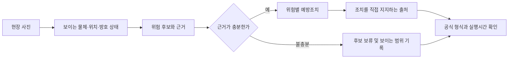
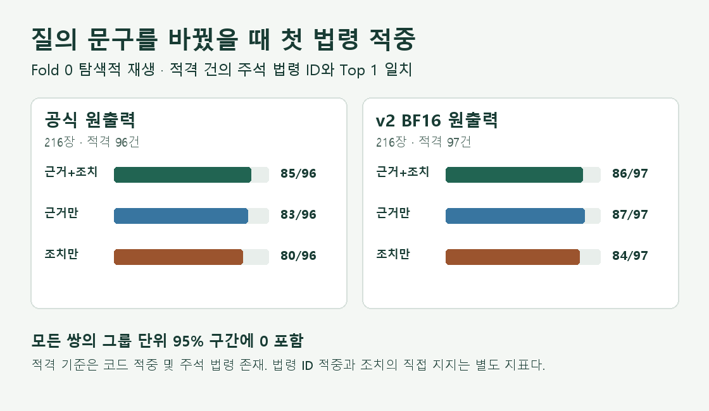
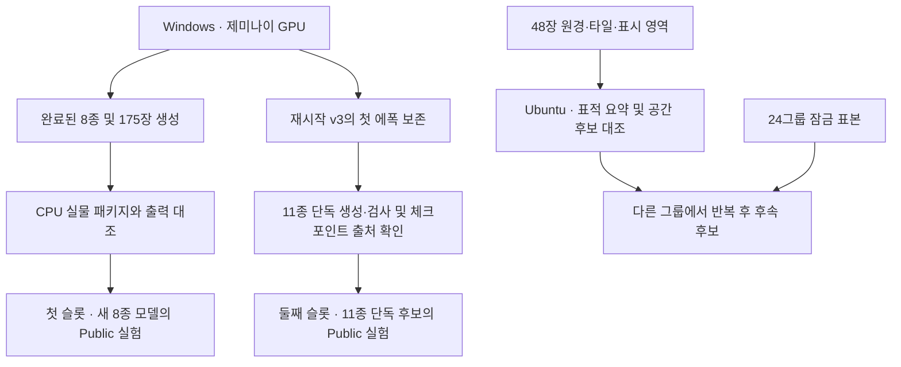
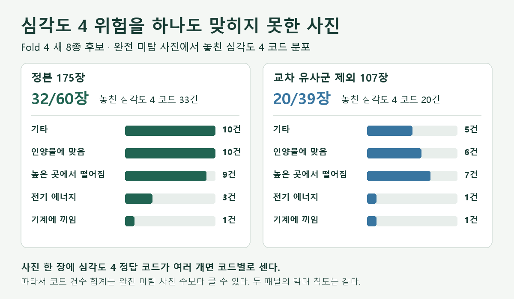

# 이슈 #2 검토 · 사진에서 확인한 위험을 조치와 출처까지 연결하는 실험

2026년 11월 27일 KST. **다섯 제안을 모두 실험에 반영하되, 먼저 답할 질문은 세 가지다. 사진에서 위험을 확인했는가, 제시한 조치가 그 위험을 줄이는가, 인용한 출처가 그 조치를 직접 뒷받침하는가.** 세 질문을 따로 재면 점수가 바뀌었을 때 어디를 고쳐야 하는지 알 수 있다. [이슈 #2](https://github.com/nornen0202/KWater-SafetyAI/issues/2) · [첫 번째 리뷰와 기존 후보 실험](issue-1-research-roadmap-20261127.md)

**11월 27일 두 번의 제출로 Public 최고 점수가 42.04 → 47.35 → 53.65로 올랐다.** 23:16 KST 기준 100팀 중 **12위**, 당시 10위 55.20점과의 차이는 **1.55점**이다. 주최 사이트가 6차를 최고 점수로 자동 선택했다. 아래에서는 이 결과에 쓰인 모델과 앞으로 시험할 다섯 기법을 구별해 설명한다. [5차 접수·결과](../results/public_submission_005.json) · [6차 접수·결과](../results/public_submission_006.json) · [공식 공개 순위](https://hackathon.imaginationgroup.co.kr/kwater/#leaderboard)

**사진으로 읽는 방법.** 이 PC에서 `data/local-reports/issue2-20261127/visual-review.html`을 열면 대표 현장 12건의 전체 사진·고정 타일·표시 영역을 비교하고, 도감에서 48장 전체를 펼쳐 볼 수 있다. 작은 물체를 찾은 뒤에는 작업자와의 위치 관계도 함께 살펴보자. 위험 관계가 불명확했던 사진이 36장이다. 문서에 사진 보기 132개와 도표 6개를 담았고 데스크톱·모바일 크기에서 오프라인 표시를 확인했다. GitHub에는 집계 그림과 실험 설계를 싣는다. [시각 패널의 표본과 판독 방법](vision-roi-experiment-roadmap-20261127.md)

| 이슈 #2의 제안 | 팀이 이미 한 일 | 다음에 확인할 한 가지 |
|---|---|---|
| ① 사진 단서로 검색 | 위험별 사례 검색, 216장 검색어 비교 | 사진에서 읽은 작업·대상·방호 상태를 쓰면 같은 조치에 더 직접적인 조문을 찾는가? |
| ② 세 과제로 나눠 학습 | 4B에 현장 판독과 후보 승인·기각을 학습 | 훈련량을 맞추고 출처 선택 또는 표적 가림을 하나씩 더했을 때 다른 현장에서도 위험을 더 잘 구분하는가? |
| ③ 애매한 후보 보류 | 전문가 후보에 시각 검증을 붙이고 오승인을 집계 | 실제 정답을 놓치는 정도를 유지하면서 정상 사진 오경보를 줄일 수 있는가? |
| ④ 여러 로컬 평가자 | 12장 단독 정성 판독, 최종 확인용 24그룹 동결 | 좌우 답안을 바꿔도 사람과 같은 이유로 더 좋은 근거·조치·인용을 고르는가? |
| ⑤ 두 단계 예방조치 | 기존 문장에 번호만 붙이는 재생에서 변경 0건 | 사진에 맞게 다시 쓴 물리적 방호와 작업 전 확인이 실제로 더 안전하고 실행 가능한가? |

## 그림 1. 어떤 단계에서 틀렸는지를 추적한다

**짧은 예.** 사진에 전기함이 보인다는 관찰만으로 통전이나 절연 손상을 확정할 수는 없다. 눈에 보이는 결함이 있으면 그 위치와 상태를 위험 근거에 쓰고, 현장 확인이 필요한 사실은 조치에서 조건부로 표현한다. 심각할 수 있다는 이유만으로 결함을 추가하거나, 일부가 가려졌다는 이유로 다른 명백한 위험까지 지우면 둘 다 오류다. 공식 스키마는 `hazard`와 `no_visible_hazard`를 사용한다. 위험별 `evidence`는 240자, `prevention`은 480자 이내다. 정상일 때는 빈 `hazards`와 확인 영역을 설명하는 `scene_evidence`를 쓴다. 독립 `판단 한계` 필드는 없다. [대회 출력·평가 규정](https://hackathon.imaginationgroup.co.kr/kwater/api/report)

## 이슈의 근거를 원자료와 대조한 결과

| 주장 | 확인한 사실 | 이번 대회에서 가져올 것 |
|---|---|---|
| K-water 역대 우승팀은 도메인 기준을 찾았다 | 운영 기록에서 1회 염분·수온, 2회 수요예측, 3회 어종 식별, 4회 상수관망 이상 감지를 확인했다. 4회 순위와 PQM의 압력·유량 분석도 확인된다. 참가자 수와 팀 수는 단위가 다르고, 특정 알고리즘을 쓴 모든 팀의 실패 원인은 순위표로 알 수 없다. | 각 훈련 분할에서 위험코드 동시출현·출처별 빈도·정상 비율을 기술하고, 다른 현장에서도 유지되는지 본다. 장소 빈도만으로 사진의 위험을 단정하지 않는다. [1~3회 운영 기록](https://aifactory.space/ko/page/kwater) · [4회 순위](https://dacon.io/competitions/official/236423/leaderboard) · [PQM 원문](https://dacon.io/competitions/official/236423/codeshare/12135) |
| CRAG-MM의 다중 과제와 기각이 효과적이었다 | NVIDIA는 Task 2 우승, DB3는 Task 3 및 Grand Prize, CRUISE는 Task 1 3위, gogoogo는 비교 질문 특별상이다. NVIDIA 논문은 2.5천 원자료에서 2.65만 학습 예제 구성과 3인 모델 평가기의 내부 사람 상관 0.92 이상을 보고한다. 벤치마크 논문의 32%는 단일 턴 질의응답 진실성, 28%는 그 대회에서의 기준선 대비 개선이다. | 쿼리 작성·재정렬·답변을 분리한 **실험 방법**을 채택한다. CRAG의 정답·부분점수·모름·오답 보상과 K-water의 코드별 F1·근거·조치·출처 배점은 다르다. DB3의 DPO·RL을 도입할 시점은 기각에 실제 이득이 있는지 본 뒤다. [주최 측 수상 발표](https://discourse.aicrowd.com/t/meta-crag-challenge-2025-winners-announcement/17308) · [NVIDIA 논문](https://openreview.net/pdf?id=7VTwu1Qu5d) · [DB3 논문](https://arxiv.org/abs/2509.09681) · [CRAG-MM 원 논문](https://arxiv.org/abs/2510.26160) |
| 한솔데코의 한국어 검색과 AI City의 공간 분업을 직수입할 수 있다 | 한솔데코는 사고 정보에서 대책 문장을 생성해 문장 유사도와 내부평가로 채점했다. 1위 팀의 공개 기록이 있다. AI City의 교통 안전 캡셔닝, 이상 추론, 보행자 의도 이해는 다른 트랙으로, 공식 결과에도 서로 다른 접근이 기재됐다. 모든 우승자가 특정 검색 조합이나 탐지기를 썼다는 일반화는 보류한다. | 한국어 안전 용어 검색과 영역 제시는 각각 대조군을 두고 검증한다. 안전용어 일치가 조문의 직접 지지를 보장하지 않고, 물체 검출이 불안전 상태의 증거가 되는 것도 아니다. [한솔데코 규정](https://dacon.io/competitions/official/236455/overview/rules) · [1위 팀 발표](https://dacon.io/en/competitions/official/236455/codeshare/12265) · [AI City 공식 결과](https://www.aicitychallenge.org/2026-challenge-winners/) |

제5회 Public과 Private은 각각 코드 F1 70점과 세 LLM이 평가하는 근거 12점·조치 12점·출처 6점이다. Public 상위 20팀이 Private으로 진행하고 합산 상위 10팀이 별도의 발주처 평가를 받는다. 최종 배점은 100+100+100이다. 재현 실험에는 입력·분할·모델·코드 지문과 시드를 남긴다. 규정 revision 93은 상위 팀 재현 검증에 한 차례 보완 절차를 명시한다. 과거 대회에 관한 일반론으로 즉시 실격을 단정하지 않는다. [현행 평가·재현·외부 데이터 규정](https://hackathon.imaginationgroup.co.kr/kwater/api/report)

## 다섯 가지 이식 실험

### 1. 표적 시각 요약과 검색

**질문.** 코드와 예방문이 같을 때, 사진에서 읽은 짧은 단서가 더 적절한 조문을 찾는 데 도움이 되는가? 현재도 위험 코드별로 사례를 검색한다. 대조군은 이 검색기와 그 실제 첫 인용이다. 고정된 원생성에서 작업·대상·방호 상태 중 *보이는 항목만* 뽑아 쿼리로 사용한다. 미확인은 결측으로 유지한다. ① 같은 어휘 검색에서 쿼리만 교체, ② 같은 쿼리에 의미 검색 추가, ③ 두 검색 순위를 RRF로 결합, ④ 같은 후보 목록을 재정렬하는 순서로 비교한다. RRF는 두 검색의 점수 척도가 달라도 순위가 높게 겹친 문서를 올려 주는 방법이다. 처음에는 같은 상위 후보 수, 동일한 훈련측 사례와 동봉 법령을 사용한다. 고가의 Qwen 검색·재정렬 모델은 사전에 조회한 로컬 지연과 메모리가 감당될 때만 별도 조건으로 잰다.

**측정.** 코드가 맞고 정답 인용이 있는 행에서 첫 인용 적중과 상위 후보 회수율을 보고, 같은 조치에서 실제 첫 조문의 직접 지지·부분 지지·무관을 별도 눈가림 판정한다. 검색 때문에 생긴 새 사실·잘못된 사례 혼입, 잘못된 코드 때문에 검색에서 제외된 정답도 센다. 공식·v2의 기존 216장 재생에서 법령 검색기를 교체해도 v2의 첫 인용 적중은 86/97로 같았다. Ubuntu 법령 제목→본문 대조에서도 단순 문자 검색 39/121, 학습 헤드 9/121이었다. **추가 단계를 넣을 조건은 독립 그룹에서 행동 직접 지지가 늘고 비용을 지불할 만큼 순개선이 남을 때**다. [현재 코드별 검색](../kwater_lab/law_reranker_11code.py) · [고정 생성문 재생](../docs/fold0-fixed-output-law-replay-20261127.md) · [Ubuntu 실측](ubuntu3050-weekend-research-plan-20261127.md)

**11월 27일 CPU에서 직접 확인한 첫 대조.** 이미 생성된 Fold 0 사진 216장의 출력을 고정하고, 폴드 밖 훈련 사례 750개와 동일 검색기를 사용했다. 검색어로 근거·예방·장면을 함께 썼을 때, 근거만 썼을 때, 예방문만 썼을 때를 비교했다. 공식 모델 출력은 각각 **85/96, 83/96, 80/96**, v2 출력은 **86/97, 87/97, 84/97**건의 첫 조문이 주석과 일치했다. 교차 현장을 제외한 34장에서는 공식 모델 14/19·14/19·13/19, v2는 16/20·18/20·15/20이었다. 사건 그룹을 단위로 다시 뽑은 95% 구간은 모든 쌍에서 0을 포함했다. 분모는 위험코드가 맞고 정답 법령이 있는 행이다. 정답 법령이 있어도 모델이 위험코드를 놓친 경우가 공식 71건·v2 70건이었고, 이런 누락은 검색어만 바꾸어 회복할 수 없다. [집계·구간·입력 지문](../results/issue2-query-ablation-20261127.json) · [재현 코드](../kwater_lab/issue2_query_ablation.py)

그림의 ‘근거+조치’는 원출력에 장면 메모가 있으면 함께 사용하는 기존 쿼리다. 색 막대의 분모는 왼쪽 96건, 오른쪽 97건이다.

구현 순서는 기존 TF-IDF를 기준으로 **한국어 형태소 BM25**, 같은 쿼리의 **Qwen3-Embedding-0.6B**, 두 순위의 **RRF**, 같은 상위 후보에 **Qwen3-Reranker-0.6B**를 각각 측정하는 방식이다. 먼저 훈련측 사례와 조문 벡터를 보조 PC에 캐시한다. 개발 그룹에서 상위 5개에 관련 사례가 새로 들어오는지, 그 사례로 생성한 조치가 타당한지 순서대로 본다. 오늘의 표는 어휘 검색에서 쿼리 필드만 바꾼 결과다. 새 시각 요약·의미 검색·사람이 판정한 직접 지지 효과는 후속 측정 대상이다. [현재 검색 구현](../kwater_lab/law_reranker_11code.py) · [Qwen 검색 모델 원자료](https://qwenlm.github.io/blog/qwen3-embedding/)

### 2. 같은 4B에 시각 검증·출처 선택·가림 대응을 가르치는 방법

사진과 같은 사건 그룹 전체를 먼저 훈련·보정·평가로 나눈다. 같은 원본의 모든 파생 행은 부모와 같은 분할에 둔다. 기존 전체 JSON 학습을 기준으로 **A**는 훈련에서 해당 그룹을 제외한 전문가가 실제로 낸 참·거짓 후보에 대해 시각 근거와 승인·기각을 학습한다. **B**는 정답을 모르는 검색기가 만든 사례·법령 후보에서 조치를 직접 지지하는 출처를 고른다. 지지하지 않는 경우와 후보에 정답이 없는 경우도 넣는다. **C**는 위험 판단의 핵심 부위만 가린 사진과, 같은 사진에서 관계없는 영역을 같은 면적으로 가린 대조 사진을 짝짓는다. 해당 위험만 관측 불가가 될 수 있으며 나머지 가시적 위험과 원래 현장 주석은 보존한다.

기존 학습 대 A, A 대 A+B, A 대 A+C를 먼저 비교한다. 두 추가 과제가 각각 이득을 보일 때만 A+B+C를 본다. 조건별 고유 사진·그룹 수, 양·음성 후보 수, 업데이트·감독 토큰·화소 예산을 같이 기록한다. 4~5배 예제 증가는 독립 사건 증가로 세지 않는다. 기존 v3 제안 시점 커리큘럼은 1,232행·791장이고 이후 재시작에서 설정이 바뀌었다. 현재 가중치의 실제 학습 원장을 사용한다. 공식 사진·라벨을 외부 생성 API로 보내지 않고, 합성·외부 자료의 실제 사용 여부는 신고 원장과 연결한다. [커리큘럼과 보정 누출 감사](safeground-v3-review-parallel-roadmap-20261127.md) · [48장 실제 영역 패널](vision-roi-experiment-roadmap-20261127.md)

### 3. 확신이 낮은 위험만 보류하는 게이트

후보를 보류하는 일과 현장 전체를 안전으로 판정하는 일은 다르다. 초벌 판독의 확실한 위험은 보존하고 새 후보에 대해 전문가 점수, 한 토큰 승인 마진, 두 값의 결합을 같은 후보에서 비교한다. 초벌·검증기 학습에서 완전히 제외한 내측 그룹으로 경계를 정한 뒤 외측에 한 번 적용한다. 0.25를 공통 하한으로 고정하지 않는다. 보이는 범위를 설명할 사실이 없으면 불확실 문장을 자동 추가하지 않는다. 기각·파싱 실패·진짜 정상·위험 일부 누락을 각각 센다.

기존 Fold 0에서는 공식 모델이 놓친 78건 중 후보 목록에 31건만 들어왔고, 검증기는 정답 28건과 오답 49건을 승인했다. **후보 회수율과 승인 정밀도를 분리**해야 한다. 전체 정상 사진을 분모로 한 오경보, 중대성 4 정답을 하나도 못 맞힌 사진, 수용률에 따른 오류 곡선을 함께 낸다. 기각이 늘어 심각한 위험을 놓친다면 문장이 매끈해져도 승격하지 않는다. [원 후보와 재판독](../results/v2_official_anchored_verified.json)

### 4. 로컬 평가자가 무엇을 믿을 만하게 판별하는지 검증

오프라인에서 시각 사실성·조치 순서·첫 출처의 지지를 따로 채점한다. 초벌 모델 이름을 감추고 같은 사진의 좌우 답안을 뒤섞는다. 시각 평가자는 사진과 문장, 출처 평가자는 해당 조치와 실제 인용 원문을 본다. 텍스트 모델 단독에는 사진 사실성 판정을 맡기지 않는다. 동일 답 복제·좌우 교환·주제만 같은 잘못된 조문을 음성 대조로 섞어 위치 편향과 이유 없는 고득점을 점검한다. 정답키는 평정 잠금 후 연다. 사람 두 명을 확보할 때 의견 일치·불일치를 먼저 측정하고 단일 AI 평가만 있으면 그 범위를 명시한다. 사진 원본을 외부 평가 서비스에 전송하지 않는다.

기존 12장은 단일 AI의 회귀 사례다. 인용이 실제 행동을 직접 지지했다는 판정은 공식 5/7, v2 1/10이었다. 새로운 24개 그룹은 **최종 확인용**으로 보존하고, 다른 개발 그룹에서 채점 기준을 다듬는다. 사람과의 쌍체 선호 일치율, 동률·판정불가 수, 순서를 뒤집었을 때의 변화, 그룹별 불확실성을 기록한다. 기존 Public 4회는 42.04점 세 건과 16.12점 한 건뿐이다. 같은 네 점에 맞춰 Spearman 0.85를 만들어도 다음 제출 순위를 예측한다는 검증이 되지 않는다. 로컬 평가자의 점수는 공식 30점과 구별한다. [12장 판정 원장](../results/fold0-ai-blind-qualitative-12.json) · [24그룹 표본](../results/fold4-qualitative-panel-20261127.json)

이를 순위로 보면 더 분명하다. Public 동점에 평균 순위를 주면 낮은 점수부터 `1, 3, 3, 3`이다. 로컬 평가자가 네 후보를 전부 구분해 `1, 2, 3, 4`를 주면, 최선의 정렬에서도 순위 상관은 약 **0.775**다. 로컬 평가자가 높은 세 점수를 모두 동률 처리하면 상관은 1이 될 수 있다. 네 제출만으로 0.85를 달성하도록 맞추면 새로운 정성 차이를 판별할 능력보다 과거 동점을 복제하는 능력을 보상하게 된다. 이슈가 가리킨 `docs/spec/evaluation-alignment.md`와 `run_benchmark.py`는 현재 Git 추적 트리에서 확인되지 않았다. 실제 출발점은 기존 눈가림 표본 배정과 판정 코드다. [현재 정성 검토 구현](../kwater_lab/fold0_qualitative_review.py)

### 5. 예방문을 '지금 줄일 위험'과 '작업 전 확인할 것'으로 구성

문장을 두 줄로 나누는 것과 조치가 좋아지는 것을 구별한다. **대조군**은 원생성, **형식 대조**는 원문 의미를 보존한 번호·순서 표시, **시험군**은 사진에서 확인한 위험에 맞는 직접 방호와 필요한 확인을 기존 480자 안에 생성한다. 불필요한 TBM 문구나 모든 사진에 같은 보호구를 붙이지 않는다. 위험을 멈추기 위한 선행 확인이 필요하면 현장 안전 순서가 문장 형식보다 우선한다. 코드·첫 인용을 고정한 비교 후 별도로 조치-조문을 대조한다. 근거 없는 새 사실, 조치 순서 악화, 위험에 맞는 실행 가능성, 글자 수와 최종 키트 출력을 센다.

오늘 새 8종에서 정본 훈련측 790개 사례로 포맷터를 재생했다. 175장 167개 위험에서 기존 조치-조문 가드만 교체해 달라진 첫 인용은 **0건**, 107장에서도 **0/114건**이었다. 기존 문장에 명시적 두 단계가 있을 때만 번호를 붙이는 보수적 재생도 변경 0건이었다. 따라서 같은 내용을 재포장해 오늘의 두 번째 제출로 삼을 근거는 없다. **실험해야 할 것은 훈련·생성 시점의 조치 내용**이다. 독립 장면에서 조치 선호가 개선되고 해로운 순서가 늘지 않을 때만 채택한다. [기존 조치 가드](../kwater_lab/prevention_law_guard.py) · [Fold 4 CPU 원장과 제출 판단](fold4-fifth-submission-decision.md)

## 그림 2. 오늘의 두 제출과 다음 연구의 경계

오늘은 기존 42.04점이 최고 점수 자동 선택으로 보존되는 상태에서, 서로 다른 학습 결과를 공식 서버에 보내 실제 실행과 Public 성적을 배우는 **탐색 제출**이다. 이슈 #2의 다섯 기법 효과를 오늘 제출 점수에 귀속할 수 없다. 21:03 공식 조회에서는 92팀 중 도니 69위·42.04점, 20위 50.70점, 10위 54.45점이었다. 새 8종의 실측은 175장 F1 0.5216·정상 오경보 10/49·중대 완전 미탐 32/60, 107장 F1 0.5429·6/27·20/39다. 공식 출력 175/175 중 원생성 한 행은 정상 대체였다. 3060에서 생성에 2,182초가 걸렸고 공식 L4에서의 시간은 접수 전 미측정이다. [공식 순위](https://hackathon.imaginationgroup.co.kr/kwater/api/leaderboard) · [평가 분모](../results/fold4-cpu-readiness-20261127.json)

| 시점·담당 | 먼저 할 일 | 다음 단계로 갈 근거 |
|---|---|---|
| 11/27 · Windows GPU와 독립 CPU | 8종은 실제 ZIP의 가중치·790개 사례·프롬프트·오프라인 진입점·출력 확인. v3는 원래 2에폭 학습의 첫 에폭을 별도 표시하고 재개 상태를 보존한다. 두 번째는 단독 판독의 형식·시간을 먼저 잰다. | 포맷·실행 가능한 서로 다른 후보를 접수한다. 두 파일의 SHA, 업로드 완료 시각, 접수 행과 잔여 횟수, 실제 서버 상태를 연결한다. |
| 11/28~29 · CPU와 Ubuntu | 실험 1의 쿼리 대조, 실험 3의 기각, 실험 5의 고정문 비교. Ubuntu는 캐시한 1,045장의 공간 특징과 48장의 원경·타일·관심영역 대조를 사용한다. | 원경·화소 예산을 맞춰야 위치 효과를 말할 수 있다. 48장 중 36장은 기존 판독에서도 위험 관계가 불명확했다. 불명확을 유지한 분모와 추가 지연을 보고한다. |
| 11/30~12/5 · 독립 개발 그룹 | 실험 2의 A/B/C 증분 학습과 실험 4의 눈가림 채점 신뢰도를 확인한다. 동일 사진, 원천 그룹, 인접 장면, 파생 이미지를 양쪽에 나누지 않는다. | 코드 F1·정상 오경보·중대 미탐·직접 지지·실행시간이 함께 유지되는 조건만 선택한다. 중대 미탐 증가 또는 한 그룹에 집중된 개선은 별도 조사한다. |
| 12/6~마감 · 패키지 후보 | 실제 쓴 외부 데이터·합성 방법의 신고 항목을 12/6 23:59 KST 전 확정하고, 선택한 모델만 동결 검증·전량 학습·배포 재현으로 보낸다. | Public 200장 1,800초, Private 300장 3,600초, 20GB 아카이브와 오프라인 L4 한도를 실물로 검증한다. 각 단계의 이득이 작으면 비용이 낮은 조건을 유지한다. [공식 규정·일정](https://hackathon.imaginationgroup.co.kr/kwater/api/report) |

보조 PC는 RTX 3050 OEM 8GiB다. CPU에서 조문·사례 검색을, GPU에서 이미 추출된 공간 특징과 원경·타일·관심영역 비교를 독립 실행할 수 있다. 4B 판독은 먼저 한 장으로 메모리와 지연을 측정한다. BF16으로 세 조건을 모두 실행하기 어렵다면 보조 PC의 세 조건을 같은 4비트 설정으로 맞춘다. 대표 장면은 이후 Windows BF16에서 짝지어 반복한다. 두 정밀도 사이의 차이는 별도로 보고한다. [보조 PC 사양과 캐시 실측](ubuntu3050-weekend-research-plan-20261127.md)

두 제출 후보는 같은 Qwen3-VL-4B에서 출발했다. 8종은 훈련 사진 790장·2에폭, v3 후보는 791장에 별도 커리큘럼·프롬프트·법령 처리·학습 일정을 썼다. Public 점수가 달라지더라도 세 코드를 추가한 순효과는 식별할 수 없다. 그 질문에는 공통 표현 가능한 790장, 동일 화소·정밀도·생성 상한·훈련 예산을 먼저 고정한 별도 8종 대 11종 실험을 사용한다. 제외되는 한 장의 희귀 위험 라벨은 보존한다. [분할·모델 비교 설계](safeground-v3-review-parallel-roadmap-20261127.md)

## 오늘 실제로 접수한 모델과 후속 실험의 우선순위

**5차는 11월 27일 21:22 KST에 접수됐다.** 주최 사이트가 새 8종 모델 `kwater-fold4-eightcode-20261127.zip`을 등록하고 오늘 잔여 횟수 1/2를 표시했다. 접수 시점 상태는 ‘채점 대기 중’, 주최자 예상 반영은 22:30까지였다. ZIP은 9,043,971,039바이트이며 SHA-256은 `1cd9cdcc92a2a2ffdf25ee7eda3865b04d95346855553b1cb42ef1edd305abfa`다. [공식 내 참가](https://hackathon.imaginationgroup.co.kr/kwater/#my) · [모델·패키지 검산](../docs/fold4-eightcode-submission-20261127.md)

**22:15 KST 조회에서 5차 Public 47.35점과 최고 점수 자동 선택을 확인했다.** 기존 최고 42.04점에서 **+5.31점**이다. 대회 서버가 새 모델을 채점했으므로 실제 제출 경로가 작동했고, 기존 제출의 동점을 처음 넘었다. 주최 사이트는 이번 점수를 코드 F1·근거·조치·출처로 나누어 표시하지 않아 각 항목의 기여는 미측정이다. [공식 제출 결과](https://hackathon.imaginationgroup.co.kr/kwater/#my)

같은 시각 공개 순위표에서 도니는 **97팀 중 35위**였다. 당시 20위 51.19점까지 3.84점, 10위 55.20점까지 7.85점 차이였고 선두는 68.10점이었다. 참가팀과 기준선도 변하므로 순위·격차에는 조회 시각을 붙인다. [공식 리더보드](https://hackathon.imaginationgroup.co.kr/kwater/api/leaderboard)

이 모델이 놓친 심각도 4 정답을 살펴보면 **기타·낙하/인양·추락**이 먼저 보인다. 175장에서 낙하/인양은 전체 심각도를 합쳐 **0/14건**, 기타는 29건 중 11건을 맞혔고 엉뚱한 추가 예측이 25건이었다. 반면 새 8종의 어휘 밖인 밀폐공간·익수/침수·기상/온열은 두 패널 모두에 정답이 없었다. 11종이 여기서 개선된다면 같은 사진에 이미 있던 위험을 더 잘 구분한 효과인지 먼저 본다. 세 희귀 코드의 검출 능력은 실제 양성 현장이 있는 다른 그룹에서 따로 검증한다. [코드 매핑과 오류 전체 표](../results/fold4-eightcode-diagnosis-20261127.json)

정상 오경보 10장 중 추락이 6장, 미끄러짐이 4장, 화학물질 노출이 2장이었다. 추락과 미끄러짐이 2장에서 겹쳤다. 따라서 실험 2·3에서는 낙하 물체와 노출 대상의 위치 관계를 확인한 양성 쌍, 추락·미끄러짐과 혼동되는 정상 쌍을 함께 평가한다. 코드별 건수만으로 모델이 어느 픽셀을 보고 틀렸는지는 단정할 수 없어 사진 도감의 불명확 판독도 유지한다. [재현 코드](../kwater_lab/fold4_code_diagnosis.py) · [비공개 도감의 검수 기준](vision-roi-experiment-roadmap-20261127.md)

11종 후보는 제미나이가 Windows에서 2에폭 일정의 **69/138스텝**을 마친 가중치다. 21:46에 저장한 어댑터 SHA-256은 `6fba484b28650025bc8e558838f2e5d1c8f897c84c3d3965dfcc2b4061c15886`이다. 훈련 사진 791장에서 만든 1,092개 학습 예제를 한 차례 사용했다. 에폭 경계에서 훈련 상태를 보존하고 별도 경로에서 GPU로 공식 예시 사진 10장을 실제 판독했다. 10/10행이 키트 검사를 통과했다. 제출 경로의 배치 8과 검증 경로의 배치 4가 달랐던 부분을 실행 전에 배치 4로 맞춰, 외측 사진 175장도 같은 설정으로 판독한다. [체크포인트와 ZIP 검산 절차](../docs/fold4-v3-epoch1-package-qa-20261127.md)

| 고정 검증 사진 | 새 8종 → v3 단독의 코드 F1 | 같은 현장끼리 묶은 F1 차이의 95% 구간 | 정상 사진 오경보 | 심각도 4 위험을 하나도 못 맞힌 사진 |
|---|---:|---:|---:|---:|
| 175장·39그룹 | 0.52162 → 0.54201 | −0.06745~+0.10178 | 10/49 → 10/49 | 32/60 → 29/60 |
| 교차 그룹 제외 107장·36그룹 | 0.54290 → 0.56252 | −0.09888~+0.06793 | 6/27 → 6/27 | 20/39 → 18/39 |

첫 에폭에서 175장 중 74장의 위험 코드 구성이 달라졌다. 기타 오탐은 19건을 해소하고 4건이 새로 발생했다. 추락 정답은 2건을 되찾고 6건을 잃었고, 미끄러짐은 2건을 되찾고 7건을 잃었다. 107장에서 큰 한 그룹까지 제외한 58장의 F1 차이는 −0.00142였다. 중대 위험 미탐은 줄었지만 두 주패널 모두 사전 승격 기준인 F1 +0.03과 정상 오경보 20%를 충족하지 못했다. 서로 다른 오답과 실제 Public 결과를 확인할 가치가 있어 둘째 기회를 탐색 제출에 배정했다. [두 모델 쌍체 비교](../results/fold4-v3-epoch1-paired-code-evaluation.json) · [코드별 회복·유실](../results/fold4-v3-epoch1-code-diagnosis-20261127.json)

v3 원생성은 175/175행 모두 해석됐고 토큰 상한에 걸린 행은 0건이었다. Windows RTX 3060에서 모델 로드 403.87초, 175장 실제 생성 1,060.7초였다. ZIP 안의 `main.py`로 원생성을 재처리한 결과와 독립 생성 결과의 행 차이는 0건이었다. 사전 실행은 입력 사진과 생성 결과를 로컬에 보존하고 CPU로 배포 경로를 검산한 것이다. 공식 L4 실행에 걸린 정확한 초 단위 시간은 사이트가 표시할 때 별도 기록한다. [실물 ZIP 감사](../results/fold4-v3-epoch1-archive-check.json)

같은 사진에서 두 모델이 모두 예측한 위험 중 정답 조문이 있는 경우만 보면 첫 조문 적중은 175장에서 **60/71 → 54/71**, 107장에서 **40/50 → 35/50**이었다. 두 모델의 예방문도 달라졌다. 다음에는 위험과 예방문을 고정한 채로 검색기만 바꾸고, 첫 조문이 그 조치를 실제로 지지하는지를 눈가림 판정한다. [동일 위험에서의 인용 대조](fold4-fifth-submission-decision.md)

**6차는 11월 27일 22:22 KST에 접수됐다.** 공식 사이트에서 `kwater-safeground-v3-epoch1-vlmonly-20261127.zip`의 개별 접수와 오늘 남은 횟수 **0/2**를 확인했다. 접수 시점에는 ‘채점 대기 중’, 예상 반영은 23:30까지였다. 완성 ZIP은 9,043,673,838바이트, SHA-256 `5b6527c82bac445f76463ee183600d3c44c202dd4c448722ca09dc810455cfe6`이다. 22:21에는 제미나이의 정규 2에폭 학습이 첫 에폭 경계에서 재개됐다. [공식 내 참가](https://hackathon.imaginationgroup.co.kr/kwater/#my) · [패키지 원장](../results/local_artifacts.json)

**23:16 KST 조회에서 6차가 Public 53.65점으로 채점 완료됐다.** 5차 대비 +6.30점, 전날 최고 대비 +11.61점이다. 같은 시각 공개 순위표는 **12/100위**, 10위 55.20점, 20위 52.17점, 1위 68.10점이었다. 당시 10위까지 1.55점, 20위 대비 여유는 1.48점이다. 두 ZIP 모두 주최 서버에서 실제로 채점을 마쳤다. [6차 실측 영수증](../results/public_submission_006.json) · [공식 순위표](https://hackathon.imaginationgroup.co.kr/kwater/api/leaderboard)

**다음 제출은 53.65점을 기준으로 비교한다.** 10위까지 1.55점을 정량 항목 하나로만 메운다는 가정이면 공식 코드 F1 약 +0.0221이 필요하다(1.55÷70). 순위표는 움직이고 로컬 175장의 F1 변화가 Public F1 변화와 같다는 보장은 없다. 먼저 같은 코드·예방문에서 법령 직접 지지를 회복할 수 있는지 CPU로 보고, 보조 PC에서는 같은 사진의 전체 장면과 관심영역을 써서 낙하·추락 관계를 더 잘 구분하는지 본다. 정규 2에폭 단독과 하이브리드는 두 패널에서 정상 오경보·심각한 미탐·후보별 추가 정답을 함께 검산한 뒤 다음 제출 후보로 판단한다. 이번 +6.30점을 11종 어휘 확대, 판단 유보, 법령 검색 중 특정 하나의 효과로 배분할 공개 세부 점수는 없다. [동일 이미지 두 패널의 결과](fold4-fifth-submission-decision.md)
