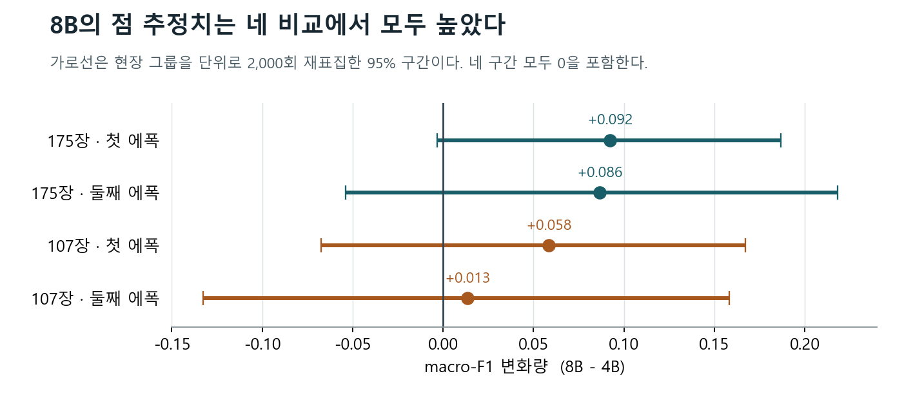
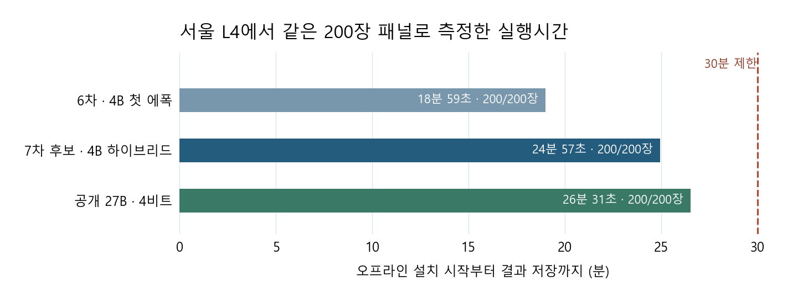
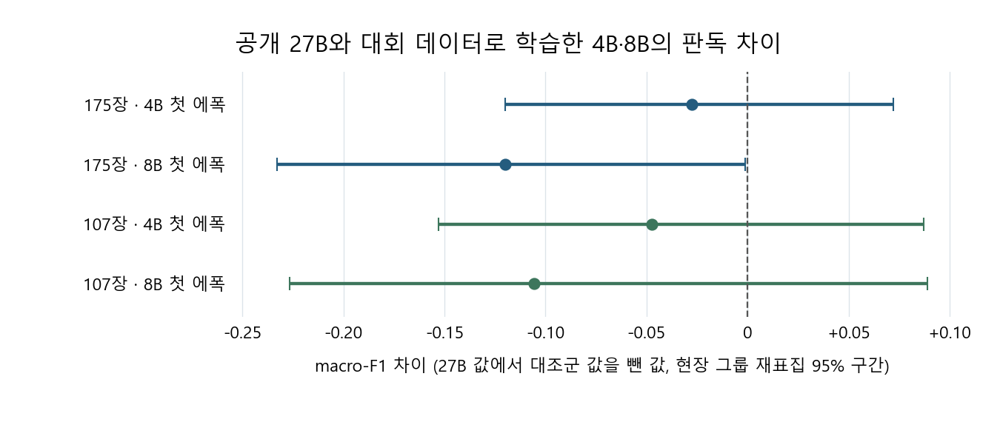

# 서울 L4 후속 실험 원장

2026년 11월 28일. 로컬 GPU는 제미나이의 1,045장 전량 학습에 배정하고 서울 L4에서 모델 크기와 제출 패키지를 시험했다. 이번 실행의 승인 예산은 15,000원이다. [마스터 로드맵](comprehensive-audit-and-vlm-roadmap-20261128.md) · [집계 JSON](../results/seoul-l4-roadmap-experiments-20261128.json)

## 같은 32장으로 4B와 8B 학습

| 서울 L4에서 측정한 항목 | Qwen3-VL-4B-Instruct | Qwen3-VL-8B-Instruct |
|---|---:|---:|
| 고유 훈련 사진 / 현장 그룹 | 32 / 32 | 32 / 32 |
| 옵티마이저 업데이트 | 16 | 16 |
| 감독 토큰 / 결정 가중 토큰 | 4,110 / 623 | 4,110 / 623 |
| 16개 스텝 시간 합계 | 64.29초 | 102.47초 |
| 스텝 로그의 최대 GPU 할당 메모리 | 4.74 GiB | 8.76 GiB |
| 학습 가능한 매개변수 | 33,980,416 | 44,793,856 |
| 새 프로세스에서 어댑터 재로드 후 원생성 스키마 통과 | 2/2 | 2/2 |

두 모델을 각각 원본 가중치에서 NF4 QLoRA로 학습했다. 검증 Fold 4와 확인된 훈련측 교차 그룹, 이전 노출 표시를 제외하고 위험 22장·정상 10장을 골랐다. 재로드용 위험 1장·정상 1장은 별도 그룹에서 선정했다. 두 팔 모두 시드 42, 동일 순서와 프롬프트, 393,216화소, LoRA 순위 16·alpha 32, 학습률 0.00014, 두 예제마다 한 업데이트를 사용했다. 이미지·언어부 어댑터에서 모두 기울기를 확인했고, 모든 스텝의 감독·결정 토큰 수가 같았다. 모델 크기를 키우면 이 조건에서 업데이트 시간이 **1.59배**였다. 2장 검사는 저장·재로드·생성 경로를 확인하며, 정확도 우위를 판단할 표본은 Fold 4의 175장과 교차 그룹을 제외한 107장이다. [파일럿 구현](../kwater_lab/scale_training_pilot.py) · [분할별 비교 설계](comprehensive-audit-and-vlm-roadmap-20261128.md#paired-models)

## 53.65점을 받은 6차 ZIP의 200장 실측

| 고정 개발 패널 | 설치 | 추론·저장 | 합계 / 제한 | 공식 유효 행 | 원생성 JSON 파싱 |
|---|---:|---:|---:|---:|---:|
| 200장·192그룹 | 14초 | 1,125초 | **1,139 / 1,800초** | **200/200** | 199/200 |

6차 접수본과 바이트 단위로 같은 9,043,673,838 B ZIP을 서울 `g2-standard-16` L4에서 실행했다. 공식 Linux 이미지, 네트워크 차단, CPU 6개·RAM 56 GiB 제한을 적용했다. 최초 시도는 호스트에서 복사한 입력과 키트 파일을 컨테이너 사용자가 읽지 못해 E03으로 종료됐다. 비공개 상위 경로 안에서 마운트할 파일의 읽기 권한을 수정한 다음 같은 ZIP을 재실행했다. 공식 키트가 OK를 반환했고, 원본 출력을 회수해 공식 검사기를 다시 실행해도 200장이 모두 유효했다. 입력·출력의 고유 ID 200개와 순서가 일치했다. 원생성 1건에서 JSON 파싱이 실패했고 최종 포매터를 거친 출력은 전부 형식 검사를 통과했다. [6차 영수증](../results/public_submission_006.json) · [ZIP·출력·로그 SHA-256](../results/seoul-l4-roadmap-experiments-20261128.json)

이 고정 패널에서 단독 모델의 여유 시간은 **661초**다. 개발 패널은 전량 훈련에도 쓰이므로 여기서 위험을 출력한 138장을 정확도 비교에 쓰지 않는다. [패널과 검산 절차](../docs/hybrid-public200-timing-20261128.md)

## 7차 전량 하이브리드 ZIP의 200장 실측

6차와 같은 200장·192그룹, 같은 공식 Linux 키트와 서울 L4에서 1,045장 전량 하이브리드가 **1,497초에 200장 전부 통과**했다. 두 ZIP의 시간 차이는 358초다. 전량 재학습과 전문가·검증기 도입이 함께 바뀌었으므로 이를 검증기만의 시간으로 해석할 수 없다. [6차·7차 실행 계측](../results/seoul-l4-roadmap-experiments-20261128.json)

| 실제 ZIP | 오프라인 설치 | 실행·저장 | 합계 | 30분까지 여유 | 공식 검사 · 회수 후 재검사 |
|---|---:|---:|---:|---:|---|
| 6차 첫 에폭 단독 | 14초 | 1,125초 | 1,139초 | 661초 | 각각 200/200 |
| 7차 후보 전량 하이브리드 | 15초 | 1,482초 | **1,497초** | **303초** | 각각 200/200 |

7차 ZIP은 **10,548,013,152 B**이고 로컬과 서울에서 SHA-256 `83c76f441f122279cd925998ce41dbc978f8dcb88cd141d5828e679d6e3ab713`이 일치했다. 200개의 고유 출력 ID와 순서가 입력과 일치했다. 출력 SHA-256은 `c9fe0310478ea28a7c6ebe8521946e702f21c4e770a4382ab30db9ef284999cd`다. 원생성 200건이 모두 파싱됐고 2초 간격으로 관측한 GPU 메모리 최대값은 11,998 MiB였다. 실제 출력과 표준 출력·오류를 포함한 로그는 팀 전용 `data/local-reports/seoul-seventh-200-20261128/`에 보관했다.

전문가에 102.94초, VLM 로드에 6.15초, 초벌 판독에 1,104.87초가 들었다. 전문가 제안 71건의 마진 계산에 55.97초가 들었고, 통과한 45건을 207.21초 동안 재판독해 9건을 승인했다. 초벌 배치 4와 재판독 배치 2를 끝까지 유지했다. 검증용 Fold 4의 두 에폭 하이브리드는 175장에서 정상 오경보 8/49, 교차 현장을 제외한 107장에서 6/27이었다. 107장의 22.2%가 사전 기준 20%를 초과한다. 전량 모델이 학습한 200장은 실행시간과 출력 형식의 근거로 사용한다. **시간 검사를 통과해도 정상 오경보를 이유로 한 제출 보류 판단은 유효하다.** [독립 Fold 4 결과와 제출 판단](seventh-submission-decision-20261128.md)

## 같은 훈련 사진 791장으로 모델 크기 비교

8B의 비교 대상은 **같은 11종을 출력하는 4B**다. 791장으로 만든 1,092개 훈련 예제의 순서와 가중치, 89개의 내측 보정 후보, 에폭당 69업데이트를 맞춘다. 평가에는 검증 사진을 검색 사례로 넣지 않는다. CPU 검산에서는 4B의 기존 두 에폭 출력을 동일한 입력으로 양쪽에 주어 모든 쌍체 차이가 0이고 기존 점수가 재현되는지 확인했다. 4B 첫째·둘째 에폭의 macro-F1은 175장에서 0.54201·0.53103, 107장에서 0.56252·0.57566이었다. 이 수치가 8B의 비교 기준이다. [학습·평가·검산 명령 구현](../kwater_lab/scale_fold4.py) · [4B 기존 평가](seventh-submission-decision-20261128.md)

8B의 138개 업데이트를 완료했다. 4B와 8B는 두 에폭 합계 2,184개 예제·감독 토큰 271,946개·결정 가중 토큰 42,352개로, 매 업데이트의 예제·토큰 수가 같았다. 동일하게 지정한 학습률 스케줄에서 로그의 배정밀도 값은 4스텝에서 최대 1.36×10⁻²⁰ 차이가 났다. 8B의 L4 스텝 시간 합은 6,782.57초다. 4B 본 비교에는 보존한 로컬 RTX 3060 훈련·생성 결과를 재사용했다. [8B 학습과 쌍체 점수 산출 코드](../kwater_lab/scale_fold4.py)

| 에폭 · 개발 패널 | macro-F1, 4B → 8B | 차이 [그룹 재표집 95% 구간] | 정상 오경보, 4B → 8B | 중대성 4 완전 미탐, 4B → 8B |
|---|---:|---:|---:|---:|
| 첫째 · 175장 | 0.54201 → **0.63415** | +0.09214 [−0.00314, +0.18680] | 10 → 9 / 49 | 29 → 29 / 60 |
| 첫째 · 107장 | 0.56252 → **0.62091** | +0.05838 [−0.06751, +0.16724] | 6 → 5 / 27 | 18 → **20** / 39 |
| 둘째 · 175장 | 0.53103 → **0.61745** | +0.08643 [−0.05382, +0.21796] | 8 → 5 / 49 | 34 → 32 / 60 |
| 둘째 · 107장 | 0.57566 → **0.58906** | +0.01340 [−0.13273, +0.15828] | 6 → 4 / 27 | 19 → **23** / 39 |

첫 에폭 8B는 정상 오경보를 두 패널에서 각 1장 줄였다. 비교에 들어간 8개 코드 중 화학 노출의 정답은 4장·4그룹이며 정탐이 1→3장, 오탐은 양쪽 1장이다. 이 한 코드의 기여는 macro-F1 **+0.05208**로, 107장 패널 순증 **+0.05838**의 89%다. 나머지 7종의 평균 개선은 +0.00720이다. 175장에서는 나머지 7종도 평균 +0.04578이었다. 정량 선발에는 유망하지만 107장 중대 미탐 2건 증가와 두 신뢰구간을 고려해 다른 현장 분할에서 재현성을 확인할 가치가 있다. 8B 첫 에폭은 175장 모두 원생성 JSON 파싱, 174장 원생성 스키마 통과, 토큰 상한 도달 0장을 기록했다. BF16 배치 4의 생성 시간은 1,057.1초다.

둘째 에폭은 107장 정상 오경보를 2장 줄였지만 중대 위험을 하나도 맞히지 못한 사진이 4장 늘었다. 화학 노출을 제외한 7종의 평균 F1도 약 0.060 하락했다. 둘째 에폭은 175/175장 파싱·174/175장 원생성 스키마 통과, 생성 1,080.5초였다. 두 모델·두 에폭 모두 실제 배치 4였고, 사진별 SHA·사진 순서·렌더링된 지시문·화소 설정·토큰 상한 지문까지 일치했다. **후속 재학습은 8B 첫 에폭과 4B 첫 에폭을 같은 새 현장 분할에서 비교하는 데 우선 배정한다.** 두 분할에서 중대 미탐을 다시 세고 화학 노출을 포함한 전체 8종 및 나머지 7종의 변화를 함께 제시한다. 개발 패널의 차이를 Public 총점으로 환산할 수 없고 8B의 실제 제출 ZIP 시간은 별도 측정 대상이다. [전체 지표·신뢰구간·생성 증거](../results/paired-qwen-4b-8b-fold4-20261128.json)

프로젝트 루트에서 회수한 두 어댑터와 예측 캐시로 `python -B -m kwater_lab.scale_fold4 score --scale-run data/vlm-scale-seoul-8b-fold4-20261128 --output results/paired-qwen-4b-8b-fold4-20261128.json`을 실행하면 표를 다시 산출한다. 사진별 예측과 두 어댑터는 로컬에 보관했다.

## Qwen3.8-27B 4비트의 배포 검사

중단됐던 모델 다운로드를 재개해 로컬 G:에서 본체 **16,564,259,744 B**와 BF16 비전 프로젝터 **931,146,432 B**의 고정 SHA-256을 각각 확인했다. 합계 17,495,406,176 B이며 실행기·라이브러리·포매터가 더해진다. 4비트 모델은 대회 사진으로 미세조정하지 않은 공개 체크포인트다. 실물 패키지가 처리한 사진 수, 원생성 스키마 통과, 공식 출력 형식과 1,800초 제한을 각각 판정한다. [고정 변환본](https://huggingface.co/unsloth/Qwen3.8-27B-GGUF/tree/4af51b3542f775b0a8e4b310bfb3f17e01c306c9)

첫 ZIP은 17,801,904,701 B였고, 1장 검사에서 4초 만에 E03을 반환했다. Linux 실행기가 공식 이미지에 설치된 PyTorch의 OpenMP 라이브러리 `libgomp.so.1`을 찾지 못했다. 실행기의 라이브러리 검색 경로에 PyTorch의 라이브러리 디렉터리를 추가하고 같은 가중치·비전 프로젝터·포매터로 ZIP을 다시 만들었다. 수정 ZIP은 **17,801,904,939 B**, 요청한 20 GB까지 **2,198,095,061 B** 남는다. 로컬과 서울에서 독립 빌드한 파일 전체의 SHA-256은 `ed76a5dec461d783b263d4e227944dd85da7b9069dbc58116470f3a5e905307f`로 일치했다. [ZIP 빌더](../tools/build_gguf_timing_archive.py) · [추론 진입점](../kwater_lab/gguf_timing_entrypoint.py) · [두 ZIP의 지문과 로그](../results/seoul-l4-roadmap-experiments-20261128.json)

| 서울 L4 공식 키트 | 설치 + 실행·저장 | 가중치 로드·서버 준비 | 원생성 스키마 | 공식 출력 형식 | 생성 토큰 |
|---|---:|---:|---:|---:|---:|
| 예시 1장 | 0 + 37초 | 17.45초 | 1/1 | 1/1 | 168 |
| 예시 10장 | 0 + 90초 | 14.74초 | 10/10 | 10/10 | 1,535 |
| 고정 개발 200장 | **0 + 1,591초** | 14.74초 | **200/200** | **200/200** | **36,470** |

200장 실행에서 1,800초까지 **209초**가 남았다. 사진당 평균 182.35토큰을 생성했고, 620토큰 상한에 도달한 사진은 0장이었다. 입력 처리와 포맷팅을 포함해 모델 준비 후 마지막 행까지의 전체 생성 처리량은 약 23.2토큰/초였다. GPU 메모리는 2초 간격 표본에서 최대 17,158 MiB였다. 세 검사 모두 새 프로세스로 모델을 로드했고, 추가 휠 설치가 없어 공식 설치 시간은 0초였다. 입력 순서와 200개 고유 출력 ID가 정확히 일치했으며, 회수한 JSONL을 다시 공식 검사기로 확인해 200행 전부 유효했다. 출력 SHA-256은 `62005c1ceb3ca42fa832ddb6fa59b861814708bb8bbc9c868fdd9a43c116d965`다. [200장 계측과 공식 검사 재현 결과](../results/seoul-l4-roadmap-experiments-20261128.json)

27B는 이 패널의 배포 조건을 통과했다. 위험 판독 품질은 아래의 별도 Fold 4에서 평가했다. 공식 사진 791장에서 만든 법령 사례 658행이 ZIP 안의 자료와 일치하는지 CPU에서 재구성해 확인했다. 4B·8B는 대회 데이터로 학습한 모델이며 이 27B는 공개 4비트 가중치여서, 비교 결과에는 모델 크기 외에도 훈련 방식·이미지 전처리·추론 엔진 차이가 함께 반영된다.

## 공개 27B와 학습한 4B·8B의 Fold 4 판독 품질

200장 통과 후 같은 27B ZIP으로 새 프로세스에서 고정 Fold 4 원본 175장을 한 번 판독했다. 사진마다 원본 SHA-256을 확인했다. 107장은 이 출력에서 훈련측과 같은 현장으로 확인된 세 그룹을 제외한 부분집합이다. 175장 공식 설치·실행 시간은 **1,304초**였다. 원생성 JSON과 스키마는 각각 174/175, 최종 출력은 공식 검사와 회수 후 재검사에서 각각 **175/175**였다. 4B·8B 양 에폭을 재채점해 기존 수치가 전부 재현됐다. [원생성·최종 출력·전체 지표](../results/stock-27b-fold4-20261128.json) · [CPU 검산 코드](../kwater_lab/gguf_fold4_score.py)

| 배포 구성 | macro-F1 175장 / 107장 | 정상 오경보 175장 / 107장 | 중대 위험 완전 미탐 175장 / 107장 | 정답 코드 집합 정확 일치 175장 / 107장 |
|---|---:|---:|---:|---:|
| 4B 첫 에폭 | 0.54201 / 0.56252 | 10/49 · 6/27 | 29/60 · 18/39 | 84 · 52 |
| 8B 첫 에폭 | **0.63415 / 0.62091** | 9/49 · 5/27 | 29/60 · 20/39 | 88 · 54 |
| 4B 둘째 에폭 | 0.53103 / 0.57566 | 8/49 · 6/27 | 34/60 · 19/39 | 80 · 48 |
| 8B 둘째 에폭 | 0.61745 / 0.58906 | **5/49 · 4/27** | 32/60 · 23/39 | 89 · 52 |
| 공개 27B 4비트 | **0.51434 / 0.51522** | **36/49 · 19/27** | **21/60 · 12/39** | 67 · 45 |

27B의 F1에서 첫 에폭 8B의 F1을 뺀 차이는 175장에서 −0.11981 (현장 그룹 재표집 95% 구간 −0.23273~−0.00119), 107장에서 −0.10569 (−0.22663~+0.08917)였다. F1 산식은 정답이나 예측이 한 건이라도 있는 코드를 평균한다. 작은 두 모델은 8종, 27B는 정답이 없는 익수·침수까지 175장에서 6건, 107장에서 3건을 출력해 9종이 반영됐다. 공통 8종으로 분모를 고정하면 27B는 **0.57864 / 0.57962**였다. [코드별 정답·예측 수와 쌍체 구간](../results/stock-27b-fold4-20261128.json)

107장의 중대 위험 39장 중 27B만 맞힌 사진은 **11장**, 첫 에폭 8B만 맞힌 사진은 **3장**이었다. 정상 27장에서는 27B만 오경보를 낸 사진이 **15장**, 8B만 낸 사진이 **1장**이었다. 27B의 추락 F1은 0.630으로 8B의 0.457보다 높았고, 걸림·미끄러짐 F1은 0.364로 8B의 0.646보다 낮았다. 107장의 정상 오경보율 70.4%는 팀 기준 20%를 크게 넘는다. **공개 27B 단독 제출은 보류한다.** 중대위험 누락을 보완할 다음 실험은 훈련측 현장의 미탐·정상 사진을 함께 눈가림 검토하고 27B만 제시한 단서가 실제 사진에 있는 비율을 재는 것이다. 검증 사진의 답을 학습에 편입하지 않고, 재현되는 단서만 소형 모델 훈련 후보로 삼는다. 27B의 도메인 미세조정 효과는 이번 실험에서 측정하지 않았다.

## 재현과 예산

11월 28일 총 사용 추정은 **9,273원**이다. VM·디스크·IPv4·VAT와 앞선 독립 파일럿, 확인한 결과 반출량을 포함했다. 실제 송신 경로·통신 오버헤드와 기타 소액 비용까지 1,500원을 잡는 보수적 시나리오에서는 **10,566원**으로, 승인 한도 15,000원까지 **4,434원**이 남는다. 10:24 KST에 마지막 VM과 디스크 삭제를 확인했고 이후 프로젝트의 전체 인스턴스·디스크 목록도 비어 있었다. 청구서 확정 전 추정이다. [실행별 시간과 비용 집계](../results/seoul-l4-roadmap-experiments-20261128.json)

| 서울 리소스 | 시작 ~ 삭제 확인 KST | 담당 실험 | VM·디스크·IP·VAT 추정 |
|---|---|---|---:|
| G2-16 온디맨드 · 150 GiB | 04:26:47 ~ 05:10:47 | 6차 200장 및 4B·8B 소규모 학습 | 1,821원 |
| G2-8 Spot · 150 GiB | 05:11:14 ~ 08:35:28 | 8B 두 에폭 훈련·평가, 이후 공유 V1/V2 | 2,239원 |
| G2-16 온디맨드 · 230 GiB | 08:35:30 ~ 10:24:34 | 7차·27B 실제 ZIP, 27B Fold 4 품질 | 4,556원 |
| 합계 | | 공유 Spot 시간 1회 계상 | **8,616원** |

독립 파일럿 약 450원과 주요 회수 파일 708,136,960 B에 대한 한국향 송신 시나리오 약 207원을 더하면 9,273원이다. 예비비 시나리오에서는 207원을 1,500원으로 대체했다. **27B 200장 검사 종료부터 Fold 4 평가·회수·삭제 확인까지의 한계비용은 약 1,067원**으로 전체액에 포함된다. 가중치는 서울에서 공개 원본을 내려받고 수정 ZIP의 서울·로컬 해시를 대조해 17.8 GB짜리 파일을 인터넷으로 반출하는 비용을 줄였다. [Google Cloud 네트워크 요금](https://cloud.google.com/vpc/network-pricing) · [요금·상금 손익분기 가정](comprehensive-audit-and-vlm-roadmap-20261128.md#prize-roi)

파일럿은 프로젝트 루트에서 `python -B -m kwater_lab.scale_training_pilot prepare --panel PANEL`로 훈련·재로드 명단을 만든다. 각 모델마다 별도 출력 폴더로 `train`과 `reload`를 별도 프로세스에서 실행하며 각각 `--panel PANEL --base BASE --out OUTPUT`을 넘긴다. 사진별 결과와 어댑터는 비공개 로컬 산출물로 보관하고 집계에는 모델 리비전과 구성·어댑터·프롬프트 해시를 남겼다. [원본 4B](https://huggingface.co/Qwen/Qwen3-VL-4B-Instruct) · [원본 8B](https://huggingface.co/Qwen/Qwen3-VL-8B-Instruct)

원화 추정에는 계획 환율 1,500원/달러, 한국 VAT 10%, VM 전체 단가와 부팅 디스크·외부 IPv4·반출량을 사용한다. 팀 전용 서울 VM에서만 대회 자료를 처리하고 실험 후 디스크까지 회수한다. 공정한 실험의 우선순위는 제출 ZIP의 실제 시간, 동일 조건 학습 결과, 다음 후보의 제출 가능성 순으로 판단한다. [요금 가정](comprehensive-audit-and-vlm-roadmap-20261128.md#l4-budget) · [주최 측 클라우드 이용 FAQ](https://hackathon.imaginationgroup.co.kr/kwater/api/report)
