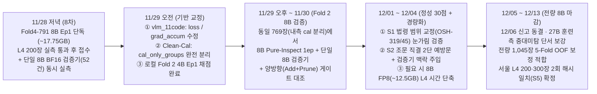

# 7차 제출(`53.98점`) 정체 원인 심층 해부, 금일 8차(`8B`) 제출 전략 및 후속 돌파 로드맵

- **작성 시각**: 2026-11-28 14:00 KST (CPU 전용 심층 분석 · 로컬 RTX 3060 `Fold 2` 학습 무간섭)
- **공식 기준 현황 (`13:55 KST`)**:
  - **6차** (`791장` 4B 1에폭 단독): `53.65점`
  - **7차** (`1,045장` 전량 4B 2에폭 + 전문가·마진 검증기 하이브리드, `SHA-256: 83c76f44...`): **`53.98점` (`+0.33점`, 최고점 자동 갱신)**
  - **현재 순위 및 커트라인 격차**: **`29 / 136위`** · **20위(Private 진출선) `56.03점`까지 `-2.05점`** · **10위(발주처 결선선) `60.25점`까지 `-6.27점`** · 금일 잔여 제출 **`1회`(`23:59 KST` 소멸)**
- **참조 원장**: [submission-7-8-decision-and-l4-value-20261128.md](submission-7-8-decision-and-l4-value-20261128.md), [seoul-eighth-200-20261128.json](../results/seoul-eighth-200-20261128.json), [sub78-public200-output-diff-20261128.json](../results/sub78-public200-output-diff-20261128.json), [sub78-8b-verifier-audit-20261128.json](../results/sub78-8b-verifier-audit-20261128.json), [antigravity-single-8b-verifier-design-20261128.md](antigravity-single-8b-verifier-design-20261128.md)

---

## 1. 왜 7차(`53.98점`)는 `57/200장`을 바꾸고도 `+0.33점`에 그쳤는가? (5대 상쇄 메커니즘)

단일 Public 총점만으로 비공개 테스트셋 내부의 세부 항목 점수를 역산할 수는 없으나, 이미 확보된 **서울 L4 200장 쌍체 비교**, **Fold 4 미노출 분해 원장**, **훈련 로그(`steps.jsonl`) 및 보정 노출 감사**를 교차 대조하면 7차 내부에서 **양(+)의 요인과 음(−)의 요인이 정면으로 상쇄된 구조**가 명확히 드러난다.

### 1.1 [상쇄 ①] 2에폭 초벌의 ‘위험 침묵(Recall 하락)’을 검증기 가산분이 메우는 데 소진됨
- 서울 L4 동일 200장 실측([sub78-public200-output-diff-20261128.json](../results/sub78-public200-output-diff-20261128.json#L14-L49), [seoul-l4-roadmap-experiments-20261128.json](../results/seoul-l4-roadmap-experiments-20261128.json#L246-L248))에서 7차는 비전 전문가+검증기가 **`+9건`의 위험을 새로 승인해 추가했음에도**, 최종 위험 판정 사진 수는 **6차 `138장` → 7차 `135장`으로 오히려 감소**(`무위험→위험 +9장` vs **`위험→무위험 -12장`**)했고, 중대성 4 사진 완전 미탐도 `19 → 22/68장`으로 소폭 늘었다.
- 이는 미노출 Fold 4(`175장`)에서 확인된 현상과 정확히 일치한다([sub78-reject-runtime-audit-20261128.json](../results/sub78-reject-runtime-audit-20261128.json#L151-L177)): 4B가 1에폭 → 2에폭으로 가면서 실제 위험 사진 `126장` 중 무위험으로 침묵한 사진이 **`37장(29.4%) → 47장(37.3%)`**으로 `10장` 급증(단독 F1 `0.54201 → 0.53103`)했고, 검증기가 `+8 TP / +5 FP`를 붙여 다시 끌어올렸으나 **검증기 이득의 상당 부분이 2에폭 초벌이 잃어버린 재현율을 복구하는 데 소모**되었다.

### 1.2 [상쇄 ②] 전량 마진 게이트의 In-Sample 낙관 편향(`tau_when_empty: 1.489 → 0.553`)과 소수 코드 정밀도 희석
- 7차의 마진 게이트는 `1,045장` 중 `170장(251쌍)`에서 적합되었는데, 이 `170장` 전부가 이미 `inspect` 기본 판독으로 2에폭 학습된 사진이었다([v3_hybrid_deployment_ledger.json](../results/v3_hybrid_deployment_ledger.json)). 이미 암기된 정상 사진에서는 기각 로그오즈가 과도하게 음수로 벌어져 안전장면 문턱 `tau_when_empty`가 Fold 4(`1.489`)보다 훨씬 낮은 **`0.553`**으로 잠겼고(`tau_when_hazard: -0.9 → -1.2`), 내측에서도 오탐 수용이 `50/178건(28.1%)`에 달했다.
- 그 결과 서울 L4 200장에서 전문가 제안 `71건` 중 **`45건(63.4%)`이 게이트를 통과**(Fold 4는 `26/66 = 39.4%`)했다. 비암기 상태인 실제 비공개 Public 사진에서는 이 낮은 문턱을 타고 소수·중간 빈도 코드에 오탐(FP)이 2~4건만 유입되어도, **코드당 동일 가중(`70점 / 활성 코드 수 ≈ 6.4~8.8점`)인 Macro-F1 특성상 정탐 추가 이득의 절반 이상을 깎아먹는다.**

### 1.3 [상쇄 ③] `4B` 백본 + 비전 전문가의 공통 시각 사각지대 (`struck_by_lifting` · `chemical` · 복합 `other`)
- 미노출 Fold 4에서 4B는 인양·낙하(`struck_by_lifting`) F1이 `0.125`(`175장`) / **`0.000`(`107장`, `0/9` 정탐)**, 화학물질 노출(`chemical_exposure`)이 `0.333`(`1/4`)에 머물렀다([paired-qwen-4b-8b-fold4-20261128.json](../results/paired-qwen-4b-8b-fold4-20261128.json)).
- 더구나 비전 전문가 역시 `struck_by_lifting` 내측 OOF 정밀도가 **`0.1168`**에 불과해([sub78-8b-verifier-audit-20261128.json](../results/sub78-8b-verifier-audit-20261128.json#L24)), 4B 하이브리드에서도 인양·기계 협착 정탐 추가는 **`0건`**(`2→2건`, [comprehensive-audit-and-vlm-roadmap-20261128.md](comprehensive-audit-and-vlm-roadmap-20261128.md#L75))이었다. 즉 **4B와 전문가가 동시에 못 보는 물리적 시각 단서(줄걸이·슬링·분전반 미세 손상·분진/용기 표식)는 4B 내부의 데이터 증량(`791→1,045장`, `+32%`)만으로는 뚫리지 않는 체급 한계**다.

### 1.4 [상쇄 ④] 정성 30점(`근거 12 + 조치 12 + 출처 6`) 무변경 및 검증기 단문 응답의 한계
- 6차와 7차는 동일한 `system_prompt_v3.txt`와 `ActionSupportedLawRetriever`를 공유해 `OSH-319`(전기)·`OSH-45`(지붕) 범위 미확인 역전([fold4-citation-alignment-20261128.md](fold4-citation-alignment-20261128.md))이 그대로 남아 있다. 또한 검증기(`verify_user_text`, 상한 `280`토큰)로 사후 추가된 위험 항목은 장면 전체 맥락(`scene_note`) 없이 단일 코드 확인용 짧은 문구로 생성되어 정성 루브릭(24점)에서 초벌 직접 생성문보다 불리하게 작용할 수 있다.

### 1.5 [상쇄 ⑤] Fold 4 반복 참조 낙관 편향의 실전 수축
- Fold 4는 `v1 → v2 → v3` 설계 과정에서 반복 참조된 개발 분할이므로, Fold 4에서의 `4B 2ep 하이브리드 − 4B 1ep 단독` 차이(`+0.0537 F1`, 정량 환산 `+3.76점`)에 내재된 선택 편향이 비공개 Public 200장에서는 `+0.33점`으로 수축되었다. **결론적으로 `4B v3` 아키텍처의 실전 점수는 `53.65 ~ 53.98점`에서 완전히 포화되었다.**

---

## 2. [중대 코드 원인 규명] 왜 `8차 4B 첫 에폭 후보`(`3c779368...`)에서 중대 미탐이 `22 → 34건`으로 폭증했는가?

코덱스의 서울 L4 실측([sub78-public200-output-diff-20261128.json](../results/sub78-public200-output-diff-20261128.json#L30-L106))에서 `Full-1045 4B 첫 에폭 단독`(`3c779368...`)은 위험 판정 사진이 **6차 `138장` · 7차 `135장` → `103장`으로 급감**했고, 7차가 맞혔던 위험 `32장`(실제 위험 `31장`, 중대성 4 `15장`)이 증발하며 중대 미탐이 `22 → 34/68장`으로 악화되었다. **이 현상을 포기 근거로 삼은 코덱스의 판단은 100% 옳으며, 본 감사에서 그 정확한 수학적·코드상 원인을 특정했다.**

- **원인 코드 ([vlm_11code.py](../kwater_lab/vlm_11code.py#L799-L820))**:
  - `train_multimodal_qlora`는 마지막 자투리 배치에서 `grad_accum(16)`이 아닌 **실제 자투리 개수 `len(group)`으로 손실을 나눈다** (`(loss / len(group)).backward()`).
  - 전량 `Full-1045` 커리큘럼(`curriculum_sha256: 1c337bf5...`)의 총 예제 수는 **`1,345개 = 84 × 16 + 1` (`1345 % 16 == 1`)**이었다!
  - `steps.jsonl` 실측 및 결정론적 시드(`Random(1042)`) 역추적 결과, `epoch-1` 저장 직전인 **Step 85**는 **`examples = 1`, `supervised_tokens = 43`, `decision_tokens = 8`인 단일 `inspect` 정상(`status: "no_visible_hazard"`) 예제 단 1장**으로만 구성되었다.
  - 직전 정상 스텝들(`step 80~84`)의 기울기 노름은 `0.55 ~ 0.65`였으나, Step 85는 단일 `no_visible_hazard` 예제가 **정상 예제 대비 16배 가중치(`len(group)=1`)**를 받아 **`grad_norm = 2.213` (`3.8배` 폭증)**의 기울기를 아직 학습률이 높은 에폭 경계(`applied_lr = 7.75e-5`)에서 AdamW(`16개 평균 분산에 맞춰 작아진 v_t`)에 그대로 꽂아 넣었다!
  - 반면 2에폭 마지막인 Step 170(`examples = 1`)에서는 코사인 스케줄 종료로 `applied_lr = 1.33e-8`(`Step 85 대비 1/5,800`)이어서 충격이 `0`이었고, Fold 4(`1092 % 16 = 4`)와 현재 진행 중인 Fold 2(`1066 % 16 = 10`: 위험 7·정상 2·기각 1)는 `len=1` 자투리가 아니었다.
- **즉시 얻는 핵심 교훈**:
  1. `3c779368...`(`Full-1045 4B Ep1 단독`)는 Step 85의 `no_visible_hazard` 단일 표본 충격에 오염된 체크포인트이므로 **오늘 8차 슬롯에 절대 제출해서는 안 된다**(참고: 충격 직전인 `checkpoint-80`은 로컬 `data/v3-11code-full1045/checkpoint-80`에 보존되어 있음).
  2. 향후 모든 1에폭 학습 전에 `vlm_11code.py` 820행을 반드시 **`(loss / grad_accum).backward()`**로 교정(또는 총 예제 수를 `16`의 배수로 정렬)해야 동일한 에폭 경계 왜곡을 원천 차단할 수 있다.

---

## 3. 금일(`11/28`) 8차 제출 전략: 왜 그리고 어떤 `8B`를 오늘 올려야 하는가?

현재 팀 최고점은 `53.98점`으로 안전하게 잠겨 있으므로 **오늘 남은 8차 1회의 하방 리스크는 `0`**이며, `23:59 KST`가 지나면 슬롯은 소멸한다. 코덱스가 권고한 **“새 8B 후보의 실물 검사를 먼저 수행해 8차에 투입”**하는 방향에 전적으로 동의하며, 현재 작업 트리에 준비된 두 경로([prepare_fold4_8b_epoch1.py](../kwater_lab/prepare_fold4_8b_epoch1.py), [sub78_single8_verifier.py](../kwater_lab/sub78_single8_verifier.py))를 가장 안전하고 정보량이 큰 순서로 실행할 것을 권고한다.

### 3.1 오늘 8차 후보 비교 및 최적 실행 순서 (`14:00 ~ 22:30 KST`)

| 오늘 8차 후보 | 구성 및 예상 ZIP 크기 | 미노출 Fold 4 성적 (`175` / `107`) | 서울 L4 200장 예상 시간 | 오늘 8차 적합성 판정 |
|---|---|---|---|---|
| ❌ `전량 4B Ep1 단독` (`3c779368...`) | 4B `85/170스텝` 단독 (`9.04 GB`) | 미측정 (200장 중대 미탐 `34/68` 폭증) | 실측 `1,190초` | **폐기** (Step 85 `len=1` 무위험 충격 확인) |
| **🥇 1순위 (`8B-S0`)**: **`Fold4-791 Qwen3-VL-8B Ep1 단독`** | `8269bc13...` (`69/138스텝`, `1092%16=4` 정상) + `658건` 사례집 (**`~17.75 GB`**) | **`.63415` / `.62091`** (`6차` 대비 **`+.0921` / `+.0584`**) 정상 오경보 **`9/49 · 5/27` (`≤20%`)** | **`~1,220 ~ 1,270초`** (여유 `~530초+`, 안전) | **★ 오늘 8차 기본 주력 후보** (패키저 구현 완료 · 6차 `53.65`와 완벽한 1변수 `4B vs 8B` 실전 대조!) |
| **🥈 조건부 승격 (`8B-S1/S2`)**: **`단일 8B Ep1 초벌 + 8B Ep1/Ep2 검증기`** | 동일 8B 기반 + 전문가 + 1~2개 8B 어댑터 (**`19.25 ~ 19.43 GB`**) | `sub78_single8_verifier` BF16 실측으로 즉시 판정 예정 (참조 `8B+4B`: `.6701 / .6653`) | **`~1,520 ~ 1,680초`** (여유 `120~280초`, 시간 민감) | BF16 검증 결과 `8B-S0` 대비 명확한 우위 + 패키저·L4 200장(`≤1,600초`)을 오늘 저녁 내 통과할 때만 투입, 아니면 **내일 9차**로 배정 |

### 3.2 왜 오늘 8차로 `8B-S0`(`Fold4-791 8B Ep1 단독`)가 전략적·과학적으로 최강인가?
1. **`6차(53.65점)`와의 완벽한 단일 변수 실전 A/B 테스트**:
   - `6차`(`53.65점`)는 정확히 동일한 `791장` 훈련 사진, 동일한 `658건` 법령 사례집, 동일한 `system_prompt_v3.txt`, 동일한 `69/138스텝`에서 학습한 **4B 1에폭 단독**이었고, `8B-S0`는 그 모든 조건과 감독 토큰(`271,946개`)을 일치시킨 채 **기반 모델만 `Qwen3-VL-8B-Instruct`로 바꾼 쌍둥이 모델**이다([seoul-l4-roadmap-experiments-20261128.md](seoul-l4-roadmap-experiments-20261128.md#L44-L58)).
   - 7차가 이미 `4B 전량 확장 + 4B 검증기`만으로는 `+0.33점`에 그침을 보여주었으므로, 오늘 8차에서 `8B-S0`가 `56~58점+`로 도약하면 **Top-20(`56.03점`)을 오늘 밤 즉시 탈환**함과 동시에 **비공개 Public 리더보드에서 8B 체급 효과가 실제로 몇 점을 만드는지 교란 변수 없이 확정**할 수 있다.
2. **예산·일정 적합성 (기승인 `15,000원` 한도 내 완결 가능)**:
   - 현재 누적 서울 추정액은 예비비 포함 `12,590원`(실측 전송 기준 `10,787원`)으로 **`15,000원` 한도까지 보수적으로도 `2,410원`이 남아 있다**([seoul-eighth-200-20261128.json](../results/seoul-eighth-200-20261128.json#L96-L105)).
   - 로컬 CPU에서 `8B-S0` ZIP(`~17.75 GB`)과 `sub78_single8_verifier freeze` 패킷을 미리 준비한 뒤 서울 `G2-16` L4를 **단 `40~45분`(약 `1,700~2,000원`)**만 가동하면:
     - ① **`8B-S0` 실물 ZIP 200장 공식 컨테이너 검사(`~21분`)** + `6차·7차`와의 200장 출력 대조(68장 중대 미탐이 `6차 19건` 이하로 줄어드는지 즉시 확인!),
     - ② 같은 L4에서 **`sub78_single8_verifier measure --precision bf16`(`~9분`)**까지 한 번에 끝내고 디스크를 삭제할 수 있다.
   - **주의할 설계 디테일 2가지 (`sub78_single8_verifier.py` 검수 메모)**:
     1. 로컬 3060용 `--precision nf4`는 배포 정밀도(`bf16`)와 다르므로, 의사결정용 측정은 서울 L4 세션에서 **`--precision bf16`**으로 수행하는 것이 정확하다.
     2. 현재 `sub78_single8_verifier.py`는 4B의 고정 마진 게이트(`beta=0.6, tau=-0.9 / 1.489`)를 그대로 대입하는데, 8B는 로짓 스케일이 다를 수 있으므로 같은 실행에서 내측 보정 쌍(`inner_margin_cal_pairs.json`, `89쌍` — 생성 없이 순전파 45배치 약 `35초`)의 8B 마진도 함께 기록해 두면 추가 비용 거의 `0원`으로 **8B 자체 보정 게이트 대 4B 이식 게이트**를 CPU에서 모두 채점할 수 있다.

---

## 4. `53.98점` 이후 `60.25점`(Top-10 결선) 돌파를 위한 4대 후속 연구·실험 로드맵

7차 결과는 **“4B 내에서의 부분 보정은 끝났으며, ① 8B 체급 전환, ② 학습/보정 구조 버그 제거, ③ 초벌 오경보 제거(Pruning), ④ 미개척 정성 30점 공략을 결합해야 60점대를 뚫을 수 있다”**는 명확한 신호다.

### 핵심 후속 실험 4축 (단일 변수 통제 및 기대 득점원)

1. **[축 1 · 학습·보정 무결성 복원 (`11/29` 즉시)]**:
   - **`grad_accum` 정규화 수정**: `vlm_11code.py`의 `(loss / len(group))`을 `(loss / grad_accum)`으로 수정해 자투리 스텝 기울기 폭발을 제거한다. (로컬 3060이 비면 기보존된 `data/v3-11code-full1045/checkpoint-80` 대 `epoch-1[step 85]`를 소수 표본에서 대조해 충격 제거 효과를 무재학습으로 교차 확인 가능.)
   - **완전 비노출 런타임 매칭 보정(`Clean-Cal`)**: `v3_turnaround.py`의 `in_cal_grp` `else` 누수를 차단하고, 외측 훈련 그룹의 `15%`(`cal_only_groups`)를 `inspect`와 `verify_*` 모두에서 제외해 **미노출 초벌 예측 위에서 `select_booster_candidates` → 1-토큰 마진 문턱**을 적합한다(7차의 `0.553` 낙관 게이트 재발 원천 방지).

2. **[축 2 · `Qwen3-VL-8B` 순수 판독(`Pure-Inspect`) + 단일 8B 양방향 검증기 (`11/29 ~ 12/01`)]**:
   - **과제 간 간섭 제거**: 현재 로컬 RTX 3060에서 돌고 있는 `Fold 2` 4B 1에폭(`769장` 학습 / `197장·55장` 평가)이 끝나면, 서울 Spot `G2-8`(`~55분`, 약 `600원`)에서 동일 `Fold 2` 분할로 **`8B Mixed 1ep` 대 `8B Pure-Inspect 1ep`(`verify_neg` 완전 제거)**를 비교해 초벌 중대 미탐(`struck_by_lifting`, `fall_height`, `other`) 추가 감소를 검증한다.
   - **가산 전용에서 ‘가산 + 저신뢰 단일위험 제거(Add + Prune)’로 확장**: Fold 4에서 `8B+검증기`조차 정상 오경보가 `9/49(18.4%) · 5/27(18.5%)`로 `18%` 목표 경계에 걸려 있다([sub78-8b-verifier-audit-20261128.json](../results/sub78-8b-verifier-audit-20261128.json#L1297)). 초벌이 단일 위험만 냈으나 비전 전문가 `scene_prob`와 코드 확률이 모두 극저신뢰인 경계 사진(`200장 중 ~12~15장`)만 같은 8B 검증기로 1-토큰 역검증하여 기각 시 초벌 `scene_note`를 `scene_evidence`로 보존하면, 추론 시간 추가는 `~15초` 이내로 묶으면서 정상 오경보율을 `12~15%`대로 낮출 수 있다.

3. **[축 3 · 미개척 ‘정성 30점(`근거 12 · 예방조치 12 · 법령 6`)’ 직접 타격 (`12/01 ~ 12/04`)]**:
   - `53.98점 → 60.25점`(`+6.27점`) 도약을 정량 70점(Macro-F1 `+0.090`) 하나에만 의존하면 위험하다. `8B` 전환으로 정량에서 `+4 ~ +5점`을 확보하고, 지금까지 6·7차에서 고정되어 있던 **정성 30점에서 `+2 ~ +3점`**을 동시에 끌어올려야 안정적으로 Top-10에 진입한다.
   - **추론 시간 `0초` 정성 개선 3종**:
     1. **`S1` 범위 전제조건 법령 가드**: 노출된 4그룹을 교체한 눈가림 패널과 `Fold 2` 출력에서 [fold4_citation_alignment.py](../kwater_lab/fold4_citation_alignment.py)(`OSH-319` 전기 전제, `OSH-45` 지붕 전제, `OSH-301/313` 배선 구분)가 손실 없이 첫 조문 일치율을 회복하는지 확정 후 반영.
     2. **`S2` 조문 의무어 직결 2단 예방조치 SFT**: 훈련 라벨 중 인용 조문의 핵심 법적 의무(예: 작업발판·덮개·검전기 무전압 확인·방화포·유도자)가 빠진 추상적 예방문을 정제해 동일 예산 SFT로 눈가림 Judge(`S4`) 승률을 검증.
     3. **검증기 승인 응답의 장면 맥락 결합**: 검증기가 후보를 승인해 새 위험을 생성할 때 초벌이 읽어 둔 `scene_note`의 물리적 대상·위치를 함께 참조하도록 연결해 검증기 추가 행의 정성 점수 하락을 방지.

4. **[축 4 · L4 시간 여유 확보(`FP8` 대 `BF16`) 및 전량 8B 결선 마감 (`12/05 ~ 12/13`)]**:
   - 단일 8B BF16 하이브리드(`19.25~19.43 GB`)의 서울 L4 200장 시간이 `1,450초`를 넘길 경우에만 공식 `Qwen3-VL-8B-Instruct-FP8`(`~12.5 GB` 하이브리드 ZIP) 대 BF16 패리티(`|ΔF1| ≤ 0.005`)를 시험해 `≤ 1,250초` 여유를 확보하고, `12/06` 외부자료 클린 신고 확정 후 검증된 최종 8B 아키텍처를 `1,045장` 전량(5-Fold OOF 비노출 보정 + `grad_accum` 수정 적용)으로 학습해 `200장·300장` 2회 해시 완전 일치(`S5`)로 마감한다.
