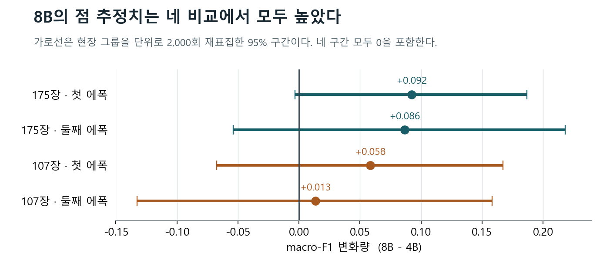

# 6차 제출 이후 무엇이 얼마나 개선됐나

2026년 11월 28일 오전 KST 기준. 코덱스 메인·Sol 검산, 사이드채팅의 서울 L4·데이터·비전·법령 실험, 안티그래비티 제미나이의 학습·배포 기록을 종합했다.

## 공식 성적과 목표

| 제출 | 실제 모델 또는 변경 | Public |
|---|---|---:|
| 1차 | 주최 측 4B·8종 LoRA | 42.04 |
| 2차 | 170장 선형 분류기·코드별 고정 문구 | 16.12 |
| 3·4차 | 공식 모델에 각각 법령 범위·관찰 문구 후처리 | 42.04 · 42.04 |
| 5차 | 기반 모델에서 새로 학습한 8종 | 47.35 |
| 6차 | 791장으로 학습한 SafeGround v3 11종 4B, 첫 에폭 단독 | **53.65** |

1차 대비 **+11.61점**, 5차 대비 **+6.30점**이다. 6차 이후 공식 추가 제출은 0회여서 새 후보의 Public 개선폭은 미측정이다. 11월 28일 10:02 KST 공식 API 조회에서 6차 영수증의 점수·제출 수·최종 접수 시각과 일치하는 표시명은 **도니고니, 128팀 중 21위**였다. 10위 57.81까지 **4.16점**, 20위 53.79까지 **0.14점**이다. 6차 직후 확인한 12/100위·10위 격차 1.55점은 당시 기록이다. [공식 리더보드](https://hackathon.imaginationgroup.co.kr/kwater/api/leaderboard) · [초기 제출 감사](../docs/top10-turnaround-audit-and-plan-2026-11-26.md) · [2차 결과](../results/public_submission_002.json) · [5차 결과](../results/public_submission_005.json) · [6차 결과](../results/public_submission_006.json)

## 같은 검증 사진에서 6차와 비교

지표는 정답 또는 예측이 있는 위험 코드별 F1의 평균이다. 175장은 Fold 4의 39그룹이고, 107장은 훈련 사진과 같은 현장이 확인된 3그룹을 뺀 36그룹이다. 두 패널을 합산하지 않는다. 오경보는 정상 사진에 위험을 하나라도 출력한 경우, 중대 미탐은 중대성 4인 사진에서 해당 중대 위험 코드를 하나도 맞히지 못한 경우다.

| 후보 | F1 175장 | F1 107장 | 정상 오경보 175장·107장 | 중대 미탐 175장·107장 |
|---|---:|---:|---:|---:|
| 6차 4B 첫 에폭 단독 | .54201 | .56252 | 10/49 · 6/27 | 29/60 · 18/39 |
| 4B 첫 에폭 + 고정 검증기 | .60569 | .63071 | 10/49 · 6/27 | 26/60 · 15/39 |
| 4B 둘째 에폭 + 같은 검증기 | .59574 | **.63746** | 8/49 · 6/27 | 30/60 · 17/39 |
| 8B 첫 에폭 단독 | **.63415** | .62091 | 9/49 · 5/27 | 29/60 · 20/39 |
| 8B 둘째 에폭 단독 | .61745 | .58906 | **5/49 · 4/27** | 32/60 · 23/39 |
| 공개 27B 4비트 단독 | .51434 | .51522 | 36/49 · 19/27 | **21/60 · 12/39** |

**27B는 6차보다 정상 사진에 훨씬 자주 경보를 냈다.** 중대 미탐은 175장에서 29→21장, 107장에서 18→12장으로 줄었지만, 정상 오경보는 각각 10→36장과 6→19장으로 늘었다. 위험 코드 Macro-F1은 6차보다 .02767·.04730 낮았다. 27B는 주석에 없는 익수·침수를 6장·3장에 예측해 평균에 9종이 들어갔다. 4B·8B와 공통인 8종만 보면 .57864·.57962다. 이 보조 계산은 익수·침수 오경보를 평균에서 제외하므로 정규 점수를 대체하지 않는다. 175장은 공식 키트 1,304초, 원생성 스키마 174/175, 최종 유효 출력 175/175였다. 사진과 정답은 동일하며 모델별 대회자료 학습·양자화·추론 환경은 다르다. [27B Fold 4 품질 원장](../results/stock-27b-fold4-20261128.json)

**가장 분명한 개선은 6차 첫 에폭에 같은 검증기를 붙였을 때다.** 초벌·사진을 고정한 비교에서 F1이 175장 **+.06368**, 107장 **+.06819** 올랐다. 현장 단위 쌍체 95% 구간은 각각 [+0.00594, +0.13562], [+0.00970, +0.17281]이다. 175장에서 전문가 후보 54건 중 22건을 재판독해 정답 8건과 오답 4건을 추가했다. 두 패널에서 중대 미탐은 각각 3장 줄고 신규 정상 오경보는 0건이었다. 기존 초벌 오경보가 남아 107장에서 6/27(22.22%)이고, 사전 기준 20%를 충족하려면 5건 이하여야 한다. 첫 에폭과 둘째 에폭 하이브리드 *사이*의 차이는 두 패널 모두 95% 구간에 0이 들어간다. [실제 고정 검증기 쌍체 집계](../results/fold4-v3-fixed-verifier-paired-code-evaluation.json)

**8B의 장점은 오경보 감소다.** 같은 791장·프롬프트·업데이트·감독 토큰으로 비교한 첫 에폭에서 6차 대비 F1이 +.09214·+.05838 올랐고, 정상 오경보가 각 1장 줄었다. 다만 107장 개선분의 약 89%가 정답 4장인 화학 노출 코드에서 나왔으며 중대 미탐은 18→20장이었다. 모델 크기 효과의 현장 단위 95% 구간은 두 패널에서 모두 0을 포함했다. 둘째 에폭은 오경보를 더 줄였지만 107장에서 중대 미탐이 23장까지 늘었다. [4B·8B 통제 비교](../results/paired-qwen-4b-8b-fold4-20261128.json)

## 실제 제출 ZIP의 실행 가능성

| 서울 L4 공식 오프라인 키트 · 같은 개발 사진 200장 | ZIP 크기(십진 GB) | 설치 포함 시간 | 6차 대비 | 30분까지 여유 | 공식 유효 행 |
|---|---:|---:|---:|---:|---:|
| 6차 4B 첫 에폭 단독 | 9.04 | 1,139초 | 기준 | 661초 | 200/200 |
| 1,045장 전량 4B 하이브리드 | 10.55 | 1,497초 | +358초 | 303초 | 200/200 |
| 공개 Qwen3.8-27B 4비트 수정본 | 17.80 | 1,591초 | +452초 | 209초 | 200/200 |

제미나이가 로컬 RTX 3060에서 1,045장으로 초벌·검증 학습을 2에폭 170/170스텝까지 끝냈고, 전문가 15개와 전량 보정을 묶었다. 이 ZIP은 Fold 4까지 학습했다. 품질 표의 4B·8B 수치는 791장으로 별도 학습한 후보의 결과이며, 27B 수치는 공개 가중치를 평가한 결과다. 서울에서 전량 ZIP과 6차 ZIP은 57/200장의 위험 코드 집합이 달랐다. 전량 ZIP의 Windows 검사도 200/200을 통과했지만 실행은 2,728초였고 서울과 코드 집합이 달랐던 사진은 15장이었다. 27B는 동봉 라이브러리 경로를 수정한 ZIP으로 검사했다. 일반 공개 가중치·4비트·별도 추론 엔진을 사용해 자체 LoRA 4B·8B와의 비교에는 모델 크기 외의 차이도 있다. 8B 자체 제출 ZIP의 200장 시간은 미측정이다. [실물 ZIP·시간](seoul-l4-roadmap-experiments-20261128.md) · [실제 출력 차이](../results/seoul-l4-sixth-vs-seventh-public200-output-diff-20261128.json)

## 세션별 작업과 채택 판단

| 작업 | 확인한 내용 | 판단 |
|---|---|---|
| 초기 Orca·코덱스, 제미나이 감사 | 3·4차는 공식 가중치를 유지해 검사한 사진의 위험 판정 변화가 작았다. Fold 0의 v2 검증기를 공식 초벌에 붙이면 216장 F1 .6031→.6053, 중대 미탐 20→12, 정상 오경보 6→17이었다. | 새 8종 및 11종 학습으로 전환했다. 5·6차부터 공식 점수가 올랐다. |
| 안티그래비티·코덱스 메인·Sol | v3 훈련, 5·6차 패키징, 동일 검증기 재판독, 교차 현장 감사, CPU 지표·해시·형식·사진 순서 검산, 1,045장 전량 ZIP을 완료했다. | Fold 4에서 두 하이브리드 모두 107장 오경보 기준을 넘었다. 전량 학습 뒤에도 별도 현장에서 기준을 충족했다는 증거가 없어 7차 접수를 보류했다. |
| 외부·합성 데이터 사이드채팅 | 실사 42장 검토, 합성 12가족 24장 제작, 10가족 20장을 관찰 과제에 선별했다. 공식 실사 3쌍 A/B는 양쪽 12스텝 학습 후 A 97/102·B 0/102에서 판독을 중단했다. 외부 침수 모델은 산업현장 탐색 170장에서 침수 오탐 48건을 냈다. | 이 자료로 제출 성능이 향상됐다는 결과는 없다. 공식 3쌍 대조에는 외부·합성 사진을 넣지 않았다. |
| 비전 사이드채팅 | 48장에 고정·수동 확대 등 3조건, 실제 144회 판독. 목표 F1 .4848→.5556이나 정상 오경보 1→3/12. 깊이 정보는 966장 5폴드×3시드 비교에서 인양 F1 .1946→.2235, 전체 macro-F1 .4772→.4854, 서울 200장에 12.31초 추가. | 수동 확대와 깊이 모두 사전 기준 미달. 탐지·분할 모델 확대를 보류했다. |
| 법령·예방조치 사이드채팅 | 첫 조문 주석 적중은 기존 검색 68/81·43/55, 현행 조치문 재정렬 60/81·37/55였다. 폭넓은 교정은 66/81·41/55까지 회복했지만 기존 눈가림 8건 중 6건에서 예방조치에 대한 직접 지지가 악화됐다. 좁은 교정은 63/81·39/55였다. 조치문 초안 3건, 불확실성 사례 13건, 평가자 자격시험 16문항도 마련했다. | 좁은 교정이 회복한 3건은 정책 설계에서 읽은 사례다. 봉인 패널의 직접 중복은 2장, 같은 검수 그룹까지 포함하면 4장이므로 독립 시험에서 새 그룹으로 교체한다. 공식 정성 점수의 증가분은 미측정이다. [9건 검수 결과](fold4-citation-alignment-20261128.md) |
| 이슈 #1·#2와 서울 클라우드 사이드채팅 | 시각 근거·후보 기각·문장과 조문의 연결·눈가림 평가를 대조 실험으로 설계했다. 서울 L4에서 4B/8B 파일럿과 본학습, ROI·깊이 측정, 6차·전량·27B 실물 ZIP 리허설을 수행했다. | 모델의 현장 판별력과 제출 환경에서의 실행 가능성을 각각 검증할 수 있게 됐다. |

각 실험의 표본과 실행 상세는 [초기 인계·A/B](turnaround-handoff-20261127.md), [외부 데이터](external-first-experiment.md), [시각 실험](vision-depth-966-and-roi-20261128.md), [정성 실험](qualitative-vision-followup-20261128.md), [이슈 #1 검토](issue-1-research-roadmap-20261127.md), [이슈 #2 실험과 샘플 안내](issue-2-transfer-experiments-20261127.md)에 있다.

자원은 로컬 RTX 3060을 제미나이의 본학습과 Windows 검사에 배정하고, CPU는 Sol의 독립 검산에 사용했다. 보조 Ubuntu PC용 계획도 작성했으며, 보조 PC를 쓸 수 없는 동안 서울 L4에서 승인 예산 15,000원 범위의 큐에 8B와 비전 실험, 공식 키트 검사를 순차 배치했다. 예산은 승인 한도이고 최종 청구액은 별도다. [보조 PC 계획](ubuntu3050-weekend-research-plan-20261127.md) · [서울 실행 원장](seoul-l4-roadmap-experiments-20261128.md)

## 다음 제출을 가르는 결과

1. 4B 첫 에폭에서 회복한 중대 위험을 유지하면서 초벌 정상 오경보를 줄일 수 있는지, 별도의 개발 현장에서 기각 조건을 정하고 새 평가 현장에서 한 번 검증한다. 107장 중 특정 오경보 한 장을 보고 고친 결과로 승격하지 않는다.
2. 8B 첫 에폭은 동일한 새 현장 분할에서 4B와 비교해 화학 노출을 제외해도 이득이 남는지, 107장에서 관찰한 중대 미탐 증가가 반복되는지 확인한다.
3. 공개 27B는 두 패널에서 정상 오경보율이 73.5%·70.4%여서 직접 제출 후보에서 제외한다. 연구용으로는 4B·8B가 놓친 중대 위험 사진에서 실제로 어떤 단서를 회복했는지, 개발용 사례 검토에 한정해 살펴볼 수 있다.
