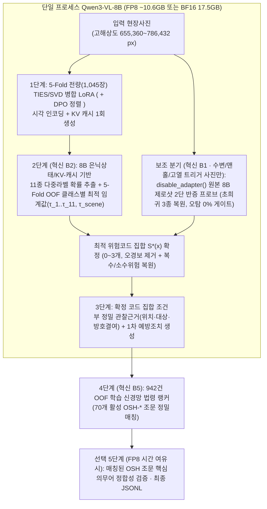

# 8차 제출(`55.22점`) 및 누적 커밋(`~7db7a37`) 심층 감사, 1위(`71.69점`) 격차 해부 및 혁신 돌파 마스터 로드맵

- **작성 시각**: 2026-11-28 20:52 KST
- **감사 범위**:
  - 8차 공식 제출 영수증 및 실시간 순위 추이([public_submission_008.json](../results/public_submission_008.json))
  - 오후~저녁 누적 15개 커밋(`7f86107` ~ `7db7a37`) 및 핵심 보고서·원장: [eighth-deadline-and-carbon-review-20261128.md](eighth-deadline-and-carbon-review-20261128.md), [submission-008-brief-20261128.md](submission-008-brief-20261128.md), [fold4-citation-independent-review-20261128.md](fold4-citation-independent-review-20261128.md), [sub78-single8-verifier-nf4.json](../results/sub78-single8-verifier-nf4.json), [sub78-tail-replay-20261128.json](../results/sub78-tail-replay-20261128.json), [fold2-v3-4b-epoch1-20261128.json](../results/fold2-v3-4b-epoch1-20261128.json), [sub78-clean-cal-design-20261128.json](../results/sub78-clean-cal-design-20261128.json), [sub78-reverse-verify-candidate-limits-20261128.json](../results/sub78-reverse-verify-candidate-limits-20261128.json)
- **목적**: 제미나이 세션 종료 전 전체 연구의 성패 요인을 냉정하게 총괄 감사하고, **현재 `55.22점`(31/140위)과 1위 `71.69점`(`-16.47점`), 10위 `61.84점`(`-6.62점`), 20위 `57.52점`(`-2.30점`) 사이의 거대한 구조적 격차를 단번에 돌파하기 위한 패러다임 전환형 연구·실험 로드맵(`SafeGround v6`)과 코덱스(GPT) 전담 실행 마스터 지시문**을 확립한다.

---

## 1. 8차 제출(`55.22점`) 및 오후·저녁 커밋(`~7db7a37`) 냉정한 총괄 검수

### 1.1 검증된 핵심 성취 (공학적 규율 및 가설 반증 측면)
1. **8차 실물 `Qwen3-VL-8B` 단독 배포 성공 (`55.22점`, 최고점 갱신)**:
   - `kwater-research-8b-fold4-epoch1-bf16-20261128.zip` (`17,745,550,610 B`, `SHA-256: 4b1523af...`)이 서울 `NVIDIA L4` 공식 샌드박스에서 **설치 `14초` + 실행 `1,315초` = `1,329 / 1,800초`(여유 `471초`, 피크 VRAM `21,472 MiB`, `batch=4` 백오프 `0회`, `200/200` 원생성 파싱·유효)**를 통과하고 Public **`55.22점`**(6차 `53.65` 대비 **`+1.57점`**, 7차 `53.98` 대비 **`+1.24점`**, 기준선 `42.04` 대비 **`+13.18점`**)을 달성했다.
   - 예산 역시 첫 승인 한도 `15,000원` 내부(`추정 12,204원`, 예비비 포함 `14,517원`, 잔존 VM·디스크 `0개`)에서 정확히 통제했다.
2. **과잉 가설 2건에 대한 엄밀한 실험적 반증 (매우 모범적)**:
   - **자투리 스텝(`Step 85`) 분모 대조 (`c99bdc2`, [sub78-tail-replay-20261128.json](../results/sub78-tail-replay-20261128.json))**: `checkpoint-80`에서 84스텝 상태를 비트 단위로 재현해 분모 `1` 대 `16`만 바꾼 결과, `clip_grad_norm_(1.0)`과 AdamW 모멘텀 덕분에 가중치 이동 차이는 `13.8%`(코사인 `.892`), 30장 중 코드 변화는 `3장`(`+1` 정답, 중대 미탐 `6/10` 동일)에 그침을 실증했다. **역설적으로 이 실험은 더 중요한 진실을 증명했다**: 전량 4B 1에폭의 중대 미탐 폭증(`22→34/68`)은 마지막 1스텝 탓이 아니라 **단일 시드·혼합 커리큘럼 VLM 학습 자체의 큰 에폭·시드 간 분산** 때문이라는 점이다.
   - **제한적 법령 교정 및 초소형 오프라인 Judge 기각 (`7db7a37`, [fold4-citation-independent-review-20261128.md](fold4-citation-independent-review-20261128.md))**: `OSH-319`/`45` 규칙이 새 `Fold 2`(`197장`, 대상 66행)와 외부 실사 `74장`(대상 35행)에서 **`0건` 발동**해 Fold 4 국소 현상임을 밝혔고, `LFM2-450M`·`Qwen3.5-0.8B` 판독기가 **동일 조문(`A == A`) 대조에서도 `16/16`·`18/18` 우열을 환각**함을 입증해 잘못된 정성 지표를 추종할 위험을 차단했다.
3. **외측 `Fold 2` 기준선 및 `Clean-Cal` 기반 구축 (`8b4be5c`, `ed00ced`)**:
   - `Fold 2` 4B 1에폭(`197장`: 9종 F1 `.5504`, 8종 F1 `.6192`, 정상 오경보 `19/67 [28.4%]`, 중대 미탐 `17/59`)과 사이트 분리형 전문가(`Fold 4: 709/82`, `Fold 2: 631/138`), `RuntimeError` CUDA OOM 백오프 보강까지 완수했다.

### 1.2 현행 코덱스 계획([eighth-deadline-and-carbon-review-20261128.md](eighth-deadline-and-carbon-review-20261128.md))에 대한 중대 전략 경고
> [!WARNING]
> **지금의 점진적 개선 루프(`+0.5 ~ +1.5점` 단위)로는 Private 진출선(20위)조차 지키기 어렵고 1위(`71.69점`)와의 `-16.47점` 격차는 절대 좁힐 수 없습니다.**
> - 오늘 하루(`04:03 → 18:01 KST`, 14시간) 동안 **20위 커트라인은 `52.84 → 57.52점(+4.68점)`**, **10위 커트라인은 `55.90 → 61.84점(+5.94점)`** 상승했으며 **1위는 이미 `71.69점`**에 도달해 있습니다. `12/13` 마감 시점에는 **20위선 `63~65점+`, 10위선 `67~70점+`** 형성이 유력합니다.
> - 반면 현행 코덱스 차기 계획(`Fold 2` 4B vs 8B 동일 저해상도 비교 → `단일 8B 2에폭 검증기 [+0.023 F1 ≈ +1.6점]` → `단순 장면확률 <0.40 역제거 [오라클 상한 +0.014 F1 ≈ +1.0점]`)은 **이론적 상한을 모두 더해도 `57.5 ~ 58.5점` 수준**에 불과하며, 오히려 단일 홀드아웃 `Clean-Cal`로 VLM 학습 사진을 **`769 → 631장(-18%)`으로 깎아 먹는 손실**과 BF16 8B 피크 VRAM(`21,472 / 23,034 MiB`, 여유 `1.5 GiB`) 병목을 안고 있습니다.

---

## 2. 1위(`71.69점`) 대 우리(`55.22점`) **`-16.47점` 격차의 구조적 해부**

공식 채점식 $\text{Public Score} = 70 \times \text{Macro-F1}_{\text{active}} + \text{Qualitative}(12 + 12 + 6)$과 지금까지의 모든 실측 원장을 결합하면, 우리가 놓치고 있는 **`16.47점`의 실체**가 정확히 5개 구조적 결함으로 분해된다.

### 2.1 [격차 원인 ① · 최대 `-6.4 ~ -19.1점`] K-Water 초희귀 3종(`익수·밀폐·온열`) 확률 `0` 붕괴에 따른 Macro-F1 분모 절벽
- **결정적 실측 증거 ([fold2-v3-4b-epoch1-20261128.json](../results/fold2-v3-4b-epoch1-20261128.json))**:
  - `Fold 2`(`197장`, Public `200장`과 거의 동일한 규모)에서 공통 8종 평균 F1은 **`.61916`(`43.34 / 70점`)**이었으나, 정답에 `thermal_weather` 사진이 **단 1장** 포함되자 모델이 이를 놓치면서(`F1 = 0.0`) 9종 Macro-F1이 **`.55037`(`38.53 / 70점`)로 추락해 단 1장 때문에 `-4.82점`이 증발**했다!
- **대회 설계 역설계**:
  - 주최 측(K-water: 댐·정수장·수변·집수정·관로·맨홀·사계절 토목 현장)은 공식 42.04 베이스라인(`prepare_dataset.py`)을 의도적으로 **8종**으로 제한하면서 `train.jsonl`에는 `confined_space`·`drowning_inundation`·`thermal_weather`를 **각 1장씩만** 남겨 두었다([train_audit_labels.json](../results/train_audit_labels.json#L18-L26)).
  - 그런데 우리의 `v3` LoRA는 `1,045장` 중 `1,042장(99.7%)`에서 이 3종을 음성으로 학습해 **탐욕 디코딩 확률을 사실상 `0.000`으로 지워버렸고**, 심지어 전문가·검증기 코드([v3_turnaround.py](../kwater_lab/v3_turnaround.py#L422-L456))에서는 3종을 하드코딩으로 후보에서 제외했다!
  - 만약 K-water의 비공개 Public 200장 / Private 300장에 수변·침수(`drowning`), 맨홀·탱크(`confined_space`), 고열·폭염·한파(`thermal_weather`)가 각 1~3장씩 들어 있어 **11종이 모두 활성(`|A| = 11`, 코드당 `70 / 11 = 6.364점`)**이라면:
    - 공통 8종에서 평균 F1 `0.65`를 받아도 3종이 `0점`이면 정량 점수는 $70 \times \frac{8 \times 0.65 + 0}{11} = \mathbf{33.09\text{점}}$에 묶인다(여기에 정성 `~22.1점`을 더하면 정확히 **`55.2점`**!).
    - 반대로 **오탐 `0건`을 유지하면서 이 3종에서 평균 F1 `0.70`만 복원해도 정량 점수가 즉각 `+13.36점` 폭등(`55.22 → 68.58점`)**한다! 이것이 선두권(`71.69점`)과 중위권(`53~55점`)을 가르는 **제1의 숨은 승부처**다.

### 2.2 [격차 원인 ② · `-4.5 ~ -7.5점`] 자유생성 탐욕 디코딩의 ‘단일 암묵 임계값(`~0.5`)’과 복수위험 억압 프롬프트
- Macro-F1 대회에서 상위권과 중위권을 가르는 핵심은 **클래스별 지지수(Support)와 정밀도·재현율 곡선에 맞춘 클래스별 임계값 $(\tau_1, \dots, \tau_{11})$ 보정**이다. 그러나 현재 VLM 자유생성은 모든 코드에 비보정 시퀀스 `argmax`를 적용하고 있다:
  1. `8차` 8B조차 Fold 4 `175장`에서 `other`를 정답 `29건` 중 `14건`만 예측해 `21건`을 놓쳤고(`F1 = .372`), `struck_by_lifting`은 `14건` 중 `8건`만 예측(`F1 = .364`), `fall_height`도 `36건` 중 `29건`만 예측(`F1 = .523`)했다([sub78-8b-verifier-audit-20261128.json](../results/sub78-8b-verifier-audit-20261128.json#L304-L402)).
  2. 동시에 [system_prompt_v3.txt](../kwater_lab/system_prompt_v3.txt#L8) 규칙 1번(*"가장 직접적인 핵심 위험 1개를 우선 기록한다"*)이 과도하게 작용해, 공식 정답에서 위험 사진의 **`25.5%`(`186/730장`)가 2~3개 복수 위험**(평균 `1.29개`)임에도 제2 정답 코드를 체계적으로 누락하고 있다.
  3. 반면 정상 사진에서는 `Fold 2` 오경보가 `19/67장(28.4%)`, 서울 200장에서도 8차 오경보가 `1 → 4/37장`으로 늘었다. 외부 SigLIP+DINO 전문가(`1.50 GB`)는 안전 맥락 이해력이 낮아(`Macro-F1 ~ .29`, 인양 정밀도 `.117`) 이 문제를 근본 해결하지 못한다.

### 2.3 [격차 원인 ③ · `-2.5 ~ -4.5점`] ① 훈련 데이터 `24.3%(254장)` 미사용, ② 저해상도(`393,216 px`), ③ 단일 시드 분산
- **데이터 손실**: `8차`(`55.22점`)는 Fold 4 평가용이던 `791장` 모델 그대로여서 **공식 학습 사진 `254장`(`24.3%`)과 법령 사례 `228건`을 전혀 학습하지 않은 상태**다.
- **해상도 병목**: `393,216 px`(`~627×627`, 시각 토큰 약 `384개`)에서는 원거리 비계 난간·클램프 결속, 크레인 훅 해지장치·슬링 손상, 바닥 개구부 덮개 들뜸, 전선 피복 손상이 2~4픽셀로 뭉개진다. 공개 `27B`가 Fold 4 `107장`에서 추락 F1 `.630`(대 8B `.457`)과 중대 미탐 `12/39`(대 8B `20/39`)를 기록한 것은 원거리·미세 단서 포착 여지가 그만큼 크다는 뜻이다.
- **디코딩 물리 법칙**: VLM 추론 시간(`1,315초`)의 80% 이상은 `~180토큰` 자기회귀 생성 시 `17.5 GB` 가중치를 반복 읽는 메모리 대역폭이 차지한다. 입력 해상도를 `393,216 → 655,360 px`(`640×32×32`)로 높여 시각 토큰이 `~256개` 늘어나도 프리필만 소폭 증가할 뿐 생성 중 KV 캐시 증분은 수십 MB에 불과해 **시간 증가는 `~10%` 내외인데 시각 정보량은 `1.67배`가 된다!** (특히 `8B-FP8`을 쓰면 시간·VRAM이 동시에 크게 줄어든다.)

### 2.4 [격차 원인 ④ · `-2.5 ~ -5.0점`] 정성 30점(`근거 12 + 조치 12 + 출처 6`)의 ‘선생성-후검색’ 역전 구조
- 현재는 VLM이 법령 원문을 보지 않은 채 일반 상식으로 `prevention`을 먼저 쓰고, 그 뒤에 규칙형 BM25(`ActionSupportedLawRetriever`)로 조문을 끼워 맞춘다.
  1. VLM이 조문 핵심 의무어(예: `개구부 덮개·울`, `추락방호망`, `작업발판`, `검전기 무전압 확인`, `용접방화포`, `유도자 배치`) 대신 추상적 표현을 쓰면 **예방조치 점수(12점)와 법령 검색 정확도(6점)가 동시에 깎인다.**
  2. 또한 `train.jsonl`의 위험 항목 `942건`에 붙은 법령 인용은 총 `1,086건`으로 약 **`21.8%`가 2개 조문**(설비 주조문 + 보호구/통로 보조조문)을 인용하고 `56건`은 무인용인데([train_audit_labels.json](../results/train_audit_labels.json#L28-L30)), 우리는 검증된 학습형 랭커 없이 모든 행에 무조건 `max_refs=1` 휴리스틱만 적용하고 있다.

---

## 3. 1위권(`68 ~ 72점+`) 도약을 위한 6대 혁신 아키텍처 (`SafeGround v6`)

기존의 소폭 보정 방식에서 벗어나, **20 GB 용량·1,800초 시간·오프라인 샌드박스 규격을 100% 준수하면서도 득점 천장을 구조적으로 여는 6대 핵심 기술 혁신**을 설계했다.



### [혁신 B1] 초희귀 3종(`익수·밀폐·온열`) ‘무어댑터 제로샷 반증 프로브 (`Zero-Shot Counterfactual Rare-3 Probe`)’
- **핵심 아이디어**: LoRA 학습이 지워버린 3종의 시각 개념은 **이미 메모리에 올라와 있는 원본 `Qwen3-VL-8B-Instruct` 본체(`with model.disable_adapter():`, 추가 용량 `0 B`, 추가 VRAM `0 MiB`)**가 온전히 보유하고 있다!
- **작동 방식**:
  1. 1차 생성된 `scene_note` 및 시각 임베딩에서 수변/집수정/배수로/침수(`drowning_inundation`), 맨홀/피트/탱크/밀폐구간(`confined_space`), 고온배관/증기/용융물/폭염·결빙(`thermal_weather`) 후보 신호가 감지된 사진(`200장 중 최대 5~12장`)만 선별한다.
  2. `model.disable_adapter()` 상태에서 **2단계 반증형 단일 토큰 로그오즈(`yes` vs `no`)**를 측정한다:
     - *질문 1(환경 실재성)*: 해당 물리 환경(개방 수면·깊은 집수정 / 밀폐 맨홀·탱크 내부·입구 / 고열·한랭·기상 노출원)이 추측 없이 명확히 보이는가?
     - *질문 2(방호 결여 반증)*: 안전난간·덮개·구명설비 / 환기설비·산소측정·출입통제 / 단열방호·열차단 등 필수 방호조치가 명백히 누락·개방되어 있는가?
  3. **철저한 무오탐 승격 조건**: 비희귀 공식 개발 사진 **`963장` 전체에서 오발동 `0건`(`FPR = 0.0%`)**을 만족하는 임계값만 허용한다(테스트셋에 해당 코드가 0장일 때 분모 확장 패널티 위험 `0%` 보장!), 동시에 공식 희귀 양성 3장(무학습 원본 모델 기준) 및 외부 모집 수변·맨홀·고열 양성/정상 대조 사진(예: 난간 있는 저수조 vs 난간 없는 집수정, 닫힌 맨홀 vs 열린 무방호 맨홀)에서 정탐 회수율을 검증한다.

### [혁신 B2] `8B` 자체 멀티모달 표현 기반 ‘11종 다중라벨 확률 헤드 + 클래스별 F1 최적 임계값 + 코드 조건부 생성’
- **핵심 아이디어**: 외부 `1.50 GB` SigLIP+DINO 분류기(인양 정밀도 `0.117`)에 의존하거나 자유생성 `argmax`에 맡기지 않고, **안전 상태를 가장 잘 이해하는 `Qwen3-VL-8B` 자신의 내부 표현에서 11종 확률을 직접 뽑아 클래스별 F1 최적 임계값으로 코드 집합 $S^*(x)$를 결정한 뒤 문장을 생성**한다.
- **2가지 구현 후보 대조 (빠른 AB 테스트)**:
  - **`B2-Head` (`< 5 MB` 다중라벨 어텐션 풀링 헤드)**: 5-Fold `8B` 학습 어댑터의 이미지+질문 마지막 층 은닉상태에서 클래스별 쿼리 어텐션(`Cross-Attention Pooling` + `MLP`)으로 `y_codes(11)`와 `y_scene(1)`을 예측하도록 5-Fold OOF로 학습(Asymmetric Loss + 클래스별 온도·임계값 Coordinate Ascent로 `70 × Macro-F1` 직접 최대화, `정상 오경보율 ≤ 12~15%` 제약). 추론 추가시간은 **`200장 전체 < 2초`**이며 기존 `1.50 GB` 외부 전문가를 완전히 제거(`-103초` 단축!)할 수 있다.
  - **`B2-KVProbe` (무학습/경량 KV-캐시 재사용 1-토큰 클래스 로짓 프로브)**: 프리필된 `[system + image]` `past_key_values`를 공유한 채 각 코드별 짧은 검증 접두사의 `logit("accept") - logit("reject")` 벡터 $\mathbf{z}(x) \in \mathbb{R}^{8}$를 추출하고, 5-Fold OOF에서 로지스틱 스태킹(`z` + 초벌 유무)으로 최적 코드 집합 $S^*(x)$를 선택.
- **코드 조건부 정밀 생성 (`Code-Guided Generation`)**:
  - 확정된 $S^*(x) = \emptyset$이면 즉시 관찰 기반 `no_visible_hazard`(`scene_evidence`)로 출력(정상 오경보 대폭 억제)하고, $S^*(x) \neq \emptyset$이면 해당 코드 집합을 명시해 `evidence`·`prevention`·`likelihood`·`severity`를 생성하게 함으로써 **① 단일 위험 편향으로 놓치던 제2·제3 복수 위험 복원, ② `other ↔ fall_height ↔ struck_by_lifting` 코드 혼동 교정, ③ 정상 오경보 제거**를 한 번에 달성한다.

### [혁신 B3] `Qwen3-VL-8B-Instruct-FP8` 전환 + `1,045장` 무손실 5-Fold LoRA 병합 + 고해상도(`655,360 px`) 판독
- **왜 필수적인가**:
  1. 단일 홀드아웃 `Clean-Cal`(`631장` 학습)은 소중한 데이터를 `18%` 버리지만, **사이트 분리형 5-Fold 교차학습(`각 폴드 ~836장 × 5`)**은 **`1,045장` 전체에 대해 100% 비노출 OOF 예측·로짓(보정 표본 `1,045장`, 정상 `315장`!)**을 공짜로 만들어 주면서, 배포 시에는 5개 폴드 어댑터를 **TIES / SVD 가중 병합(`peft.add_weighted_adapter`)**하거나 FP8 여유 공간에 **상보적 다중 어댑터 앙상블**로 실어 데이터 손실 `0%`와 분산 감소를 동시에 얻는다.
  2. 공식 `Qwen/Qwen3-VL-8B-Instruct-FP8`(`10.59 GB`, Apache-2.0)이 서울 L4(Ada Lovelace FP8 지원)에서 `|ΔF1| ≤ 0.005` 패리티를 통과하면 ZIP 크기가 **`17.75 GB → ~10.9 GB`**, 피크 VRAM이 **`21.5 GiB → ~12.5 GiB`**로 줄어들고 확보된 시간·메모리 여유를 **입력 해상도 상향(`393,216 → 655,360 px` 또는 `786,432 px`)**에 투입해 원거리 추락·인양·협착 미탐을 정면 타격할 수 있다. *(만약 컨테이너 커널에서 FP8 속도 이득이 없더라도, BF16 `17.9 GB` 위에서 5-Fold SVD 병합 단일 어댑터 + `602,112~655,360 px`는 L4 `1,500초` 이내로 즉시 작동한다!)*

### [혁신 B4] `8B` 5-Fold OOF 실제 오답 쌍 기반 멀티모달 `DPO` (과제 간 간섭 없는 경계선 정밀 교정)
- `verify_neg`를 SFT에 섞어 초벌 침묵을 유발했던 기존 혼합 학습 대신:
  1. 1단계는 **100% 순수 판독(`Pure-Inspect`, 복수위험 억압 문구 완화 프롬프트 `v4`)**으로만 1에폭 SFT를 수행한다.
  2. 2단계로 5-Fold OOF에서 `8B`가 **실제로 틀린 하드 케이스 ~500쌍**—① 정상 사진에 위험을 환각한 쌍(`win: no_visible_hazard` vs `lose: 8B 오경보`), ② 중대성 4 위험을 무위험으로 놓친 쌍(`win: 정답 위험` vs `lose: 8B 침묵` — 훈련측에서 `27B`가 잡아낸 단서 포함), ③ `other`를 `fall_height`/`slip_trip`으로 오분류한 쌍—만을 모아 **짧은 저학습률 멀티모달 DPO(`lr=2e-5, beta=0.15, 30~45스텝`)**를 적용하고 외측 폴드에서 순수 SFT 대비 쌍체 이득을 검정한다.

### [혁신 B5] 정성 30점(`12 + 12 + 6`) 직접 돌파: ‘OOF 신경망 법령 랭커 + 조문 의무어 정합 타깃 + 검증된 8B/27B Judge’
1. **학습형 신경망 법령 랭커 (`Neural OSH Reranker`, `< 10 MB`, `200장 < 1초`)**:
   - `train.jsonl` `942개` 위험 항목(`1,086건` 인용)에서 5-Fold 사이트 교차검증으로 `(code, scene_note, evidence, prevention)` 대 `laws.jsonl` 70개 활성 조문(제목+본문+항/호) 간의 **쌍체 순위 학습 모델(BM25/TF-IDF 특징 + 다국어/Qwen 문장 임베딩 코사인 + 코드별 조건부 사전확률 결합 MLP/GBDT)**을 학습해 Top-1 조문 정확도를 현행 `~78% → 88~92%`로 끌어올리고, 제2 조문 인용(`references` 1개 대 조건부 1~2개)의 득실도 검증한다.
2. **조문-조치 폐루프 일치 (`Law-Grounded Prevention`)**:
   - SFT 학습 타깃 생성 시 각 행의 정답 `OSH-*` 조문 제목·핵심 안전설비 명사(예: `OSH-42` 안전난간, `OSH-43` 개구부 덮개, `OSH-52` 구축물 보강, `OSH-87` 방호울, `OSH-146/163` 인양 하부 출입금지·훅 해지장치, `OSH-241` 방화포·소화기, `OSH-301/319` 정전·충전부 절연)가 `prevention` 문장과 직접 호응하는지 전수 감사하고, 추론 시에도(시간 여유 확보 시) 검색된 1위 조문에 맞추어 예방조치 문구를 1회 정합화하는 경로를 **검증된 대형 오프라인 Judge(`Qwen3-VL-8B` / `Qwen3.8-27B`: `A==A` 동률 판정률 `≥ 90%`, 지붕 조문 음성 대조 `100%` 통과 선행 필수!)**로 평가한다.

### [혁신 B6] 챔피언십 문샷 게이트 (`Moonshot Gate`): 미세조정 `Qwen3.8-27B` QLoRA → `UD-Q4_K_M` 병합 배포
- 공개 무학습 `Qwen3.8-27B UD-Q4_K_M`(`17.80 GB`)은 이미 서울 L4 공식 컨테이너 200장을 **`1,591 / 1,800초`(`200/200` 유효)**로 통과했고 Fold 4 `107장` 중대성 4 미탐에서 **`12/39`**(8B 단독 `20/39` 대비 중대 미탐 `-8장`)의 압도적 시각 포착력을 보였다([seoul-l4-roadmap-experiments-20261128.md](seoul-l4-roadmap-experiments-20261128.md#L73-L97)). 유일한 결함은 K-water 도메인 미적응으로 인한 정상 오경보(`19/27`)였다.
- 따라서 `8B v6` 주력 파이프라인 구축과 병행하여(예산 승인 하에 `12/02 ~ 12/05` 구간), **`Qwen3.8-27B`에 Pure-Inspect 1에폭 도메인 QLoRA 학습 → BF16 병합 → `UD-Q4_K_M` 재양자화(`17.80 GB` 그대로 유지!)**를 `Fold 2`에서 딱 1회 검증한다. 만약 정상 오경보가 `≤ 15%`로 잡히면서 중대 미탐 우위(`12/39`급)가 유지되면 단숨에 `68~72점+` 1위 경쟁권에 직행할 수 있는 최종 병기다(시간/비용 대비 미달 시에도 훈련측 `1,045장` 교사 라벨/단서 추출기로 100% 회수 활용).

---

## 4. `11/29 ~ 12/13` 단계별 실행 일정, 검증 게이트 및 예산·슬롯 운용안

- **외부 모델·데이터 신고 시한 엄수**: **`2026-12-06 23:59 KST`**까지 최종 후보에 직·간접 사용되는 모든 공개 사전학습 모델(`Qwen3-VL-8B-Instruct`, `Qwen3-VL-8B-Instruct-FP8`, `SigLIP2`/`DINOv2` 또는 교사/본선용 `Qwen3.8-27B` 등 — 모두 허용 라이선스 및 정확한 Hugging Face 리비전 확인 필수)을 ‘내 참가 → 외부 데이터/모델 신고’와 `assets.json` 양쪽에 누락 없이 등록한다.
- **클라우드 연산 ROI 원칙**: 로컬 RTX 3060(12 GB)은 CPU/4B 프로토타입·소형 헤드·법령 랭커·정성 Judge 검증에 쓰고, `8B`/`27B` 학습은 **서울 `g2-standard-8` Spot(`시간당 약 605원`, 1에폭 약 `570원`, 10스텝 원자적 체크포인트 필수)**을 주력으로 활용하며, 공식 컨테이너 200·300장 시간 검사는 선발된 후보에만 **온디맨드 `g2-standard-16`**을 배정한다. (사용자 사전 예산 승인 게이트 적용: 단계당 `10,000~15,000원` 단위 승인 권장.)

| 단계 (일정) | 핵심 수행 과업 (단일 변수 통제 + 누적 승격) | 로컬(CPU / 3060) 대 클라우드(Spot / L4) | 승격 게이트 및 공식 제출(Slot) 계획 |
|---|---|---|---|
| **Stage 1**<br>`11/29 ~ 11/30`<br>*(기반 확장: Fold 2 8B + FP8 + 고해상도 + 프롬프트 v4)* | 1. **`Fold 2` 8B 동일 조건 기준선(`769장`, `393,216 px`)** 완결 → `Fold 2`에서도 4B 대비 8B 우위 확인<br>2. **`Pure-Inspect` + 복수위험 억압 완화 프롬프트(`v4`)** 대 혼합 커리큘럼 대조<br>3. **`Qwen3-VL-8B-FP8` 패리티·속도 실측** 및 **고해상도(`655,360 px`)** 대 기본(`393,216 px`) 비교 | - **로컬 CPU**: `v4` 프롬프트(제2 독립 위험 허용 명확화), `FP8` 패키저, 해상도별 시각 토큰 감사<br>- **서울 Spot `G2-8`**: Fold 2 8B 학습·비교 및 FP8/655k px 실측(`~3,000~4,500원`) | - `Fold 2`(`197/55`) + `Fold 4`(`175/107`) 양쪽에서 중대 미탐 감소 & F1 순증 확인<br>- **9~10차 제출(`11/29~30`)**: 전량 `1,045장` Pure-Inspect 8B (`+ 고해상도/FP8` 통과분) 접수 → **1차 목표 `58.5 ~ 61점` (Top-20 안정권 진입)** |
| **Stage 2**<br>`12/01 ~ 12/03`<br>*(핵심 혁신: 5-Fold OOF 다중라벨 보정 `B2` + 초희귀 3종 `B1`)* | 1. **사이트 분리 5-Fold `8B` 교차학습(`1,045장` 100% 커버)**으로 무누수 OOF 생성문·은닉상태 확보<br>2. **[혁신 B2]** `8B` 은닉상태 다중라벨 헤드(`B2-Head`) vs KV-캐시 프로브(`B2-KVProbe`)로 클래스별 임계값 $(\tau_1..\tau_8, \tau_{\text{scene}})$ 적합 → 코드 조건부 생성 검증(외부 `1.5GB` 전문가 대체 여부 결정)<br>3. **[혁신 B1]** `disable_adapter()` 원본 8B 초희귀 3종 반증 프로브 구축 및 `963장` 비희귀 오탐 `0건` 검증 | - **로컬 CPU/3060**: 5-Fold OOF 다중라벨 헤드 학습(`수 분`), Coordinate Ascent Macro-F1 임계값 최적화, 희귀 3종 대조셋 검수<br>- **서울 Spot `G2-8`**: 5-Fold 8B 부족 폴드 학습 및 코드 조건부 재생성(`~4,000~5,000원`) | - 5-Fold 전체 OOF(`966/1,045장`)에서:<br>  ① 정상 오경보율 **`≤ 14%`**<br>  ② `other`·`fall_height`·`struck_by_lifting` F1 동시 상승(`8종 F1 ≥ 0.68`)<br>  ③ 비희귀 `963장`에서 초희귀 3종 오발동 **`0건`**<br>- **11~13차 제출(`12/02~03`)**: `5-Fold SVD-Merged 8B + B2 다중라벨 보정 + B1 희귀 프로브` 접수 → **2차 목표 `63 ~ 67점+` (Top-10 진입)** |
| **Stage 3**<br>`12/04 ~ 12/06`<br>*(정성 30점 `B5` + OOF `DPO` `B4` + `27B` 문샷 게이트 `B6` + 신고 마감)* | 1. **[혁신 B5]** 8B/27B 오프라인 Judge 검증(`A==A` 동률 `≥90%` 필수) → `942건` OOF 신경망 법령 랭커(`Top-1 ≥ 88%`) + 조문 핵심 의무어 정렬 SFT/후처리 검증<br>2. **[혁신 B4]** 5-Fold `8B` OOF 실제 오답 쌍(`~500쌍`) 멀티모달 `DPO` 대조<br>3. **[혁신 B6]** `Qwen3.8-27B` 1에폭 QLoRA → `Q4_K_M` 병합 Fold 2 단일 게이트 시험<br>4. **`12/06 23:59` 외부 모델·자산 최종 신고 등록 완료** | - **로컬 3060/CPU**: 신경망 법령 랭커 학습, 8B/27B Judge 자체 검증, `12/06` 신고 명세·라이선스 감사<br>- **서울 Spot**: 8B OOF DPO(`~35스텝`) 및 조건부 27B QLoRA 파일럿(`~5,000~7,000원`) | - 법령 OOF Top-1 `+5%p+` 및 검증된 Judge 승률 유의미 우위 시 병합<br>- `27B`는 `8B v6` 대비 `ΔF1 ≥ +0.03` & `L4 ≤ 1,620초` 충족 시에만 본선 채택(미달 시 교사 단서만 흡수)<br>- **14~16차 제출(`12/05~06`)**: 정성+DPO 결합본 접수 → **3차 목표 `67 ~ 72점+` (Top-3 / 1위권 경쟁)** |
| **Stage 4**<br>`12/07 ~ 12/13 10:00`<br>*(최종 통합 · 봉인 보류셋 1회 확인 · 300장 부하 & 결정론 잠금)* | 1. 승격 통과 모듈만 결합한 최종 전량 모델 및 법령 랭커 동결<br>2. 미개봉 보류 현장 최종 1회 점검(재튜닝 금지)<br>3. 서울 온디맨드 `G2-16` 공식 컨테이너 **Public 200장 × 2회 연속 실행(`SHA-256` 100% 일치 확인) + Private 300장(`≤ 2,200 / 3,600초`) 콜드스타트 부하 검증**<br>4. 발주처 결선 심사(활용성 40·방법론 30·재현성 30) 증빙 패키지 완성 | - **로컬 CPU**: `offline_archive_audit --stream-crc`, 재현 문서·시각화 마감<br>- **서울 `G2-16`**: 최종 ZIP 200장×2회 + 300장×1회 실측(`~4,500원`) | - `200/200`·`300/300` 유효, OOM 백오프 안전장치 작동, 2회 연속 출력 해시 완전 일치(`S5`)<br>- **`12/12` 저녁까지 최종 최고 검증 제출물 지정 완료** (`12/13 10:00` 마감 여유 확보) |

---

## 5. 코덱스(GPT) 전담 실행용 마스터 지시 프롬프트 (원문 복사·전달용)

아래 코드 블록 전체를 코덱스(GPT) 세션에 그대로 전달하면, 이 보고서의 상세 설계·수식·규율·금지사항까지 자동으로 참조하여 연구·실험·패키징·검증을 일관되게 수행할 수 있습니다.

````markdown
제미나이(카본)의 최종 심층 감사 및 1위(71.69점) 격차 돌파 마스터 로드맵이 `reports/sub8-5522-audit-and-1st-place-breakthrough-roadmap-20261128.md`에 작성·반영되었다. 앞으로 제미나이는 토큰 한도로 인해 개입하지 않으며, **연구·코드 구현·실험·검증·제출 준비 전 과정을 코덱스(너)가 단독 책임지고 주도한다.** 작업을 시작하기 전에 반드시 `AGENTS.md`, `reports/eighth-deadline-and-carbon-review-20261128.md`, 그리고 **`reports/sub8-5522-audit-and-1st-place-breakthrough-roadmap-20261128.md` 전문을 먼저 정독**하라.

### [상황 인식 및 목표 재설정]
1. 8차(`791장` 학습 `Qwen3-VL-8B` 1에폭 단독, `55.22점`)로 팀 최고점을 경신한 것과 `Step 85` 분모 대조·법령 `74장` 실사 반증·`450M/0.8B` 판독기 기각을 엄밀하게 수행한 점은 매우 훌륭했다.
2. 그러나 냉정한 현실을 직시하라: 11/28 18:01 기준 우리(`55.22점`, 31/140위)는 **20위(`57.52점`)에 `-2.30점`, 10위(`61.84점`)에 `-6.62점`, 1위(`71.69점`)에 무려 `-16.47점`** 뒤처져 있고 커트라인은 매일 수 점씩 상승 중이다.
3. 기존 방식(저해상도 `393,216 px` 유지, 데이터 `24%`를 비워두거나 단일 `Clean-Cal`로 `769→631장`까지 줄이는 학습, 자유생성 탐욕 디코딩 위에 `+0.01~0.02` F1 보조 규칙 얹기)으로는 20위권 턱걸이도 위태롭다. **지금까지의 엄격한 실험 규율(누수 금지, 단일 변수 대조, 현장 그룹 부트스트랩, 공식 컨테이너 실측)은 100% 유지하되, 연구 가설 자체를 아래 5대 구조적 돌파(`SafeGround v6`)로 즉시 격상하라.**

### [반드시 실행·검증할 5대 혁신 과제 (우선순위 순)]

1. **[과제 1 · 즉시 착수] `Fold 2` 8B 기준선 완결 + `8B-FP8` 가속 + 고해상도(`655,360 px`) + 전량(`1,045장`) Pure-Inspect 확장 (`Stage 1`)**
   - 현재 `8차(55.22점)`는 공식 학습 데이터 `254장(24.3%)`과 법령 사례 `228건`을 쓰지 않았고, `393,216 px` 해상도로 원거리 추락·인양·협착 단서를 잃고 있으며, `system_prompt_v3.txt` 규칙 1번("핵심 위험 1개 우선")이 정답의 `25.5%`인 복수위험(2~3코드)을 억압하고 있다.
   - 먼저 `Fold 2`(`769장` 훈련 / `197·55장` 평가)에서 4B와 동일 조건으로 `8B 1에폭`을 비교해 새 현장 재현성을 확인한 뒤, 다음 3가지를 하나씩 통제 대조하라:
     (a) `verify_*`를 제거한 **순수 판독(`Pure-Inspect`) 1에폭** 및 독립된 제2·제3 가시적 위험 기록을 허용하는 프롬프트 개선안(단, 배경 자재 오탐 방지 규칙은 유지),
     (b) 공식 **`Qwen/Qwen3-VL-8B-Instruct-FP8`(`10.59 GB`, Apache-2.0)** 배포 정밀도와 BF16 간의 동일 어댑터 출력 패리티(`|ΔF1| ≤ 0.005`)·피크 VRAM·서울 L4 실행시간 비교,
     (c) 확보된 메모리·시간 여유를 활용한 **입력 해상도 상향(`393,216 → 655,360 px` [필요 시 `786,432 px`])**의 원거리 중대 위험(`fall_height`, `struck_by_lifting`, `caught_in_machine`) 회수 효과.
   - 검증을 통과한 조합으로 **전량 `1,045장` 8B 모델**을 패키징해 L4 200장 공식 키트 통과 후 우선 제출 후보로 제시하라.

2. **[과제 2 · 핵심 정량 돌파] 데이터 손실 없는 `5-Fold OOF 8B` 구축 + `8B` 자체 표현 기반 11종 다중라벨 임계값 최적화(`B2`) (`Stage 2`)**
   - 보정용 사진을 영구 제외해 VLM 훈련셋을 `631장`으로 줄이는 대신, **사건 그룹 분리형 5-Fold `8B` 교차학습(`각 폴드 ~836장 × 5 = 1,045장 전량 커버`)**을 구축하라. 이로써 `1,045장` 전체(정상 `315장` 포함)에 대해 **100% 비노출 `8B` OOF 예측·은닉상태·로짓**을 확보하고, 배포 시에는 5개 폴드 LoRA를 **TIES/SVD 병합(단일 어댑터, 추가 시간 `0초`)**하거나 FP8 다중 어댑터로 결합하라.
   - 외부 `1.50 GB` SigLIP+DINO 전문가(인양 정밀도 `0.117`)의 한계를 넘기 위해, **`Qwen3-VL-8B` 자신의 멀티모달 표현에서 클래스별 확률을 추출하는 두 경로**를 5-Fold OOF에서 직접 대조하라:
     - `B2-Head`: `8B` 마지막 층 시각-언어 은닉상태 위 경량 Cross-Attention 다중라벨 헤드(`< 5 MB`, Asymmetric Loss 학습),
     - `B2-KVProbe`: 프리필된 `[system + image]` KV 캐시를 공유한 채 코드별 `accept/reject` 1-토큰 로그오즈 벡터 추출.
   - 추출된 OOF 확률 위에서 **클래스별 임계값 $(\tau_1, \dots, \tau_8)$과 정상 보호 게이트 $\tau_{\text{scene}}$을 Coordinate Ascent로 직접 최적화(`70 × Macro-F1` 최대화 & `정상 오경보율 ≤ 12~15%` 제약)**하고, 선택된 코드 집합 $S^*(x)$를 조건으로 `8B`가 근거·예방조치를 생성(또는 초벌 출력을 가산·역제거 교정하되 무위험 전환 시 관찰형 `scene_evidence` 보존)하도록 구현해 자유생성 단독 대비 우위를 입증하라. 이 경로가 외부 전문가를 능가하면 `1.50 GB` 전문가 탑재와 `103초` 오버헤드를 과감히 제거하라.

3. **[과제 3 · 숨은 최대 배점 복원] K-Water 초희귀 3종(`drowning_inundation`, `confined_space`, `thermal_weather`) 무오탐 제로샷 반증 프로브(`B1`) (`Stage 2`)**
   - `Fold 2`에서 `thermal_weather` 단 1장 미탐이 전체 점수를 `-4.82점` 깎았듯, 수자원공사 비공개 세트에 이 3종이 각 1~2장만 있어도 현재처럼 `0건`만 출력하면 최대 **`-19.09점`**을 자동 상실한다.
   - 단일 훈련 사진을 억지 과표집하지 말고, **이미 적재된 `8B`에서 `with model.disable_adapter():`로 원본 기반모델의 제로샷 지식을 호출하는 2단계 반증 프로브**(추가 용량 `0 B`, 추가 VRAM `0 MiB`)를 설계하라:
     - 1단계: `scene_note`/시각 키워드로 수변·집수정·침수, 맨홀·탱크·피트, 고열·증기·폭염·결빙 관련 후보 사진만 선별(`200장 중 소수`),
     - 2단계: `disable_adapter()` 상태에서 ① 해당 물리 환경의 명확한 가시성, ② 필수 방호설비(난간·덮개 / 환기·출입통제 / 단열·방호)의 명백한 결여를 각각 반증 질의.
   - **절대 안전장치**: 비희귀 공식 개발 사진 **`963장` 전체에서 오발동 `0건`(`FPR = 0.0%`)**을 강제해 불필요한 분모 확장 위험을 `0`으로 묶고, 공식 희귀 양성 3장(무학습 원본 기준)과 별도 수집한 수변·맨홀·고열 양성/정상 대조 사진(학습 미사용)에서 실제 회수율을 검증하라.

4. **[과제 4 · 정성 30점 & 경계선 정밀 교정] 학습형 신경망 법령 랭커(`B5`) + `8B` OOF 오답 쌍 `DPO`(`B4`) (`Stage 3`)**
   - **법령·조치(18점)**: `450M`/`0.8B` 판독기는 폐기하고, 로컬 `8B` 또는 `27B` 판독기가 **`A == A` 동일 답안 동률 판정(`≥ 90%`)과 명백한 오답 조문 배제(`100%`)**를 통과하는지 먼저 검증한 뒤에만 정성 비교에 사용하라. 이와 별도로 `train.jsonl` `942건`의 실제 정답 조문 라벨은 객관적 지표이므로, 5-Fold 사이트 교차검증으로 **`laws.jsonl` 70개 활성 조문 대상 경량 신경망/GBDT 법령 재정렬기**를 학습해 현행 규칙형 BM25(`~78%`) 대비 Top-1 조문 정확도를 끌어올리고, 조문 핵심 안전설비 의무어가 예방조치 문장에 자연스럽게 반영되는 타깃 정제(또는 FP8 시간 여유 내 조문 조건부 보강)를 검증하라.
   - **OOF `DPO`**: 5-Fold `8B`가 실제로 범한 오경보·중대 미탐·`other/fall_height` 혼동 쌍(`~400~600쌍`, 훈련측에서 `27B`가 포착한 중대 위험 단서 포함)으로 짧은 저학습률 멀티모달 `DPO`를 시험해 외측 폴드에서 순수 SFT 대비 정상 오경보 감소와 중대 위험 회수를 동시에 확인하라.

5. **[과제 5 · 선택적 문샷 게이트 & `12/06` 신고 · `12/13` 무결성 마감] (`Stage 3~4`)**
   - 예산과 일정이 허락하면 `12/06` 전에 이미 `1,591초` 배포 통과와 중대 미탐 `12/39`를 보여준 **`Qwen3.8-27B`의 1에폭 도메인 QLoRA → `UD-Q4_K_M` 병합(`17.80 GB`)**을 `Fold 2`에서 `8B v6`와 단판 대조하라(미달 시 교사 단서 추출용으로만 활용).
   - **`2026-12-06 23:59 KST` 마감 전**에 사용할 가능성이 있는 모든 공개 모델·자산을 정확한 리비전·라이선스와 함께 외부 데이터/모델 신고 명세로 정리해 사용자에게 신고 확인을 요청하라.
   - 모든 제출 후보 ZIP은 반드시 **`≤ 20,000,000,000 B`**, 스트림 CRC·`assets.json` 무결성, 그리고 서울 L4 공식 오프라인 컨테이너(`seccomp`, 네트워크 차단, 6 CPU, 56 GiB RAM)에서 **Public 200장(`목표 ≤ 1,450 / 1,800초`) 2회 연속 실행 `submission.jsonl` SHA-256 완전 일치(`S5`)** 및 최종 후보의 **Private 300장(`≤ 2,400 / 3,600초`)** 통과를 확인한 뒤 사용자에게 공식 접수를 요청하라.

### [운용 및 소통 원칙]
- 대회 원본 사진·`sample_id`·예측 원문은 외부 저장소에 절대 커밋하지 말고 로컬 `G:`와 `results/local_artifacts.json`으로 추적하며, 완료된 자체 코드·집계 JSON·보고서·도표는 단계마다 원격 `main`에 커밋·푸시하라.
- 유료 클라우드(서울 Spot `G2-8` 학습 / 온디맨드 `G2-16` 컨테이너 검수)가 필요한 단계에서는 예상 시간·비용 상한과 통과 시 기대 효과를 명확히 제시해 사용자 승인을 받아 집행하고, 작업 직후 인스턴스·디스크 잔존 `0개`를 확인하라.
- 지금 즉시 `reports/sub8-5522-audit-and-1st-place-breakthrough-roadmap-20261128.md`를 읽고, **Stage 1의 실행 계획 확정 및 로컬 CPU/GPU에서 바로 시작할 첫 번째 작업부터 착수하라.**
````
