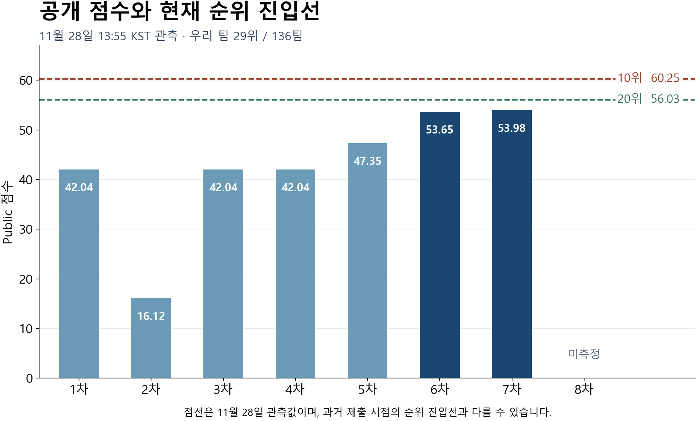

# 8차 제출 1분 요약

**8B 단독 모델이 55.22점으로 팀 최고점을 갱신했다.** 11월 28일 15:13:50에 직접 접수했고 16:29에 대회 화면에서 최종 제출 자동 선택을 확인했다. 6차보다 **1.57점**, 7차보다 **1.24점**, 최초 기준 42.04보다 **13.18점** 올랐다. [공식 점수 영수증](../results/public_submission_008.json)

| 제출 | 사진을 판독한 방법 | 공식 Public | 같은 개발 사진 200장의 서울 실행 시간 |
|---|---|---:|---:|
| 6차 | 791장으로 학습한 4B 첫 에폭 | 53.65 | 18분 59초 |
| 7차 | 1,045장으로 학습한 4B가 재판독 | 53.98 | 24분 57초 |
| **8차** | **6차와 같은 791장으로 학습한 8B 첫 에폭** | **55.22** | **22분 09초** |

**진출선도 움직인다.** 채점 확인 시점에는 140팀 중 30위로 20위까지 1.17점이 남았다. 17:47과 18:01에는 같은 55.22점으로 **31위**였고, 20위 57.52까지 **2.30점**, 10위 61.84까지 **6.62점**이었다. Public 상위 20팀이 Private 평가를 받는다. [시각별 순위 관측](../results/public_submission_008.json) · [공식 순위표](https://hackathon.imaginationgroup.co.kr/kwater/api/leaderboard)

**서울 L4의 실익.** 같은 4B 학습 8스텝이 로컬보다 2.60배 빨랐다. 서울에서 8B를 학습하고 실제 제출 ZIP이 제한 30분을 7분 51초 남기고 통과하는 것을 확인했다. 서울 누적 추정은 약 12,204원, 예비비 포함 14,517원으로 15,000원 예산 안이다. 추가 유료 실험은 다른 현장에서도 개선이 재현된 후보의 배포 정밀도와 최종 200·300장 실행시간을 확인할 때 가장 가치가 크다. [서울 시간과 비용 원장](../results/seoul-8b-fold4-epoch1-solo-200-20261128.json)

**다음 비교의 기준은 55.22점 원본이다.** 같은 8B에 둘째 에폭 어댑터를 붙여 재판독하자 교차 현장을 제외한 107장에서 중대 미탐은 20→19/39, 정상 오경보는 5/27, 위험 유형별 F1은 .621→.644였다. 다른 현장에서 이 차이가 유지되는지 확인한다. 카본이 제안한 마지막 훈련 예제의 분모 변경은 30장에서 중대 미탐 6/10으로 같아 우선순위를 낮췄다. [단일 8B 재판독 그림](figures/sub78-single8-verifier-nf4-20261128.png) · [마지막 예제 실측 그림](figures/sub78-tail-replay-measured-20261128.png)

실제 현장 사진 6장의 공식 주석과 네 모델의 판독 결과는 이 PC의 `G:\Projects\KWater-SafetyAI\data\local-reports\sub78-20261128\8b-review\review.html`에서 볼 수 있다. [표본·비용·후속 실험을 담은 전체 보고서](eighth-deadline-and-carbon-review-20261128.md)
