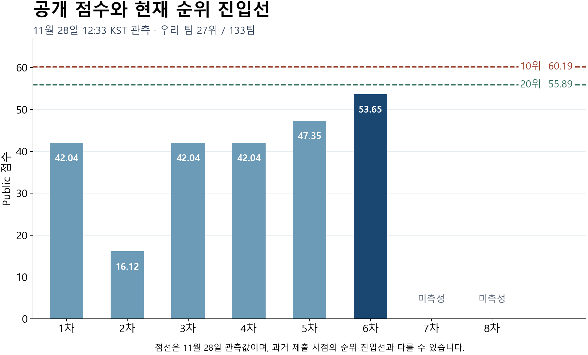
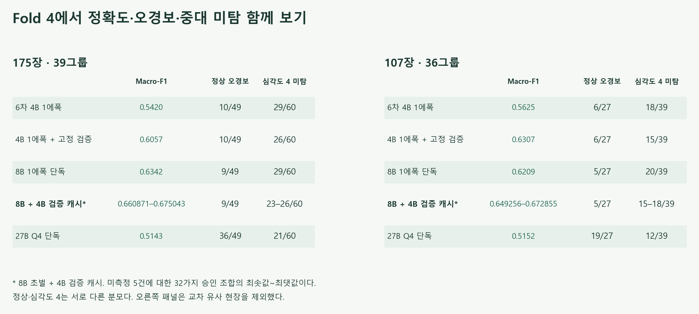
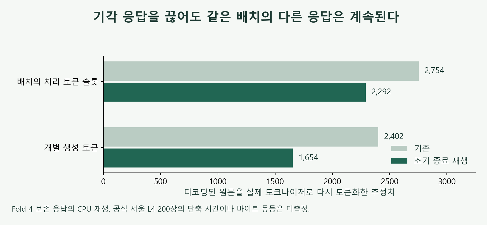
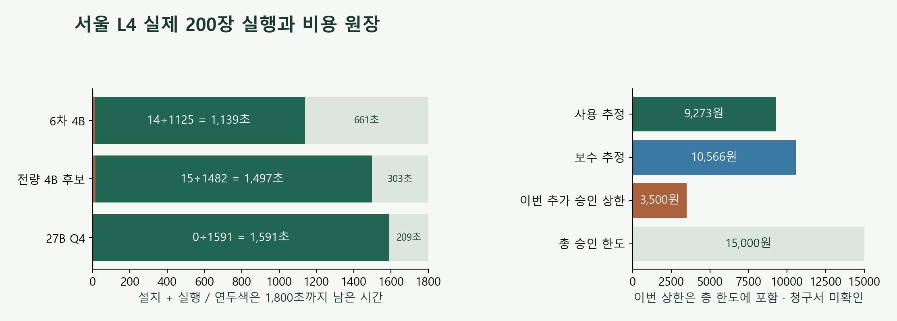

# 11월 28일 7·8차 제출 전략과 서울 L4 사용 판단

## 한눈에 보는 결정

| 질문 | 판단 |
|---|---|
| 7차에 무엇을 쓸까? | **1,045장으로 학습한 4B 둘째 에폭 + 전문가·검증기**를 Public 탐색 제출로 선택했다. 서울에서 200장 모두 통과했고 6차와 위험 코드가 달라진 사진은 57/200장이다. 사용자가 이 ZIP의 공식 접수를 승인했다. |
| 8차로 무엇을 실제 시험할까? | **1,045장으로 학습한 4B 첫 에폭 단독**을 포장해 같은 L4·같은 200장에서 검사한다. 6차와는 학습 범위·체크포인트가 다르고, 7차와는 에폭 및 전문가 재판독 사용 여부가 다르다. 공식 접수는 실측 후 사용자가 따로 결정한다. |
| 점수가 가장 유망한 연구 후보는? | Fold 4에서 **8B 첫 에폭으로 초벌 판독하고 4B 둘째 에폭으로 검증**하는 조합이다. 기존 마진 47건과 새로 확인해야 하는 5건을 구별했다. 원래 두 BF16 기반모델만 합쳐도 ZIP 20 GB 상한을 넘는다. 배포 가능한 구성으로 바꾼 후 다시 평가해야 한다. |
| L4를 더 쓸 이유는? | **새 ZIP의 Linux 배포 가능성**을 확인하고, 시간이 남으면 미측정 5건을 판독하는 데 우선 배정한다. 이전 총예산 15,000원 안에서 이번 증분 최대 3,500원을 승인받았다. |

## 1. 오늘의 슬롯과 점수

11월 28일 12:33 KST 공식 API에서 도니고니는 **6회 제출, 최고 53.65점, 133팀 중 27위**였다. 20위 **55.89**까지 2.24점, 10위 **60.19**까지 6.54점이다. 같은 날 10:02의 21/128위와 20위 53.79점은 이전 관측이다. 20위는 Public 종료 후 Private 평가 진출선이고, 발주처 결선 10팀은 Public과 Private 합산으로 정한다. [공식 순위표](https://hackathon.imaginationgroup.co.kr/kwater/api/leaderboard) · [주최 측 안내 rev.93](https://hackathon.imaginationgroup.co.kr/kwater/api/report)



공식 ‘내 참가’에서 최고점 자동 선택과 6차 53.65점이 선택된 상태를 확인했다. 하루 두 번의 제출 기회는 00:00 KST에 초기화되고, ZIP 검사를 통과해 접수되면 실행 실패도 한 번으로 계산한다. 기술 검증을 통과했고 6차와 다른 판정을 내리는 7차를 오늘 시험할 근거다. 한 번의 Public 총점으로 학습 데이터 추가, 에폭 변경, 검증기, 법령 사례집 각각의 기여를 분해할 수는 없다. [공식 제출 규칙](https://hackathon.imaginationgroup.co.kr/kwater/api/report) · [6차 영수증](../results/public_submission_006.json)

| 공식 7차 결과 | 8차 판단에 쓰는 방법 |
|---|---|
| 53.65점 초과 | 새 자동 선택과 실제 점수, 그 시각의 20위·10위 격차를 기록한다. 8차 단독은 전량 학습 범위를 유지하면서 에폭·재판독을 함께 바꾼 도전안으로 평가한다. |
| 53.65점 이하 | 6차 최고점과 7차 개별 점수를 따로 기록한다. 8차 단독이 6차와 실제 판정을 바꿨고 실물 200장을 통과했으면 검토한다. 7차 총점만으로 특정 위험의 오경보나 침묵 편향을 원인으로 지목하지 않는다. |
| 채점 대기 또는 실패 | ‘내 참가’의 파일·접수 시각·실패 코드로 상태를 확인한다. 공개 순위표에는 낮은 개별 점수가 나타나지 않을 수 있다. 남은 슬롯은 8차 자체 검증과 사용자 결정에 따른다. |

## 2. 제미나이 검수에서 확인한 내용과 수정한 내용

| 제안·주장 | 원본 대조 결과 |
|---|---|
| 전량 7차 ZIP을 지금 시험한다 | 동의한다. SHA-256이 83c76f44…ab713인 10,548,013,152바이트 ZIP은 서울 공식 키트와 Windows에서 각각 200/200을 통과했다. 107장 정상 오경보 6/27은 **검증용 791장 훈련 모델**의 수치다. 전량 모델은 Fold 4까지 학습했으므로 그 ZIP의 독립 F1은 없다. 오전의 연구 승격 보류와 오늘의 Public 탐색 제출은 서로 다른 결정이다. |
| 8B 초벌과 고정 검증기를 결합하면 개선된다 | 8B가 만든 후보 52건 중 기존 **4B** 마진 47건을 재사용했다. 28건이 마진에서 탈락했고 나머지 19건의 실제 생성에서 10건 승인(정답 6·오답 4), 9건 명시적 기각이었다. 5건은 별도 판독 대상이었다. |
| 5건을 전부 기각하면 F1의 하한이다 | 모두 생략한 F1 **.66189 / .65077**은 재현됐다. 미측정 후보 중 오답도 있어서 32가지 승인·기각 시나리오의 범위는 **.66087~.67504 / .64926~.67286**이다. 이론적 양 끝은 발생 확률이나 신뢰구간을 뜻하지 않는다. 기존 6차 대비 F1 +.03, 정상 오경보율 ≤20%, 중대 미탐 비증가는 **32/32**에서 충족한다. |
| 이 조합으로 Public이 6~8점 오른다 | 5건 생략 상태에서 6차 대비 ΔF1은 +.11988 / +.08825, 현장 단위 쌍체 95% 구간은 **[+.02118,+.22103] / [−.04652,+.19880]**이다. 107장은 175장의 부분집합이다. 70을 곱해 얻는 개발 패널의 정량 환산값과 숨은 사진·정성 평가까지 포함하는 실제 Public 점수를 구별한다. |
| 단일 8B에서 검증용 어댑터만 전환한다 | 여기서 판독한 검증기 가중치는 **4B**다. 4B LoRA를 8B에 올릴 수 없다. 두 BF16 기반모델의 가중치만 **26,410,058,856 B**다. 단일 8B 전용 검증기, 양자화한 두 모델 조합, 8B 단독은 각자 실물 크기·정확도·시간을 검증해야 한다. |
| 2에폭의 빈 판정은 기각 감독이 유발했다 | 8B에서 107장 중 실제 위험인 80장의 빈 판정이 16→22건으로 늘었다. 기각 문구를 출력한 횟수나 파싱 실패 횟수와는 다른 지표다. 혼합 학습 대 판독 전용 학습을 같은 사진·업데이트·감독량으로 재학습해야 인과 효과를 잴 수 있다. |
| 미채택 36건을 조기 종료하면 145초 절감, 출력 동일 | 서울 7차에서 71건 제안→45건 재판독→9건 승인, 재판독 생성은 207.21초였다. 이 200장의 개별 기각 토큰과 배치별 시간은 보관되지 않았다. Fold 4의 실제 생성 32건을 동봉 토크나이저로 재생하면 짧아진 배치는 16개 중 4개였다. 아래 계산을 실제 L4 시간과 구분한다. |
| 제한적 법령 교정을 8차에 바로 넣는다 | 실제 퇴행 9건 중 OSH-20/32로 바뀐 건은 0건이었다. 제한적 교정이 회복한 3건은 정책 설계 때 읽은 사례다. 이번 8차 실물은 현행 법령 방식을 유지하고, 노출 그룹을 교체한 눈가림 시험으로 넘긴다. |

[제미나이 원 제안](codex-final-commit-audit-and-sub78-roadmap-20261128.md) · [8B+4B 캐시와 32가지 경계](../results/sub78-8b-verifier-audit-20261128.json) · [6차·4B 하이브리드](seventh-submission-decision-20261128.md) · [법령 9건 검수](fold4-citation-alignment-20261128.md)

## 3. 8차 실물과 다음 연구 후보

| 후보 | 실제로 바뀌는 것 | 결정 |
|---|---|---|
| **4B 전량 첫 에폭 단독** | 85/170스텝 어댑터·전량 사례집·초벌 단독. 6차는 791장·69/138스텝, 7차는 전량 둘째 에폭·재판독을 쓴다. | 추가 학습 없이 실제로 구별되는 후보를 준비한다. 전량 학습에 사용한 개발 사진 200장은 배포와 출력 변화만 검사한다. |
| 8B 첫 에폭 + 기존 4B 고정 검증기 | 791장으로 학습한 초벌·검증기와 같은 전문가·마진 정책으로 검증한 연구 조합이다. | 남은 5건을 완결하고, 상한 안에 들어가는 배포 구성에서 동일한 검증 지표를 다시 측정한다. |
| 단일 8B 첫 에폭 또는 8B 전용 검증기 | 단독의 Fold 4 F1은 .63415/.62091, 107장 중대 미탐은 20/39다. 기존 8B의 훈련에는 기각·승인 예제가 모두 들어갔다. | 8B 단독 ZIP은 약 17.88 GB로 추정한다. 단일 ZIP 200장 시간이 없고, 새 검증기로 전환하면 재채점해야 한다. | 원래 마진·엄격 기각·승인 정책을 고정한 32개 조합 중 F1 ≥.65는 175장 32개, 107장 31개에서 충족했다. 두 패널 모두 오경보율 ≤18%인 조합은 0개였다.

## 재현 자료

프로젝트 루트의 기존 ML 환경에서 아래 CPU 명령을 사용한다. 첫 명령은 5건 측정 이전의 조건부 범위, 두 번째는 원래 재판독 토큰과 배치를 재생한다. 사진·예측 원문·검수 HTML은 G:에만 보관한다.

```powershell
python -B -m kwater_lab.sub78_verifier_audit audit
python -B -m kwater_lab.sub78_reject_audit
python -B tools/plot_sub78_audit.py
python -B -m kwater_lab.plot_sub78_public_gap
```

8차 가중치는 첫 에폭 경계에서 저장한 85/170스텝 어댑터다. CPU 픽스처에서는 정상·위험·파싱 실패 처리 3/3행이 공식 형식을 통과했다. 가중치에서 이미지를 실제 생성한 수치는 서울 실측 결과에서 확인한다. [후보별 크기·어댑터·검사 명세](../results/sub78-package-readiness-20261128.json) · [서울 배포 조건과 보호 규정](https://hackathon.imaginationgroup.co.kr/kwater/api/report)
| 4B 전량 첫 에폭 + 더 높은 승인 문턱 | 초벌이 정상일 때 전량 정책은 .553, Fold 4 정책은 1.489였다. 문턱을 높이면 올바른 추가 위험도 잃을 수 있다. | 첫 에폭 단독과 별도 조건이다. 다음 연구에서 초벌·검증기·문턱을 명시해 다른 현장 자료로 비교한다. |

**모델 이름이 비슷해도 근거가 적용되는 범위가 다르다.** 왼쪽 두 전량 모델은 같은 개발 사진으로 배포를 시험한다. 오른쪽은 Fold 4를 학습에서 제외한 모델로 위험 판별력을 비교한다.




기각 조기 종료의 CPU 대조에서는 Fold 4 재판독 32건 중 15건이 명시적 기각이었다. 저장한 응답을 다시 토큰화해 정해진 JSON 결정 접두사 직후에 멈추면 엄격 파서 결과가 바뀐 건은 0/32였다. 사진별로 단순 합산한 토큰 수는 2,402→1,654(−31.1%)지만, 실제 배치 순서대로 가장 긴 응답까지 생성하는 비용을 반영한 토큰 슬롯은 2,754→2,292(−16.8%)였다. 주된 초벌 생성 1,104.87초는 이 변경의 대상 밖이다. 절약 시간과 새 모델 출력의 완전 일치는 **같은 L4에서 변경 전후 실제 ZIP을 대조**해야 확인할 수 있다. [CPU 재생 원장](../results/sub78-reject-runtime-audit-20261128.json)



## 4. 서울 L4는 비용에 비해 무엇을 남겼나

| 사용처 | 확인된 효과 | 제출 결정에서의 가치 |
|---|---|---|
| 같은 4B 학습 8스텝 | 116예제·13,921 감독 토큰에서 RTX 3060 **652.78초**, 서울 L4 **251.27초**. 같은 업데이트를 401.51초 단축해 처리량이 **2.60배**였다. | 로컬을 제미나이 본학습에 남겨 두고 병행할 수 있었다. 전체 훈련·8B·추론에 같은 배율을 적용하지 않는다. |
| 6차와 7차의 실물 검사 | 같은 200장에서 6차 **1,139초**, 7차 **1,497초**. 7차는 303초 여유다. 같은 7차의 Windows 실행만으로는 2,728초가 걸렸고 L4와 15/200장의 코드 집합이 달랐다. | Windows 결과만 보고 버릴 수 있었던 7차 ZIP의 제출 가능성을 확인했다. 공식 키트는 배포 환경을 시험하며 대회의 숨은 정답이나 점수는 제공하지 않는다. |
| 8B와 27B 실험 | 같은 학습 설정에서 8B 첫 에폭을 찾았다. 공개 27B는 동봉 라이브러리 경로 오류를 고친 뒤 200/200, 1,591초를 통과했지만 107장 정상 오경보가 **19/27**이었다. | 실제 슬롯을 쓰기 전 오류를 고쳤고 27B 단독 제출을 기각했다. 8B 결과는 고정 검증기 결합을 시험할 근거가 됐다. |
| ROI와 깊이 보조 | 48장×3조건 ROI에서 정상 오경보 1→3/12. 깊이는 L4에서도 200장 추가시간 **12.31초**, 966장 인양 F1 .1946→.2235였다. | 별도 시험에서 이득이 작거나 정상 오경보가 늘어난 요소를 7·8차에 넣는 비용을 피했다. |

첫 서울 실험 묶음의 **9,273원은 청구 전 추정**이다. VM·디스크·IPv4·VAT 8,616원, 앞선 파일럿 450원, 회수량 기준 송신 207원을 더했다. 송신·부대비를 1,500원으로 대체한 예비비 시나리오는 **10,566원**이다. 두 추정치를 합산하지 않는다. 첫 묶음의 VM과 디스크는 모두 삭제했다. 실험으로 상금 확률이나 클라우드 자체의 Public 점수 기여분을 알아낸 것은 아니다. [서울 실험과 비용](seoul-l4-roadmap-experiments-20261128.md) · [동일 스텝 속도](fold4-v3-seoul-l4-benchmark-20261128.md) · [비전 실험](vision-depth-966-and-roi-20261128.md)



**추가 사용은 8차 실물 검사에 우선 배정했다.** 3,500원을 전부 써도 이전 보수 추정과 합계 14,066원으로 총한도까지 934원이 남는다. 한 VM에서 8차 검사 뒤 남은 시간에 5건을 배정한다. 이후에는 중단 시 재개 가능한 훈련만 Spot으로 보내고, 56 GiB 컨테이너에서의 정시 리허설에는 G2-16 온디맨드를 사용한다. 결과가 제출 선택을 바꿀 수 있는 실행만 켜고, CPU에서 가능한 재채점이나 패키지 생성 중에는 끈다. [Google Cloud GPU VM 과금](https://cloud.google.com/products/compute/pricing/accelerator-optimized) · [Spot 회수 조건](https://docs.cloud.google.com/compute/docs/instances/spot) · [VM 실행시간 제한](https://docs.cloud.google.com/compute/docs/instances/limit-vm-runtime)

**그 이후의 유료 실행이 값어치가 있을 조건**은 새 8B 단일 모델 또는 양자화 조합이 로컬 용량 검사를 통과하고, 독립 현장 품질이나 최종 300장 재현이 제출 선택을 좌우할 때다. 공용 27B를 또 학습하거나 기존 7차를 같은 패널에서 반복 측정하는 것은 오늘의 8차 선택에 주는 정보가 작다. 우수상 50만 원만 놓고 단순 계산하면 증분 3,500원의 금전적 손익분기는 수상 확률이 0.7%p 높아지는 경우다. 이는 실제 확률 추정이 아니며, 이번 지출의 직접 근거는 **희소한 제출 슬롯 사용 전 확인할 수 있는 오류·시간·출력 차이**다. [상금·가정과 다른 등급의 손익분기](comprehensive-audit-and-vlm-roadmap-20261128.md#prize-roi)

## 5. 마감까지의 실험 순서

| 일정(KST) | 하나씩 바꿀 조건 | 합격·중단 판단 |
|---|---|---|
| **11/28** | 7차 실물의 공식 결과, 8차 첫 에폭 단독의 서울 200장, 8B 초벌+4B 검증기 미측정 5건. | 공식 영수증과 개발 검사를 따로 기록한다. 8차는 실물 출력·시간·6/7차와의 차별성을 보고 사용자가 결정한다. |
| **11/29~11/30** | Fold 2를 제외하고 4B·8B를 같은 훈련 사진으로 새로 학습한다. 법령 인덱스와 전문가, 내측 마진 보정까지 다시 만든다. 먼저 초벌·검증기 어댑터 분리 효과, 그다음 초벌 오경보 제거 효과를 평가한다. | 기존 Fold 4 모델은 Fold 2 사진을 학습했다. 신규 현장의 오경보·중대 미탐·그룹 쌍체 구간을 보고한다. Fold 4 175장과 부분집합 107장은 합산하지 않는다. |
| **12/01~12/04** | 고정된 8B에서 검증기 이전 또는 양자화를 한번에 하나씩 대조한다. 근거가 부족한 위험 제거 시 장면 설명이 보존되는지 검사한다. 조문 교정·두 단계 예방문은 별도 눈가림 패널에서 검수한다. | 후보별 실제 ZIP ≤20 GB, 유효 출력·ID 일치, 품질을 검사한다. 양자화 F1 손실 .005 이내와 1,250초는 연구 목표다. 정성 정책 설계에 노출된 봉인 패널 4장은 해당 현장까지 고려해 교체한다. |
| **12/05~12/08** | 훈련측 OOF 미탐·정상 대조쌍만 사용해 27B가 추가로 보는 중대 위험 단서를 확인한다. 같은 사진에서 해상도 효과를 비교한다. | 고유 사건의 위험 회복과 추가 오탐을 함께 센다. 외부 데이터를 사용하면 **12/06 23:59까지 ‘내 참가 → 외부 데이터 신고’ 탭**에 데이터별 등록한다. 모델·데이터·라이브러리·시드는 실제 자산으로 기재한다. [공식 신고 안내](https://hackathon.imaginationgroup.co.kr/kwater/api/report) |
| **12/09~12/13 10:00** | 독립 검증을 통과한 구성만 동결해 전량 학습한다. 같은 Linux L4에서 동일 ZIP을 두 번 새로 실행하고 300장 부하를 별도로 검사한다. | 공식 한도는 Public 200장 1,800초, Private 300장 3,600초다. 해시가 달라지면 ID·위험 상태·코드·설명 순으로 원인을 찾는다. 자동 최고점이나 팀이 직접 지정한 최종 모델을 마감 전 확인한다. |

기존 선발선은 정상 오경보율 **20% 이하**다. 이후 제안한 **18% 이하**를 적용하면 49장 중 최대 8건, 27장 중 최대 **4건**, 67장 중 최대 12건이다. 5/27은 18.52%로 새 기준을 넘는다. 8B+4B는 두 패널에서 9/49·5/27이다. 다음 단계에서는 반복 사용한 Fold 4와 새로 평가할 Fold 2를 각각 표시해 어느 한쪽의 퇴행이 합산 평균에 가려지지 않게 한다.
