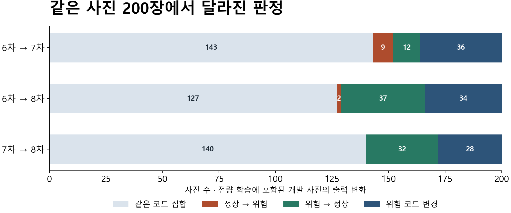
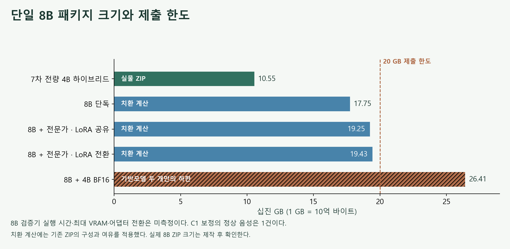
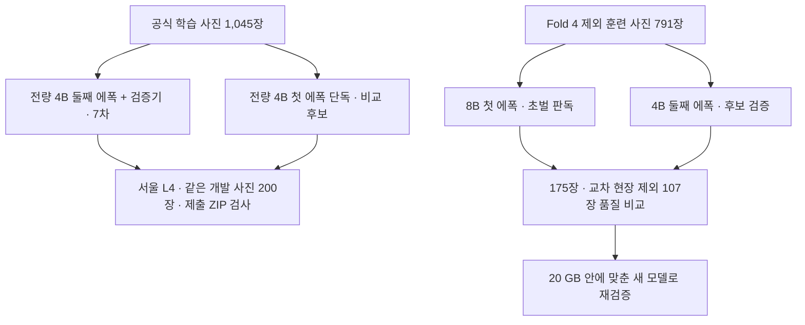
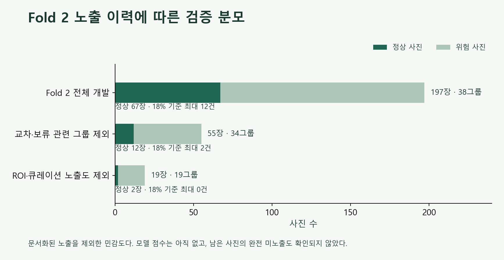

# 11월 28일 7·8차 제출 전략과 서울 L4 사용 판단

14시 카본이 제시한 ‘마지막 정상 훈련 예제 하나’ 가설, 6차와 8B 단독의 실제 구현 차이, 23:30 전 접수 절차와 최신 실측을 함께 검토했다. [8차 후보의 현재 판단과 검수 결과](eighth-deadline-and-carbon-review-20261128.md)

## 한눈에 보는 결정

| 질문 | 판단 |
|---|---|
| 7차가 6차보다 얼마나 올랐나? | **53.65 → 53.98점, +0.33점**이다. 1,045장으로 학습한 4B 둘째 에폭과 검증기를 쓴 ZIP이 최고점으로 자동 선택됐다. 13:55 KST **136팀 중 29위**, 20위까지 **2.05점**, 10위까지 **6.27점**이다. |
| 오늘 마지막 슬롯은? | **791장으로 학습한 8B 첫 에폭 단독**은 서울에서 22분 09초·200/200으로 통과했다. 7차보다 2분 48초 빨랐고 정상 오경보는 1→4/37, 중대 미탐은 22→26/68이었다. 1,045장으로 학습한 4B 첫 에폭 단독의 중대 미탐은 34/68이었다. 이 8B 파일을 15:13:50 KST에 8차로 접수했다. |
| 점수가 가장 유망한 연구 후보는? | Fold 4의 **8B 첫 에폭 판독 + 4B 둘째 에폭 검증**이다. 기존 47건과 서울 실측 5건을 모두 반영한 F1은 **.67014 / .66528**, 6차보다 **+.12813 / +.10276**이다. 107장의 현장별 불확실성 범위는 0을 포함한다. 두 BF16 모델 파일만 26.41 GB여서 20 GB 안에 드는 구현을 따로 검증해야 한다. |
| L4가 실제로 해준 일은? | 전량 4B의 중대 미탐 증가를 발견해 후보 우선순위를 바꿨고, 로컬에서 만든 실물과 같은 8B ZIP을 22분 09초에 검증했다. 8B 검사 증분 약 **1,417원**, 누적 **12,204원**, 모든 예비비 포함 **14,517원/15,000원**이다. 14:52 KST에 VM·디스크 삭제를 확인했다. |

4B·8B는 약 40억·80억 개 파라미터를 가진 모델이다. 한 에폭은 훈련 예제를 한 바퀴 본 시점이다. 하이브리드는 모델이 사진을 먼저 읽고, 전문가 분류기가 제안한 추가 위험을 다시 확인해 승인된 것만 더한다. 아래에서 **Public**은 주최 측의 숨은 사진으로 매긴 100점 만점 성적이고, **Fold 4·Fold 2의 macro-F1**은 사진을 학습에서 떼어 놓고 위험 유형별 탐지 성능을 평균한 0~1 지표다.

## 1. 오늘의 슬롯과 점수

11월 28일 12:33 KST 공식 API에서 도니고니는 **6회 제출, 최고 53.65점, 133팀 중 27위**였다. 20위 **55.89**까지 2.24점, 10위 **60.19**까지 6.54점이다. 같은 날 10:02의 21/128위와 20위 53.79점은 이전 관측이다. 20위는 Public 종료 후 Private 평가 진출선이고, 발주처 결선 10팀은 Public과 Private 합산으로 정한다. [공식 순위표](https://hackathon.imaginationgroup.co.kr/kwater/api/leaderboard) · [주최 측 안내 rev.93](https://hackathon.imaginationgroup.co.kr/kwater/api/report)


공식 ‘내 참가’에서 최고점 자동 선택과 6차 53.65점이 선택된 상태를 확인했다. 하루 두 번의 제출 기회는 00:00 KST에 초기화되고, ZIP 검사를 통과해 접수되면 실행 실패도 한 번으로 계산한다. 기술 검증을 통과했고 6차와 다른 판정을 내리는 7차를 오늘 시험할 근거다. 한 번의 Public 총점으로 학습 데이터 추가, 에폭 변경, 검증기, 법령 사례집 각각의 기여를 분해할 수는 없다. [공식 제출 규칙](https://hackathon.imaginationgroup.co.kr/kwater/api/report) · [6차 영수증](../results/public_submission_006.json)

**7차는 12:56:00 KST 접수됐고 13:55 KST에 53.98점으로 채점 완료된 것을 직접 확인했다.** 로그인한 ‘내 참가’의 해당 ZIP 행에 최고점 자동 선택과 ‘최종 제출’이 표시됐다. 6차 대비 **+0.33점**, 1차 42.04점 대비 **+11.94점**이다. 13:55:48 공식 순위표는 **29/136위**, 20위 **56.03**, 10위 **60.25**, 1위 **71.69**였다. 13:04 당시 화면이 안내한 14:30은 예상 반영 시각이었다. [7차 개별 영수증](../results/public_submission_007.json) · [공식 내 참가](https://hackathon.imaginationgroup.co.kr/kwater/#my) · [공식 순위표](https://hackathon.imaginationgroup.co.kr/kwater/api/leaderboard)

7차는 숨은 평가에서 6차보다 0.33점 앞섰고 20위까지는 2.05점 남았다. 두 번째 슬롯에서는 **8B 단독 실물이 정상 오경보와 중대 미탐을 얼마나 바꾸는지** 확인한 후 선택한다. 이미 측정한 4B 첫 에폭 단독도 보존했다. 7차와 새로운 8B는 훈련 범위와 모델이 모두 달라 이번 Public 0.33점으로 그 차이를 예측할 수 없다.

## 2. 제미나이 검수에서 확인한 내용과 수정한 내용

| 제안·주장 | 원본 대조 결과 |
|---|---|
| 전량 7차 ZIP을 지금 시험한다 | 동의한다. SHA-256이 83c76f44…ab713인 10,548,013,152바이트 ZIP은 서울 공식 키트와 Windows에서 각각 200/200을 통과했다. 107장 정상 오경보 6/27은 **검증용 791장 훈련 모델**의 수치다. 전량 모델은 Fold 4까지 학습했으므로 그 ZIP의 독립 F1은 없다. 오전의 연구 승격 보류와 오늘의 Public 탐색 제출은 서로 다른 결정이다. |
| 8B 초벌과 고정 검증기를 결합하면 개선된다 | 8B가 만든 후보 52건 중 기존 **4B** 마진 47건을 재사용했다. 28건이 마진에서 탈락했고 나머지 19건의 실제 생성에서 10건 승인(정답 6·오답 4), 9건 명시적 기각이었다. 5건은 별도 판독 대상이었다. |
| 5건을 전부 기각하면 F1의 하한이다 | 모두 생략한 F1 **.66189 / .65077**은 재현됐다. 미측정 후보 중 오답도 있어서 32가지 승인·기각 시나리오의 범위는 **.66087~.67504 / .64926~.67286**이다. 이론적 양 끝은 발생 확률이나 신뢰구간을 뜻하지 않는다. 기존 6차 대비 F1 +.03, 정상 오경보율 ≤20%, 중대 미탐 비증가는 **32/32**에서 충족한다. |
| 이 조합으로 Public이 6~8점 오른다 | 5건 생략 상태에서 6차 대비 ΔF1은 +.11988 / +.08825, 현장 단위 쌍체 95% 구간은 **[+.02118,+.22103] / [−.04652,+.19880]**이다. 107장은 175장의 부분집합이다. 70을 곱해 얻는 개발 패널의 정량 환산값과 숨은 사진·정성 평가까지 포함하는 실제 Public 점수를 구별한다. |
| 단일 8B에서 검증용 어댑터만 전환한다 | 여기서 판독한 검증기 가중치는 **4B**다. 4B LoRA를 8B에 올릴 수 없다. 두 BF16 기반모델의 가중치만 **26,410,058,856 B**다. 단일 8B 전용 검증기, 양자화한 두 모델 조합, 8B 단독은 각자 실물 크기·정확도·시간을 검증해야 한다. |
| 2에폭의 빈 판정은 기각 감독이 유발했다 | 8B에서 107장 중 실제 위험인 80장의 빈 판정이 16→22건으로 늘었다. 기각 문구를 출력한 횟수나 파싱 실패 횟수와는 다른 지표다. 혼합 학습 대 판독 전용 학습을 같은 사진·업데이트·감독량으로 재학습해야 인과 효과를 잴 수 있다. |
| 미채택 36건을 조기 종료하면 145초 절감, 출력 동일 | 서울 7차에서 71건 제안→45건 재판독→9건 승인, 재판독 생성은 207.21초였다. 이 200장의 개별 기각 토큰과 배치별 시간은 보관되지 않았다. Fold 4의 실제 생성 32건을 동봉 토크나이저로 재생하면 짧아진 배치는 16개 중 4개였다. 아래 계산을 실제 L4 시간과 구분한다. |
| 제한적 법령 교정을 8차에 바로 넣는다 | 실제 퇴행 9건 중 OSH-20/32로 바뀐 건은 0건이었다. 제한적 교정이 회복한 3건은 정책 설계 때 읽은 사례다. 이번 8차 실물은 현행 법령 방식을 유지하고, 노출 그룹을 교체한 눈가림 시험으로 넘긴다. |

[제미나이 원 제안](codex-final-commit-audit-and-sub78-roadmap-20261128.md) · [8B+4B 캐시와 32가지 경계](../results/sub78-8b-verifier-audit-20261128.json) · [6차·4B 하이브리드](seventh-submission-decision-20261128.md) · [법령 9건 검수](fold4-citation-alignment-20261128.md)

## 3. 8차 실물과 다음 연구 후보

| 후보 | 실제로 바뀌는 것 | 결정 |
|---|---|---|
| **4B 전량 첫 에폭 단독** | 85/170스텝 어댑터·전량 사례집·초벌 단독. 6차는 791장·69/138스텝, 7차는 전량 둘째 에폭·재판독을 쓴다. | 실물 9,043,784,038바이트, SHA-256 `3c779368…c6645`. 전량 학습에 사용한 개발 사진 200장으로 배포와 판정 차이를 확인했다. |
| 8B 첫 에폭 + 기존 4B 고정 검증기 | 791장으로 학습한 초벌·검증기와 같은 전문가·마진 정책으로 검증한 연구 조합이다. | 52건 모두 측정했다. 용량 상한 안에 들어가는 새 배포 구성에서 같은 지표를 다시 측정한다. |
| 단일 8B 첫 에폭 또는 8B 전용 검증기 | 단독의 Fold 4 F1은 .63415/.62091, 107장 중대 미탐은 20/39다. 기존 8B의 훈련에는 기각·승인 예제가 모두 들어갔다. | 단독 실물은 **17,745,550,610바이트**, SHA `4b1523af…bd549`. 서울에서 같은 200장을 1,329초에 통과했다. 8B 전용 검증기를 붙이면 별도 배포 구성이다. |
| 4B 전량 첫 에폭 + 더 높은 승인 문턱 | 초벌이 정상일 때 전량 정책은 .553, Fold 4 정책은 1.489였다. 문턱을 높이면 올바른 추가 위험도 잃을 수 있다. | 첫 에폭 단독과 별도 조건이다. 다음 연구에서 초벌·검증기·문턱을 명시해 다른 현장 자료로 비교한다. |

### 실제 제출 ZIP 세 개가 같은 사진 200장을 읽은 결과

같은 192개 현장 그룹의 사진 200장을 같은 순서로 서울 L4 공식 키트에 넣었다. 6차·7차·전량 4B 대조 후보 세 ZIP 모두 최종 200행의 형식과 사진 ID가 맞았다. 전량 4B 대조 후보에서 원생성 JSON 한 건이 파싱에 실패했고 후처리를 거친 최종 파일은 검사를 통과했다. 설치와 실행을 합친 시간은 6차 **18분 59초**, 7차 **24분 57초**, 전량 4B 후보 **19분 50초**였다. 이 후보는 30분 한도까지 **10분 10초**가 남았다. [6·7차 실측](seoul-l4-roadmap-experiments-20261128.md) · [전량 4B 첫 에폭 실측 원장](../results/seoul-eighth-200-20261128.json) · [세 ZIP의 독립 CPU 대조](../results/sub78-public200-output-diff-20261128.json)

| 어떤 ZIP을 비교했나 | 위험 코드 집합이 같음 | 위험 없음 → 위험 | 위험 → 위험 없음 | 양쪽에 위험이 있고 코드가 바뀜 |
|---|---:|---:|---:|---:|
| 6차 → 7차 | 143 | 9 | 12 | 36 |
| 6차 → 전량 4B 단독 후보 | 127 | 2 | 37 | 34 |
| 7차 → 전량 4B 단독 후보 | 140 | 0 | 32 | 28 |

7차가 위험 없음으로 본 사진 중 전량 4B 후보가 새로 위험을 낸 사진은 **0장**이었다. 반대로 7차의 위험이 사라진 **32장**의 공식 주석은 정상 1장·위험 31장이었다. 이 중 23장에서는 7차가 맞힌 위험 코드가 사라졌고, 위험 주석이 있는 나머지 8장은 7차도 다른 위험을 잘못 지목했다. 6차와 비교해 위험이 사라진 37장에서도 36장에 실제 위험 주석이 있고 6차가 22장의 코드를 맞혔다.

| 공식 주석과 대조한 모든 200장 | 6차 | 7차 | 전량 4B 단독 후보 |
|---|---:|---:|---:|
| 정상 37장에서 위험을 출력 | 1 | 1 | 0 |
| 중대 위험 68장에서 중대 정답 코드를 모두 놓침 | 19 | 22 | 34 |

중대 위험에서는 7차만 맞힌 사진이 15장, 전량 4B 단독 후보만 되찾은 사진이 3장이었다. 이렇게 세부 코드 교체까지 계산해도 전량 4B 후보의 중대 미탐은 12장 늘었다. 이 200장은 7차와 전량 4B 대조 후보가 모두 학습했다. 숨어 있는 대회 사진에서의 점수 손익은 알 수 없지만, 같은 사진에서 어느 종류의 실수를 늘리는 후보인지는 확인할 수 있다. [공식 주석·출력의 집계](../results/sub78-public200-output-diff-20261128.json)



**이 PC에서 실제 사진 6장과 답변을 나란히 볼 수 있다.** 서로 다른 현장에서 위험이 사라진 예, 위험 코드가 바뀐 예, 6차 대비 새 위험을 낸 예를 두 장씩 고정 시드로 골랐다. 3·4번째 사진은 주석상 걸림·미끄러짐이고 6·7차가 맞혔지만 전량 4B 후보에는 위험이 없다고 나왔다. 반대로 마지막 사진에서는 전량 4B 후보가 걸림 위험을 새로 맞혔다. 각 사진에 공식 주석과 세 모델의 근거·예방조치를 표시했다. 참가자용 원사진은 프로젝트의 로컬 자료 폴더에 있다. [사진과 전체 답변 HTML · 이 PC 전용](../data/local-reports/sub78-20261128/review.html) · [6장 한눈에 보기 PNG · 이 PC 전용](../data/local-reports/sub78-20261128/review.png)

### 8B가 읽고 4B가 추가 위험을 검증한 52건

마지막 5건은 서울 L4에서 같은 사진·프롬프트·4B 가중치로 새로 판독했다. 5건 모두 마진 문턱을 넘어 답변을 생성했고, 승인 4건 중 3건은 정답(추락 2·기타 1), 1건은 오답이었다. 기각한 1건도 기타 위험 정답이었다. 5장 모두 실제 위험이 있는 사진이다. 실제 8B 초벌 출력에 **Windows에서 확보해 둔 4B 검증 마진 47건 + 서울 판독 5건**을 합쳤다. 검증용 수치는 구성요소별 출력을 결합한 재생 결과다. 이 두 모델을 한 ZIP에 넣고 실행한 시간은 없다.

| Fold 4 판독 범위 | 6차 첫 에폭 F1 → 8B+4B | F1 차이의 현장 단위 95% 구간 | 정상 오경보 | 중대 위험 미탐 |
|---|---:|---|---:|---:|
| 175장 | .54201 → **.67014** | +.03516 ~ +.22023 | 10 → 9/49 | 29 → 24/60 |
| 같은 표본에서 교차 현장을 제외한 107장 | .56252 → **.66528** | −.04111 ~ +.19784 | 6 → 5/27 | 18 → 16/39 |

측정 전에는 미측정 5건의 승인 여부에 따라 32가지 경우가 가능했다. 그중 F1 ≥.65를 충족한 경우는 175장에서 32개, 107장에서 31개였다. 실제 결과는 두 패널에서 기존 선발 기준인 F1 +.03·오경보 20% 이하·중대 미탐 비증가를 충족한다. 더 엄격한 18% 기준은 둘 다 넘었다. 위험을 추가하는 현재 정책으로 초벌의 정상 오경보를 줄이려면 별도의 제거 실험이 필요하다. [모든 가능한 경우와 측정 후 집계](../results/sub78-8b-verifier-audit-20261128.json)

### 8B를 실제 제출 규격에 맞추는 방법

안티그래비티 카본은 기존 8B가 이미 후보 검증 예제 157건을 학습했다는 점을 활용했다. 첫 에폭으로 초벌을 고정한 뒤 **같은 8B를 검증에도 사용하거나, 같은 기반모델 안에서 둘째 에폭 어댑터로 전환**하는 실험이다. Sol이 설정 파일까지 포함해 다시 계산한 예상 ZIP은 각각 **19.25 GB·19.43 GB**다. 가중치를 새로 학습하기 전에 기존 52개 후보에서 승인·기각을 실제로 비교할 수 있다. 결정 토큰은 위험 코드별 프롬프트 11/11에서 일치했다. 실제 검증 품질·완성 파일 크기·200장 시간은 다음 측정 대상이다. [카본 설계·Sol 검수본](antigravity-single-8b-verifier-design-20261128.md) · [독립 CPU 원장](../results/sub78-single-8b-verifier-design-audit-20261128.json)



기존 보정 89쌍에서 검증 학습과 겹친 두 그룹을 빼면 **34쌍·22장**이다. 정상 사진에서 잘못 제안된 후보는 **1건**만 남고 22장 모두 초벌 학습을 거쳤다. 여기에서 문턱을 맞춘 결과는 탐색에 쓴다. 새 현장에서는 초벌과 검증기가 모두 학습하지 않은 그룹을 확보하고, 모델 크기를 비교할 두 팔에는 같은 훈련 사진을 사용한다. 초기 제안의 7분·250~650원은 모델 준비·적재·회수를 포함한 청구 실측이 없다.

Sol이 실제 후보 52개의 사진·순서·프롬프트·토크나이저와 두 어댑터를 고정했다. 8B 첫 에폭으로 검증한 결과와 둘째 에폭 어댑터로 전환한 결과를 같은 조건에서 채점하는 실행기도 준비했다. 로컬 RTX 3060에서는 BF16 기반모델 17.53 GB가 전용 메모리를 넘으므로, 고정 BF16 초벌에 4비트(NF4) 검증기를 붙인 조건부터 시험할 수 있다. 이때 첫 에폭과 둘째 에폭 간 비교는 유효하지만, BF16 검증이나 4비트 초벌까지 포함한 배포 성능은 각각 다시 측정해야 한다. [실행 절차](../docs/sub78-single8-verifier-replay-20261128.md) · [고정 입력과 CPU 검증](../results/sub78-single8-verifier-preflight-20261128.json)

**모델 이름이 비슷해도 근거가 적용되는 범위가 다르다.** 왼쪽 두 전량 모델은 같은 개발 사진으로 배포를 시험한다. 오른쪽은 Fold 4를 학습에서 제외한 모델로 위험 판별력을 비교한다.




**6차와 같은 사진에서 어느 정도 바뀌었나.** 791장만 학습한 4B에서 6차 첫 에폭 단독은 175장·107장 F1이 **.54201 / .56252**였다. 같은 첫 에폭에 검증기를 붙이면 **.60569 / .63071**로 올랐다. 둘째 에폭에 같은 검증기를 붙인 7차 연구 대조군은 **.59574 / .63746**으로, 6차 대비 **+.05373 / +.07494**였다. 정상 오경보는 **10→8/49, 6→6/27**, 중대 미탐은 **29→30/60, 18→17/39**였다. 실제 7차와 위 전량 4B 첫 에폭 후보는 1,045장 전량을 학습했으므로 이 수치의 적용 대상은 791장 비교 모델이다. 정상 오경보는 주석상 정상인 사진에서 위험을 하나라도 출력한 경우다. 중대 미탐은 심각도 4 정답 코드 중 하나도 맞히지 못한 사진을 뜻하며, 다른 위험을 출력한 경우도 포함한다. [동일 검증기 비교](seventh-submission-decision-20261128.md)

기각 조기 종료의 CPU 대조에서는 Fold 4 재판독 32건 중 15건이 명시적 기각이었다. 저장한 응답을 다시 토큰화해 정해진 JSON 결정 접두사 직후에 멈추면 엄격 파서 결과가 바뀐 건은 0/32였다. 사진별로 단순 합산한 토큰 수는 2,402→1,654(−31.1%)지만, 실제 배치 순서대로 가장 긴 응답까지 생성하는 비용을 반영한 토큰 슬롯은 2,754→2,292(−16.8%)였다. 주된 초벌 생성 1,104.87초는 이 변경의 대상 밖이다. 절약 시간과 새 모델 출력의 완전 일치는 **같은 L4에서 변경 전후 실제 ZIP을 대조**해야 확인할 수 있다. [CPU 재생 원장](../results/sub78-reject-runtime-audit-20261128.json)


## 4. 서울 L4는 비용에 비해 무엇을 남겼나

6차는 **11월 27일 22:22**에 접수됐고 서울 4B 처리량 파일럿은 **11월 28일 03:45**에 시작됐다. 따라서 이미 얻은 53.65점이나 기준선 대비 +11.61점을 서울 사용의 성과로 소급할 수 없다. 서울이 직접 바꾼 것은 새 후보를 제시간에 검증하고, 탈락 위험이 큰 구성에 공식 슬롯을 쓰기 전 발견할 수 있었던 점이다. 장비 자체가 F1을 높였다고 보기에도 근거가 없다. 4B와 8B의 판독 차이에는 모델과 학습 조건이 반영돼 있다.

| 사용처 | 확인된 효과 | 제출 결정에서의 가치 |
|---|---|---|
| 같은 4B 학습 8스텝 | 116예제·13,921 감독 토큰에서 RTX 3060 **652.78초**, 서울 L4 **251.27초**. 같은 업데이트를 401.51초 단축해 처리량이 **2.60배**였다. | 로컬을 제미나이 본학습에 남겨 두고 병행할 수 있었다. 전체 훈련·8B·추론에 같은 배율을 적용하지 않는다. |
| 6차와 7차의 실물 검사 | 같은 200장에서 6차 **1,139초**, 7차 **1,497초**. 7차는 303초 여유다. 같은 7차의 Windows 실행만으로는 2,728초가 걸렸고 L4와 15/200장의 코드 집합이 달랐다. | Windows 결과만 보고 버릴 수 있었던 7차 ZIP의 제출 가능성을 확인했다. 공식 키트는 배포 환경을 시험하며 대회의 숨은 정답이나 점수는 제공하지 않는다. |
| 8B와 27B 실험 | 같은 학습 설정에서 8B 첫 에폭을 찾았다. 공개 27B는 동봉 라이브러리 경로 오류를 고친 뒤 200/200, 1,591초를 통과했지만 107장 정상 오경보가 **19/27**이었다. | 실제 슬롯을 쓰기 전 오류를 고쳤고 27B 단독 제출을 기각했다. 8B 결과는 고정 검증기 결합을 시험할 근거가 됐다. |
| ROI와 깊이 보조 | 48장×3조건 ROI에서 정상 오경보 1→3/12. 깊이는 L4에서도 200장 추가시간 **12.31초**, 966장 인양 F1 .1946→.2235였다. | 별도 시험에서 이득이 작거나 정상 오경보가 늘어난 요소를 7·8차에 넣는 비용을 피했다. |

첫 서울 실험 묶음의 **9,273원은 청구 전 추정**이다. VM·디스크·IPv4·VAT 8,616원, 앞선 파일럿 450원, 회수량 기준 송신 207원을 더했다. 송신·부대비를 1,500원으로 대체한 예비비 시나리오는 **10,566원**이다. 두 추정치를 합산하지 않는다. 첫 묶음의 VM과 디스크는 모두 삭제했다. 실험으로 상금 확률이나 클라우드 자체의 Public 점수 기여분을 알아낸 것은 아니다. [서울 실험과 비용](seoul-l4-roadmap-experiments-20261128.md) · [동일 스텝 속도](fold4-v3-seoul-l4-benchmark-20261128.md) · [비전 실험](vision-depth-966-and-roi-20261128.md)


**전량 4B 첫 에폭을 검사한 13시 서울 사용은 증분 약 1,514원에 두 가지 결과를 냈다.** 전량 4B 첫 에폭 후보 ZIP의 설치 19초·실행 1,171초를 잰 뒤 같은 L4에서 8B가 제안한 미측정 5건을 기존 4B 검증기로 판독했다. 후자는 모델 적재 포함 **45.48초**였다. 36.57분 만에 VM·150 GiB 디스크 삭제를 확인했다. 이번 부대비용 예비비 포함 **2,024원**은 승인 상한 3,500원 이내다. 누적 추정은 **10,787원**, 모든 예비비 포함 **12,590원**이어서 해당 시점에는 **2,410원**이 남았다. 다음 8B 실측을 포함한 최종 보수 추정은 14,517원이다. 실제 원화 청구액이나 무료 크레딧 차감액은 아직 확인되지 않았다. [전량 4B 후보의 시간·환경·비용](../results/seoul-eighth-200-20261128.json)

다음에는 재개 가능한 학습을 Spot에, 56 GiB 컨테이너의 시간 검사를 G2-16 온디맨드에 배정할 수 있다. 새 실행은 8B 배포 후보의 선택이나 Private 300장 준비에 영향을 줄 때 검토한다. CPU 패키징과 지표 재생에는 로컬을 쓴다. [Google Cloud GPU VM 과금](https://cloud.google.com/products/compute/pricing/accelerator-optimized) · [Spot 회수 조건](https://docs.cloud.google.com/compute/docs/instances/spot) · [VM 실행시간 제한](https://docs.cloud.google.com/compute/docs/instances/limit-vm-runtime)

**7차 채점 후에는 8B 단독 ZIP의 추가 1회 실측을 승인받았다.** 새 한도는 **2,400원**, 기존 집행 예비비까지 포함한 누적 최대 **14,990원**이다. 확인할 항목은 20 GB 이하 실제 파일의 Linux 200장 처리시간, 정상 오경보와 중대 미탐, 7차와 다른 위험 판정이다. 8B가 같은 검증 사진에서 더 높은 F1을 낸 근거가 있고, 먼저 시험한 4B 후보는 중대 미탐이 늘어 이 검사가 오늘의 선택을 바꿀 수 있다. 우수상 50만 원만 놓고 단순 계산하면 2,400원의 손익분기는 수상 확률 0.48%p 증가다. 실제 확률과 청구액은 별도다. [상금·가정과 다른 등급의 손익분기](comprehensive-audit-and-vlm-roadmap-20261128.md#prize-roi)

## 5. 마감까지의 실험 순서

제미나이가 로컬 RTX 3060에서 전량 4B 학습을 170/170스텝까지 마쳐 7차 ZIP을 만들었다. 다음 훈련을 바로 배정하지 않아 GPU가 한동안 비었다. 13:18 KST에 Sol의 새 Fold 2 실험에서 학습률이 0보다 큰 첫 가중치 갱신을 확인했다. 13:34까지 10스텝과 체크포인트가 기록됐다. 첫 에폭은 67스텝이고 이후 같은 GPU에서 197장을 생성한다. 동시에 서울 L4는 8차 실물 ZIP을 검사했다. 안티그래비티의 기존 프로젝트 대화에는 **한 개의 8B로 초벌과 검증을 맡는 실험 설계**를 직접 전달했다. 카본이 작성한 설계와 Sol이 실제 자산에서 다시 계산한 용량·표본 수는 [단일 8B 설계 검수본](antigravity-single-8b-verifier-design-20261128.md)에 있다.

| 일정(KST) | 하나씩 바꿀 조건 | 합격·중단 판단 |
|---|---|---|
| **11/28** | 7차 실물의 공식 결과, 전량 4B 및 791장 학습 8B 첫 에폭 각각의 서울 200장, 8B 초벌+4B 검증기 미측정 5건. | 공식 영수증과 개발 검사를 따로 기록한다. 8차는 실물 출력·시간·6/7차와의 차별성을 보고 사용자가 결정한다. |
| **11/29~11/30** | Fold 2를 제외하고 4B·8B를 같은 훈련 사진으로 새로 학습한다. 법령 인덱스와 전문가, 내측 마진 보정까지 다시 만든다. 먼저 초벌·검증기 어댑터 분리 효과, 그다음 초벌 오경보 제거 효과를 평가한다. | 기존 Fold 4 모델은 Fold 2 사진을 학습했다. 신규 현장의 오경보·중대 미탐·그룹 쌍체 구간을 보고한다. Fold 4 175장과 부분집합 107장은 합산하지 않는다. |
| **12/01~12/04** | 고정된 8B에서 검증기 이전 또는 양자화를 한번에 하나씩 대조한다. 근거가 부족한 위험 제거 시 장면 설명이 보존되는지 검사한다. 조문 교정·두 단계 예방문은 별도 눈가림 패널에서 검수한다. | 후보별 실제 ZIP ≤20 GB, 유효 출력·ID 일치, 품질을 검사한다. 양자화 F1 손실 .005 이내와 1,250초는 연구 목표다. 정성 정책 설계에 노출된 봉인 패널 4장은 해당 현장까지 고려해 교체한다. |
| **12/05~12/08** | 훈련측 OOF 미탐·정상 대조쌍만 사용해 27B가 추가로 보는 중대 위험 단서를 확인한다. 같은 사진에서 해상도 효과를 비교한다. | 고유 사건의 위험 회복과 추가 오탐을 함께 센다. 외부 데이터를 사용하면 **12/06 23:59까지 ‘내 참가 → 외부 데이터 신고’ 탭**에 데이터별 등록한다. 모델·데이터·라이브러리·시드는 실제 자산으로 기재한다. [공식 신고 안내](https://hackathon.imaginationgroup.co.kr/kwater/api/report) |
| **12/09~12/13 10:00** | 독립 검증을 통과한 구성만 동결해 전량 학습한다. 같은 Linux L4에서 동일 ZIP을 두 번 새로 실행하고 300장 부하를 별도로 검사한다. | 공식 한도는 Public 200장 1,800초, Private 300장 3,600초다. 해시가 달라지면 ID·위험 상태·코드·설명 순으로 원인을 찾는다. 자동 최고점이나 팀이 직접 지정한 최종 모델을 마감 전 확인한다. |

기존 선발선은 정상 오경보율 **20% 이하**다. 이후 제안한 **18% 이하**를 적용하면 49장 중 최대 8건, 27장 중 최대 **4건**, 67장 중 최대 12건이다. 5/27은 18.52%로 새 기준을 넘는다. 8B+4B는 두 패널에서 9/49·5/27이다. 다음 단계에서는 반복 사용한 Fold 4와 새로 평가할 Fold 2를 각각 표시해 어느 한쪽의 퇴행이 합산 평균에 가려지지 않게 한다.

### Fold 2에서 독립적으로 확인할 수 있는 범위

4B와 8B 모두 **Fold 2 외부의 같은 769장·154그룹**에서 새로 학습한다. 법령 사례도 이 훈련셋에서 뽑고, 전문가 임계값은 훈련셋 안에서 그룹을 나눈 별도 예측으로 고정한다. Fold 4에서 이미 훈련한 모델과 1,045장 전량 모델은 Fold 2의 197장을 학습했다. 그대로 옮겨 점수를 내면 새 현장 일반화의 근거가 되지 않는다.

| 평가에 남기는 사진 | 현장 그룹 | 정상 사진 | 오경보 18% 충족 최대 건수 | 심각도 4 위험 사진 |
|---|---:|---:|---:|---:|
| Fold 2 전체 197장 | 38 | 67 | 12 | 59 |
| 기존 노출 원장·확인된 교차 현장을 그룹 단위로 제외한 55장 | 34 | 12 | 2 | 15 |
| 이전 ROI·큐레이션 현장까지 추가로 제외한 19장 | 19 | 2 | 0 | 9 |



초기 170장 파일럿이 Fold 2의 94장과 겹친다. 노출 원장 전체에서 같은 사진은 95장이고 같은 그룹으로 넓히면 142장이다. 확인된 교차 현장 103장은 그 안에 포함된다. 남은 55장에도 ROI 판독에 쓴 사진 16장이 들어 있다. 197장·55장 결과를 나란히 보고하고, 두 정상 사진만 남는 19장 시험에서는 오경보의 작은 차이로 우열을 정하지 않는다. 최종 확인에는 새로운 현장 그룹을 남겨야 한다. [노출 이력과 그룹별 분모](../results/sub78-fold2-prospective-readiness-20261128.json)

### 보조 PC가 가동될 때 병행할 일

현재 보조 PC는 사용 가능 시간에 포함하지 않았다. 복귀하면 먼저 비공개 로컬 자료의 지문을 맞추고, 주 GPU와 독립적으로 **새 현장 그룹의 예방조치·첫 조문 눈가림 평가**와 **동일 후보의 조기 종료 전후 엄격 파싱 재생**을 진행할 수 있다. GPU 메모리가 확인되면 초벌이 경보를 낸 사진 중 실제 정상인 훈련측 대조쌍에서만 위험 제거기를 시험한다. 두 팔은 같은 해상도·정밀도로 맞춘다. 이미 끝난 48장×3조건 수동 ROI와 966장 깊이 실험은 각각 정상 오경보와 처리시간 문제로 확대를 미뤘다. [보조 PC 사양과 실행 절차](../docs/ubuntu-3050-handoff.md) · [완료된 비전 실험](vision-depth-966-and-roi-20261128.md) · [조문 평가 노출 현장](fold4-citation-alignment-20261128.md)

## 재현 자료

프로젝트 루트의 기존 ML 환경에서 아래 CPU 명령을 실행할 수 있다. 첫 명령은 서울에서 회수한 5건을 포함해 사전 범위와 실제 52건의 지표를 함께 재현한다. 나머지는 재판독 토큰·배치 길이, Fold 2 노출 범위와 도표를 재생한다. 사진·응답 원문과 눈가림 검수 자료는 이 PC의 G:에 보관한다.

```powershell
python -B -m kwater_lab.sub78_verifier_audit audit --seoul-response data/local-reports/seoul-eighth-200-20261128/response.json
python -B -m kwater_lab.sub78_reject_audit
python -B -m kwater_lab.sub78_fold2_readiness
python -B tools/plot_sub78_audit.py
python -B -m kwater_lab.plot_sub78_public_gap
python -B -m kwater_lab.plot_sub78_public_gap --comparisons results/sub78-public200-output-diff-20261128.json
```

전량 4B 대조 후보는 85/170스텝에서, 791장으로 학습한 8B 단독은 69/138스텝에서 저장한 첫 에폭 어댑터다. CPU 픽스처에서는 정상·위험·파싱 실패 처리 3/3행이 공식 형식을 통과했다. [후보별 크기·어댑터·검사 명세](../results/sub78-package-readiness-20261128.json) · [서울 배포 조건과 보호 규정](https://hackathon.imaginationgroup.co.kr/kwater/api/report)
