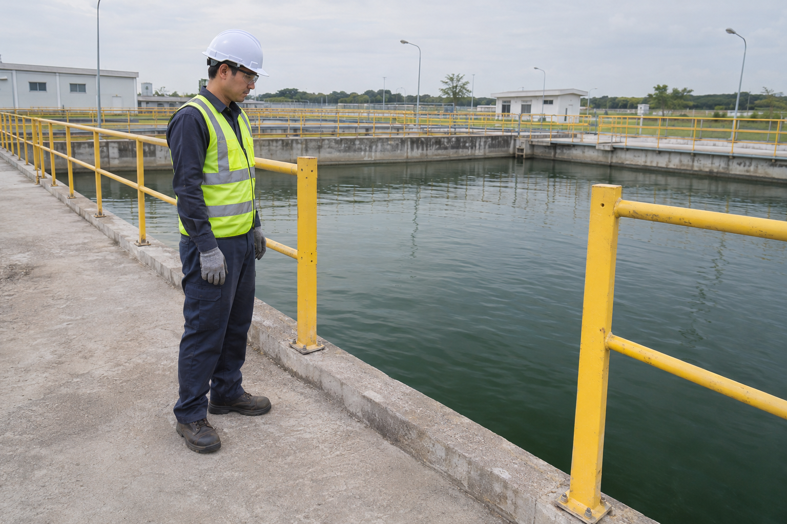
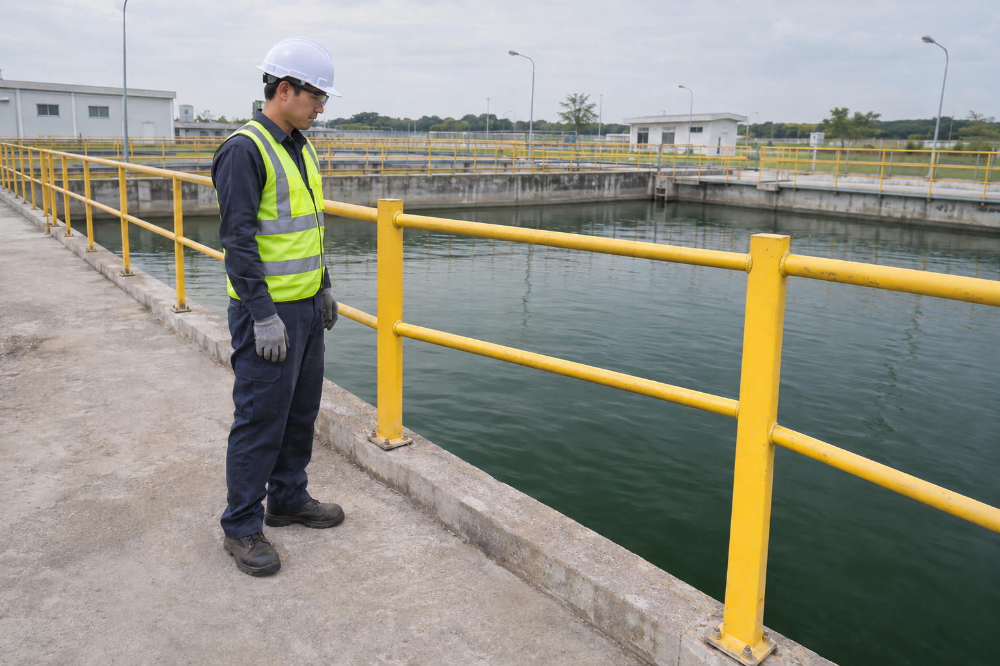

# 11월 26일 · 생성 이미지 증강과 실제 생성문의 법령 비교

## 합성 사진을 어디에 쓸 것인가

공식 학습 사진 1,045장 중 위험 미관측은 315장이다. 위험 코드별 양성은 걸림·미끄러짐 317장, 추락 224장, 인양·낙하물 72장인 반면 익수·침수, 밀폐공간, 온도·기상은 각각 1장이다. 여러 위험이 함께 있는 사진은 각 코드에 한 번씩 포함된다. 한 장짜리 유형은 그 사례를 학습과 독립 검증에 동시에 쓸 수 없다. 우선 위험을 유발하는 위치·방호 관계가 달라지는 쌍을 선별하고, 실사 양성 사건을 별도로 확보할 가치가 있다. [공식 사진 감사](../results/train_audit_full.json)

공식 규정은 학습 단계에서 외부 AI로 데이터를 만들면 사용 모델과 방법을 공개하도록 하고, 공개 외부 데이터 사용에는 이름·출처의 12월 6일까지 신고 규정을 둔다. 운영 안내의 예시는 LLM으로 만든 라벨·설명이다. 자체 생성 이미지의 별도 신고 분류는 명시적으로 확인되지 않았다. 본 시연은 텍스트에서 만든 가상 현장과 그 합성본만 입력했다. 개발 보고서에는 내장 ImageGen, 사용 시점, 실제 프롬프트, 출력 해시, 선정·제외 내역을 남긴다. 생성 도구에서 하위 모델 리비전이나 시드를 제공하지 않아 원본 두 장을 보존한다. 채점 시 추론은 로컬에서 실행한다. [운영 규정](https://hackathon.imaginationgroup.co.kr/kwater/#rules) · [운영사 공개 원문](https://hackathon.imaginationgroup.co.kr/kwater/api/report)

## 수조 난간 한 구간을 바꾼 시연

왼쪽은 텍스트로 생성한 사진, 오른쪽은 그 결과에 가로대 두 개를 연결하도록 편집한 사진이다. 도구 출력에서 같은 구도의 사람·수조·기둥을 확인했다. 수면의 잔물결과 세부 질감은 일부 달라졌다. 평가자가 볼 질문은 ‘작업자 가까이에서 수면으로 이어지는 열린 가장자리가 보이는가’이다. 가로대가 보이는 것만으로 실제 규정 적합이나 현장 전체의 안전 여부까지 판정하기는 어렵다. 이 한 장면에는 사람의 독립 위험 코드 라벨이 없다.

| 난간이 열린 장면 | 가로대를 연결한 장면 |
|---|---|
|  |  |

접수된 2차 ZIP과 모델·헤드·설정 바이트를 대조한 뒤 PNG 두 장을 같은 추론기로 측정했다. 추락 점수는 가로대를 연결하자 **0.7066에서 0.6594**로 내려갔지만 두 장 모두 임계값 0.20을 넘었다. 걸림·미끄러짐 점수는 **0.1991에서 0.2084**로 높아져 연결한 장면에서만 추가 경보가 나왔다. 익수·침수는 두 장 모두 0이었다. 2차 헤드는 해당 코드의 학습 양성이 없어 출력을 0으로 고정한다. 이 검사는 합성 한 쌍에서 현재 모델의 민감도를 측정했다. 합성 증강 학습 후 실사 성능은 미측정이다. [원본별 전체 점수와 해시](../results/synthetic_basin_probe.json) · [측정 코드](../tools/score_synthetic_basin.py)

## 실사에서 확인할 실험

1. **1단계에서 12개 장면군·24장의 시험 제작을 제안한다.** 수조 가장자리의 접근·차단, 인양물과 사람의 위치, 개구부 방호 세 상황에 각각 다른 시점·배경의 4쌍을 둔다. 이번 시연은 수조 장면군 하나다. 밀폐공간의 산소 농도, 온열 부담 등 사진만으로 관측하기 어려운 속성은 생성 프롬프트를 정답으로 간주하지 않는다. 사진마다 복수 코드와 판단 곤란을 허용한다. 두 번째 이미지가 항상 안전해지는 순서 효과를 피하도록 제작 순서를 교차한다.
2. **사람이 프롬프트를 보지 않고 품질을 판정한다.** 사진 크기, 사람·구조물 위치, 방호 상태와 부수 위험이 실제로 어떻게 달라졌는지 기록한다. 두 사람이 각각 검토해 의도한 상태와 일치하고 다른 변화가 판정에 영향을 주지 않는 쌍을 선별한다. 생성 실패율과 판단 곤란 비율도 기록한다. 같은 장면의 모든 편집·변형은 하나의 출처로 묶고 합성은 학습에만 넣는다.
3. **같은 학습 예산에서 네 조건을 비교한다.** 실사만, 실사 재표집과 약한 밝기·대비 변형, 실사+검토된 합성, 실사+상태 라벨을 쌍 안에서 뒤집은 대조군이다. 같은 기반 모델·시드·업데이트 수·위험 코드별 노출 수에서 비교하고 합성 비중은 10%부터 시작한다. 시연 1쌍으로 선택한 임계값을 쓰지 않는다. 실사 검증 개선이 반복될 때만 25%를 추가한다. [실사와 합성 혼합의 근거 및 적용 범위](https://arxiv.org/abs/2304.08466)
4. **판단은 별도의 실사 사건에서 한다.** 동일 영상·현장·근접 프레임을 분리하고 탐색 노출 182장을 제외한다. 외부 71407의 대응쌍 9개는 5현장·18영상이며, 기존 8쌍과 신규 추락 1쌍의 측정 범위를 구분한다. 507의 검증 원영상 17/17이 훈련과 겹쳐 현행 분할을 독립 검증으로 사용하기 어렵다. 실사 Macro F1 +0.02, 미관측 오경보율 증가 3%p 이내, 중대 위험 완전 미탐 비증가를 기존 기준과 함께 본다. 실제 희귀 양성 사건이 한 건도 없는 검증에서는 해당 유형의 재현율을 미측정으로 남긴다. [공동 실험 기준](../docs/coordinated-safety-experiments.md)

## 6장·18장 실생성 법령 대조

아래 값은 정답 위험 코드와 첫 조문이 모두 일치한 건수다. 한 사진에 정답 조문이 붙은 위험이 여럿일 수 있다. 6장과 18장은 각각 고정한 탐색 표본이며 조건별 행을 합산하지 않는다. 키트 통과 수는 형식 검사다. 코드와 조치가 해당 조문의 요건을 충족하는지는 별도로 검토해야 한다.

| 생성 조건 | 형식 통과 | 인용 있는 정답 위험 | 코드별 최빈 조문 | 조문 본문 검색 | 학습 사례 검색 | 예방조치로 재정렬 |
|---|---:|---:|---:|---:|---:|---:|
| 8개 코드 직접 판독 | 6/6 | 6 | 3 | 0 | 3 | 1 |
| 11개 코드 직접 판독 | 6/6 | 6 | 3 | 0 | 3 | 1 |
| 사실 먼저 판독 | 5/6 | 6 | 2 | 0 | 2 | 1 |
| 후보 검토 | 5/6 | 6 | 2 | 0 | 2 | 1 |
| 사진 교환 대조 | 6/6 | 6 | 3 | 0 | 3 | 2 |
| 배포 어댑터 배율 1.00 | 18/18 | 23 | 10 | 1 | 10 | 2 |
| 배포 어댑터 배율 0.75 | 18/18 | 23 | 9 | 0 | 9 | 2 |

6장은 사진 교환 시 실제로 표시한 사진의 정답과 대조했고 잘린 생성도 전체 사진 분모에 남겼다. 11개 코드 직접 판독에서 잘못 판정한 위험에 조문을 붙인 수는 위 네 검색 방식 순서대로 1·2·2·2건이었다. 18장에서는 배율 1.00이 네 방식 모두 5건, 0.75가 모두 4건이었다. 이 표본에서는 코드별 최빈 조문이 강한 기준선이며, 코드 판독 오류를 먼저 줄여야 엉뚱한 인용도 줄일 수 있다. 같은 접두사·동일 및 근접 사진을 사례 검색에서 제외했으며 사건 전체를 독립 분리했다는 확인은 아직 없다. [원문 해시와 집계](../results/generated_law_comparison.json) · [6장 공식 키트 검사](../results/prompt_format_replay.json) · [18장 공식 키트 검사](../results/adapter_scale_pilot.json)

## 합성 시연의 실제 입력

내장 ImageGen에서 첫 번째는 텍스트 생성, 두 번째는 첫 번째 합성 PNG를 입력으로 한 편집이다.

1. Photorealistic natural unposed workplace inspection photograph of a completely fictional, ordinary industrial waterworks. Horizontal 3:2, eye-level phone camera, diffuse daylight. A level concrete maintenance deck runs beside an open rectangular water treatment basin full of dark green water, with the deck edge clearly distinguishable from the water. Exactly one adult maintenance worker in plain protective equipment stands fully on the deck, about one step from its edge. A long fixed yellow steel guardrail borders that edge except for ONE conspicuous open span directly beside the worker, framed by two existing yellow posts. Show unobscured full body, shoes, both posts, edge, and water vertically below from an oblique angle. Plain utility buildings far away. No accident, no injury, no logos or text, no warning sign, no ladders or cables. No collage, no diagrams. Do not depict any real project or facility.
2. Edit this synthetic photograph. Add exactly two straight yellow steel horizontal guardrail tubes spanning the entire open gap between the large yellow posts in the center foreground at the basin edge. Make the upper and middle tubes visibly join both posts at the existing connection heights, along the perspective of the deck. The water must still be visible below and between them. Preserve the worker, both shoes, camera, pose, buildings, lighting, shadows, water, and deck in the same places as closely as possible. No other changes, no signage or text. Same resolution and aspect ratio.
