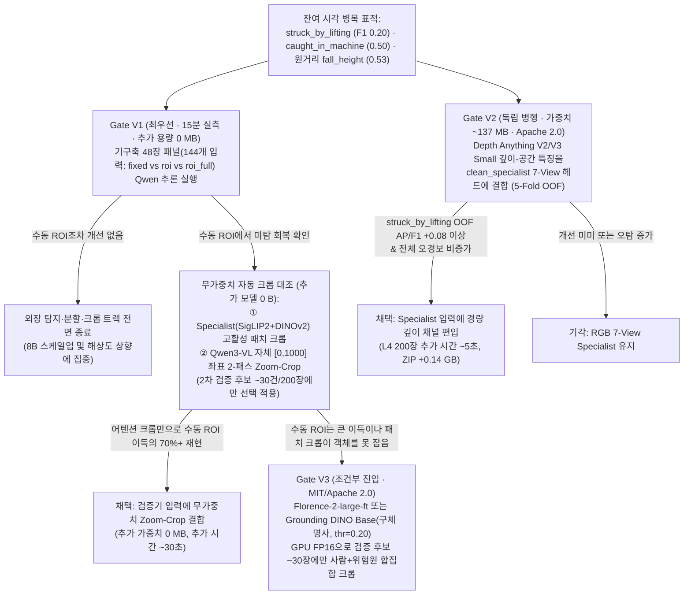

# 비전 태스크 모델(`SAM` · `YOLO` · `*** Anything` · `DINO`) 실험 전수 감사 및 후속 로드맵 편입 타당성 보고서

**11월 28일 후속 검증.** 현대 RGB 특징을 고정한 170장 인양 실험에서 상대 깊이를 더하면 TP 3→4, FP 16→6이었다. 6개 그룹에서 얻은 결과로 966장 확대 검증을 제안한다. 보조 PC 대신 팀 전용 서울 L4용 ROI 패킷을 준비했다. 48장의 관계 판독은 지지 11·반대 1·불명확 36장이다. [후속 결과와 자원 배정](qualitative-vision-followup-20261128.md)

- **작성 시각**: 2026-11-28 KST
- **검토 목적**: 이전에 지시된 비전 전용 모델군(`SAM 2.1/3/3.1`, `YOLO/YOLOE/DETR`, `Depth Anything V2/3`, `Grounding DINO`, `Florence-2`, `RAM++`, `DINOv2/v3`, `SigLIP2` 등)의 **실제 로컬 실험 진행 상태와 중단 원인**을 원장 단위로 규명하고, 대회 채점 구조·제약(`70점 코드 F1 + 30점 정성`, `20GB`, `L4 24GB`, `1,800초`, 오프라인 `seccomp`, 라이선스) 아래 **후속 로드맵에 무엇을 포함하고 무엇을 영구 배제할지** 공학적으로 확정한다.
- **연계 마스터 로드맵**: [comprehensive-audit-and-vlm-roadmap-20261128.md](comprehensive-audit-and-vlm-roadmap-20261128.md) · [vision-roi-experiment-roadmap-20261127.md](vision-roi-experiment-roadmap-20261127.md)

---

## 0. 핵심 진단 및 최종 판정 요약 (Executive Summary)

1. **기존 비전 실험의 실체 — "절반의 대성공, 절반의 연결 전 중단"**:
   - 비전 파운데이션 모델 중 **`SigLIP 2 So400m (384px)` + `DINOv2-Large (336px)` 기반 7-View 공간 전문가(`clean_specialist.py`)는 이미 완주되어 현재 최고 성능 하이브리드 파이프라인의 핵심 축으로 작동 중**이다. Fold 4에서 1차 Qwen(`v3` 1·2에폭) 단독 대비 코드 F1을 **175장 `+0.0637 ~ +0.0647` (`0.5420 → 0.6057`), 107장 `+0.0618 ~ +0.0682` (`0.5757 → 0.6375`)** 끌어올렸으며 정상 사진 추가 오경보는 `0장`이었다.
   - 반면 **외장 객체 탐지·분할·깊이·영역(ROI) 실험들은 모두 VLM(`Qwen3-VL`) 최종 점수 비교 직전에 멈췄다**:
     - `Grounding DINO Tiny`: 64장 중 `person`(20장) 외 **5대 안전 핵심 명사(`suspended load`, `crane hook`, `guardrail`, `floor opening`, `elevated edge`) 검출 `0/64장`**으로 실패; `Base`도 16장 중 사람+위험원 동시 검출 `1/16장`에 그쳤고 Qwen 연결 평가(`qwen_hazard_scores: null`)는 미실행됐다.
     - `SAM 2.1 Tiny/Large`: 위 Base 박스 6장에 마스크만 생성한 채 Qwen 재판독 `0건`; `SAM 3.1`은 첫 공개 사진에서 `init_state()` 인자 불일치 `TypeError`로 마스크 `0건`에서 중단됐다.
     - `Depth Anything V2 Small`: 탐색 170장 선형 분류기 결합에서 **추락(`fall_height`)에는 무효**였으나, **낙하·인양(`struck_by_lifting`)에서는 `TP 0→2`, `FP 13→6`(-54%)으로 20회 교환 대조군 전부를 이기는 유의미한 신호**를 보였다. 그러나 현행 `SigLIP2+DINOv2` 전문가나 Qwen 검증기에는 아직 연결되지 않았다.
     - `48장 수동/타일 ROI 패널`(`vision-roi-48`): 비교 이미지 144장(`fixed`·`roi`·`roi_full`) 생성까지 마쳤으나 **정작 Qwen 추론 횟수는 `0건`(`qwen_generations: 0`)**인 상태다.
     - `YOLO / YOLOE / Florence-2 / RAM++ / LocateAnything`: 문서상 후보 표에만 기재되었고 로컬 실행은 `0건`이다.

2. **후속 로드맵 편입 여부 종합 판정 — "백화점식 도입은 독(毒), 잔여 미탐 2종(`인양·끼임·원거리 개구부`) 표적 3단계 게이트만 선별 편입"**:
   - 본 대회는 바운딩 박스나 마스크 mAP를 채점하지 않으며(1,045장 학습셋에 박스 라벨 `0건`), **장비·사람의 단순 존재(Presence)와 실제 불안전 상태(Unsafe State)를 구분**해야 점수가 오른다. 일반 탐지기·분할기를 무분별하게 붙이면 정상 사진 오경보 증가(POPE 현상), 마스크 가림(SoM 아티팩트), `AGPL-3.0`/`CC-BY-NC` 라이선스 위반, 20GB·1,800초 예산 잠식만 초래한다.
   - 반면 현재 최신 하이브리드 모델에서도 해결되지 않은 **Fold 4 `struck_by_lifting` 미탐(`12/14건`, F1 `0.20`) 및 `caught_in_machine` 미탐(`4/7건`, F1 `0.50`)**은 ① 광각 사진 축소로 인한 **소형 부위 뭉개짐**과 ② 배경 장비와 전경 작업자의 **2D 원근 착시**가 직접 원인이므로, 아래 **비용 대비 효용이 가장 높은 3개 게이트(`Gate V1 ~ V3`)만 후속 로드맵의 보조 PC(Ubuntu RTX 3050)·CPU 병렬 트랙에 정식 편입**한다:
     - **★ 편입 1순위 (`Gate V1` · 추가 가중치 `0 MB`)**: 이미 완성된 **`48장 수동 ROI 144개 입력` Qwen 오라클 실측(15분 소요)** → 효과 입증 시 외장 모델 추가 없이 **기탑재 `SigLIP2+DINOv2` 패치 어텐션 또는 `Qwen3-VL` 네이티브 2D Grounding 좌표로 검증 후보(`~30건/200장`)만 조건부 확대(Zoom-Crop)** 제공.
     - **★ 편입 2순위 (`Gate V2` · 가중치 `99~137 MB` · Apache 2.0)**: **`Depth Anything V2 Small` 또는 `Depth Anything 3 Small`**의 깊이 평면 일치도 특징을 현행 `clean_specialist` 헤드에 결합해 `struck_by_lifting` OOF 후보 회수율·정밀도 개선 여부 검증(L4 GPU 추론 추가 비용 `~5초/200장`).
     - **조건부 예비 (`Gate V3` · 가중치 `~0.6~1.5 GB` · MIT/Apache 2.0)**: `Gate V1`에서 수동 ROI는 크게 이기는데 무가중치 어텐션 크롭이 영역을 못 잡을 때만, GPU FP16 기반 **`Florence-2-large-ft`(MIT)** 또는 구체 물리 명사 프롬프트로 교정한 **`Grounding DINO Base`(Apache 2.0)**를 2차 검증 대상 사진에만 제한 호출.
     - **영구 배제 확정**: `SAM 2.1 Large / SAM 3.0 / SAM 3.1`(마스크 실익 부재·3.5GB·커스텀 라이선스), Ultralytics `YOLOv8/v11/YOLOE`(`AGPL-3.0` 라이선스 리스크 및 학습 박스 부재), `Depth Anything V2 Large`/`LocateAnything`/`DAM`(`CC-BY-NC`/비상업 라이선스), `Caption Anything`(외부 API 의존).

---

## 1. 기존 비전 태스크 모델 실험 전수 감사표 (Fact-Checked Ledger)

저장소 내 모든 실행 로그(`data/phase2-runs/p38-20261126-49bb82ce/regions/`), 집계 JSON(`results/depth_*.json`, `results/vision-roi-*.json`), 소스코드를 전수 대조한 실제 이행 현황이다.

| 분류 및 모델명 | 로컬 가중치·실행 범위 | 확인된 정량 실측 결과 | 중단 지점 및 핵심 실패·성공 원인 | 원장 근거 |
|---|---|---|---|---|
| **듀얼 비전 백본 + 공간 어텐션** `SigLIP2-So400m` + `DINOv2-L` (`clean_specialist.py`) | 1,045장 × **7개 공간 뷰**(원경 + 2×2 62% 타일 + 중앙 68% + 상위 64 현저성 패치) × 2,176차원 완주, 5-Fold × 3-Seed 탑재 | 966장 내측 보정 OOF 8종 F1 **`0.6656`** · Fold 4 하이브리드 결합 시 1차 VLM 단독 대비 **F1 `+0.0618 ~ +0.0682` 상승**, 정상 오경보 추가 **`0장`** | **[성공 · 주력 가동 중]** 단, 전역·타일 풀링만으로는 `struck_by_lifting`(OOF F1 `0.1818`, Fold 4 추가 `0건`)의 사람-하중 위치 관계 판별에 한계 | [clean_specialist.py](../kwater_lab/clean_specialist.py#L52-L160) [fold4-v3-fixed-verifier-paired-code-evaluation.json](../results/fold4-v3-fixed-verifier-paired-code-evaluation.json) |
| **VLM 내부 공간 프로브** `Qwen3-VL` 동결 ViT 4×4 (`spatial_probe.py`) | Ubuntu RTX 3050(`origin/ubuntu/weekend-20261127`)에서 1,045장 `4×4 × 2,560d` 캐시 추출 및 Fold 1~3(575장, 위험 399장) 전역 대 상위 3영역(MIL) 비교 완주 | 262,144화소: 전역 `262/399` → 영역 `271/399` (`+2.26%p`, 117그룹 95% 구간 `-1.02 ~ +5.25%p`, 회수 36·손실 27) · 393,216화소: `264 → 271/399` (`+7, +4, -4`) | 단순 4×4 특징 평균 풀링만으로는 **사전 승격 기준(`+5%p`, 3폴드 일관 개선)에 미달**(Fold 3 역전 `-1`·`-4`, 신뢰구간 0 포함) → 특징 평균 대신 실제 **원본 고해상도 픽셀 크롭(`Gate V1`)** 검증이 필수임을 입증 | [spatial_probe.py](../kwater_lab/spatial_probe.py#L1-L140) `origin/ubuntu/weekend-20261127`: `results/ubuntu-continuous-spatial-20261127.json` |
| **단안 상대 깊이** `Depth Anything V2 Small` (`depth_pilot.py`) | 탐색 170장 + 외부 AI-Hub 8쌍 CPU ONNX 실행 완료(`254초`, 중앙값 `1.40초/장`); `DA3-Small`은 미실행 | 추락 TP `7→7`(외부 상태쌍 `2/7`로 **무효**) vs **낙하·인양 `TP 0→2`, `FP 13→6`** (다른 사진 깊이 20회 순열 `0/20` 전승!) | 구형 `CLIP 224` 선형 분류기에만 붙여보고, 현행 `SigLIP2+DINOv2` 전문가 및 Qwen 검증기에는 **미연결(`0건`)**; RGB 증류는 F1 `0.1919`로 실패 | [depth-and-state-pairs.md](depth-and-state-pairs.md) [depth_pilot.json](../results/depth_pilot.json) [depth_control_sensitivity.json](../results/depth_control_sensitivity.json) |
| **개방어휘 객체 탐지** `Grounding DINO Tiny / Base` | `Tiny`(INT8 CPU) 64장(`387초`), `Base`(FP32 CPU) 16장(`313초`) 실행 | `Tiny`: 64장 중 `person` 20장 외 **위험 대상 5종 전부 `0/64장`** · `Base`: 16장 중 `person`+위험원 동시 검출 **`1/16장`**, `suspended load` **`0/16장`** | ① 추상 복합어(`"suspended load"`, `"elevated edge"`)에 높은 임계값(`0.35`) 적용으로 미검출 사태 발생, ② CPU 실행으로 과도한 시간 소요, ③ **Qwen 입력 실험 `0건`(`qwen_hazard_scores: null`)** | [phase2-item38-measured-20261126.md](../docs/phase2-item38-measured-20261126.md#L82-L87) |
| **객체·개념 분할** `SAM 2.1 Tiny/Large` · `SAM 3.0 / 3.1` | `SAM 2.1 Tiny/Large`: 16장 중 박스 있는 6장 마스크 생성(`Tiny` 23초 vs `Large` 123초, 로드 615초). `SAM 3.0`: 3.45GB 수신 완료. `SAM 3.1`: 3.50GB 첫 사진 실행 | `SAM 2.1` 두 크기 마스크 IoU `0.72~0.94`로 대동소이; `SAM 3.1`은 `init_state(offload_state_to_cpu)` 인자 오류로 **유효 마스크 `0건` 실패** | 박스가 없으면 `SAM 2.1`은 호출조차 안 되며(`10/16장` 원경 복귀), `SAM 3.1`은 비디오 추적기 API 불일치 + 호스트 메모리 경합(`로드 4,884초`)으로 중단. **Qwen 위험 점수 비교 `0건`** | [large-vlm-sam3-fit-audit-20261126.md](../docs/large-vlm-sam3-fit-audit-20261126.md#L55-L61) [phase2-large-model-execution-20261126.md](../docs/phase2-large-model-execution-20261126.md#L52-L58) |
| **수동/타일 ROI 상한 패널** `vision-roi-48` | Fold 1~3 난례 48장(걸림·추락·인양 각 16장) 블라인드 육안 검수(박스 69개) 및 `1024×384` 비교 입력 144장(`fixed`·`roi`·`roi_full`) 생성 완료 | 육안 판독에서도 48장 중 관계 명확 지지 `11장`, 반대 `1장`, **화면 밖·가림 등 불명확 `36장(75%)`**; **`qwen_generations: 0`** | 입력 데이터셋만 완벽히 준비해 두고 정작 GPU 우선순위에 밀려 **Qwen 144장 추론을 아직 1건도 돌리지 않음** | [vision-roi-experiment-roadmap-20261127.md](vision-roi-experiment-roadmap-20261127.md#L3-L21) [vision-roi-review-20261127.json](../results/vision-roi-review-20261127.json#L27) |
| **실시간 탐지·캡셔닝·태그** `YOLO / YOLOE / RF-DETR / Florence-2 / RAM++` | 로컬 가중치 다운로드 및 추론 **`0건`** (문헌·모델 카드 조사만 기록) | 실측치 없음 | 박스 정답 라벨 부재(0건), 라이선스 제약(`YOLOE` AGPL-3.0, `DAM`/`LocateAnything` 비상업), 4B 본학습 전환으로 미착수 | [phase2-depth-detection-segmentation-20261126.md](../docs/phase2-depth-detection-segmentation-20261126.md#L37-L45) |

---

## 2. 왜 대부분의 외장 비전 모델을 그대로 붙이면 실패하는가? (4대 구조적 원인)

### 2.1 '사물 존재(Object Presence)'와 '불안전 상태(Unsafe State)'의 괴리
산업·건설 현장 사진에서는 **정상(`no_visible_hazard`) 사진 315장에도 작업자, 안전모, 비계, 사다리, 크레인, 분전반, 전선이 그대로 등장**한다.
- 고정 클래스 `YOLO`(COCO 80종에는 `person`, `truck` 외 안전 설비 클래스 전무)나 태그 생성기(`RAM++`)가 *"사다리 검출, 전선 검출, 크레인 검출"* 정보를 VLM에 넘기면, VLM은 시각적 결함 유무보다 프롬프트에 주입된 사물 이름에 끌려 위험을 과잉 긍정(POPE 현상)한다.
- 실제로 본 프로젝트의 초기 실험에서도 객체 단서로 빈 슬롯에 위험 코드를 추가했을 때 **281건 중 정답은 12건(정밀도 4.3%)에 불과하고 269건이 오탐**이었다([phase2-depth-detection-segmentation-20261126.md](../docs/phase2-depth-detection-segmentation-20261126.md#L56)). 현재 7차 제출 보류의 유일한 원인이 **정상 사진 오경보 초과(`107장` 기준 `6/27 > 20%`)**인 상황에서 저정밀 탐지 신호의 무분별한 주입은 역효과를 낸다.

### 2.2 픽셀 마스크(Set-of-Mark) 대비 순수 영역 확대(Zoom-Crop)의 우위
- `SAM 2.1 / SAM 3`가 만드는 정밀 윤곽선이나 번호표 오버레이(Set-of-Mark)는 이미지 위에 인공 경계선·색상 마스크를 덧칠한다. 최신 시각 프롬프팅 벤치마크(*VPBench* 등)와 안전 도메인 특성을 대조하면, **안전대 고리 미체결, 전선 피복 손상, 비계 클램프 풀림, 개구부 난간 결손**처럼 경계면 바로 위에 핵심 단서가 있는 과제에서는 **마스크 경계선이 오히려 결정적 픽셀을 가리는 부작용(Boundary Occlusion)**이 발생한다.
- 반면 원본 픽셀을 훼손하지 않고 **전체 장면(맥락 보존) + 핵심 상호작용 영역의 고해상도 직사각형 크롭(Zoom-Crop)**을 나란히 주는 방식은 아티팩트가 없고 구현·실행 비용이 극히 낮다.

### 2.3 `Qwen3-VL`의 네이티브 공간 지각 능력 중복
- 구형 VLM과 달리 현재 베이스 모델인 `Qwen3-VL-4B / 8B`는 **DeepStack 다층 ViT 특징 융합**과 **`[0, 1000]` 정규화 좌표계 기반 네이티브 2D/3D Grounding**을 자체 보유하고 있으며, 보조 분류기인 `clean_specialist` 역시 이미 7개 다중 크롭과 `SigLIP2+DINOv2` 패치 토큰을 읽고 있다. 따라서 성능이 낮은 소형 외장 탐지기(`Grounding DINO Tiny` 등)는 VLM 본체보다 사물을 더 못 찾는 역전 현상이 발생한다.

### 2.4 대회 라이선스 및 오프라인 컨테이너(`seccomp` · 20GB · 1,800초) 제약
대회 운영 규정("모델별 라이선스를 준수하는 범위에서 선택", 결선 **현장 활용성 40점·재현성 30점**)에 따라 라이선스 부적격 모델은 성적과 무관하게 배제해야 한다.

| 모델군 | 라이선스 | ZIP·런타임 부담 | 대회 채택 적격성 판정 |
|---|---|---|---|
| `SigLIP 2` / `DINOv2` / `Qwen3-VL` | **Apache 2.0** | 기탑재 (`1.72 GB` 전문가) | **✅ 적격 (현재 주력 가동 중)** |
| `Depth Anything V2 Small` / **`Depth Anything 3 Small`** | **Apache 2.0** | **`99 ~ 137 MB`**, L4 200장 `~5초` | **✅ 적격 (초경량·고속, 인양 위험 특화 후보)** |
| `Depth Anything V2 Large` | **CC-BY-NC 4.0** (비상업) | `~1.3 GB` | **❌ 부적격 (비상업 제한 — 사용 금지)** |
| `Florence-2-large-ft` | **MIT** | FP16 `~1.5 GB`, L4 고속 | **✅ 적격 (조건부 영역 그라운딩 예비 1순위)** |
| `Grounding DINO Tiny / Base` · `OWLv2` · `RT-DETRv2` · `RF-DETR` | **Apache 2.0** | `0.15 ~ 0.93 GB` | **✅ 적격 (단, 구체 명사 프롬프트·GPU 실행 필수)** |
| Ultralytics `YOLOv8 / v11 / YOLOE-26` | **AGPL-3.0** (상용 별도) | 경량이나 `ultralytics` 패키지·의존성 다수 | **❌ 배제 권고 (AGPL 전염성 리스크 + 박스 학습 라벨 0건)** |
| `SAM 2.1 Tiny` | **Apache 2.0** | `156 MB` | **⚠️ 보류 (박스 크롭 대비 마스크 순증 미입증)** |
| `SAM 3.0 / SAM 3.1` | **Meta SAM License** (승인형) | **`3.45 ~ 3.50 GB`**, PyTorch 2.7 요구 | **❌ 배제 확정 (용량 과중·런타임 충돌·실익 부족)** |
| `DINOv3` | **Meta Custom License** (승인형) | `0.3 ~ 1.2 GB` | **⚠️ 후순위 (Apache 2.0인 `DINOv2-L`로 이미 충분)** |
| `LocateAnything-3B` / `DAM-3B` / `Caption Anything` | **NVIDIA 비상업** / 외부 API | `6 GB+` 또는 네트워크 필요 | **❌ 부적격 (라이선스 및 오프라인 규정 충돌)** |

---

## 3. 후속 연구 로드맵에 실제로 포함할 '고수익 3단계 비전 게이트(`Gate V1 ~ V3`)' 설계

현재 `Fold 4` 최신 하이브리드 결과([comprehensive-audit-and-vlm-roadmap-20261128.md](comprehensive-audit-and-vlm-roadmap-20261128.md) 참조)에서 검증기가 회복하지 못한 잔여 미탐은 **`struck_by_lifting`(인양·낙하: 14건 중 12건 미탐, F1 `0.20`)**, **`caught_in_machine`(끼임: 7건 중 4건 미탐, F1 `0.50`)**, 그리고 **원거리 `fall_height`(추락: 36건 중 20건 미탐, F1 `0.53`)** 세 곳에 집중돼 있다.

메인 트랙(서울 L4 및 주 PC의 **4B/8B VLM 학습·검증기 고도화**)을 절대 지연시키지 않도록, **보조 PC(Ubuntu RTX 3050)와 CPU 유휴 시간**을 활용해 아래 3단계 게이트 순서로 검증하고 통과한 요소만 최종 하이브리드에 합류시킨다.

---

### 3.1 `Gate V1` — 기구축 48장 ROI 패널 오라클 측정 및 '무가중치 Zoom-Crop' (11/28~29, 최우선)
1. **즉시 실행할 일 (매몰 자산 회수)**:
   - 이미 `data/vision-roi-48/reviewed-v1/`에 해시 검증까지 끝난 `fixed.json`(고정 타일), `roi.json`(동일 배율 수동 ROI), `roi_full.json`(영역 무절단 수동 ROI) 48×3 = **144장**에 대해 현재 최강 4B 어댑터(`v3` 1·2에폭)로 생성을 수행한다(배치 4 기준 **약 8~12분이면 완료**).
   - **반드시 분리 집계할 분모**: 전체 48장 결과와 함께, 앞선 블라인드 육안 검수에서 실제로 시각적 위험 관계가 화면 안에 보였던 `supported/contradicted` **12장** 대 화면 밖·가림으로 판정된 `unclear` **36장**에서의：① 미탐 정답 회수 수, ② 정상/타 위험 대조 사진에서 새로 유발된 허위 단정(오탐) 수를 나란히 비교한다.
2. **자동화 경로 (외장 모델 `0 MB` 우선 원칙)**:
   - `roi_full`이 `fixed` 및 원경 단독 대비 순이득(회수 정답 > 신규 오탐, 정상 오경보 비증가)을 보이면, 새 탐지 모델을 넣기 전에 **두 가지 무가중치(Zero-Extra-Weight) 자동 ROI 방법**을 먼저 비교한다:
     - **방법 V1-a (`Specialist Patch-Attention Crop`)**: 이미 매 사진마다 계산하는 `SigLIP2-So400m`(27×27 패치) + `DINOv2-L`(24×24 패치) 특징에서 제안된 후보 코드 `c`에 대한 클래스별 패치 기여도 상위 영역을 감싸는 사각형을 잘라, 2차 검증(`verify`) 시 `[전체 사진 + 확대 영역]`으로 제시한다.
     - **방법 V1-b (`Qwen3-VL Self-Grounding 2-Pass`)**: 2차 검증 대상 후보(`200장 중 ~25~35건`)에 한해 `Qwen3-VL`에게 먼저 *"관련 작업자와 위험 설비의 `[ymin, xmin, ymax, xmax]` 좌표를 출력하라"*고 짧게 질의(`~30토큰`)한 뒤 해당 합집합 영역을 원본 고해상도에서 잘라 최종 수락·기각 및 근거 문장을 생성한다.

### 3.2 `Gate V2` — `Depth Anything V2/V3 Small` 기반 인양·낙하(`struck_by_lifting`) 원근 착시 해소 (11/29~12/01)
1. **과학적 근거**:
   - 본 프로젝트의 앞선 비전 실험 전체에서 **교환 대조군 20회를 `20/20` 전승하며 오탐을 절반(`13→6건`)으로 줄인 유일한 신호**가 단안 상대 깊이의 `struck_by_lifting` 판별 효과였다([depth-and-state-pairs.md](depth-and-state-pairs.md#L25-L32)).
   - 현재 `clean_specialist`가 `fire`(`0.89`), `elec`(`0.79`), `chem`(`0.76`)과 달리 유독 `struck_by_lifting`(`0.18`)에서만 무너지는 이유는 **배경의 먼 크레인/굴착기 붐대와 전경 작업자가 2D 이미지에서 상하로 겹칠 때 원근 분리가 안 되기 때문**이다.
2. **실험 설계 (엄격 5-Fold 내측 OOF 대조)**:
   - Apache 2.0 라이선스이며 가중치가 `99~137 MB`에 불과한 `Depth Anything V2 Small`(기존 검증 해시 보유) 및 최신 `Depth Anything 3 Small`(`depth-anything/DA3-SMALL`)로 966장 개발셋 깊이 맵을 GPU에서 추출한다(1,045장 전체 추출도 GPU에서 1분 미만).
   - 각 공간 뷰(7-View) 및 상부(인양물 후보)–하부(작업자 후보) 영역 사이의 **상대 깊이 차분·연속성 요약 벡터(64차원)**를 기존 2,176차원 특징에 덧붙여 동일한 `SpatialDualSpecialistHead` 5-Fold × 3-Seed를 재학습한다(CPU/보조 GPU에서 수십 초 내 학습 완료).
3. **채택 기준 (Go / No-Go)**:
   - 966장 엄격 내측 보정 OOF에서 ① **`struck_by_lifting` F1이 `0.1818 → ≥0.28` 이상 상승**(및 Fold 4 외측 후보 제안에 실제 정답 인양 사진 유입 증가), ② 전체 966장 활성 Macro-F1 비하락 및 정상 사진 오경보 비증가, ③ 컨테이너 내 200장 깊이 추출 추가 시간이 `≤10초`일 때만 정식 편입한다. 미달 시 즉시 기각하여 파이프라인 복잡도를 늘리지 않는다.

### 3.3 `Gate V3` — 조건부 경량 개방어휘 탐지(`Florence-2` / 교정된 `Grounding DINO Base`) (12/01~03, 조건부)
- **진입 조건**: `Gate V1`에서 수동 ROI(`roi_full`)는 뚜렷한 F1 상승을 만드는데, 무가중치 방법(`V1-a`/`V1-b`)이 소형 크레인 훅·개구부·물림점 위치를 찾지 못해 그 이득의 절반도 회수하지 못할 때만 실행한다.
- **과거 실패 교정 사항**:
  1. CPU INT8 실행 금지 → **GPU FP16 배치 실행**(2차 검증 대상 `~30장`만 호출하므로 L4 소요시간 `~3~5초`).
  2. 추상 위험명(`"suspended load"`, `"elevated edge"`, 임계값 `0.35`) 금지 → **구체 물리 객체 사전(`person, crane hook, hoist, sling, scaffold, ladder, guardrail, floor opening, trench, exposed wire, rotating machine`, 임계값 `0.18~0.22`)** 사용 또는 **`Florence-2-large-ft`(MIT)**의 `<OD>` / `<CAPTION_TO_PHRASE_GROUNDING>` 태스크로 작업자 박스와 위험 설비 박스의 **상호작용 합집합 창(Interaction Union Window, 주변 문맥 여백 25% 포함)**을 잘라 검증기에 전달한다.
  3. 탐지기의 클래스 점수로 위험 코드를 직접 추가하는 행위는 엄격히 금지하며, 오직 **VLM 검증기(`adapter_verify`)에 고해상도 시각 근거 창을 제공하는 크롭 생성기**로만 한정한다.

---

## 4. 마스터 로드맵과의 일정·자원 통합 요약

| 일정 | 주 트랙 (서울 L4 + Windows RTX 3060) | 비전 보조 트랙 (Ubuntu RTX 3050 + CPU 유휴 자원) | 합류(Merge) 판정 기준 |
|---|---|---|---|
| **11/28 ~ 11/29** | 4B 기준 200장 컨테이너 시간 측정 · 4B `v4`(분리 어댑터·양방향 게이트) 및 4B vs 8B 동일 조건 학습 착수 | **`Gate V1` 실행**: 기구축 48장(`144개 입력`) Qwen 추론 완료 및 `supported(12장)` vs `unclear(36장)` 정밀 채점 | 수동 ROI 순이득(`ΔTP > ΔFP`) 확인 시에만 `V1-a/b` 자동 크롭 개발 진행; 무효 시 외장 탐지/분할 연구 즉시 종결 |
| **11/29 ~ 12/01** | 4B vs 8B 초벌·하이브리드 쌍체 평가 (`Fold 4` + 새 외측 폴드) 및 `27B Q4` 200장 시간 검증 | **`Gate V2` 실행**: `DAv2-Small` / `DA3-Small` 깊이-공간 특징 결합 `clean_specialist` 5-Fold OOF 대조 | `struck_by_lifting` OOF F1 `+0.08` 이상 & 오경보 비증가 & 200장 추가 `≤10초` 충족 시에만 Specialist v2로 승격 |
| **12/01 ~ 12/04** | 승격 모델(8B FP8 또는 개선 4B) 새 외측 폴드 재학습 및 검증기 결합 | **`Gate V1-a/b` (필요 시 `Gate V3`)**: 검증 후보 `~30건` 한정 고해상도 Zoom-Crop 결합 전후 비교 | 동일 검증기 대비 `struck_by_lifting`·`caught`·`fall` 미탐 순감소 및 L4 총 벽시계 `≤1,350초` 유지 시 채택 |
| **12/05 ~ 12/13** | 동결 파이프라인 전량 `1,045장` 학습, `assets.json` 라이선스/해시 검증, L4 200·300장 콜드스타트 리허설 및 최종 지정 | 채택된 비전 모듈(해당 시 `Apache 2.0` / `MIT` 가중치 및 휠)의 오프라인 아카이브 무결성·CRC·`seccomp` 감사 | 비채택 실험 가중치·코드는 제출 ZIP에서 100% 배제해 용량·오류 위험 최소화 |
